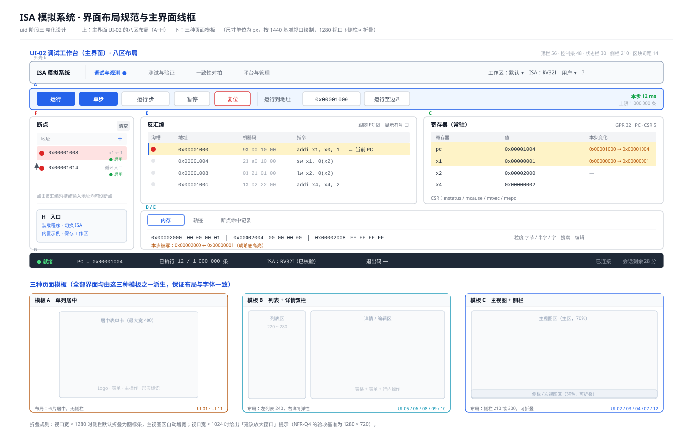
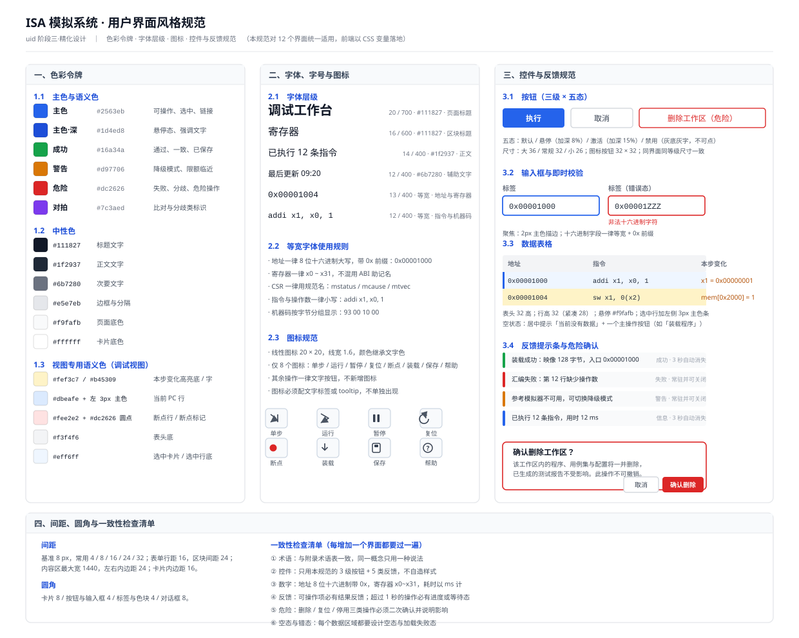
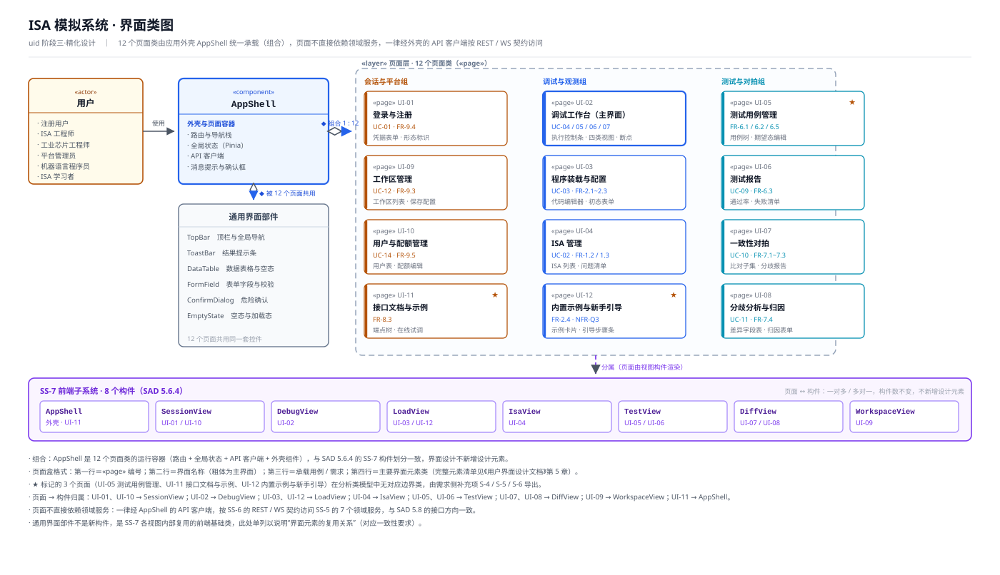
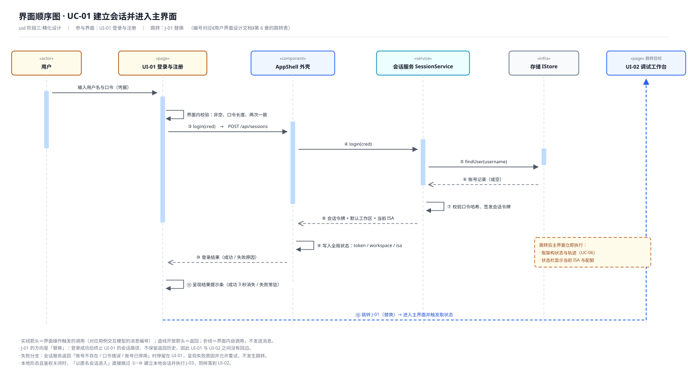
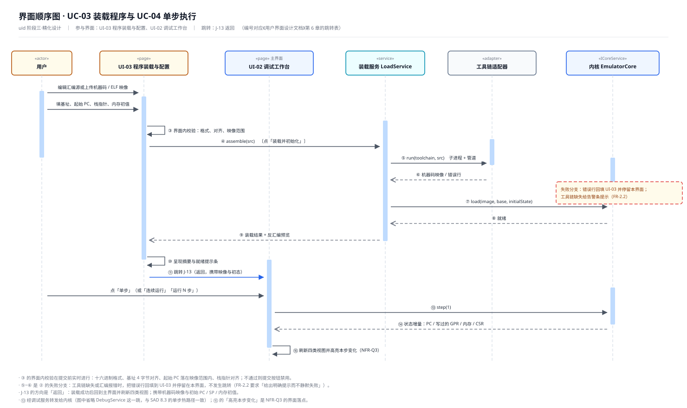
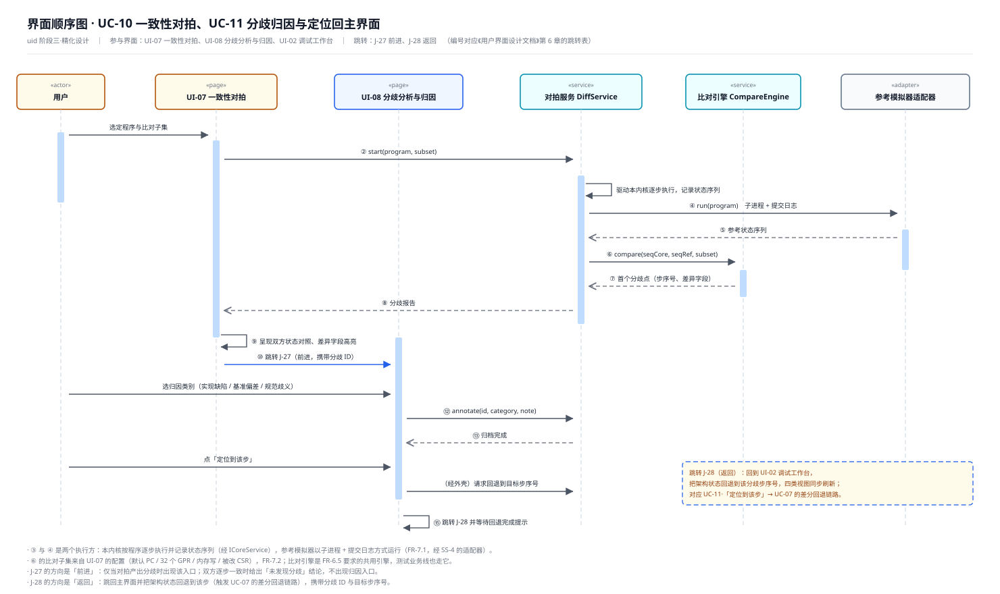

# 用户界面设计文档

**项目**：ISA 模拟系统
**文档版本**：v2.0
**编制日期**：2026-10-13
**上游文档**：《软件需求规格说明书》（38 条功能需求 / 13 条质量与约束需求 / 14 个用例）、《软件体系结构设计文档》（8 子系统 / 35 构件 / SS-7 前端 8 构件）
**下游文档**：《软件详细设计文档》（`sdd`）
**过程文档**：《初步界面设计说明》、《界面跳转关系说明》、《界面精化设计说明》（均位于 `界面设计/`）

---

## 1 文档概述

### 1.1 编写目的

本文档给出 ISA 模拟系统的**用户界面设计结果**。它把《软件需求规格说明书》的用例模型与用例交互模型，以及《软件体系结构设计文档》约定的表示层结构，转换为**可指导前端实现**的界面方案——确定有哪些用户界面、每个界面承载什么职责与哪些元素、界面之间如何跳转、精化后的布局与视觉规范是什么、以及用什么原型来验证这套设计。

本文档回答五个问题：

1. **有哪些用户界面**，每个界面为谁、为什么而存在（第 4 章）；
2. **每个界面上有什么**，哪些元素负责输入、哪些负责输出、各自触发什么操作（第 5 章）；
3. **界面之间怎么走**，主界面是哪个、跳转从哪来、到哪里去、带什么数据（第 6 章）；
4. **界面被精化成什么样**，查漏补缺补了什么、为什么不合并、布局与视觉如何统一（第 7 章）；
5. **如何验证这套设计**，原型如何组织、覆盖到什么程度、与 UML 模型如何对应（第 8、9 章）。

本文档**不覆盖**：类与数据结构的具体设计、接口的方法签名（由 `sdd` 阶段产出）；界面像素级视觉稿与设计源文件；前端代码实现。

### 1.2 组织结构

| 章节 | 内容 | 对应 `uid` 技能的活动 |
| --- | --- | --- |
| 1 文档概述 | 编写目的、组织结构、读者对象、术语定义、参考资料、文档约定 | — |
| 2 系统概述 | 建设目标、主要功能、边界和范围、目标用户、运行环境 | — |
| 3 设计目标和原则 | 界面设计目标、遵循的原则、设计考虑与取舍 | — |
| 4 用户界面清单 | 12 个用户界面及其职责、业务域分布、共用外壳、主界面 | 初步设计用户界面 |
| 5 界面元素与操作设计 | 逐界面给出静态元素、动态元素与操作清单 | 初步设计用户界面 |
| 6 界面跳转关系 | 主界面论证、三层结构、28 条跳转、2 条通用规则、携带数据 | 建立界面间跳转关系 |
| 7 精化设计说明 | 查漏补缺、建立跳转、优化设计、调整布局、美化界面、保持一致 | 精化用户界面设计 |
| 8 界面原型说明 | 原型的组织方式、覆盖情况、可演示跳转、与模型的对应 | 精化用户界面设计 |
| 9 界面 UML 模型 | 界面类图、页面—构件映射、界面顺序图、上游同步项 | 精化用户界面设计 |
| 附录 A | 图件索引 | — |
| 附录 B | 需求—界面追踪矩阵（用例 / 功能需求 / 质量需求） | — |
| 附录 C | 界面元素补充与跳转修正登记表 | — |

### 1.3 读者对象

| 读者 | 关注点 | 建议重点阅读 |
| --- | --- | --- |
| 项目组 · 前端组 | 界面清单、元素与操作、跳转绑定、视觉规范 | 4、5、6、7.2、7.4~7.6 |
| 项目组 · 服务端组 | 每个界面要调哪些服务、跳转要带什么数据 | 5、6.6、9.2 |
| 项目组 · 内核组 | 调试工作台的执行控制与状态呈现对内核的要求 | 5.2、7.1（C-01 / C-02 / C-04） |
| 需求与设计评审教师 | 界面是否覆盖需求、跳转是否与用例序列协调、模型与原型是否一致 | 4、6、7、8.4、9、附录 B |
| 后续维护者 | 界面约定、术语与格式规范、可扩展点 | 7.5、7.6、9.2 |

### 1.4 术语定义

本文档沿用《软件需求规格说明书》1.3 与《软件体系结构设计文档》1.4 的术语。下表只补充**界面层新增**的术语；三处术语同名同义，不存在冲突。

| 术语 / 缩略语 | 含义 | 说明 |
| --- | --- | --- |
| 用户界面（界面 / 页面） | 用户可直接操作与观察的一屏内容 | 本文档共 12 个，编号 `UI-01` ~ `UI-12` |
| 应用外壳（AppShell） | 11 个界面共用的容器：全局导航、当前工作区、账号菜单、消息提示区 | **不计为一个界面**；同时是跳转与全局状态的落地载体 |
| 独立界面 | 不经应用外壳、单独渲染的界面 | 本系统仅 UI-01 |
| 外壳内界面 | 在应用外壳容器内渲染的界面 | 共 11 个（UI-02 ~ UI-12） |
| 主界面 | 用户开始使用系统时呈现、展示系统主要功能的界面 | 本系统为 UI-02 调试工作台 |
| 静态界面元素 | **负责处理输入**的元素：可录入、可点击、可切换 | 输入框、按钮、菜单、可编辑表格、超链接、开关、快捷键 |
| 动态界面元素 | **负责处理输出**的元素：随状态变化而更新 | 结果表格、高亮、进度指示、状态栏、提示条 |
| 跳转 | 从一个界面切换到另一个界面 | 共 28 条（`J-01` ~ `J-28`）+ 2 条通用规则（`G-1` / `G-2`） |
| 叶子界面 | 进入后无业务跳转、回归只依赖 G-1 的界面 | 本系统仅 UI-11 |
| 空态 / 错态 | 数据为空时的占位提示 / 取数失败时的错误提示与重试入口 | 见 7.6.2 反馈规范 |
| 危险操作 | 造成不可撤销后果的操作 | 复位、删除工作区 / ISA / 用例、重置口令、登出 |
| 视觉令牌 | 以 CSS 变量承载的颜色、字号等视觉常量 | 见 7.5.1 |
| 可运行原型 | 用浏览器即可打开的界面验证工具 | `界面设计/原型/index.html` |

### 1.5 参考资料

> 本文档的参考文献编号（`RF1` ~ `RF8`）作用域为本文件，独立于需求规格说明书与体系结构设计文档中的同名编号。

| 编号 | 名称 | 说明 |
| --- | --- | --- |
| RF1 | 《软件需求规格说明书.md》 | 本文档的直接输入：38 条 FR / 13 条 NFR / 14 个用例 |
| RF2 | 《交互模型说明.md》 | 14 张用例顺序图与其逐条消息表（含参数）；**推导界面元素的主要依据** |
| RF3 | 《分析类模型说明.md》 | 30 个分析类（边界 10 / 控制 8 / 实体 12）；判定哪些边界类构成界面 |
| RF4 | 《软件体系结构设计文档.md》 | 层次风格、8 子系统 / 35 构件、SS-7 前端 8 构件、SA-01 ~ SA-13 |
| RF5 | 《初步界面设计说明.md》 | `uid` 第一步产出：12 个界面 + 各界面元素与操作清单 |
| RF6 | 《界面跳转关系说明.md》 | `uid` 第二步产出：主界面论证 + 28 条跳转 + 2 条通用规则 |
| RF7 | 《界面精化设计说明.md》 | `uid` 第三步产出：查漏补缺 / 绑定 / 优化 / 布局 / 美化 / 一致性 |
| RF8 | 前端可重用资源官方文档 | Vue 3 / Vite / Vue Router / Pinia / CodeMirror 6 / TypeScript 5 |

### 1.6 文档约定

- 需求编号沿用上游，不做任何改动：功能需求 `FR-x.y`、质量需求 `NFR-Qx` / `NFR-Ix`、开发约束 `NFR-Cx`、用例 `UC-xx`、需求来源 `S1` ~ `S9`；
- 本文档新增编号：用户界面 `UI-01` ~ `UI-12`、跳转 `J-01` ~ `J-28`、通用跳转规则 `G-1` / `G-2`、**补**充界面元素 `C-01` ~ `C-18`、减少跳转优化 `O-1` ~ `O-4`、录入方式调整 `R-1` ~ `R-7`、需求侧补充项 `S-1` ~ `S-8`（承接第一步）、主界面判据 `M-1` ~ `M-6`（承接第二步）、跳转推导规则 `DR-1` ~ `DR-3`（承接第二步，本文档统一编号）；
- 界面元素的"静态 / 动态"严格按技能定义区分：**静态 = 负责处理输入**，**动态 = 负责处理输出**，与视觉上是否运动无关；
- 表中「对应消息」一列引用 RF2 的消息序号，格式为 `UC-xx·n`；
- 正文中的图均以相对路径引用 `./界面设计/图/xxx.svg`；每张图在正文中至少被引用一次，图件清单见附录 A；
- 本文档是 `uid` 阶段的**汇总交付物**；RF5 / RF6 / RF7 为过程文档，其中的推导细节不再重复，只在需要追溯时引用。

---

## 2 系统概述

> 本章与《软件需求规格说明书》第 2 章、《软件体系结构设计文档》第 2 章保持一致，仅按界面表达的需要精简重述；**凡两者表述不一致处，以需求规格说明书为准**。

### 2.1 系统建设目标

本系统是一个**纯软件的 ISA 模拟系统**，以解释执行的方式重建指令级行为，并提供可视化、可调试、可批量验证、可与外部参考模拟器比对的能力。四项业务目标与所回应的四类问题如下。

| 编号 | 业务目标 | 对应问题 | 对界面的直接要求 |
| --- | --- | --- | --- |
| G1 | 让 ISA 学习者在无硬件条件下，以可视化单步的方式理解指令语义 | 指令执行过程不可观察 | 需要"单步 + 四类状态视图 + 本步变化高亮"的主界面，以及免配置的入门路径 |
| G2 | 让工业芯片工程师在秒级完成指令级功能冒烟验证，不依赖 EDA 工具链 | 指令级功能验证成本高 | 需要用例批量执行与报告界面；**主路径是集成 API**，界面为辅助 |
| G3 | 让 ISA 工程师通过两套独立实现的行为对拍，发现规范本身的歧义与不一致 | 指令集规范的歧义难以发现 | 需要对拍配置、分歧呈现与归因标注三类界面能力 |
| G4 | 让机器语言程序员在可回退、可重放的模拟环境中调试裸机程序 | 机器语言程序缺乏轻量调试环境 | 需要执行控制、断点管理与**历史回退**的界面入口 |

四项目标是界面设计的第一约束：**G1 / G4 要求"单步 → 观察变化"这条动线不能有额外跳转**（落到 7.4.3 的寄存器常驻）；**G2 / G3 要求对拍与比对能力被复用**（落到 UI-06 与 UI-07 的"去对拍复核"通道）。

### 2.2 主要功能

系统的功能归为**九个功能组**，共 **38 条功能需求**（`FR-1.1` ~ `FR-9.5`），覆盖 **14 个用例**。

| 功能组 | 需求编号 | 数量 | 主要承载界面 |
| --- | --- | --- | --- |
| ISA 描述装载 | FR-1.1 ~ FR-1.3 | 3 | UI-04 |
| 程序装载 | FR-2.1 ~ FR-2.4 | 4 | UI-03、UI-12 |
| 执行内核 | FR-3.1 ~ FR-3.5 | 5 | UI-02 |
| 调试控制 | FR-4.1 ~ FR-4.4 | 4 | UI-02 |
| 状态可视化 | FR-5.1 ~ FR-5.4 | 4 | UI-02 |
| 测试验证 | FR-6.1 ~ FR-6.5 | 5 | UI-05、UI-06 |
| 一致性对拍 | FR-7.1 ~ FR-7.5 | 5 | UI-07、UI-08 |
| 集成 API | FR-8.1 ~ FR-8.3 | 3 | UI-11（文档侧） |
| 会话与存储 | FR-9.1 ~ FR-9.5 | 5 | UI-01、UI-09、UI-10 |
| **合计** | | **38** | 12 个界面 |

> **口径说明**：上表"主要承载界面"为**功能组级**口径。组内个别条目本身无界面承载（FR-1.1 抽象边界、FR-3.1 执行循环、FR-6.4 经 API 触发、FR-8.1 HTTP / WS 接口、FR-9.1 会话生命周期、FR-9.2 双形态部署，共 6 条），属后端结构、接口或部署形态，逐条说明见附录 B.2。

用例优先级沿需求 3.2.2：`P0` = UC-03、UC-04；`P1` = UC-13、UC-06、UC-08、UC-10、UC-05；其余为 `P2` / `P3`。界面优先级（第 4 章）由此导出。

### 2.3 边界和范围

**本期功能范围**：ISA 描述装载与校验（首期 RISC-V RV32I）、程序装载与运行配置、指令解释执行、程序终止与运行期异常处理、指令级单步与断点调试、寄存器与内存可视化、示例程序与新手引导、测试用例组织与批量验证、与 Spike 的一致性对拍、集成 API、多用户会话与隔离。

**本期不在范围内**（与界面相关的部分）：

| 排除项 | 对界面的影响 |
| --- | --- |
| 周期精确的微架构建模 | 界面不呈现流水线、缓存等微架构视图 |
| 完整外设与中断建模 | 界面不提供外设配置面板 |
| 操作系统级全系统仿真 | 界面面向裸机程序，不提供 OS 相关视图 |
| 第二套指令集的完整实现 | UI-04 的 ISA 列表本期只有 RV32I，界面按"可多项"设计但不预置第二套 |
| QEMU 等其他参考模拟器的接入 | UI-07 的参考模拟器选择器本期只有 Spike 一项 |

**边界划分**：

| 由本软件实现（界面侧可见） | 由环境或第三方提供（界面不实现） |
| --- | --- |
| 指令语义解释、架构状态维护、调试控制、状态可视化、示例程序、测试编排与判定、对拍调度与差异归因、API 服务、用户与会话管理 | 浏览器渲染容器、宿主操作系统、外部汇编工具链、外部参考模拟器（Spike）、Git 托管服务 |

> **对界面的影响**：第三方资源一律经服务端适配层进入，**界面侧不直接感知工具链与参考模拟器**——UI-03 只呈现"工具链缺失"的结论，UI-07 只呈现"参考模拟器不可用"的结论。

### 2.4 目标用户

| 类别 | 用户 | 关注点 | 主要使用的界面 |
| --- | --- | --- | --- |
| 人工 · 需求方 | ISA 学习者 | 免硬件、可视化、看得懂每条指令的执行过程 | UI-12 → UI-02 |
| 人工 · 需求方 | 工业芯片工程师 | 免 EDA 工具链，快速批量跑指令级功能冒烟验证 | UI-05、UI-06、UI-11（主路径走集成 API） |
| 人工 · 需求方 | ISA 工程师 | 通过双实现对拍发现规范本身的歧义与不一致 | UI-04、UI-07、UI-08 |
| 人工 · 需求方 | 机器语言程序员 | 可下断点、可回放地调试机器码 / 汇编程序 | UI-03 → UI-02 |
| 人工 · 管理方 | 平台管理员 | 用户与资源配额管理（云端形态） | UI-10 |
| 系统 · 交互方 | 外部汇编工具链、参考模拟器（Spike） | 以子进程方式被调用 | **不构成界面**（系统对系统） |
| 系统 · 交互方 | 浏览器 / 宿主操作系统、Git 托管平台 | 提供渲染容器与运行环境 | **不构成界面** |

> **对界面的影响**：人工执行者共 5 类，其中 4 类为注册用户、1 类为平台管理员；**界面按"使用者不同则职责不同"分列**，这是 `SessionView` 被拆为 UI-01（登录侧）与 UI-10（管理侧）、`DiffView` 被拆为 UI-07（对拍侧）与 UI-08（归因侧）的判据。

### 2.5 运行环境

| 项 | 云端部署 | 本地部署 | 对界面的影响 |
| --- | --- | --- | --- |
| 服务端 | Linux 主机（容器化） | Linux / Windows 主机 | 界面无差别（同一套前端产物） |
| 前端 | 现代浏览器（Chrome / Edge / Firefox 近两个大版本） | 同左 | 界面不得依赖浏览器私有特性（NFR-Q4） |
| 视口基准 | 按 1280 × 720 验收 | 同左 | 见 7.4.4 折叠与响应规则 |
| 鉴权 | 必须登录 | **可关闭**（FR-8.2） | UI-01 按形态显示/隐藏「以匿名会话进入」入口 |
| 外部依赖 | 工具链、Spike 随服务端部署 | 由用户安装或随部署包提供 | UI-03 / UI-07 需呈现依赖不可用时的明确提示 |

---

## 3 设计目标和原则

### 3.1 用户界面设计欲达成的目标

| 编号 | 界面设计目标 | 达成的判据 | 主要落点 |
| --- | --- | --- | --- |
| UI-G1 | **调试主线一屏可完成**：执行控制、架构状态与轨迹同屏，不因观察状态而产生跳转 | 单步后无需切换界面即可看到寄存器与内存变化 | 7.4.3 主界面八区布局（寄存器常驻） |
| UI-G2 | **新手 5 分钟上手**（NFR-Q3） | 从进入系统到"完成一次装载 + 单步 + 看到寄存器变化"≤ 3 步 | UI-12 引导三步 + O-3 一键装载 |
| UI-G3 | **每条需求都有界面落点**，不出现"需求无界面可承载" | 38 条 FR 中凡属界面职责的条目均可指认界面与元素 | 第 5 章、附录 B |
| UI-G4 | **跳转路径短且不迷路**：主界面到任一功能界面 ≤ 1 跳；任一界面可随时回归主界面 | 跳转表统计与 G-1 / G-2 规则 | 6.3、6.5 |
| UI-G5 | **全局风格与表述一致**：同概念同用词、同控件同形态、同数据同格式 | 术语统一表 16 条 + 数据格式表 9 项 + 一致性检查清单 6 条 | 7.6 |
| UI-G6 | **设计可被验证**：界面方案有可运行原型支撑，且原型与 UML 模型一一对应 | 原型 12 个界面全部可走通；原型元素与第 5 章一致 | 第 8、9 章 |

### 3.2 遵循的原则

`uid` 技能给出六条界面设计原则，本章逐条落到具体设计。

| 原则 | 本系统的落实 |
| --- | --- |
| **直观性** | 用贴近领域的术语与图符：寄存器用 `x0` ~ `x31`、地址用 `0x` + 8 位十六进制、指令用真实汇编写法；断点用红点与左侧沟槽（调试器惯例）；术语统一表见 7.6.3 |
| **易操作性** | 减少输入：内存初值支持批量粘贴（C-08）、比对子集默认全选四大类（R-4）；减少跳转：主界面到功能界面 ≤ 1 跳（G4）、UI-05 / UI-07 内联结果摘要（O-1 / O-2）；提供快捷键（C-05） |
| **一致性** | 三种页面模板派生全部 12 个界面（7.4.2）；三级按钮 + 五类反馈；术语与数据格式统一（7.6.3）；危险操作统一二次确认（C-17） |
| **反应性** | 超过 1 秒的操作显示进度或加载态（UI-03 的汇编进度 C-09、UI-05 的批量执行进度、UI-07 的对拍进度）；执行类操作在返回后即时刷新四类视图并显示单步耗时（NFR-Q1） |
| **容错性** | 十六进制字段即时格式校验（R-1）、初态越界实时提示、前置校验失败不跳转而在原地报错（7.2.4）；危险操作二次确认（C-17）；非法编码不得使服务进程崩溃（FR-3.2），界面呈现异常现场而非白屏 |
| **人性化** | 每个数据区域都有空态与错态（C-18）；用户在任一时刻都能从状态栏知道"系统处于什么状态"（就绪 / 运行 / 暂停 / 终止 / 异常）；引导提供知识点说明卡（UI-12） |

### 3.3 关键原则（来自技能，逐条对照）

| # | 关键原则 | 本系统的落实 |
| --- | --- | --- |
| 1 | 以用户为中心，以用户满意为基准 | 5 类人工执行者各有明确界面归属（2.4）；工业芯片工程师的主路径是集成 API，界面不强行替代它 |
| 2 | 界面元素必须覆盖用例交互模型中的输入和输出 | 第 5 章的静态元素表逐条对应"发给边界类的消息参数"，动态元素表逐条对应"边界类返回/推送的消息"；查漏补缺另补 18 项通用与实现级元素（7.1） |
| 3 | 主界面应展示系统主要功能，其他界面最终回归主界面 | 主界面 = UI-02（6.2 六条判据）；通用规则 G-1 保证任意外壳内界面可回主界面，跳转图强连通（6.4） |
| 4 | 精化过程与原型构建同步进行，模型与原型保持一致 | 精化的每个决定都落在原型中（第 8 章）；原型的 12 个路由 = 界面类图的 12 个页面类（9.4） |
| 5 | 界面风格必须在整个系统中保持一致 | 三种页面模板 + 色彩令牌 + 字体层级 + 图标规范 + 一致性检查清单（7.4 ~ 7.6） |

### 3.4 设计考虑（主要取舍）

| # | 取舍 | 决策 | 理由 |
| --- | --- | --- | --- |
| 1 | 界面粒度：按边界类一比一，还是按使用者 / 任务再分？ | 对 `SessionView` 与 `DiffView` 按使用者与任务**各拆两页**，共得 12 个界面 | 登录（门槛）与管理配额（常驻）不是同一件事；发起对拍（可失败于"未发现分歧"）与归因标注（人工判断）不是同一件事 |
| 2 | 需求要求但交互模型无对应对象的 3 项（FR-6.1 / FR-8.3 / FR-2.4）怎么办？ | **补 3 个界面**（UI-05、UI-11、UI-12），不改分析类模型 | 需求原文明确要求；缺界面则需求落空。其处理逻辑分别落在既有控制类上，无需新增分析类 |
| 3 | 主界面四类视图是"全部选项卡"还是"部分常驻"？ | **寄存器与反汇编常驻**，内存与轨迹走选项卡 | 最高频动线是"单步 → 看寄存器与本步变化"（G1 / NFR-Q3），寄存器进选项卡会让每次单步多一次切换（详见 7.4.3） |
| 4 | UI-11（接口文档）是否也提供操作入口？ | 保持为**叶子界面**，只有 G-1 一条出边 | 文档界面的职责是"查阅"；把它变成操作入口会与 UI-07 的试调职责重叠 |
| 5 | 原型做到什么程度？ | 做到**可运行**（单文件、hash 路由、元素可点、跳转可走），但不接后端 | 原型用于验证"布局可实现、元素够用、跳转走得通、风格统一"，不用于验证后端行为（8.5 已列明不覆盖部分） |

---

## 4 用户界面清单

### 4.1 澄清总表

系统共 **12 个用户界面**。界面从**边界类**导出：7 个人工可达的边界类构成界面主体，另补 3 项需求要求但交互模型无对应对象的界面。

| 编号 | 界面名称 | 业务域 | 主要使用者 | 来源 | 承载用例 / 需求 | 优先级 |
| --- | --- | --- | --- | --- | --- | --- |
| UI-01 | 登录与注册界面 | 平台与管理 | 注册用户（全部四类） | `SessionView`（登录侧） | UC-01、FR-9.4 | P3 |
| UI-02 | **调试工作台（主界面）** | 调试与观测 | 注册用户 | `DebugView` | UC-04 / 05 / 06 / 07 | **P0 / P1** |
| UI-03 | 程序装载与配置界面 | 调试与观测 | 注册用户、机器语言程序员 | `LoadView` | UC-03、FR-2.1 ~ 2.3 | **P0** |
| UI-04 | ISA 管理界面 | 调试与观测 | ISA 工程师 | `IsaView` | UC-02、FR-1.2 / 1.3 | P2 |
| UI-05 | 测试用例管理界面 | 测试与验证 | ISA 工程师、工业芯片工程师 | 补充 **S-4** | FR-6.1 / 6.2 / 6.5 | P1 |
| UI-06 | 测试报告界面 | 测试与验证 | 工业芯片工程师 | `TestView` | UC-09、FR-6.3 / 6.5 | P2 |
| UI-07 | 一致性对拍界面 | 一致性对拍 | ISA 工程师 | `DiffView`（对拍侧） | UC-10、FR-7.1 ~ 7.3 / 7.5 | P1 |
| UI-08 | 分歧分析与归因界面 | 一致性对拍 | ISA 工程师 | `DiffView`（归因侧） | UC-11、FR-7.4 | P2 |
| UI-09 | 工作区管理界面 | 平台与管理 | 注册用户 | `WorkspaceView` | UC-12、FR-9.3 | P3 |
| UI-10 | 用户与配额管理界面 | 平台与管理 | 平台管理员 | `SessionView`（管理侧） | UC-14、FR-9.5 / 8.2 | P3 |
| UI-11 | 接口文档与示例界面 | 平台与管理 | 工业芯片工程师、外部集成方 | 补充 **S-5** | FR-8.3 | P2 |
| UI-12 | 内置示例与新手引导界面 | 调试与观测 | ISA 学习者、新用户 | 补充 **S-6** | FR-2.4、NFR-Q3 | P1 |

### 4.2 各界面职责

| 编号 | 界面职责（一句话） | 界面构成 |
| --- | --- | --- |
| UI-01 | 账号凭据录入与校验、注册入口、本地形态的匿名进入 | 单页居中卡片；登录表单与注册表单互斥切换；**不含应用外壳** |
| UI-02 | 系统主界面。承载执行控制、断点管理、四类状态视图与轨迹回退 | A 执行控制条 · B 反汇编视图 · C 寄存器视图 · D 内存视图 · E 轨迹与时间轴视图 · F 断点面板 · G 状态栏 · H 入口区 |
| UI-03 | 提交待模拟程序（汇编源或机器码）、配置运行初态、呈现装载与汇编结果 | 源输入区（代码编辑器 + 文件上传）· 初态配置区 · 示例入口 · 结果区 |
| UI-04 | 上传与校验 ISA 描述、列出与切换已装载 ISA、呈现问题清单 | 已装载 ISA 列表 · 描述上传区 · 校验结果区 · 描述详情展开区 |
| UI-05 | 测试用例的导入、编辑、分组与标签管理，以及从界面发起批量执行 | 用例集树 · 用例编辑器 · 期望态编辑区 · 分组与标签 · 批量执行入口 |
| UI-06 | 呈现测试报告的通过率、失败清单与失败现场快照 | 报告列表 · 通过率概览 · 失败清单 · 失败现场详情 |
| UI-07 | 配置比对子集、发起一致性对拍、呈现首个分歧点与双方状态 | 对拍配置区 · 执行进度区 · 分歧报告区 |
| UI-08 | 呈现分歧的差异字段与双方状态，支持人工标注归因类别与说明 | 分歧记录列表 · 差异字段详情 · 归因表单 |
| UI-09 | 工作区的保存与加载，程序与用例集的持久化入口 | 工作区列表 · 保存配置区 · 加载与删除操作区 |
| UI-10 | 平台管理员查看用户与资源占用、调整配额、停用或启用账号 | 用户列表 · 资源占用呈现 · 配额编辑 · 账号状态管理 |
| UI-11 | 系统内可查阅的集成 API 文档、调用示例与在线试调 | 接口目录树 · 端点详情与示例 · 在线试调区 |
| UI-12 | 提供内置示例程序集与新手引导，支撑"5 分钟上手"目标 | 示例卡片列表 · 引导步骤条 · 知识点说明卡 |

### 4.3 界面规模与共用外壳

- **12 个用户界面** = **1 个独立界面**（UI-01 登录与注册，不经外壳）+ **11 个外壳内界面**（UI-02 ~ UI-12）。
- **应用外壳（AppShell）** 是 11 个界面共用的容器，提供四类公共能力：全局导航（4 个业务域入口 + 帮助入口）、当前工作区选择、账号菜单（含登出与"用户与配额管理"）、消息提示区（含会话回收提示）。外壳**不计为一个界面**，但它承担三类公共职责：
  1. **跳转通道**——B 组外壳导航跳转（J-06 ~ J-11）与两条通用规则 G-1 / G-2 的载体；
  2. **状态载体**——跳转携带的 11 项数据以 Pinia 全局状态 + 路由参数的形式落在外壳上（6.6）；
  3. **公共部件宿主**——统一确认对话框、全局提示条、空态与错态占位（C-17 / C-18）。
- 按业务域分布：**调试与观测 4 个**（UI-02、UI-03、UI-04、UI-12）· **测试与验证 2 个**（UI-05、UI-06）· **一致性对拍 2 个**（UI-07、UI-08）· **平台与管理 4 个**（UI-01、UI-09、UI-10、UI-11）。

### 4.4 界面与边界类的对应

| 边界类 | 驱动方 | 对应界面 | 说明 |
| --- | --- | --- | --- |
| `SessionView` | 注册用户、平台管理员 | UI-01、UI-10 | 服务两类使用者，故拆两页 |
| `DebugView` | 注册用户 | UI-02 | 承载 4 个用例，同页多区 |
| `LoadView` | 注册用户、机器语言程序员 | UI-03 | — |
| `IsaView` | ISA 工程师 | UI-04 | — |
| `TestView` | 工业芯片工程师 | UI-06 | 用例管理侧由补充项 UI-05 承载 |
| `DiffView` | ISA 工程师 | UI-07、UI-08 | 服务两条用例，故拆两页 |
| `WorkspaceView` | 注册用户 | UI-09 | — |
| `ApiEndpoint` | 集成 API 客户端（系统） | **不构成界面** | 对外 HTTP / WS 接口，文档侧由 UI-11 承载 |
| `ToolchainAdapter` / `RefSimAdapter` | 由控制类反向调用（系统） | **不构成界面** | 系统对系统；界面只呈现其结论 |

> **三处缺口与补充**：FR-6.1（用例导入编辑）、FR-8.3（接口文档与示例）、FR-2.4（内置示例与新手引导）在交互模型中没有对应的界面边界类。三者补为 UI-05、UI-11、UI-12（7.1.3 的 S-4 / S-5 / S-6），**分析类模型不需要改动**——其处理逻辑分别落在 `TestController`、`ApiController`、`LoadController` 上。

### 4.5 主界面

技能要求"主界面（用户开始使用系统时呈现的界面，展示系统主要功能）"。

**主界面 = UI-02 调试工作台。**

判据与论证见 6.2（六条判据 `M-1` ~ `M-6`）。简要地说：需求模型 `UC-01` 第 10 条消息的原文就是「进入主界面」；UI-02 承载 4 个用例（占 14 个用例的 28.6%）与 9 条功能需求，为单界面之最；五条业务链的产物最终都汇聚到它。

---

## 5 界面元素与操作设计

> 本章逐界面给出**静态元素清单**（负责输入）、**动态元素清单**（负责输出）与**操作清单**。
> 表中「对应消息」一列引用 RF2 的消息序号；标 `（C-xx）` 的行为**精化阶段补充的元素**（清单见 7.1.2），标 `（S-x）` 的行为**需求侧补充项**（清单见 7.1.3）。
> 本章的元素清单是**精化后的最终清单**（已并入补充元素），前端实现以本章为准。

### 5.1 UI-01 登录与注册界面

| 项 | 内容 |
| --- | --- |
| 界面职责 | 账号凭据录入与校验、注册入口、本地形态的匿名进入 |
| 使用者 | 注册用户（ISA 学习者 / 工业芯片工程师 / ISA 工程师 / 机器语言程序员） |
| 来源 | `SessionView`（登录侧） |
| 承载用例 / 需求 | UC-01、FR-9.4 |
| 界面构成 | 单页居中卡片；登录表单与注册表单互斥切换；**不含应用外壳** |

**静态界面元素（负责输入）**

| 元素 | 类型 | 承载的输入消息 / 参数 | 触发的操作 |
| --- | --- | --- | --- |
| 用户名输入框 | 输入框 | `UC-01·1`「凭据（用户名、口令）」的用户名 | — |
| 口令输入框 | 输入框（掩码） | `UC-01·1` 的口令 | — |
| 口令可见性切换按钮 | 图标按钮 | —（界内状态切换） | 明文 / 密文切换（**C-07**） |
| 确认口令输入框 | 输入框（掩码） | 注册时的口令复核（界内校验，不发给控制类） | — |
| 「登录」主按钮 | 按钮（主） | — | 提交凭据 → `UC-01·2`（J-01） |
| 「注册」超链接 | 超链接 | — | 切换为注册表单（界内切换，不跳转） |
| 「提交注册」主按钮 | 按钮（主） | 用户名、口令 | 提交注册 → `UC-01·2` 注册分支（J-02） |
| 「以匿名会话进入」超链接 | 超链接 | —（**仅本地形态且 FR-8.2 鉴权关闭时渲染**） | 跳过鉴权直达 UI-02（J-03） |
| 表单字段内联提示位 | 文本 | —（占位，由动态元素填充） | — |

**动态界面元素（负责输出）**

| 元素 | 类型 | 承载的输出消息 / 数据 | 更新时机 |
| --- | --- | --- | --- |
| 登录 / 注册结果提示条 | 提示条 | `UC-01·9`「登录结果（会话令牌）」的成功与失败 | 控制类返回后 |
| 凭据校验失败原因 | 文本 | 账号不存在 / 口令错误 / 账号已停用（FR-9.5） | 同上 |
| 注册字段内联错误 | 文本 | 用户名被占用 / 两次口令不一致 | 提交注册后 |
| 登录中加载态 | 按钮内加载态 | 登录中的等待状态（反应性原则，**C-07**） | 请求发出至返回之间 |
| 当前部署形态标识 | 文本 | 云端形态（必须登录）/ 本地形态（鉴权可关闭） | 进入界面时 |

**操作清单**

| 操作 | 触发方式 | 对应消息 | 处理结果 / 去向 |
| --- | --- | --- | --- |
| 登录 | 点「登录」（或回车提交） | 会话界面 → 会话控制器 `UC-01·2` | 成功：持令牌进入 UI-02（J-01）；失败：界内提示，允许重试 |
| 注册 | 点「提交注册」 | 同上（注册分支） | 账号创建成功后自动登录并进入 UI-02（J-02） |
| 切换登录 / 注册表单 | 点超链接 | 界内自调用 | 表单纯切换，不发生跳转 |
| 口令可见性切换 | 点图标按钮 | 界内自调用 | 仅改变输入框掩码状态 |
| 匿名进入 | 点「以匿名会话进入」 | —（本地形态专有） | 直达 UI-02（J-03），绕过 UC-01 |
| 离开界面 | 登录成功后 | `UC-01·10`「进入主界面」 | 跳转至 UI-02，本界面不再回访（替换式） |

### 5.2 UI-02 调试工作台（主界面）

| 项 | 内容 |
| --- | --- |
| 界面职责 | 系统主界面。承载执行控制、断点管理、四类状态视图与轨迹回退 |
| 使用者 | 注册用户 |
| 来源 | `DebugView` |
| 承载用例 / 需求 | UC-04、UC-05、UC-06、UC-07；FR-3.2 ~ 3.5、FR-4.1 ~ 4.4、FR-5.1 ~ 5.4；NFR-Q1 / Q3 / Q5 |
| 界面构成 | A 执行控制条 · B 反汇编视图（**常驻**）· C 寄存器视图（**常驻**）· D 内存视图 / E 轨迹与时间轴视图（**选项卡互斥**）· F 断点面板 · G 状态栏 · H 入口区（详见 7.4.3） |

**静态界面元素（负责输入）**

| 元素 | 类型 | 承载的输入消息 / 参数 | 触发的操作 |
| --- | --- | --- | --- |
| 「单步」按钮 | 按钮（主） | `UC-04·1`「触发单步或连续运行」 | 执行（步数 = 1）→ `UC-04·2` |
| 「连续运行」按钮 | 按钮 | 同上 | 执行（运行） |
| 运行步数输入框 + 「运行 N 步」按钮 | 输入框 + 按钮 | `UC-04·2`「步数或运行」中的步数 | 执行（步数 = N） |
| 「暂停」按钮 | 按钮 | `UC-04·1` | 执行（暂停）；仅运行中可用 |
| 「复位」按钮 | 按钮（危险操作） | `UC-04·1` | 复位；二次确认后执行（**C-17**） |
| 「运行到地址」按钮 + 地址输入框 | 按钮 + 输入框 | FR-4.3 的运行目标 | 执行（运行至地址）——见 **S-2** |
| 「运行至边界」按钮 + **边界取值只读显示** | 按钮 + 只读文本 | FR-4.3「运行至边界」 | 执行（运行至映像区间端点）——见 **S-2**、边界取值见 **C-01** |
| 运行中执行类按钮的**禁用规则** | 状态约束 | — | 运行中禁用「连续运行 / 单步 / 运行 N 步 / 运行到地址 / 运行至边界」，仅「暂停」「复位」可用（**C-04**） |
| 全局**键盘快捷键** | 快捷键 | — | F5 运行 / F10 单步 / F9 跳到下一个断点 / Esc 暂停 / **Ctrl+S 快速保存当前工作区（不跳转）**（**C-05**） |
| 次视图区选项卡（内存 / 轨迹） | 选项卡菜单 | UC-06·1「切换视图」 | 切视图 → `UC-06·2`（**精化后范围收窄为次视图区**，见 7.4.3） |
| 视图区**折叠开关**（断点面板 / 寄存器视图 / 次视图区） | 开关 | — | 折叠 / 展开该区（**C-06**） |
| 内存视图·地址跳转输入框 | 输入框 | FR-5.2 跳转地址 | 内存视图定位（界内） |
| 内存视图·搜索输入框 | 输入框 | FR-5.2 搜索内容 | 内存视图搜索（界内） |
| 内存视图·字节 / 半字 / 字单选组 | 单选框组 | FR-5.2 显示粒度 | 重排内存视图 |
| 内存视图·单元格编辑器 | 可编辑数据 | FR-5.2「编辑：写入地址与值」 | 写内存——见 **S-1** |
| 轨迹视图·起止步选择器 | 输入框（数值范围） | `UC-06·5`「查询轨迹（范围）」的范围 | 刷新轨迹视图 |
| 轨迹行·「回退到此步」按钮 | 按钮 | `UC-07·1`「选择历史某一步」 | 回退到指定步 → `UC-07·2` |
| 断点地址输入框 + 「添加断点」按钮 | 输入框 + 按钮 | `UC-05·1`「在地址栏或反汇编视图设断点」的地址 | 登记断点 → `UC-05·2` |
| 反汇编行·沟槽点击区 | 可点击数据 | 同上（在反汇编视图设断点） | 登记断点（该行地址）；悬停提示"点击设断点"（**R-3**） |
| 断点列表·启用 / 禁用开关 | 开关 | 地址 + 启停状态（FR-4.2） | 登记断点（启用 / 禁用） |
| 断点列表·「删除」按钮 | 按钮 | 地址 | 登记断点（删除） |
| 断点面板·「全部启用 / 全部禁用 / 全部清除」按钮组 | 按钮组 | — | 批量改变断点状态（**C-03**） |
| 「装载程序」入口链接（H 区） | 超链接 | — | 跳转 UI-03（J-12） |
| 当前 ISA 标识 + 「切换 ISA」超链接（H 区） | 文本 + 超链接 | — | 跳转 UI-04（J-14） |
| 「保存工作区」超链接（H 区） | 超链接 | — | 进入 UI-09 做**选择性保存**（跳转 UI-09，J-21） |
| 「内置示例与引导」超链接（H 区） | 超链接 | — | 跳转 UI-12（J-17） |
| 异常处置选择（终止 / 暂停） | 单选组 | FR-3.5「按配置终止执行或暂停」 | 设定异常处置策略 |

**动态界面元素（负责输出）**

| 元素 | 类型 | 承载的输出消息 / 数据 | 更新时机 |
| --- | --- | --- | --- |
| 寄存器表格 | 数据表格 | `UC-06·7`「状态与轨迹」中的 PC / GPR / CSR | 每条执行命令返回后 |
| 本步变化高亮 | 高亮 | `UC-04·8`「高亮本步变化」、FR-5.1「高亮本步发生变化的位」 | 同上（NFR-Q3 要求变化必须有视觉高亮） |
| 反汇编列表 | 数据列表 | 当前 PC 前后若干条指令；当前指令高亮 | 同上 |
| 内存表格 | 数据表格 | 内存内容；本步被写的单元格高亮 | 同上 |
| 轨迹时间轴 | 数据列表 / 时间轴 | `UC-06·6` 的轨迹记录（指令地址、指令、操作数、状态增量） | 每步追加；回退后其后条目置灰 |
| 轨迹裁剪提示 | 提示条 | 超出可回退范围时明示用户（对应 SA-13 的轨迹裁剪策略） | 轨迹被裁剪时 |
| 断点命中提示 | 提示条 + 高亮 | `UC-05·8`「暂停并高亮」、`UC-05·9`「断点命中呈现」 | 断点命中瞬间 |
| 运行状态与退出码 | 状态栏 | FR-3.4「结束状态与退出码」；就绪 / 运行 / 暂停 / 终止 / 异常 | 状态变化时 |
| 本次运行**已执行条数 / 上限** | 状态栏文本 | NFR-Q5 的指令条数限额可视（**C-02**）；**上限值来自当前会话的运行配置**（UI-03 的初态配置或当前用例的超时上限），本界面只读显示 | 每次执行返回后 |
| 异常现场面板 | 提示区 | FR-3.5 异常类型、触发地址、当时架构状态 | 运行期异常时（不得使服务进程崩溃） |
| 回退完成提示 | 提示条 | `UC-07·7`「状态已回退」、`UC-07·8`「四类视图同步刷新」 | 回退完成后 |
| 单步响应时延 | 文本 | 本步端到端耗时（NFR-Q1：本地 ≤ 100 ms、云端 ≤ 300 ms） | 每次执行返回后 |
| 空态 / 错态占位 | 占位 | 未装载程序时提示"尚未装载程序 + 「装载程序」主操作"；取数失败时提示 + 「重试」（**C-18**） | 数据为空或取数失败时 |

**操作清单**

| 操作 | 触发方式 | 对应消息 | 处理结果 / 去向 |
| --- | --- | --- | --- |
| 单步 / 连续运行 / 暂停 / 复位 / 运行到地址 / 运行至边界 | 点执行控制条或按快捷键（C-05） | 调试界面 → 调试控制器 `UC-04·2` | 内核执行，返回状态增量并刷新四类视图；运行中执行类按钮禁用（C-04） |
| 添加 / 删除 / 启用 / 禁用断点 | 地址输入、反汇编沟槽点击、列表开关与删除 | 调试界面 → 调试控制器 `UC-05·2` | 断点表更新；命中时暂停并高亮 |
| 批量启用 / 禁用 / 清除断点 | 点断点面板按钮组（C-03） | 同上（批量） | 断点表批量更新 |
| 回退到历史某一步 | 点轨迹行的「回退到此步」 | 调试界面 → 调试控制器 `UC-07·2` | 架构状态恢复，四类视图同步刷新 |
| 切换次视图 | 点选项卡 | 调试界面 → 调试控制器 `UC-06·2` | 取状态与轨迹并渲染次视图区 |
| 折叠 / 展开视图区 | 点折叠开关（C-06） | —（界内） | 仅改布局，不改数据 |
| 内存粒度切换 / 跳转 / 搜索 / 编辑 | 内存视图内操作 | `UC-06·2` 读状态；（编辑见 S-1） | 重排或更新内存视图 |
| 跳转装载 / ISA / 工作区 / 示例 | 点 H 区入口 | —（界面跳转） | 分别去 UI-03（J-12）/ UI-04（J-14）/ UI-09（J-21）/ UI-12（J-17） |
| **快速保存当前工作区** | 按 Ctrl+S（C-05） | 工作区保存链路（UC-12） | **不跳转**，直接保存当前工作区；成功提示 3 秒。需要选择性保存时走 H 区链接进 UI-09（J-21） |
| 刷新与高亮 | 控制类返回状态增量 | 边界类自调用 `UC-04·8`、`UC-06·8` | 更新高亮，不换页 |

### 5.3 UI-03 程序装载与配置界面

| 项 | 内容 |
| --- | --- |
| 界面职责 | 提交待模拟程序（汇编源或机器码）、配置运行初态、呈现装载与汇编结果 |
| 使用者 | 注册用户、机器语言程序员 |
| 来源 | `LoadView` |
| 承载用例 / 需求 | UC-03、FR-2.1 / 2.2 / 2.3 |
| 界面构成 | 源输入区（代码编辑器 + 文件上传）· 初态配置区 · 示例入口 · 结果区 |

**静态界面元素（负责输入）**

| 元素 | 类型 | 承载的输入消息 / 参数 | 触发的操作 |
| --- | --- | --- | --- |
| 代码编辑器（CodeMirror 6） | 可编辑数据 | `UC-03·1`「汇编源」 | — |
| 「上传文件」按钮 | 文件选择 | `UC-03·1`「机器码」；FR-2.1 的 bin / hex / ELF 可装载段 | 选择源或映像文件 |
| 「从工作区选择程序」超链接 | 超链接 | —（复用 UC-12 已保存程序） | 载入已保存程序 |
| 「使用内置示例」按钮 | 按钮 | — | 跳转 UI-12（J-18） |
| 目标 ISA 只读显示 + 「切换 ISA」超链接 | 文本 + 超链接 | — | 跳转 UI-04（J-15） |
| 基址输入框 | 输入框（十六进制） | `UC-03·1`「基址」 | —（即时格式校验，R-1） |
| 起始 PC 输入框 | 输入框（十六进制） | `UC-03·1`「起始 PC」（FR-2.3） | —（R-1） |
| 栈指针输入框 | 输入框（十六进制） | `UC-03·1`「栈指针」（FR-2.3） | —（R-1） |
| 内存初值表格（地址 = 值，可增删行） | 可编辑数据 | FR-2.3「内存初值」 | — |
| 「按行批量粘贴内存初值」按钮 | 按钮 | FR-2.3「内存初值」 | 按 `地址=值` 逐行解析填入表格（**C-08**、**R-2**） |
| 「装载并初始化」主按钮 | 按钮（主） | — | 提交 → `UC-03·2`「装载程序（源、基址、初态）」→ J-13 |
| 「仅汇编不装载」按钮 | 按钮（次） | — | 只取机器码映像（便于先看汇编结果） |

**动态界面元素（负责输出）**

| 元素 | 类型 | 承载的输出消息 / 数据 | 更新时机 |
| --- | --- | --- | --- |
| 汇编 / 装载进度指示 | 进度条 | 汇编需起子进程，耗时可能超过 1 秒（反应性原则，**C-09**） | 提交后至返回之间 |
| 汇编结果摘要 | 文本区 | `UC-03·4`「机器码映像或错误行」：字节数、入口地址、反汇编预览 | 汇编返回后 |
| 汇编错误行列表 | 数据列表 | 同上：文件、行号、原文；FR-2.2 | 汇编失败时 |
| 工具链缺失告警条 | 提示条 | FR-2.2「工具链缺失时给出明确提示而不静默失败」 | 提交后发现工具链不可用时 |
| 装载结果与内核就绪状态 | 提示条 | `UC-03·9`「装载结果」、`UC-03·8`「就绪」 | 装载返回后 |
| 初态校验提示 | 文本 | 基址非对齐 / 起始 PC 越出映像 / 栈指针越界（界内校验） | 提交前实时 |
| 装载完成提示 | 提示条 | `UC-03·10`「就绪并刷新视图」（成功 3 秒自动消失，R-7） | 就绪后 |

**操作清单**

| 操作 | 触发方式 | 对应消息 | 处理结果 / 去向 |
| --- | --- | --- | --- |
| 编辑源 / 上传文件 | 编辑器输入、点上传 | 装载界面 → 装载控制器 `UC-03·2` | 走汇编或直接载入映像 |
| 配置初态 | 填基址 / 起始 PC / 栈指针 / 内存初值，或批量粘贴 | 同上（`UC-03·2` 的初态参数） | 传给内核初始化 |
| 装载并初始化 | 点「装载并初始化」 | `UC-03·2` → 内核 `UC-03·7`「初始化」 | **成功：回 UI-02 并刷新四类视图（J-13）；失败：停留本界面显示错误行** |
| 仅汇编不装载 | 点「仅汇编不装载」 | `UC-03·2`（部分） | 停在本界面看汇编结果 |
| 使用内置示例 | 点「使用内置示例」 | —（界面跳转） | 去 UI-12（J-18）选示例后回填 |
| 离开界面 | 装载成功后 | `UC-03·10` | 返回 UI-02（J-13） |

### 5.4 UI-04 ISA 管理界面

| 项 | 内容 |
| --- | --- |
| 界面职责 | 上传与校验 ISA 描述、列出与切换已装载 ISA、呈现问题清单 |
| 使用者 | ISA 工程师 |
| 来源 | `IsaView` |
| 承载用例 / 需求 | UC-02、FR-1.2 / 1.3 |
| 界面构成 | 已装载 ISA 列表 · 描述上传区 · 校验结果区 · 描述详情展开区 |

**静态界面元素（负责输入）**

| 元素 | 类型 | 承载的输入消息 / 参数 | 触发的操作 |
| --- | --- | --- | --- |
| 「上传 ISA 描述文件」按钮 | 文件选择 | `UC-02·1`「上传 ISA 描述文件」 | 选择 `.yaml` / `.json` 描述文件 |
| 已装载 ISA 列表 | 数据列表（可选中） | FR-1.3「查询、列出已装载的 ISA」 | 选中行 = 切换当前 ISA |
| 「设为当前 ISA」主按钮 | 按钮 | FR-1.3「切换」 | 切换当前 ISA（J-16）；**目标未通过校验时禁用** |
| 「装载并校验」主按钮 | 按钮 | — | → `UC-02·2`「装载并校验（描述文件）」 |
| 「重新校验」按钮 | 按钮 | FR-1.2 | 修正描述文件后单独复校，无需重新上传（**C-10**） |
| 「查看描述详情」超链接 | 超链接 | — | 界内展开指令表 / 寄存器表 / 编码字段表 |
| 「删除已装载 ISA」按钮 | 按钮（危险操作） | — | 二次确认后删除（**C-17**） |

**动态界面元素（负责输出）**

| 元素 | 类型 | 承载的输出消息 / 数据 | 更新时机 |
| --- | --- | --- | --- |
| 问题清单表格 | 数据表格 | `UC-02·8`「装载结果或问题清单」；FR-1.2 的三类问题：语义缺失 / 编码冲突 / 字段重叠 | 校验完成后 |
| 校验规则清单 | 文本列表 | 本次校验了哪些完备性与自洽性规则 | 同上 |
| 装载结果与当前 ISA 标识 | 提示条 + 标记 | `UC-02·9`「呈现结果」 | 装载完成后 |
| 描述统计 | 文本 | 指令条数、寄存器数、编码字段数 | 选中 ISA 时 |
| 空态占位 | 占位 | 尚未装载任何 ISA 时提示"暂无 ISA + 「上传描述文件」主操作"（**C-18**） | 列表为空时 |

**操作清单**

| 操作 | 触发方式 | 对应消息 | 处理结果 / 去向 |
| --- | --- | --- | --- |
| 上传描述文件 | 点上传按钮 | ISA 管理界面 → ISA 管理控制器 `UC-02·2` | 进入解析与校验 |
| 校验完备性与自洽性 | 点「装载并校验」或「重新校验」 | 控制器自调用 `UC-02·5` | 输出问题清单 |
| 装载并切换 | 点「设为当前 ISA」 | ISA 管理界面 → ISA 管理控制器 `UC-02·6` | 生效为当前 ISA，回 UI-02 且状态栏同步（J-16） |
| 查看描述详情 | 点超链接 | 界内展开 | 不改模型状态 |
| 删除已装载 ISA | 点删除并二次确认 | — | 从列表移除；若删除的是当前 ISA，需先切换 |
| 离开界面 | 由 UI-02 / UI-03 进入或返回 | — | 返回 UI-02（J-16）/ UI-03（G-2） |

### 5.5 UI-05 测试用例管理界面

| 项 | 内容 |
| --- | --- |
| 界面职责 | 测试用例的导入、编辑、分组与标签管理，以及从界面发起批量执行 |
| 使用者 | ISA 工程师；工业芯片工程师（主路径仍走集成 API，FR-6.4） |
| 来源 | 无（补充项 **S-4**：UC-08 的"管理"半段在交互模型中无边界类） |
| 承载用例 / 需求 | FR-6.1、FR-6.2、FR-6.5 |
| 界面构成 | 用例集树 · 用例编辑器 · 期望态编辑区 · 分组与标签 · 批量执行入口 |

**静态界面元素（负责输入）**

| 元素 | 类型 | 承载的输入消息 / 参数 | 触发的操作 |
| --- | --- | --- | --- |
| 用例集树（用例集 → 用例） | 树形列表 | FR-6.1 的用例组织结构 | 选中用例载入编辑区 |
| 「新建用例 / 复制 / 重命名 / 删除」按钮组 | 按钮组 | FR-6.1「管理测试用例」 | 用例的增删改（**C-11**） |
| 「保存到用例集」按钮 | 按钮 | FR-6.1 | 提交编辑并触发完整性校验（C-12） |
| 「导入用例」按钮 | 文件选择 | FR-6.1「导入测试用例」 | 导入用例定义 + 程序 + 期望态 |
| 代码编辑器 | 可编辑数据 | FR-6.1「编辑测试用例（程序）」 | — |
| 判定模式单选组（终态快照 / 逐条提交日志） | 单选框组 | FR-6.5 的两种判定模式 | **切换期望态录入控件形态**（R-5） |
| 终态快照录入表（终值寄存器 / 内存） | 可编辑数据 | FR-6.5 模式一：期望态快照 | — |
| 「上传逐条提交日志」按钮 | 文件选择 | FR-6.5 模式二：逐条提交日志 | 载入期望序列 |
| 分组选择 / 新建分组输入框 | 下拉 + 输入框 | FR-6.1「分组」 | — |
| 标签输入框 | 输入框（多值） | FR-6.1「标签」 | — |
| 超时步数上限输入框 | 输入框 | FR-4.3 / NFR-Q5 的指令执行条数上限 | — |
| 「批量执行」主按钮 | 按钮（主） | FR-6.2 | → 测试控制器 `runSuite()` |
| 「另存到工作区」按钮 | 按钮 | FR-9.3 | 跳转 UI-09（J-24） |
| 搜索框 + 分组 / 标签筛选器 | 输入框 + 筛选器 | — | 界内过滤 |

**动态界面元素（负责输出）**

| 元素 | 类型 | 承载的输出消息 / 数据 | 更新时机 |
| --- | --- | --- | --- |
| 用例统计 | 文本 | 用例条数、分组分布、标签分布 | 用例集变化时 |
| 用例完整性校验清单 | 数据列表 | 缺程序 / 缺期望态 / 判定模式未选 / 标签未设（**C-12**） | 保存用例时；同时在用例树节点上标记 |
| 执行进度 | 进度条 | 当前用例 / 总数、已通过 / 已失败（FR-6.2） | 批量执行过程中 |
| **内联执行结果摘要** | 汇总卡片 | 通过率、失败条数、失败前 3 条与首个差异点；单用例失败不牵连其余（NFR-Q2）（**O-1**） | 执行完成后 |
| 「查看报告」按钮 | 按钮 | — | **执行完成后才渲染**，点击去 UI-06（J-23） |
| 导入结果提示 | 提示条 | 成功条数、失败原因（格式 / 重复） | 导入后 |
| 空态占位 | 占位 | 无用例集时提示"暂无用例 + 「导入用例」主操作"（**C-18**） | 用例集为空时 |

**操作清单**

| 操作 | 触发方式 | 对应消息 | 处理结果 / 去向 |
| --- | --- | --- | --- |
| 新建 / 复制 / 重命名 / 删除用例 | 点按钮组 | 测试控制器管理路径（S-4） | 更新用例集（实体类 `TestSuite`） |
| 导入 / 编辑用例 | 点导入、编辑区修改后保存 | 同上 | 更新用例集并触发完整性校验 |
| 设置分组 / 标签 / 判定模式 | 表单选择 | 同上 | 更新用例属性；判定模式切换改变期望态录入选控件 |
| 批量执行 | 点「批量执行」 | 测试控制器 → 内核 `UC-08·6` → 比对引擎 `UC-08·8` | 逐条执行并判定，结果汇总为报告；完成后出现内联摘要与「查看报告」 |
| 另存 | 点「另存到工作区」 | 工作区保存链路（UC-12） | 跳转 UI-09（J-24），程序与用例集入库 |
| 跳转报告 | 点「查看报告」 | — | 去 UI-06 查看报告（J-23） |

### 5.6 UI-06 测试报告界面

| 项 | 内容 |
| --- | --- |
| 界面职责 | 呈现测试报告的通过率、失败清单与失败现场快照 |
| 使用者 | 工业芯片工程师 |
| 来源 | `TestView` |
| 承载用例 / 需求 | UC-09、FR-6.3、FR-6.5 |
| 界面构成 | 报告列表 · 通过率概览 · 失败清单 · 失败现场详情 |

**静态界面元素（负责输入）**

| 元素 | 类型 | 承载的输入消息 / 参数 | 触发的操作 |
| --- | --- | --- | --- |
| 报告列表（按时间 / 用例集） | 数据列表 | FR-6.3「输出测试报告」的报告选择 | 选中报告 |
| 「打开报告」按钮 | 按钮 | `UC-09·1`「打开测试报告」 | → `UC-09·2`「请求报告」 |
| 失败用例列表（行可点） | 数据列表 | `UC-09·6`「点击失败用例」 | → 取该用例的失败现场快照 |
| 过滤（分组 / 标签 / 判定模式） | 筛选器 | 复用 FR-6.1 的分组与标签 | 界内过滤 |
| 「重新执行失败用例」按钮 | 按钮 | FR-6.2 | 重跑并生成新报告 |
| 「导出报告」按钮 | 按钮 | FR-6.3 | 导出 JSON / CSV |
| 「去对拍复核」超链接 | 超链接 | — | 跳 UI-07，把测试分歧转对拍归因（J-26） |
| 「在调试工作台中复现」超链接 | 超链接 | — | 回归 UI-02 并携带失败现场快照（**C-13**，**不新增跳转编号**，走 G-1） |

**动态界面元素（负责输出）**

| 元素 | 类型 | 承载的输出消息 / 数据 | 更新时机 |
| --- | --- | --- | --- |
| 通过率 | 数字 + 进度环 | `UC-09·5`「报告」；FR-6.3「通过率」 | 报告载入后 |
| 失败清单表格 | 数据表格 | `UC-09·4`「报告数据」：用例名、分组、标签、首个差异点、耗时 | 同上 |
| 失败现场快照 | 三视图复现 | `UC-09·8`「快照与首个差异点」：寄存器 / 内存 / 轨迹（**复用 UI-02 的视图组件，但为只读副本**——不含执行控制条与状态栏，避免被误认为可在此继续执行） | 点失败用例后 |
| 判定模式标识 | 标记 | FR-6.5：本报告用的是终态快照还是逐条提交日志 | 报告载入后 |
| 单用例失败标注 | 标记 | NFR-Q2：单个用例执行失败不影响其余用例 | 同上 |
| 重跑结果提示 | 提示条 | 新报告的生成结果 | 重跑完成后 |
| 空态占位 | 占位 | 无报告时提示"暂无测试报告 + 「去执行测试」主操作"（**C-18**） | 报告列表为空时 |

**操作清单**

| 操作 | 触发方式 | 对应消息 | 处理结果 / 去向 |
| --- | --- | --- | --- |
| 打开报告 | 选报告后点「打开报告」 | 测试界面 → 测试控制器 `UC-09·2` | 取通过率与失败清单并呈现 |
| 查看失败现场 | 点失败用例行 | 测试界面 → 测试报告 `UC-09·7` | 呈现快照与首个差异点 |
| 重新执行失败用例 | 点按钮 | FR-6.2 | 生成新报告并刷新本界面 |
| 去对拍复核 | 点超链接 | — | 跳 UI-07（J-26），程序与用例集随带 |
| 在调试工作台中复现 | 点超链接（C-13） | — | 走 G-1 回 UI-02 并携带失败现场快照 |

### 5.7 UI-07 一致性对拍界面

| 项 | 内容 |
| --- | --- |
| 界面职责 | 配置比对子集、发起一致性对拍、呈现首个分歧点与双方状态 |
| 使用者 | ISA 工程师 |
| 来源 | `DiffView`（对拍侧） |
| 承载用例 / 需求 | UC-10、FR-7.1 / 7.2 / 7.3、FR-7.5、NFR-I1 |
| 界面构成 | 对拍配置区 · 执行进度区 · 分歧报告区 |

**静态界面元素（负责输入）**

| 元素 | 类型 | 承载的输入消息 / 参数 | 触发的操作 |
| --- | --- | --- | --- |
| 程序选择器 | 下拉 + 文件 | `UC-10·1`「选定程序」 | — |
| 参考模拟器选择 + 可用性标识 | 下拉 + 标记 | FR-7.1「调用外部参考模拟器」；本期 Spike | — |
| **比对子集四大类复选组**（PC / 32 个 GPR / 内存写 / 被改 CSR） | 复选框组 | `UC-10·1`「比对子集」；FR-7.2 的默认四项（**R-4**：默认全选） | — |
| 「自定义比对字段」展开区 | 复选组 | NFR-I1「比对子集可配置」 | 逐字段勾选（先粗后细） |
| 「发起对拍」主按钮 | 按钮（主） | — | → `UC-10·2`「发起对拍（程序、比对子集）」 |
| 「取消对拍」按钮 | 按钮 | — | 中断长任务 |
| 「降级模式」开关 | 开关 | FR-7.5「参考模拟器不可用时的降级模式」 | 退化为基于期望态快照的断言比对（**S-3**） |

**动态界面元素（负责输出）**

| 元素 | 类型 | 承载的输出消息 / 数据 | 更新时机 |
| --- | --- | --- | --- |
| 对拍进度 | 进度条 + 步数 | 已推进步数、双方执行状态（反应性原则） | 对拍执行过程中 |
| 分歧报告卡片 | 卡片 | `UC-10·13`「分歧报告」：首个分歧点、指令序号 | 对拍完成后 |
| **内联差异字段简表** | 小表格 | 字段 / 本内核值 / 参考值三列（**O-2**） | 同上 |
| 「查看分歧现场并归因」链接 | 链接 | — | **仅当产出分歧时渲染**，点击去 UI-08（J-27） |
| 双方状态对照表 | 对照表格 | `UC-10·10`「首个分歧点」：本内核值 / 参考模拟器值 / 差异字段高亮（紫色系，见 7.5.1） | 同上 |
| 一致结论 | 提示条 | 双方逐步一致时给出"未发现分歧" | 对拍完成后 |
| 参考模拟器不可用告警 | 告警条 | FR-7.5；出现时提示可切降级模式 | 调用失败时 |
| 降级模式提示 | 标记 | 当前处于降级模式（比对依据为期望态快照而非参考模拟器） | 开关切换时 |
| 空态占位 | 占位 | 未选定程序时提示"请先选择待对拍的程序"（**C-18**） | 未选定时 |

**操作清单**

| 操作 | 触发方式 | 对应消息 | 处理结果 / 去向 |
| --- | --- | --- | --- |
| 选定程序与比对子集 | 下拉与复选框 | 对拍界面 → 对拍控制器 `UC-10·2` | 形成对拍请求 |
| 发起对拍 | 点「发起对拍」 | `UC-10·2` → 内核 `UC-10·3` / 参考模拟器适配器 `UC-10·5` → 比对引擎 `UC-10·9` | 返回首个分歧点或"一致" |
| 切换降级模式 | 拨开关 | FR-7.5 | 改用期望态快照断言比对 |
| 查看分歧现场 | 点分歧卡片的链接 | — | 跳 UI-08 做归因（J-27） |
| 离开界面 | 由 UI-02 / UI-06 进入或返回 | — | 返回来源界面（G-2）/ 主界面（G-1） |

### 5.8 UI-08 分歧分析与归因界面

| 项 | 内容 |
| --- | --- |
| 界面职责 | 呈现分歧的差异字段与双方状态，支持人工标注归因类别与说明 |
| 使用者 | ISA 工程师 |
| 来源 | `DiffView`（归因侧） |
| 承载用例 / 需求 | UC-11、FR-7.4 |
| 界面构成 | 分歧记录列表 · 差异字段详情 · 归因表单 |

**静态界面元素（负责输入）**

| 元素 | 类型 | 承载的输入消息 / 参数 | 触发的操作 |
| --- | --- | --- | --- |
| 分歧记录列表（按程序 / 时间 / 归因状态） | 数据列表 | `UC-11·1`「查看分歧现场」的记录选择 | 选中分歧 |
| 分歧 ID 选择 + 「查看差异」按钮 | 列表 + 按钮 | `UC-11·2`「取差异字段（分歧 ID）」 | → 取分歧详情 |
| 归因类别单选组（实现缺陷 / 基准偏差 / 规范歧义） | 单选框组 | FR-7.4「区分实现缺陷、基准偏差与规范歧义」 | — |
| 归因说明文本框 | 输入框（多行） | `UC-11·7`「标注归因」的说明参数 | — |
| 「提交归因」主按钮 | 按钮（主） | — | → `UC-11·7`「标注归因（分歧 ID、类别、说明）」 |
| 分歧列表**多选框 + 「同类批量归因」按钮** | 多选 + 按钮 | FR-7.4（批量） | 对多个分歧一次提交同一类别（**C-14**） |
| 「定位到该步」按钮 | 按钮（主） | — | 跳 UI-02 并把架构状态回退到该步（J-28） |
| 「导出分歧记录」按钮 | 按钮 | — | 导出分歧记录（含归因） |

**动态界面元素（负责输出）**

| 元素 | 类型 | 承载的输出消息 / 数据 | 更新时机 |
| --- | --- | --- | --- |
| 差异字段表 | 数据表格 | `UC-11·5`「分歧详情」：字段、本内核值、参考模拟器值、是否在比对子集内 | 选中分歧后 |
| 双方状态快照 | 三视图复现 | 同上：该步的寄存器 / 内存 / CSR 双方对照 | 同上 |
| 归因状态标识 | 标记 | `UC-11·10`「已归档」：未归因 / 已归因 + 类别 | 提交归因后 |
| 归因统计 | 图表 | 按类别的分歧数量分布（辅助研判） | 列表变化时 |
| 归档确认 | 提示条 | `UC-11·9`「归档完成」 | 提交后 |
| 空态占位 | 占位 | 无分歧记录时提示"当前无待归因的分歧"（**C-18**） | 列表为空时 |

**操作清单**

| 操作 | 触发方式 | 对应消息 | 处理结果 / 去向 |
| --- | --- | --- | --- |
| 查看分歧现场 | 选中分歧记录 | 对拍界面 → 对拍控制器 `UC-11·2` | 取差异字段并呈现 |
| 提交归因 | 选类别、填说明、点提交 | 对拍界面 → 对拍控制器 `UC-11·7` | 更新 `Divergence.attribution` 并归档 |
| 同类批量归因 | 勾选多条 + 选类别 + 点按钮（C-14） | 同上（批量） | 多条分歧一次归档 |
| 定位到该步 | 点「定位到该步」 | —（界面跳转 + 回退） | 跳 UI-02（J-28），回退至该步 |
| 导出分歧记录 | 点按钮 | — | 导出文件 |

### 5.9 UI-09 工作区管理界面

| 项 | 内容 |
| --- | --- |
| 界面职责 | 工作区的保存与加载，程序与用例集的持久化入口 |
| 使用者 | 注册用户 |
| 来源 | `WorkspaceView` |
| 承载用例 / 需求 | UC-12、FR-9.3 |
| 界面构成 | 工作区列表 · 保存配置区 · 加载与删除操作区 |

**静态界面元素（负责输入）**

| 元素 | 类型 | 承载的输入消息 / 参数 | 触发的操作 |
| --- | --- | --- | --- |
| 工作区列表（名称、创建时间、大小、占用） | 数据列表 | `UC-12·7`「加载工作区」的目标选择 | 选中工作区 |
| 「新建工作区」按钮 | 按钮 | — | 创建空工作区 |
| 工作区名称输入框 | 输入框 | 工作区名称 | 重命名 |
| 保存内容复选组（☑ 程序 ☑ 用例集 ☑ 配置） | 复选框组 | `UC-12·2`「保存（程序、用例集、配置）」的参数 | —（按当前实际产物预选） |
| 「保存当前工作区」主按钮 | 按钮（主） | — | → `UC-12·2` |
| 「加载」按钮（行内） | 按钮 | — | → `UC-12·8`「加载」（J-22 / J-25） |
| 「设为当前工作区」按钮 | 按钮 | — | 切换当前工作区（应用外壳同步） |
| 「删除工作区」按钮 | 按钮（危险操作） | — | 二次确认后删除（**C-17**） |

**动态界面元素（负责输出）**

| 元素 | 类型 | 承载的输出消息 / 数据 | 更新时机 |
| --- | --- | --- | --- |
| 保存结果与持久化时间 | 提示条 | `UC-12·5`「已保存」 | 保存完成后 |
| 恢复结果 | 提示条 | `UC-12·13`「已恢复」 | 加载完成后 |
| 视图刷新提示 | 提示条 | `UC-12·14`「视图刷新」 | 加载完成后 |
| 配额占用条 | 进度条 | FR-9.5：当前占用 / 配额上限（持久化服务口径） | 列表刷新时 |
| 删除确认对话框 | 对话框 | 容错性原则：危险操作要求再次确认 | 点删除后 |
| 空态占位 | 占位 | 无工作区时提示"暂无工作区 + 「新建工作区」主操作"（**C-18**） | 列表为空时 |

**操作清单**

| 操作 | 触发方式 | 对应消息 | 处理结果 / 去向 |
| --- | --- | --- | --- |
| 保存工作区 | 勾选内容后点保存 | 工作区界面 → 工作区控制器 `UC-12·2` | 程序、用例集、配置入库 |
| 加载工作区 | 点行内「加载」 | `UC-12·8` → 控制器恢复程序与用例集 | 视图刷新；目标为 UI-02（J-22）或 UI-05（J-25） |
| 新建 / 重命名 | 点按钮、编辑名称 | — | 工作区元数据更新 |
| 删除工作区 | 点删除并确认 | — | 删除数据与文件，释放配额 |
| 设为当前工作区 | 点按钮 | — | 应用外壳的当前工作区切换 |

### 5.10 UI-10 用户与配额管理界面

| 项 | 内容 |
| --- | --- |
| 界面职责 | 平台管理员查看用户与资源占用、调整配额、停用或启用账号 |
| 使用者 | 平台管理员 |
| 来源 | `SessionView`（管理侧） |
| 承载用例 / 需求 | UC-14、FR-9.5、FR-8.2 |
| 界面构成 | 用户列表 · 资源占用呈现 · 配额编辑 · 账号状态管理 |

**静态界面元素（负责输入）**

| 元素 | 类型 | 承载的输入消息 / 参数 | 触发的操作 |
| --- | --- | --- | --- |
| 用户列表（用户名、角色、状态、配额、占用） | 数据列表 | `UC-14·1`「查看用户列表与资源占用」 | 选中用户 |
| 「刷新」按钮 | 按钮 | — | → `UC-14·2`「查询用户与配额」 |
| 搜索框 + 角色 / 状态筛选器 | 输入框 + 筛选器 | — | 界内过滤 |
| 配额编辑输入组（并发会话数 / 单位时间请求数 / 单次请求指令执行条数） | 输入框组 | FR-8.2 的三个限额维度 | — |
| 存储配额输入框 | 输入框 | FR-9.5「按用户设置资源配额」 | — |
| 「停用 / 启用账号」开关 | 开关 | `UC-14·9`「更新（用户 ID、配额或状态）」的状态参数 | — |
| 「应用变更」主按钮 | 按钮（主） | — | → `UC-14·9` |
| 「重置口令」按钮 | 按钮（危险操作） | FR-9.4（会话管理） | 二次确认后重置（**C-17**） |

**动态界面元素（负责输出）**

| 元素 | 类型 | 承载的输出消息 / 数据 | 更新时机 |
| --- | --- | --- | --- |
| 用户与资源占用表 | 数据表格 | `UC-14·7`「用户与占用」：用户列表 + 工作区资源占用 | 查询 / 刷新后 |
| 变更结果提示 | 提示条 | `UC-14·12`「操作结果」、`UC-14·13`「确认」 | 应用变更后 |
| 限额越界告警 | 告警条 | 设定值低于当前占用时给出提示（容错性原则） | 输入时实时 |
| 账号状态标识 | 标记 | 正常 / 已停用 / 已超配额 | 列表刷新时 |
| 空态占位 | 占位 | 搜索无结果时提示"没有匹配的用户"（**C-18**） | 过滤结果为空时 |

**操作清单**

| 操作 | 触发方式 | 对应消息 | 处理结果 / 去向 |
| --- | --- | --- | --- |
| 查看用户与占用 | 进入界面、点「刷新」 | 会话界面 → 会话控制器 `UC-14·2` | 列出用户并查询资源占用 |
| 调整配额 | 编辑配额输入框后应用 | 会话界面 → 会话控制器 `UC-14·9` | 配额生效（限额在接入层前置检查） |
| 停用 / 启用账号 | 拨开关后应用变更 | 同上 | 账号状态更新 |
| 重置口令 | 点按钮并确认 | FR-9.4 | 口令重置 |

### 5.11 UI-11 接口文档与示例界面

| 项 | 内容 |
| --- | --- |
| 界面职责 | 系统内可查阅的集成 API 文档、调用示例与在线试调 |
| 使用者 | 工业芯片工程师、外部集成方 |
| 来源 | 无（补充项 **S-5**：FR-8.3 直接要求） |
| 承载用例 / 需求 | FR-8.3（并旁证 FR-8.1 / 8.2） |
| 界面构成 | 接口目录树 · 端点详情与示例 · 在线试调区；**叶子界面，回归只走 G-1** |

**静态界面元素（负责输入）**

| 元素 | 类型 | 承载的输入消息 / 参数 | 触发的操作 |
| --- | --- | --- | --- |
| 接口目录树（REST 端点按功能组分组、WS 事件列表） | 树形菜单 | FR-8.1 的六类操作：装载 / 单步运行暂停 / 读状态 / 执行测试 / 发起对拍 | 选中端点 |
| 端点**搜索框** | 输入框 | — | 按路径 / 名称过滤端点（**C-15**） |
| 端点详情（方法、路径、鉴权要求、参数表） | 文本表格 | FR-8.2 的鉴权与限额说明 | — |
| 请求 / 响应示例（JSON 片段） | 文本区 | FR-8.3「调用示例」 | — |
| 示例语言切换（cURL / Python / JavaScript） | 选项卡菜单 | — | 切换示例体裁 |
| 「复制 cURL」/「复制代码片段」按钮 | 按钮 | — | 复制到剪贴板 |
| 令牌输入框 + 「在线试调」按钮 | 输入框 + 按钮 | 调用凭据（`UC-13·1` 的凭据参数） | 发起试调请求 |
| 「下载 OpenAPI 描述文件」按钮 | 按钮 | FR-8.3 | 下载契约文件 |

**动态界面元素（负责输出）**

| 元素 | 类型 | 承载的输出消息 / 数据 | 更新时机 |
| --- | --- | --- | --- |
| 试调结果回显 | 结果面板 | 状态码、响应体、耗时（对应 `UC-13·8`「返回结果」） | 试调返回后 |
| 限额提示 | 文本 | 当前剩余配额（FR-8.2） | 试调前 / 后 |
| 试调错误提示 | 告警条 | 鉴权失败 / 限额用尽 / 参数非法 | 试调失败时 |
| 文档版本与更新时间 | 文本 | 契约版本（与 SS-6 的 REST / WS 契约同步维护） | 进入界面时 |
| 空态占位 | 占位 | 搜索无结果时提示"无匹配端点"（**C-18**） | 过滤结果为空时 |

**操作清单**

| 操作 | 触发方式 | 对应消息 | 处理结果 / 去向 |
| --- | --- | --- | --- |
| 浏览 / 搜索接口 | 点目录树节点、输入搜索词 | — | 界内切换详情 |
| 复制示例 | 点复制按钮 | — | 剪贴板 |
| 在线试调 | 填令牌后点试调 | 集成 API 接口 `UC-13·1` → 请求控制器 | 回显结构化响应 |
| 下载契约 | 点下载 | FR-8.3 | 下载文件 |
| 离开界面 | 走 G-1 | — | 回归 UI-02（叶子界面唯一出边） |

### 5.12 UI-12 内置示例与新手引导界面

| 项 | 内容 |
| --- | --- |
| 界面职责 | 提供内置示例程序集与新手引导，支撑"5 分钟上手"目标 |
| 使用者 | ISA 学习者、新用户 |
| 来源 | 无（补充项 **S-6**：FR-2.4 + NFR-Q3 要求） |
| 承载用例 / 需求 | FR-2.4、NFR-Q3 |
| 界面构成 | 示例卡片列表 · 引导步骤条 · 知识点说明卡 |

**静态界面元素（负责输入）**

| 元素 | 类型 | 承载的输入消息 / 参数 | 触发的操作 |
| --- | --- | --- | --- |
| 示例程序卡片列表（寄存器运算演示 / 冒泡排序 / 斐波那契数列 …） | 卡片列表 | FR-2.4「覆盖 RV32I 常用指令的演示程序与经典算法样例」 | 选中示例 |
| 示例**分类筛选器**（按指令覆盖 / 按算法类型） | 筛选器 | — | 界内过滤示例卡片（**C-16**） |
| 「查看源码」超链接 | 超链接 | — | 打开 UI-03 并回填该示例源码（J-19） |
| 「一键装载」主按钮 | 按钮（主） | — | 直接触发装载（`UC-03·2`）→ 跳 UI-02（J-20） |
| 引导步骤条（① 装载示例 → ② 单步执行 → ③ 观察寄存器变化） | 步骤条 | NFR-Q3 的可验收路径 | 点步骤可定位 |
| 「下一步」/「上一步」按钮 | 按钮 | — | 推进 / 回退引导步骤 |
| 「跳过引导 / 不再提示」按钮 | 按钮 | — | 关闭引导并直达 UI-02（J-20） |

**动态界面元素（负责输出）**

| 元素 | 类型 | 承载的输出消息 / 数据 | 更新时机 |
| --- | --- | --- | --- |
| 步骤完成状态 | 步骤条勾选 / 高亮 | NFR-Q3：引导进度的达成状态 | 每步达成时 |
| 引导高亮遮罩 | 遮罩 + 指向标记 | 指向 UI-02 中对应的按钮与视图元素 | 引导进行中 |
| 知识点说明卡 | 文本卡片 | FR-2.4「配套新手引导」：涉及的指令与观察要点 | 选中示例 / 进入某步时 |
| 目标达成提示 | 提示条 | 已完成"装载 → 单步 → 观察到寄存器变化" | 三步全部达成时 |
| 装载结果提示 | 提示条 | `UC-03·9`「装载结果」（复用 UI-03 的结果呈现） | 一键装载后 |

**操作清单**

| 操作 | 触发方式 | 对应消息 | 处理结果 / 去向 |
| --- | --- | --- | --- |
| 选择示例 | 点卡片或筛选 | — | 展示源码预览与知识点 |
| 一键装载 | 点「一键装载」 | 装载界面 → 装载控制器 `UC-03·2` | 装载示例并跳 UI-02（J-20），**把两跳压成一跳（O-3）** |
| 查看源码 | 点「查看源码」 | — | 跳 UI-03 并回填源码（J-19） |
| 走引导 | 点「下一步」 | — | 依次指向 UI-02 的单步按钮与寄存器视图 |
| 跳过引导 | 点跳过 | — | 关闭引导，直达 UI-02（J-20） |
| 达成目标 | 完成三步后才算 | — | NFR-Q3 的可验收路径闭合 |

---

## 6 界面跳转关系

### 6.1 推导规则

| 规则 | 内容 |
| --- | --- |
| **DR-1 跳转只从"操作"导出** | 第 5 章的操作分三类：**用户命令触发**（可能产生跳转）、**动态元素变化触发**（控制类返回后刷新同界面，不产生跳转）、**界面跳转触发**（本身就是跳转）。本章只处理第一类与第三类。 |
| **DR-2 同界面内的区域切换不是跳转** | UI-02 的次视图区切换、内存跳转与搜索、断点列表开关、视图折叠等，均属界面内状态变化，**不计为跳转**。 |
| **DR-3 外壳导航是公共跳转通道** | 应用外壳虽不计为界面，但它向外壳内 11 个界面提供直达入口与会话级操作，故其发起的跳转单独成组（A 组、B 组）。 |

### 6.2 主界面的确定

**主界面 = UI-02 调试工作台。**

| # | 判据 | 证据 |
| --- | --- | --- |
| M-1 | **需求侧直接证据** | `UC-01` 第 10 条消息原文即「**进入主界面**」，说明登录完成后系统的落点就是主界面——需求模型给出的最强依据 |
| M-2 | **承载用例最多且均为核心用例** | UI-02 承载 UC-04 / 05 / 06 / 07 共 4 个用例（占 14 个用例的 28.6%），且全部落在 P0 / P1；其余任一界面最多承载 1 个 |
| M-3 | **承载需求最多** | 承载 FR-3.2 ~ FR-3.5、FR-4.1 ~ FR-4.4、FR-5.1 ~ FR-5.4 共 12 条功能需求与 NFR-Q1 / Q3 / Q5 三条质量需求，为单界面之最 |
| M-4 | **各业务链的产物最终都汇聚到它** | 装载结果（J-13）、ISA 切换（J-16）、示例一键装载（J-20）、工作区加载（J-22）、对拍归因定位到该步（J-28）——五条链路产出都在 UI-02 呈现 |
| M-5 | **使用频度与停留时长最长** | 调试会话是使用主线（连续单步、观察变化、回退），其余界面属"完成一件事即返回"的辅助界面 |
| M-6 | **界面构成最完整** | A 执行控制条 · B 反汇编 · C 寄存器 · D 内存 · E 轨迹 · F 断点 · G 状态栏 · H 入口——八区构成一个自洽的工作台 |

**为什么不是其它界面**

| 候选 | 否证理由 |
| --- | --- |
| UI-01 登录与注册 | 鉴权门槛界面，功能单一；本地形态下还可被 J-03 直接绕过，不具备"展示系统主要功能"的资格 |
| UI-03 程序装载与配置 | 装载是调试的**一次性前置动作**，装载完成后即无停留价值 |
| UI-05 / UI-06 / UI-07 / UI-08 | 任务型界面（跑测试、看报告、发起对拍、做归因），任务完成后应回主界面继续调试 |
| UI-09 / UI-10 / UI-11 | 平台与管理类；UI-10 仅平台管理员可进入，UI-11 为文档型叶子界面 |

### 6.3 跳转的总体结构

**三层结构**：

| 层 | 界面 | 进入方式 | 职责 |
| --- | --- | --- | --- |
| **L0 会话入口层** | UI-01 登录与注册 | 直接访问（不经外壳） | 建立会话（登录 / 注册 / 本地匿名）；会话终止后回到此层 |
| **L1 主界面层** | UI-02 调试工作台 | 会话建立后自动进入 | 主界面；承载调试主线与各业务链的汇聚呈现 |
| **L2 功能界面层** | UI-03 ~ UI-12 | 由主界面或外壳导航进入 | 每个界面完成一件相对独立的事，完成后回归主界面 |

三层之外，**应用外壳**横向服务于 L1 / L2 的 11 个界面。**跳转深度约束**（三个口径需区分）：① 从主界面到任一功能界面 **≤ 1 跳**；② 进入功能界面之后，**功能界面之间**的链路最长 **4 跳**（UI-05 → UI-06 → UI-07 → UI-08 → UI-02）；③ 从会话入口 UI-01 起算的最长链路为 **6 跳**（见下表"最长链路"）。该约束来自"易操作性"原则（减少不必要的操作和跳转）。

图中：琥珀框 UI-01 为独立界面（位于应用外壳之外）；蓝色粗框 UI-02 为主界面；四个业务域各成一组；灰色横条为应用外壳的全局导航与账号菜单；箭头上的 `J-xx` 为跳转编号，与 6.5 跳转表一一对应；`G-1` / `G-2` 为 6.4 的两条通用规则。

**跳转统计**：

| 统计项 | 值 |
| --- | --- |
| 跳转总数 | **28 条**（J-01 ~ J-28） |
| 通用规则 | **2 条**（G-1 回归主界面、G-2 返回来源） |
| 按来源分组 | 会话级 5 条（J-01 ~ J-05）· 外壳导航 6 条（J-06 ~ J-11）· 界面间 17 条（J-12 ~ J-28） |
| 按业务域关系分组 | 域内 11 条 · 跨域 6 条 · 会话级 5 条 · 外壳导航 6 条 |
| 指向 UI-02 的跳转 | 9 条具体跳转（J-01、J-02、J-03、J-06、J-13、J-16、J-20、J-22、J-28）+ 通用规则 G-1 |
| 由 UI-02 发出的跳转 | 4 条（J-12、J-14、J-17、J-21） |
| 带非平凡前置条件的跳转 | 11 条（J-03、J-05、J-10、J-13、J-16、J-19、J-20、J-22、J-23、J-25、J-27） |
| 携带业务数据的跳转 | 26 条（仅 J-04 登出、J-05 会话回收不携带业务数据） |
| 跨界面共享的状态数据项 | 11 项（见 6.6） |
| 最长链路 | UI-01 → UI-02 → UI-05 → UI-06 → UI-07 → UI-08 → UI-02（6 跳） |
| 无跳转的用例 | UC-04 / UC-05 / UC-06 / UC-07（全过程在 UI-02 内）、UC-13（纯接口） |

### 6.4 通用跳转规则

28 条为**具体跳转**；另有 2 条**通用规则**作用于全体外壳内界面，故不逐条列举。

| 编号 | 规则 | 适用范围 | 触发元素 | 触发条件 | 说明 |
| --- | --- | --- | --- | --- | --- |
| **G-1** | **回归主界面** | 11 个外壳内界面（UI-02 ~ UI-12） | 外壳 Logo / 面包屑根节点 / 全局导航「调试与观测」 | 已建立会话 | 落实技能关键原则 3「其他界面最终回归主界面」。任意外壳内界面（含 UI-11 这类无返回入口的界面）都能经此回到 UI-02，这是"界面图连通性"的保证；也是 UI-06 的 C-13（在调试工作台中复现）的通道 |
| **G-2** | **返回来源** | 所有界面 | 各级界面的「返回」按钮 / 浏览器后退 | 外壳导航栈非空 | 外壳维护导航栈，返回即回到来源界面。J-13、J-16、J-19、J-22、J-25、J-28 这 6 条"返回"跳转是**携带数据的具体化**，与 G-2 叠加使用 |

> **G-1 与 G-2 的分工**：G-2 保证"从哪来、回哪去"（用户预期），G-1 保证"随时可回主界面"（系统一致性）。二者叠加后，界面跳转图是**强连通**的：任意外壳内界面 ⇄ UI-02。

### 6.5 跳转清单

> 列说明：**触发元素**已按 7.2.3 的四处修正细化到可绑定控件；**方向** ＝ `前进`（沿任务流向下）/ `返回`（回到来源或主界面）/ `替换`（终止当前会话路径，不留返回历史）。实现级绑定（前置校验 / 跳转前动作 / 目标进入动作）见 7.2.2。

**A 组 · 会话与会话入口（J-01 ~ J-05）**

| 编号 | 源 | 目标 | 触发元素 | 触发事件 | 条件 | 方向 | 携带数据 | 来源依据 |
| --- | --- | --- | --- | --- | --- | --- | --- | --- |
| J-01 | UI-01 | UI-02 | 「登录」主按钮 | 凭据校验通过后建立会话 | 用户名与口令匹配且账号未被停用 | 替换 | 会话令牌、默认工作区、当前 ISA | `UC-01·10` |
| J-02 | UI-01 | UI-02 | 「提交注册」主按钮 | 注册成功后自动登录 | 用户名未被占用、两次口令一致 | 替换 | 会话令牌、新建的默认工作区、当前 ISA | `UC-01·2` 注册分支 |
| J-03 | UI-01 | UI-02 | 「以匿名会话进入」超链接 | 跳过鉴权直接建立本地会话 | **仅本地形态且 FR-8.2 鉴权关闭时渲染** | 替换 | 本地匿名会话、默认工作区 | FR-8.2 |
| J-04 | 应用外壳 | UI-01 | 账号菜单「登出」项 | 销毁会话并回到鉴权界面 | 无（二次确认后执行） | 替换 | —（清空客户端会话状态） | FR-9.4；**S-7** |
| J-05 | 应用外壳 | UI-01 | （自动）**空闲超时事件** | 空闲超时后回收会话 | 空闲时长达到会话超时阈值 | 替换 | —（提示中允许"续期"，续期则不跳转） | NFR-Q5；**S-8** |

**B 组 · 应用外壳全局导航（J-06 ~ J-11）**

| 编号 | 源 | 目标 | 触发元素 | 触发事件 | 条件 | 方向 | 携带数据 | 来源依据 |
| --- | --- | --- | --- | --- | --- | --- | --- | --- |
| J-06 | 外壳全局导航 | UI-02 | 「调试与观测」导航项 / 外壳 Logo | 切换到调试与观测域 | 已建立会话 | 前进 | 当前工作区、当前 ISA | 4.3（外壳为公共通道） |
| J-07 | 外壳全局导航 | UI-05 | 「测试与验证」导航项 | 切换到测试与验证域 | 已建立会话 | 前进 | 当前工作区 | 同上 |
| J-08 | 外壳全局导航 | UI-07 | 「一致性对拍」导航项 | 切换到一致性对拍域 | 已建立会话 | 前进 | 当前工作区、当前 ISA | 同上 |
| J-09 | 外壳全局导航 | UI-09 | 「平台与管理」导航项 | 切换到平台与管理域 | 已建立会话 | 前进 | 当前工作区 | 同上 |
| J-10 | 外壳账号菜单 | UI-10 | 账号菜单「用户与配额管理」项 | 打开管理界面 | **角色 = 平台管理员**（非管理员不渲染该项） | 前进 | — | `UC-14·1`；FR-9.5 |
| J-11 | 外壳帮助入口 | UI-11 | 「帮助 · 接口文档」链接 | 打开接口文档界面 | 已建立会话 | 前进 | 当前 ISA（用于过滤端点示例） | FR-8.3；**S-5** |

**C 组 · 调试与观测域（J-12 ~ J-20）**

| 编号 | 源 | 目标 | 触发元素 | 触发事件 | 条件 | 方向 | 携带数据 | 来源依据 |
| --- | --- | --- | --- | --- | --- | --- | --- | --- |
| J-12 | UI-02 | UI-03 | H 区「装载程序」超链接 | 进入装载与配置界面 | 已有当前会话 | 前进 | 当前 ISA、当前工作区 | 5.2 操作清单 |
| J-13 | UI-03 | UI-02 | 「装载并初始化」主按钮的**提交成功回调** | 装载成功后就绪并刷新四类视图 | **装载成功**（失败则停留本界面显示错误行） | 返回 | 装载结果、机器码映像、初始 PC / SP、内存初值 | `UC-03·10` |
| J-14 | UI-02 | UI-04 | H 区「切换 ISA」超链接 | 进入 ISA 管理界面 | 已有当前会话 | 前进 | 当前 ISA | 5.2 操作清单 |
| J-15 | UI-03 | UI-04 | 初态区「切换 ISA」超链接 | 进入 ISA 管理界面 | 已有当前会话 | 前进 | 当前 ISA | 5.3 静态元素表 |
| J-16 | UI-04 | UI-02 | 「设为当前 ISA」主按钮 | 生效为当前 ISA 后回主界面 | **目标 ISA 已通过校验且已装载** | 返回 | 新的当前 ISA（UI-02 状态栏同步） | `UC-02·6` |
| J-17 | UI-02 | UI-12 | H 区「内置示例与引导」超链接 | 进入示例与引导界面 | 已有当前会话 | 前进 | 当前 ISA | FR-2.4；**S-6** |
| J-18 | UI-03 | UI-12 | 源输入区「使用内置示例」按钮 | 进入示例与引导界面 | 已有当前会话 | 前进 | 当前 ISA | FR-2.4；**S-6** |
| J-19 | UI-12 | UI-03 | 示例卡片的「查看源码」超链接 | 打开装载界面并回填源码 | 已选中某个示例 | 返回 | 示例源码、目标 ISA | FR-2.4；**S-6** |
| J-20 | UI-12 | UI-02 | 「一键装载」按钮 / 「跳过引导」按钮 / 引导三步完成 | 装载示例后进入调试，或结束引导 | 一键装载需装载成功；引导完成需三步全部达成（NFR-Q3） | 前进 | 已装载的程序与初态 | `UC-03·2` 复用；NFR-Q3 |

**D 组 · 主界面 ↔ 平台与管理域（J-21 ~ J-22）**

| 编号 | 源 | 目标 | 触发元素 | 触发事件 | 条件 | 方向 | 携带数据 | 来源依据 |
| --- | --- | --- | --- | --- | --- | --- | --- | --- |
| J-21 | UI-02 | UI-09 | H 区「保存工作区」超链接 | 进入工作区界面（含保存配置区） | 已有当前会话 | 前进 | 待保存的程序、用例集、配置 | UC-12 |
| J-22 | UI-09 | UI-02 | 列表行内「加载」按钮 | 恢复工作区后回主界面并刷新视图 | **加载成功** | 返回 | 程序映像、运行配置、当前 ISA | `UC-12·13` / `UC-12·14` |

**E 组 · 测试与验证域（J-23 ~ J-25）**

| 编号 | 源 | 目标 | 触发元素 | 触发事件 | 条件 | 方向 | 携带数据 | 来源依据 |
| --- | --- | --- | --- | --- | --- | --- | --- | --- |
| J-23 | UI-05 | UI-06 | 执行结果摘要中的**「查看报告」按钮** | 打开本次执行的测试报告 | **批量执行完成**（执行中该按钮不渲染） | 前进 | 报告标识、用例集标识、判定模式 | FR-6.3；**O-1** |
| J-24 | UI-05 | UI-09 | 页头「另存到工作区」按钮 | 进入工作区界面保存程序与用例集 | 用例集结构完整（无缺程序 / 缺期望态） | 前进 | 用例集、程序、判定模式 | UC-12 |
| J-25 | UI-09 | UI-05 | 列表行内「加载」按钮 | 恢复用例集后回用例管理界面 | **工作区中含用例集** | 返回 | 用例集、程序、判定模式 | `UC-12·13` / `UC-12·14` |

**F 组 · 一致性对拍链路（J-26 ~ J-28）**

| 编号 | 源 | 目标 | 触发元素 | 触发事件 | 条件 | 方向 | 携带数据 | 来源依据 |
| --- | --- | --- | --- | --- | --- | --- | --- | --- |
| J-26 | UI-06 | UI-07 | 页头「去对拍复核」超链接 | 把测试分歧转入对拍归因 | 已打开某份报告 | 前进 | 程序、用例集、失败用例的判定模式 | FR-6.5 / FR-7.3 |
| J-27 | UI-07 | UI-08 | 分歧卡片的**「查看分歧现场并归因」链接**（或记录行点击） | 查看分歧现场并做归因 | **对拍已产出分歧**（一致结论时不渲染该链接） | 前进 | 分歧 ID | `UC-11·1`；**O-2** |
| J-28 | UI-08 | UI-02 | 页头「定位到该步」按钮 | 跳主界面并把架构状态回退到该步 | 该分歧已定位到具体步序号 | 返回 | 分歧 ID、目标步序号（触发 `UC-07` 回退链路） | `UC-11` |

### 6.6 跳转携带的数据

跳转不只是换页，还要把上一环节的产物带到下一环节。传递方式有二：**前端全局状态（Pinia store）** 承载跨界面长期有效的数据；**路由参数** 承载本次跳转专属的选中项。

| 数据项 | 产生界面 | 消费界面 | 传递方式 | 说明 |
| --- | --- | --- | --- | --- |
| 会话令牌 | UI-01 | 全部外壳内界面 | 全局状态 + 请求头 | J-01 / J-02 / J-03 建立；J-04 / J-05 清空 |
| 当前工作区 | UI-09 / UI-01 | 全部外壳内界面 | 全局状态 | 外壳显示；J-09、J-21 ~ J-25 依赖它 |
| 当前 ISA | UI-04 / UI-01 | UI-02、UI-03、UI-07、UI-11 | 全局状态 | J-16 更新后 UI-02 状态栏同步 |
| 机器码映像与初态 | UI-03 | UI-02 | 全局状态 | J-13 携带；对应内核"装载并初始化"的产物 |
| 示例源码 | UI-12 | UI-03 | 路由参数 | J-19 回填到装载界面的代码编辑器 |
| 已装载的程序与初态 | UI-12 | UI-02 | 全局状态 | J-20 的"一键装载"直接复用装载链路 |
| 程序与运行配置 | UI-09 | UI-02 | 全局状态 | J-22 加载工作区后刷新视图 |
| 用例集与判定模式 | UI-05 / UI-09 | UI-06、UI-07 | 全局状态 | J-23、J-24、J-25、J-26 |
| 报告标识 | UI-05 | UI-06 | 路由参数 | J-23 打开指定报告 |
| 分歧 ID | UI-07 | UI-08 | 路由参数 | J-27 选中分歧记录 |
| 目标步序号 | UI-08 | UI-02 | 路由参数 + 触发回退命令 | J-28 把"定位到该步"翻译成 `UC-07` 的回退请求 |

> **数据传递的接口归属**：上述全局状态与路由参数的落地载体是 SS-7 的 `AppShell`（路由 + 全局状态 + API 客户端三合一外壳构件），与体系结构设计文档"SS-7 前端 8 构件"的划分一致。**跳转携带的数据不新增设计元素。**

### 6.7 与用例交互序列的一致性核对

| 用例 | 界面路径 | 跳转编号 | 核对结论 |
| --- | --- | --- | --- |
| UC-01 注册与登录 | UI-01 → UI-02 | J-01 / J-02 / J-03 | 一致：`UC-01·10`「进入主界面」即 J-01 |
| UC-02 装载与管理 ISA | 外壳 → UI-02 → UI-04 → UI-02 | J-06 / J-14 / J-16 | 一致：`UC-02·6` 切换后返回主界面 |
| UC-03 装载并配置程序 | UI-02 → UI-03 → UI-02 | J-12 / J-13 | 一致：`UC-03·10`「就绪并刷新视图」即 J-13 |
| UC-04 单步与连续执行 | 全程在 UI-02 | — | 无跳转（符合 DR-2） |
| UC-05 设置与管理断点 | 全程在 UI-02 | — | 无跳转 |
| UC-06 查看架构状态与执行轨迹 | 全程在 UI-02 | — | 视图切换属界面内操作（符合 DR-2） |
| UC-07 回退执行历史 | 全程在 UI-02（可由 J-28 从 UI-08 进入） | J-28 | 一致：`UC-11` 的"定位到该步"落到 UI-02 的回退链路 |
| UC-08 管理并批量执行测试用例 | 外壳 → UI-05 → UI-06 | J-07 / J-23 | 一致：批量执行完成后打开报告 |
| UC-09 查看测试报告 | UI-05 → UI-06 → UI-07 | J-23 / J-26 | 一致：报告中的失败用例可转对拍归因 |
| UC-10 发起 ISA 一致性对拍 | 外壳 → UI-07 → UI-08 | J-08 / J-27 | 一致：对拍产出分歧后进入归因 |
| UC-11 分析与标注分歧归因 | UI-08 → UI-02 | J-28 | 一致 |
| UC-12 保存与加载工作区 | UI-02 ↔ UI-09；UI-05 ↔ UI-09 | J-21 / J-22 / J-24 / J-25 | 一致：`UC-12·13` / `UC-12·14` 即 J-22、J-25 的数据回填 |
| UC-13 通过集成 API 驱动模拟 | 无界面 | — | 纯接口用例，由 UI-11 提供文档支撑（一致） |
| UC-14 管理用户与资源配额 | 外壳 → UI-10 | J-10 | 一致：`UC-14·1` 为界面进入点 |

**两项结构性结论**：

1. **无孤立界面**——12 个界面均至少有一条入边与一条出边（UI-11 经 G-1 回归主界面，故有出边）。UI-11 是唯一"进入后无业务跳转"的文档型叶子界面，其回归依赖 G-1，这是 G-1 存在的直接理由。
2. **无环形路径**——除 G-1 / G-2 这类"回退型"跳转外，前进型跳转（J-06 ~ J-12、J-14、J-17、J-18、J-21、J-23、J-24、J-26、J-27）构成有向无环图，最深链为 UI-01 → UI-02 → UI-05 → UI-06 → UI-07 → UI-08 → UI-02。用户不会陷入"只能往前、回不去"的死路。

---

## 7 精化设计说明

精化按 `uid` 技能规定的七个动作执行。本章覆盖前六个（①~⑥），第七个动作「调整模型」见第 9 章。

| # | 技能动作 | 本文档的落实 |
| --- | --- | --- |
| ① | 查漏补缺：补充遗漏的界面元素 | 7.1（补 18 项元素 + 明确 8 项不补） |
| ② | 建立跳转：跳转动作与界面元素及操作事件关联 | 7.2（五要素绑定 + 28 条逐条绑定 + 四处修正） |
| ③ | 优化设计：合并或拆分界面、减少不必要跳转、调整信息呈现与录入方式 | 7.3（6 组合并评估 + 4 处减少跳转 + 7 项录入方式） |
| ④ | 调整布局：组织界面元素 | 7.4（栅格 + 三种模板 + 主界面八区 + 响应规则） |
| ⑤ | 美化界面：图标、字符大小和颜色 | 7.5（色彩令牌 + 字体层级 + 图标 + 强调优先级） |
| ⑥ | 保持一致：风格、字体、对齐、输入输出方式 | 7.6（控件 + 反馈 + 术语与格式统一 + 检查清单） |
| ⑦ | 调整模型：同步修改界面 UML 模型 | 第 9 章 |

> **精化的定位**：本步**不改变**已确认的界面划分（12 个）、主界面（UI-02）、跳转编号与条件（28 条）；改变的是**元素的完备性、绑定的精确性、布局的可实现性与视觉的一致性**。凡涉及界面数量或跳转增减的改动，均在本章显式说明理由与影响范围。

### 7.1 查漏补缺

#### 7.1.1 查漏方法

对 12 个界面各做两遍对表：

1. **输入侧**：用例交互模型中"发给边界类的消息"的参数，是否都有对应的可录入元素？缺失即漏。
2. **输出侧**：边界类返回 / 推送的消息，是否都有对应的呈现元素？缺失即漏。

此外补一类第 5 章未系统处理的元素：**与具体用例无关、但每个界面都需要的通用元素**（空态、加载态、危险确认、键盘快捷键、禁用规则）——它们不来自某一条消息，而来自 3.2 的界面设计原则（容错性、反应性、人性化）。

#### 7.1.2 补充的界面元素（18 项）

| # | 界面 | 补充元素 | 类型 | 依据 |
| --- | --- | --- | --- | --- |
| C-01 | UI-02 | 「运行至边界」的**边界取值只读展示**（边界 = 程序映像区间端点，随装载的映像自动确定） | 静态 · 只读文本 | FR-4.3 原文即"运行至边界"，边界由程序映像区间端点确定，是**派生量而非用户选项**；故由"选择"降为"展示"（落实 **S-2**；**`sdd` 类设计 D-1 回写**，见附录 D） |
| C-02 | UI-02 | 本次运行的**已执行条数 / 上限**显示（状态栏） | 动态 · 文本 | NFR-Q5 的指令条数限额需对用户可见，否则限额被触发时用户不知所因 |
| C-03 | UI-02 | 断点的「全部启用 / 全部禁用 / 全部清除」 | 静态 · 按钮组 | 容错性与易操作性：断点数量多时逐条点击不可接受 |
| C-04 | UI-02 | 运行中执行类按钮的**禁用规则** | 静态 · 状态约束 | 容错性：防止重复提交导致内核被并发驱动 |
| C-05 | UI-02 | 全局**键盘快捷键**：F5 运行 / F10 单步 / F9 跳到下一个断点 / Esc 暂停 / **Ctrl+S 快速保存当前工作区（不跳转）** | 静态 · 快捷键 | 操作习惯：调试器的标准交互方式，只用鼠标不符合目标用户习惯。Ctrl+S 与 H 区「保存工作区」链接分工：前者快速保存、后者进 UI-09 做选择性保存 |
| C-06 | UI-02 | 视图区的**折叠开关** | 静态 · 开关 | NFR-Q4 的 1280×720 视口下，八区同时展开信息密度过高 |
| C-07 | UI-01 | 口令的**可见性切换**与**登录中加载态** | 静态 · 图标按钮 / 动态 | 人性化与反应性：口令输入易错，且登录有网络往返 |
| C-08 | UI-03 | 内存初值的「**批量粘贴**」（按 `地址=值` 逐行解析） | 静态 · 按钮 | 信息录入方式优化：初值可能十余行，逐行填效率低 |
| C-09 | UI-03 | 汇编中 / 装载中的**进度指示** | 动态 · 进度条 | 反应性：汇编要起子进程，耗时可能超过 1 秒 |
| C-10 | UI-04 | 「**重新校验**」按钮 | 静态 · 按钮 | 原设计只有「装载并校验」，修正描述文件后无法单独复校 |
| C-11 | UI-05 | 「新建 / 复制 / 重命名 / 删除」与「保存到用例集」 | 静态 · 按钮组 | FR-6.1「管理测试用例」的完整语义；原设计只覆盖了"导入 + 编辑" |
| C-12 | UI-05 | 用例的**完整性校验清单** | 动态 · 列表 | FR-6.1 的"管理"要求保存前可校验；明确触发时机为"保存时 + 用例树标记" |
| C-13 | UI-06 | 「**在调试工作台中复现**」入口 | 静态 · 链接 | 失败现场看完之后的自然去向；**不新增跳转编号**，走 G-1 回归主界面并携带失败现场快照 |
| C-14 | UI-08 | **同类批量归因**（多个分歧选同一类别一次提交） | 静态 · 多选 + 按钮 | 效率：同一根因往往产生多个分歧记录 |
| C-15 | UI-11 | 端点的**搜索框** | 静态 · 输入框 | 易操作性：REST 端点十余个、WS 事件若干，纯树形浏览效率低 |
| C-16 | UI-12 | 示例的**分类筛选**（按指令覆盖 / 按算法类型） | 静态 · 筛选器 | 示例集有 6 个以上时，卡片列表需要可筛 |
| C-17 | 全局 | **危险操作统一二次确认**：复位、删除工作区、删除 ISA、删除用例、重置口令、登出 | 通用 · 对话框 | 容错性原则明确要求"危险操作要求再次确认"；统一为通用部件而非各界面自行实现 |
| C-18 | 全局 | **空态与加载失败态**的统一表达（每个数据区域都要有） | 通用 · 占位 | 人性化与反应性；缺少时会出现"空白页不知是没数据还是出错" |

> **归类**：C-02 / C-04 是 NFR-Q5 在界面上的可见化（限额与并发控制）；C-05 / C-06 是 NFR-Q4（1280×720）与操作习惯的要求；C-17 / C-18 是 3.2 界面设计原则（容错性 / 人性化）的通用化。**18 项均已并入第 5 章的元素清单**。

#### 7.1.3 明确**不补**的（防止造需求）

以下 8 项在设计过程中被考虑过，但**均无需求依据**，明确不补：

| 候选 | 不补的理由 |
| --- | --- |
| UI-02 的「轨迹导出」 | FR-3.3 只要求"记录与呈现"轨迹；FR-6.3 的导出针对测试报告。轨迹导出无需求依据 |
| UI-01 的「记住用户名」 | 无需求依据，且与 NFR-Q5 的会话回收策略存在张力 |
| UI-03 的「格式化 / 语法检查」 | 汇编语法检查是工具链的职责（FR-2.2 由工具链报错行），界面侧重复实现会产生两套判定 |
| UI-06 的「报告对比」 | 无需求依据 |
| UI-07 的「把当前对拍保存为基线」 | 无需求依据；"基线"概念未出现在需求与用例模型中 |
| UI-09 的「复制工作区」 | 无需求依据 |
| UI-10 的「导出用户列表」 | 无需求依据（FR-9.5 只要求查看与调整） |
| UI-12 的「示例上传」 | FR-2.4 是"内置示例程序集"，用户自建示例走 UI-03 的源输入，不另设上传口 |

#### 7.1.4 需求侧补充项 S-1 ~ S-8 的处理

以下 8 项由**需求原文直接要求**，但在 14 张顺序图中找不到对应消息；界面若不承载，需求即落空。**这些是 `uid` 阶段对需求与交互模型的补充，不属于界面设计自身的自由发挥。**

| 编号 | 补充项 | 起因（需求原文） | 界面落点 | 影响范围 | 本阶段状态 |
| --- | --- | --- | --- | --- | --- |
| S-1 | 内存**写**操作（地址 + 值） | FR-5.2 要求内存视图"支持地址跳转、搜索与**编辑**"，而 UC-06 只有"查询内存" | UI-02 内存视图的可编辑单元格（已并入 5.2） | 需内核开放调试期直接写内存，超出 FR-3.1 的"取指—译码—执行—写回"范围 | **转 `sdd`**（落 `ICoreService`） |
| S-2 | 「运行到指定地址」与「运行至程序边界」 | FR-4.3 要求两种运行方式，UC-04 的消息只有"步数或运行" | UI-02 执行控制条的两个操作（C-01 展示边界取值） | 内核需提供 `runTo(addr)` 与边界判定 | **转 `sdd`**（落 `ICoreService`；已由 **D-1** 定夺，见附录 D） |
| S-3 | 参考模拟器不可用时的**降级模式** | FR-7.5 要求降级为基于期望态快照的断言比对，UC-10 只有"适配器成功返回"一条路径 | UI-07 的降级开关与不可用告警（已并入 5.7） | 对拍控制器需分支能力 | **转 `sdd`**（落对拍服务接口） |
| S-4 | 测试用例**导入与编辑**的界面承载 | FR-6.1；UC-08 只建了 `ApiEndpoint` 路径 | **新增 UI-05** | 处理逻辑已落在 `TestController`，分析类模型不需改 | **已吸收** |
| S-5 | **接口文档与调用示例**的界面承载 | FR-8.3 | **新增 UI-11** | 内容由 SS-6 的 REST / WS 契约生成与维护 | **已吸收** |
| S-6 | **内置示例程序集与新手引导**的界面承载 | FR-2.4、NFR-Q3（5 分钟上手目标） | **新增 UI-12** | 示例程序集是制品，需在部署时随包分发（体系结构 6.1 已登记） | **已吸收** |
| S-7 | **登出**操作 | FR-9.4 含"登出与会话管理"，14 张顺序图均无此消息 | 应用外壳账号菜单（**不计为独立界面**，对应 J-04） | 会话销毁链路需补 | **已吸收** |
| S-8 | 会话超时回收的**用户提示** | NFR-Q5"空闲会话超时回收" | 应用外壳消息提示区（回收前倒计时 + 续期入口，对应 J-05） | 会话服务需可查询剩余空闲时长 | **已吸收** |

> S-1 / S-2 / S-3 会反向影响内核与对拍控制器的方法集合，已在体系结构设计文档评审意见中登记为转交 `sdd` 的项；S-4 ~ S-6 已在本阶段吸收为界面；S-7 / S-8 落在共用外壳上，不影响界面个数。

### 7.2 建立跳转：界面元素与跳转事件的绑定

#### 7.2.1 绑定的五要素

第 6 章给出了"源 → 目标 + 触发元素 + 触发事件 + 条件"；精化补足为实现所需的另两项，形成完整绑定：

| 要素 | 说明 |
| --- | --- |
| 触发元素 | **具体到元素类型与所在区域**（原设计写"入口"，精化写"H 区「装载程序」超链接"） |
| 触发事件 | 点击 / 提交成功回调 / 自动事件 |
| 前置校验 | 不满足时不跳转并给出什么反馈 |
| 跳转前动作 | 是否先写全局状态 / 是否需二次确认 |
| 目标进入动作 | 目标界面挂载时做什么（取数 / 恢复选中项 / 显示提示） |

#### 7.2.2 逐条绑定表

> 条件与携带数据与第 6 章一致；本表补充的是**实现级绑定**。

**A 组 · 会话与会话入口**

| 编号 | 触发元素（精确） | 触发事件 | 前置校验 | 跳转前动作 | 目标进入动作 |
| --- | --- | --- | --- | --- | --- |
| J-01 | UI-01 表单区「登录」主按钮 | 点击（或回车提交） | 用户名非空、口令非空；返回结果为成功 | 写入全局状态：令牌 / 默认工作区 / 当前 ISA | 拉取架构状态与轨迹，状态栏置"就绪" |
| J-02 | UI-01 表单区「提交注册」主按钮 | 点击 | 用户名未被占用、两次口令一致、口令长度达标 | 同 J-01（注册成功即自动登录） | 同 J-01，另显示"默认工作区已创建" |
| J-03 | UI-01 底部「以匿名会话进入」超链接 | 点击 | **本元素仅在本地形态且 FR-8.2 鉴权关闭时渲染** | 建立本地匿名会话 | 同 J-01；顶栏不显示账号菜单的配额项 |
| J-04 | 外壳顶栏账号菜单「登出」项 | 点击 | 弹出二次确认（S-7） | 清空全局状态与令牌 | 停留登录界面，清空表单 |
| J-05 | （自动）空闲超时事件 | 会话空闲达阈值 | — | 外壳消息区先显示"会话将在 5 分钟后回收 + 续期" | 停留登录界面并提示"会话已回收"；点「续期」则不跳转 |

**B 组 · 应用外壳全局导航**

| 编号 | 触发元素（精确） | 触发事件 | 前置校验 | 跳转前动作 | 目标进入动作 |
| --- | --- | --- | --- | --- | --- |
| J-06 | 外壳顶栏「调试与观测」导航项 | 点击 | 已建立会话 | 记录导航栈 | 若是 UI-02 则只刷新当前视图，不做整页重载 |
| J-07 | 外壳顶栏「测试与验证」导航项 | 点击 | 同上 | 同上 | 载入用例集（无则显示空态 + 「导入用例」主操作） |
| J-08 | 外壳顶栏「一致性对拍」导航项 | 点击 | 同上 | 同上 | 载入比对子集默认值（PC / GPR / 内存写 / CSR） |
| J-09 | 外壳顶栏「平台与管理」导航项 | 点击 | 同上 | 同上 | 载入工作区列表与配额占用 |
| J-10 | 外壳账号菜单「用户与配额管理」项 | 点击 | **角色 = 平台管理员**（非管理员不渲染该项） | — | 查询用户列表与资源占用（`UC-14·2`） |
| J-11 | 外壳顶栏「帮助 · 接口文档」链接 | 点击 | 已建立会话 | — | 载入契约版本号，按当前 ISA 过滤端点示例 |

**C 组 · 调试与观测域**

| 编号 | 触发元素（精确） | 触发事件 | 前置校验 | 跳转前动作 | 目标进入动作 |
| --- | --- | --- | --- | --- | --- |
| J-12 | UI-02 左栏 H 区「装载程序」超链接 | 点击 | 已有当前会话 | 暂存当前未保存的编辑态 | 代码编辑器置空 / 显示上次源（按用户偏好） |
| J-13 | UI-03 页头「装载并初始化」主按钮 | **提交成功回调**（见 7.2.3） | 界面内校验通过且汇编、装载均成功 | 写入全局状态：映像 / 初始 PC / SP / 内存初值 | 刷新四类视图；状态栏显示"就绪"；显示装载成功提示条（3 秒） |
| J-14 | UI-02 左栏 H 区「切换 ISA」超链接 | 点击 | 已有当前会话 | 携带当前 ISA 作为选中项 | 选中当前 ISA 行 |
| J-15 | UI-03 初态区「切换 ISA」超链接 | 点击 | 同上 | 同上 | 同上；返回则回到 UI-03 并保留已填初态 |
| J-16 | UI-04 页头「设为当前 ISA」主按钮 | 点击 | **目标 ISA 已通过校验且已装载**（未通过则按钮禁用） | 更新全局状态：当前 ISA | UI-02 状态栏同步显示新 ISA；顶栏 ISA 标识同步 |
| J-17 | UI-02 左栏 H 区「内置示例与引导」超链接 | 点击 | 已有当前会话 | — | 默认选中"寄存器运算演示"（NFR-Q3 的最短路径） |
| J-18 | UI-03 源输入区「使用内置示例」按钮 | 点击 | 已有当前会话 | 暂存编辑器内容 | 同上 |
| J-19 | UI-12 示例卡片的「查看源码」按钮 | 点击 | 已选中某个示例 | 通过路由参数携带示例源码 | **回填 UI-03 的代码编辑器**，并把界面上滚到编辑器 |
| J-20 | UI-12「一键装载」按钮 / 「跳过引导」按钮 / 引导三步完成 | 三类独立事件（见 7.2.3） | 一键装载需装载成功；引导完成需三步全部达成 | 装载链路内部完成（复用 `UC-03·2`） | UI-02 刷新四类视图；若来自引导，继续指向"单步"按钮做高亮 |

**D 组 · 主界面 ↔ 平台与管理域**

| 编号 | 触发元素（精确） | 触发事件 | 前置校验 | 跳转前动作 | 目标进入动作 |
| --- | --- | --- | --- | --- | --- |
| J-21 | UI-02 左栏 H 区「保存工作区」超链接 | 点击 | 已有当前会话 | 携带待保存的程序 / 用例集 / 配置 | 进入 UI-09 并展开「保存配置」区，勾选内容按当前实际产物预选 |
| J-22 | UI-09 列表行内「加载」按钮 | 点击 | **加载成功** | 恢复程序映像、运行配置、当前 ISA | UI-02 刷新四类视图并显示"已恢复"提示条 |
| J-23 | UI-05「执行结果」卡片中的「查看报告」按钮 | 点击 | **批量执行完成**（执行中该按钮不渲染） | 通过路由参数携带报告标识 | UI-06 打开该报告，展开失败清单首行 |
| J-24 | UI-05 页头「另存到工作区」按钮 | 点击 | 用例集结构完整（无缺程序 / 缺期望态） | 携带用例集 / 程序 / 判定模式 | UI-09 展开「保存配置」区，预勾"用例集" |
| J-25 | UI-09 列表行内「加载」按钮 | 点击 | **工作区中含用例集** | 恢复用例集与程序 | UI-05 刷新用例树并显示"已恢复"提示条 |
| J-26 | UI-06 页头「去对拍复核」链接 | 点击 | 已打开某份报告 | 携带程序、用例集、失败用例的判定模式 | UI-07 预选该程序与比对子集 |
| J-27 | UI-07 分歧卡片的「查看分歧现场并归因」链接 | 点击 | **对拍已产出分歧**（一致结论时该链接不渲染） | 通过路由参数携带分歧 ID | UI-08 选中该分歧并取差异字段 |
| J-28 | UI-08 页头「定位到该步」按钮 | 点击 | 该分歧已定位到具体步序号 | 通过路由参数携带目标步序号，触发 `UC-07` 的回退请求 | UI-02 回退后刷新四类视图；显示"状态已回退"提示条；选中该步的轨迹行 |

**通用规则 G-1 / G-2 的实现绑定**

| 规则 | 绑定 | 实现要点 |
| --- | --- | --- |
| G-1 回归主界面 | 外壳 Logo、「调试与观测」导航项、面包屑根节点 | 三者绑定同一处理：清空路由参数 → 跳 UI-02 → 保留全局状态（工作区 / ISA 不变）。携带数据的情形只有 C-13（失败现场复现） |
| G-2 返回来源 | 各界面页头的「返回」按钮、浏览器后退 | 外壳维护导航栈；带数据的返回（J-13 / J-16 / J-19 / J-22 / J-25 / J-28）先写全局状态再出栈 |

#### 7.2.3 对跳转表的四处修正

绑定时发现四处"触发元素"表述不精确——它们把**结果呈现元素**当成了**触发元素**，或把多事件混写为一个。均已在 6.5 与 7.2.2 中修正：

| # | 编号 | 原表述 | 修正为 | 为什么要改 |
| --- | --- | --- | --- | --- |
| ① | J-13 | 触发元素 = "装载完成提示条" | 触发元素 = 「装载并初始化」按钮的**提交成功回调** | 提示条是结果呈现，不可点击；把结果当触发器会导致实现时找不到绑定点 |
| ② | J-05 | 触发元素 = "消息提示区的超时提示" | 触发元素 = **空闲超时事件（自动）**；提示条提供「续期」反向操作 | 跳转由事件驱动而非点击驱动；提示条只是"续期"这一反向操作与"结果告知"的载体 |
| ③ | J-20 | 触发元素 = "「一键装载」按钮 / 「跳过引导」按钮 / 引导完成" | 拆为三个独立事件：**一键装载**（条件 = 装载成功）、**跳过引导**（无条件）、**引导三步完成**（条件 = NFR-Q3 三步达成） | 三者条件不同，混写会导致条件无法表达 |
| ④ | J-27 | 触发元素 = "分歧报告中的分歧记录" | 触发元素 = 分歧卡片的**「查看分歧现场并归因」链接**（或记录行点击） | 明确可点击控件，避免实现时把整块卡片做成热区导致误触 |

> 四处修正**均不改变**跳转的源、目标、条件与携带数据，只把触发元素细化到可绑定控件，因此**跳转编号与跳转表的其余部分保持不变**。

#### 7.2.4 跳转的统一处理套路

为保持一致（7.6），所有跳转按同一套路实现：

1. **前置校验失败不跳转**，在原地以内联错误或告警条反馈（例如 J-13 汇编失败）；
2. **跳转前不丢数据**：编辑类界面（UI-03、UI-05）在离开前把未保存内容暂存到全局状态，返回时可恢复；
3. **同页不重复挂载**：目标是当前界面时（如 G-1 落在 UI-02）只做视图刷新，不整页重载；
4. **进入动作单一**：每个界面在挂载时只做一件事——取数（状态 / 列表）或恢复选中项，不做多段异步串联，避免出现"半加载"页面；
5. **失败有出口**：目标界面的取数失败时，显示错误态 + 「重试」，不停在空白页（对应 C-18）。

### 7.3 优化设计

#### 7.3.1 评估方法

对每个"可能合并 / 可能拆分"的候选，用四条判据评估：

- **判据 A 使用者与任务目标是否相同**：不同则倾向不合并；
- **判据 B 交互模式是否冲突**：只读产物与可编辑对象放在同一界面会诱发误操作；
- **判据 C 跳转成本**：合并能省下几条跳转？省的跳转是否真的是高频动作？
- **判据 D 与用例 / 需求的对应**：合并后一个界面承载多个用例时，是否仍能讲清"这个界面为谁做什么"。

#### 7.3.2 合并与拆分评估结果

| # | 候选 | 结论 | 主要理由 |
| --- | --- | --- | --- |
| 1 | UI-05 测试用例管理 + UI-06 测试报告 → "测试工作台" | **维持拆分** | 判据 A / D：分属 UC-08（编辑与执行）与 UC-09（研判结果），使用者虽同为测试角色但任务目标不同；判据 B：用例集可编辑、报告是只读产物，混排会诱发误改 |
| 2 | UI-07 一致性对拍 + UI-08 分歧分析与归因 → "对拍工作台" | **维持拆分** | 判据 C：对拍可能产出"未发现分歧"，此时 UI-08 无内容可显示，合并后会出现"一半界面不可用"；判据 A：发起配置与归因标注是两类动作 |
| 3 | UI-02 拆分为"执行控制 + 独立轨迹窗口" | **不拆分** | 判据 C：主界面的价值就在"一屏内看到执行控制、状态与轨迹"，拆开会让最高频的"单步 → 看寄存器"多一次跳转，直接违背 NFR-Q3 的 5 分钟上手目标 |
| 4 | UI-11 接口文档 + UI-12 内置示例与引导 → "帮助中心" | **维持拆分** | 判据 A：使用者不同（工业芯片工程师 / 外部集成方 vs ISA 学习者 / 新用户）；入口也不同（外壳帮助入口 vs 调试与观测域） |
| 5 | UI-03 装载 + UI-12 示例（把示例当作装载的一种输入源） | **维持拆分** | 判据 D：FR-2.4 明确要求示例集"配套新手引导"，引导本身是一段跨界面的流程（J-19 / J-20），塞进装载界面会污染"单一职责的输入界面" |
| 6 | UI-09 工作区并入外壳的工作区下拉 | **不并入** | 判据 C：下拉只能切换，无法承载列表、配额占用、删除与重命名 |

**结论：12 个界面维持不变**（4 个业务域、1 个独立界面 + 11 个外壳内界面），与第 4 章的划分一致。

#### 7.3.3 减少不必要跳转的四处优化

不做界面合并，但在**界面上把跳转从"必经"降为"按需"**：

| # | 优化 | 效果 |
| --- | --- | --- |
| O-1 | UI-05 执行完成后**内联结果摘要**（通过率 + 失败前 3 条 + 首个差异点），「查看报告」按钮按需进入 | J-23 从"去看结果"变成"去看细节"；用户不跳转也能判断本次执行是否通过 |
| O-2 | UI-07 的**分歧卡片内联差异字段简表**（字段 / 本内核值 / 参考值三列），「查看分歧现场并归因」按需进入 | J-27 从"看差异"变成"做归因与定位"；只想知道差异是什么时不必跳转 |
| O-3 | UI-12 提供**「一键装载」**，把"UI-12 → UI-03 → UI-02"两跳压成一跳（J-20） | 新手引导的最短路径 3 跳 → 1 跳，直接支撑 NFR-Q3 |
| O-4 | 外壳把**业务域作为一级入口**（4 个），界面作为二级（左侧栏） | 任意界面到主界面 ≤ 2 跳；G-1 与 G-2 叠加后跳转图强连通的性质不变 |

> 这四处优化**不新增、不删除、不改变**任何跳转编号与条件：J-23 / J-27 仍是"前进"跳转，只是入口从"唯一出口"变为"深入入口"。

#### 7.3.4 信息呈现与录入方式的调整（7 项）

| # | 项 | 调整前 | 调整后 | 理由 |
| --- | --- | --- | --- | --- |
| R-1 | 十六进制字段 | 自由文本 | 统一 `0x` 前缀 + 8 位等宽 + **即时格式校验**（非法字符 / 位数 / 对齐） | 容错性：错误在输入时就暴露，而不是提交后才发现 |
| R-2 | 内存初值 | 逐行录入 | 表格逐行 + **批量粘贴**（按 `地址=值` 解析） | 易操作性：初值常有多行 |
| R-3 | 断点设置 | 地址栏输入 | **地址输入 + 反汇编沟槽点击**双通道，沟槽悬停即显示"点击设断点" | 操作习惯：反汇编视图点击设断点是标准做法 |
| R-4 | 比对子集 | 一长串复选 | **四大类复选（默认全选）+ 「自定义比对字段」展开** | 先粗后细：默认即 FR-7.2 的四项，需要时才细分（NFR-I1） |
| R-5 | 期望态录入 | 一张表 | **判定模式切换决定录入控件**：终态快照 → 期望值表格；逐条提交日志 → 文件上传 | 避免用户在错误的控件形态里录错（FR-6.5 的两种模式） |
| R-6 | 归因标注 | 单条提交 | 单条提交 + **同类批量归因** | 效率：同一根因常见多个分歧 |
| R-7 | 结果反馈 | 统一提示条 | **成功 3 秒自动消失；失败 / 警告常驻并可关闭**；超过 1 秒的操作显示进度或等待态 | 反应性 + 人性化：重要信息不应被自动抹掉 |

### 7.4 调整布局

#### 7.4.1 统一栅格

| 项 | 规格 |
| --- | --- |
| 视口基准 | 1440 × 900（按 1280 × 720 验收，见 NFR-Q4） |
| 外壳顶栏 | 高 56 |
| 外壳状态栏 | 高 30（仅 UI-02 与 UI-03 有） |
| 左侧栏 | 宽 210（UI-02、UI-03、UI-05 使用），可折叠为图标条 |
| 内容区 | 弹性，最大宽 1440，左右内边距 22 |
| 栅格 | 卡片间距 14；三栏时左列表 240 ~ 290、右详情弹性 |
| 间距基准 | 8 的倍数，常用 8 / 14 / 16 / 24 / 32 |

#### 7.4.2 三种页面模板

12 个界面**全部由三种模板派生**（图见 7.4.1 的线框图），保证布局与字体一致：

| 模板 | 结构 | 使用界面 |
| --- | --- | --- |
| **A 单列居中** | 居中卡片，最大宽 400，无侧栏、无目录树 | UI-01（唯一） |
| **B 列表 + 详情双栏** | 左列表 220 ~ 280，右详情弹性 | UI-05、UI-06、UI-08、UI-09、UI-10 |
| **C 主视图 + 侧栏** | 侧栏 210 或 340，主区弹性 | UI-02、UI-03、UI-04、UI-07、UI-11（侧栏 = 接口目录树）、UI-12 |

#### 7.4.3 主界面（UI-02）八区布局

原设计给出八区（A 执行控制条 / B 反汇编 / C 寄存器 / D 内存 / E 轨迹 / F 断点 / G 状态栏 / H 入口），精化后**区位如下（区不改名，只调整排布与互斥关系）**：

| 区 | 位置 | 尺寸 | 精化说明 |
| --- | --- | --- | --- |
| A 执行控制条 | 顶栏之下，通栏 | 高 44 | 右侧内联"本步耗时 + 已执行条数 / 上限"（C-02） |
| B 反汇编 | 内容区中左（主视图） | 弹性 | **常驻**，承载当前 PC 高亮与断点沟槽 |
| C 寄存器 | 内容区右侧 | 宽 340 | **常驻**：单步时最高频的观察对象，不再与其它视图互斥切换 |
| D 内存 / E 轨迹 | 内容区下方（次视图区） | 高 ≈ 110 | **选项卡互斥**；这是与原设计的唯一排布差异 |
| F 断点 | 内容区最左 | 宽 210 | 含"全部启用 / 全部禁用 / 全部清除"（C-03） |
| G 状态栏 | 底部通栏，深色 | 高 30 | 就绪态 / PC / 条数 / ISA / 退出码 / 连接态 / 会话剩余 |
| H 入口 | 左栏 F 区下方 | 宽 210 | 装载程序 · 切换 ISA · 内置示例 · 保存工作区 |

> **与原设计的排布差异**：原设计把 B / C / D / E 四类视图做成一组互斥选项卡。精化改为"**B、C 常驻，D、E 选项卡**"，理由有二：① 最高频动线是"单步 → 看寄存器与本步变化"（NFR-Q3、G1 / G4），把寄存器放进选项卡会让每次单步都多一次切换；② UC-06 的"切换视图"消息仍然存在，只是可切换范围收窄为次视图区——**交互模型不需要修改**。
>
> 与此同时补 C-06（各区可折叠），使 1280 × 720 视口下仍可用：折叠后 A + B 占满首屏，C、D / E 按需展开。

#### 7.4.4 折叠与响应规则

| 视口宽 | 行为 |
| --- | --- |
| ≥ 1440 | 八区完整展开 |
| 1280 ~ 1439 | 断点面板折叠为图标条；主视图区自动增宽 |
| 1024 ~ 1279 | 次视图区默认折叠；寄存器视图宽度压缩至 280 |
| < 1024 | 给出"建议放大窗口至 1280 × 720 以上"的提示条（NFR-Q4 的验收基准） |

### 7.5 美化界面

视觉规范完整表见 `界面设计/图/界面风格规范图.svg`，此处只列选定值与理由。

#### 7.5.1 色彩令牌

| 用途 | 值 | 理由 |
| --- | --- | --- |
| 主色 / 主色深 | `#2563eb` / `#1d4ed8` | 蓝色在深色代码背景与浅色界面下都可读，且与"可操作"的心理预期一致 |
| 成功 / 警告 / 危险 | `#16a34a` / `#d97706` / `#dc2626` | 语义色只用在这三类含义上，不做装饰 |
| 对拍标识 | `#7c3aed` | 比对与分歧相关元素（分歧卡片、比照表）用紫色与普通状态区分 |
| 本步变化高亮 | 底 `#fef3c7` / 字 `#b45309` | NFR-Q3 要求"变化必须有视觉高亮"；琥珀底在白色表格上足够醒目又不刺眼 |
| 当前 PC 行 | 底 `#dbeafe` + 左 3px 主色条 | 与"本步变化"区分：PC 用蓝底表示"位置"，变化用琥珀底表示"改动" |
| 断点行 / 标记 | 底 `#fee2e2` + `#dc2626` 圆点 | 断点用红点与左侧沟槽，符合调试器惯例 |
| 中性色阶 | 正文 `#111827` / `#1f2937` / `#6b7280`；底 `#f9fafb`；卡 `#ffffff`；边 `#e5e7eb` | 三级文字层级 + 一层底 + 一层卡，保证信息层次 |

#### 7.5.2 字体层级

| 层级 | 规格 |
| --- | --- |
| 页面标题 | 20 / 700 / `#111827` |
| 区块标题 | 16 / 600 |
| 正文 | 14 / 400 / `#1f2937` |
| 辅助文字 | 12 / 400 / `#6b7280` |
| 等宽（地址 / 寄存器 / 指令 / 机器码） | 13 与 12，Consolas |

#### 7.5.3 图标

线性图标 20 × 20、线宽 1.6、颜色继承文字色；**只用 8 个**：单步 / 运行 / 暂停 / 复位 / 断点 / 装载 / 保存 / 帮助。其余操作一律文字按钮；图标必须配文字标签或 tooltip，不单独出现。

#### 7.5.4 视觉强调的优先级

同一屏内可能出现多种强调，约定**优先级**（高 → 低）：**错误 / 告警 > 断点命中 > 本步变化高亮 > 当前 PC > 选中行 > 悬停**。低优先级强调不得盖过高优先级的色彩（例如断点行同时是本步变化行时，按断点行渲染并在"本步变化"列单独标出）。

### 7.6 保持一致

#### 7.6.1 控件规范

| 控件 | 规范 |
| --- | --- |
| 按钮 | 三级（主 / 次 / 危险）× 五态（默认 / 悬停 / 激活 / 禁用 / 加载中）；尺寸大 36 / 常规 32 / 小 26 |
| 输入框 | 高 32；标签在上；聚焦 2px 主色描边；错误态红框 + 框下一行错误文案 |
| 表格 | 表头 32 高、灰底；行高 32；悬停浅灰；选中行加左侧 3px 主色条；空态居中提示 + 一个主操作 |
| 选项卡 | 下划线式；同一区域最多一组 |
| 提示条 | 左侧 4px 语义色条；成功 3 秒消失，失败 / 警告常驻并可关闭 |
| 对话框 | 仅用于危险确认；含标题 + 影响说明 + [取消][确认]（危险按钮在右） |

#### 7.6.2 反馈规范

| 情形 | 表达 |
| --- | --- |
| 操作进行中（> 1 秒） | 按钮内加载态 + 进度条或等待文案；不阻塞其它区域 |
| 操作成功 | 提示条（3 秒自动消失）+ 受影响的区域自刷新 |
| 操作失败 | 提示条常驻 + 可关闭 + 可重试；若是表单错误则内联到字段 |
| 数据为空 | 空态：居中提示 + 一个主操作（如"装载程序"） |
| 数据取数失败 | 错误态：提示 + 「重试」，不停在空白页 |
| 危险操作 | 二次确认对话框，说明影响范围与可否撤销 |

#### 7.6.3 术语与数据格式统一表

**术语**（在界面文本中只用左列写法）：

| 统一用法 | 不使用 | 说明 |
| --- | --- | --- |
| 程序 | 代码、工程、项目 | 装载到内存中准备执行的机器码映像及其初态 |
| 映像 | image、镜像 | 机器码字节序列（`.bin` / `.hex` / ELF 可装载段） |
| 初态 | 初始状态 | 基址、起始 PC、栈指针、内存初值四项 |
| 架构状态 | 寄存器组、CPU 状态 | PC + 32 个 GPR + CSR + 内存 |
| 轨迹 | 日志、trace | 逐步记录（地址、指令、操作数、状态增量） |
| 分歧 | 差异、错误 | 对拍中双方首个不一致点 |
| 差异字段 | 错误字段 | 分歧中具体不一致的字段 |
| 归因 | 分类 | 对分歧的原因标注（实现缺陷 / 基准偏差 / 规范歧义） |
| 判定模式 | 比对模式 | 终态快照 / 逐条提交日志（FR-6.5） |
| 对拍 | 对比、比对测试 | 与参考模拟器逐步比对（FR-7） |
| 装载 | 加载 | 把映像放入内存并初始化 |
| 加载 | 装载 | 从工作区恢复程序与用例集 |
| 用例集 | 测试集 | 测试用例的集合（含分组与标签） |
| 工作区 | 项目、工程 | 程序 + 用例集 + 配置的持久化单元 |
| 平台管理员 | 管理员 | 角色名，避免与系统管理员混淆 |
| 注册用户 | 普通用户 | 除平台管理员外的人工执行者统称 |

**数据格式**：

| 数据 | 格式 | 示例 |
| --- | --- | --- |
| 地址 | `0x` + 8 位十六进制**大写** | `0x00001000` |
| 寄存器 | `x0` ~ `x31`（不混用 ABI 助记名） | `x7` |
| CSR | 规范名 | `mstatus` / `mcause` / `mtvec` / `mepc` |
| 指令 | 全小写，逗号加空格 | `addi x1, x0, 1` |
| 机器码 | 按字节空格分组 | `93 00 10 00` |
| 时间 | `yyyy-MM-dd HH:mm` | `2026-10-13 09:26` |
| 容量 | KB / MB | `4.1 MB` |
| 耗时 | < 1 秒用 ms，否则用 s | `12 ms` / `1.84 s` |
| 配额 | 并发会话数 / 请求每分钟 / 指令条数 / MB | `8 / 300 / 1000000 / 50 MB` |

#### 7.6.4 一致性检查清单

每新增或修改一个界面，逐条过一遍：

1. **术语**：与 7.6.3 的术语表一致，同一概念只用一种说法；
2. **控件**：只用三级按钮 + 五类反馈，不自造样式；
3. **数字**：地址 8 位十六进制带 `0x`，寄存器 `x0` ~ `x31`，耗时以 ms 计；
4. **反馈**：可操作项必有结果反馈；超过 1 秒的操作必有进度或等待态；
5. **危险**：删除 / 复位 / 停用 / 重置口令必须二次确认并说明影响；
6. **空态与错态**：每个数据区域都要设计空态与加载失败态。

---

## 8 界面原型说明

### 8.1 组织方式

| 项 | 说明 |
| --- | --- |
| 文件 | `界面设计/原型/index.html`（**单文件**，无外部依赖、无需构建、无需联网） |
| 技术 | 原生 HTML + CSS + JavaScript；用 hash 路由模拟界面切换；用 CSS 变量承载 7.5.1 的视觉令牌 |
| 运行 | 双击用浏览器打开即可；底部控制条可切换 12 个界面、查看跳转记录 |
| 定位 | **界面设计的验证工具**，不是产品实现：它验证布局是否可实现、元素是否够用、跳转是否走得通、风格是否统一 |
| 不含 | 不连接后端、不调用内核、不持久化数据；数据为静态示例值 |

### 8.2 覆盖情况

12 个界面全部实现（UI-01 ~ UI-12），每个界面按 7.4.2 的模板与 7.5 的视觉规范渲染，元素与第 5 章一致：

- **UI-02** 完整实现八区（A ~ H），含断点面板（含 C-03 批量按钮组）、反汇编沟槽、寄存器常驻视图、内存 / 轨迹选项卡、状态栏（含 C-02 条数 / 上限）、各区折叠开关（C-06）；
- **UI-01** 按模板 A 独立渲染（**不含应用外壳**，与"UI-01 是独立界面"的设计一致），含 C-07 口令可见性与加载态；
- **UI-03** 含 R-1 即时格式校验、C-08 批量粘贴、C-09 汇编进度；
- **UI-05 / UI-07 / UI-08** 实现 7.3.3 的内联优化（结果摘要 O-1、差异字段简表 O-2、同类批量归因 C-14）；
- **UI-06** 含 C-13「在调试工作台中复现」；
- **UI-12** 实现引导步骤条与示例卡片（含 C-16 分类筛选、一键装载 O-3、查看源码）。

### 8.3 可演示的跳转

底部控制条实时记录跳转编号与方向（形如 `09:26 J-12 ui-02→ui-03`）。可走通的路径：

| 路径 | 跳转 |
| --- | --- |
| 登录 → 主界面 | J-01 / J-02 / J-03 |
| 新手最短路径（NFR-Q3） | 外壳 → UI-12 →（一键装载）→ UI-02 → 单步 → 看寄存器（1 跳） |
| 装载调试闭环 | UI-02 → UI-03 → UI-02（J-12 / J-13） |
| ISA 切换闭环 | UI-02 → UI-04 → UI-02（J-14 / J-16） |
| 测试与对拍链路 | UI-05 → UI-06 → UI-07 → UI-08 → UI-02（J-23 / J-26 / J-27 / J-28） |
| 工作区保存与加载 | UI-02 ↔ UI-09、UI-05 ↔ UI-09（J-21 / J-22 / J-24 / J-25） |
| 通用规则 | 顶栏 Logo 与「调试与观测」回归主界面（G-1）；界面内「返回」回归来源（G-2） |
| 会话级 | 账号菜单「登出」（J-04）、「模拟会话空闲超时回收」（J-05） |

28 条具体跳转 + 2 条通用规则在原型中全部可触发；UI-11 是唯一"进入后无业务跳转"的叶子界面，其回归依赖 G-1（与 6.7 的结论一致）。

### 8.4 原型与模型的对应关系

| 模型 | 原型中的对应 |
| --- | --- |
| 界面类图的 12 个 `«page»` | 原型的 12 个 hash 路由 |
| 界面类图的 `AppShell`（组合容器） | 原型的顶栏 + 左侧栏 + 底部控制条（控制条本身是演示工具，不是产品界面） |
| 顺序图的界面内校验 | 原型中以静态校验提示呈现（如"基址必须 4 字节对齐"） |
| 跳转表的 28 条 | 原型中每个可点击元素都带跳转编号，点击即记录 |

| 一致性检查项 | 结论 |
| --- | --- |
| 原型的界面个数 = 第 4 章清单个数 | 一致（12 = 12） |
| 原型的可点击元素 ⊆ 第 5 章静态元素清单 | 一致；原型未引入清单外的可操作元素 |
| 原型中跳转编号 ⊆ 第 6 章跳转表 | 一致；底部控制条另有"直接切换界面"下拉，已在原型内标注为"不计入跳转表"的演示工具 |
| 原型配色 = 7.5.1 色彩令牌 | 一致（原型以同名 CSS 变量承载） |

### 8.5 原型不覆盖的部分

- 不做真实的异步时序（顺序图里的等待、加载态以静态样式呈现）；
- 不做多用户与配额的真实判定（UI-10 的数值为示例）；
- 不做响应式的完整实现（只按 1440 基准渲染；折叠规则见 7.4.4，属实现约定）；
- 不实现权限判定（J-10 的平台管理员条件在原型中以"直接可达"呈现，便于演示）；
- 不绑定键盘事件（C-05 的快捷键在原型中不生效，改由按钮触发；快捷键属前端实现约定）。

---

## 9 界面 UML 模型

### 9.1 界面类图

结构分四层：

| 层 | 内容 |
| --- | --- |
| 执行者 | 用户（注册用户 / ISA 工程师 / 工业芯片工程师 / 平台管理员 / 机器语言程序员 / ISA 学习者） |
| 容器 | `AppShell`：路由与导航栈、全局状态（Pinia）、API 客户端、消息提示与确认框；另有 6 个通用界面部件（TopBar / ToastBar / DataTable / FormField / ConfirmDialog / EmptyState） |
| 页面层 | 12 个 `«page»` 页面类，每类标注编号、名称、承载用例与主要界面元素 |
| 构件层 | SS-7 前端子系统的 8 个构件 |

**关系**：`用户 ──▶ AppShell`（使用）；`AppShell ◆── 12 个页面`（组合，1 : 12）；`页面 ──▶ SS-7 构件`（分属，虚线）；`页面 ──▶ 领域服务` **不直接连**，一律经 `AppShell` 的 API 客户端按 SS-6 的 REST / WS 契约访问，与体系结构设计文档 5.8 的接口方向一致。

### 9.2 页面 → SS-7 构件映射（回填体系结构评审的登记项）

体系结构设计阶段登记了"SS-7 的 8 个构件与界面清单对齐"这一待办。精化后给出映射（与组件划分一致，**不新增设计元素**）：

| 构件 | 对应页面 | 说明 |
| --- | --- | --- |
| `SessionView` | UI-01 登录与注册、UI-10 用户与配额管理 | 服务两类使用者，故承载两页 |
| `DebugView` | UI-02 调试工作台 | 主界面 |
| `LoadView` | UI-03 程序装载与配置、UI-12 内置示例与新手引导 | 示例装载复用装载链路 |
| `IsaView` | UI-04 ISA 管理 | 一对一 |
| `TestView` | UI-05 测试用例管理、UI-06 测试报告 | 承载"编辑执行"与"查看报告"两页 |
| `DiffView` | UI-07 一致性对拍、UI-08 分歧分析与归因 | 承载"发起对拍"与"归因定位"两页 |
| `WorkspaceView` | UI-09 工作区管理 | 一对一 |
| `AppShell` | UI-11 接口文档与示例 | 外壳内的只读帮助页，不依赖领域服务 |

> **结论**：12 个页面映射到 **SS-7 的 8 个构件**，UI-11 落在 `AppShell` 上，使 SS-7 保持 8 个构件、**无需新增**。该映射同时回填了体系结构设计文档评审意见中登记的 ④-1 项。

### 9.3 界面顺序图

| 图 | 覆盖 | 展示要点 |
| --- | --- | --- |
| `界面设计/图/界面顺序图-UC-01-会话建立.svg` | UC-01（含 J-01） | 界面内校验 → 经外壳调服务 → 写全局状态 → **替换式跳转**（不回访） |
| `界面设计/图/界面顺序图-UC-03-装载与单步执行.svg` | UC-03 + UC-04（含 J-13） | 失败分支停留本界面不跳转；成功后返回主界面；单步的状态增量驱动"四类视图刷新 + 本步高亮" |
| `界面设计/图/界面顺序图-UC-10-对拍与分歧归因.svg` | UC-10 + UC-11（含 J-27、J-28） | 两个执行方（本内核 / 参考模拟器）→ 共用比对引擎 → 分歧 → 归因 → **定位回主界面并回退** |

三张图都按"用户 — 页面 — 外壳 — 服务 / 基础设施"四类生命线绘制，与 9.1 的界面类图层次一致；消息编号对应 RF2 的用例消息编号。

### 9.4 对上游的同步项

精化没有产生新的"需要回改上游"的项，但**落实**了上游登记的三项界面依据：

| 上游登记项 | 本阶段的处理 |
| --- | --- |
| 体系结构评审 ④-1：SS-7 的 8 个构件与界面清单对齐 | 见 9.2 的映射表（8 构件保持不变） |
| 体系结构评审 ⑤-2 / NFR-Q3：可验收操作路径 | 见 7.3.3 的 O-3 与 7.4.3：UI-12 引导三步 + 「一键装载」把路径压到 1 跳，主界面把寄存器设为常驻 |
| 体系结构评审 / NFR-Q4：浏览器 × 视口验收矩阵 | 见 7.4.4 的折叠规则；浏览器范围按需求 2.8（Chrome / Edge / Firefox 最近两个大版本） |

**需要转交下游的项**：

| 项 | 内容 | 去向 |
| --- | --- | --- |
| S-1 内存写入 | UI-02 需内核开放调试期写内存（地址 + 值） | `sdd`：落 `ICoreService` |
| S-2 运行到地址 / 运行至边界 | UI-02 需 `runTo(addr)` 与边界判定；C-01 **改为只读展示边界取值**（边界 = 映像区间端点；`sdd` 的 D-1 回写） | `sdd`：落 `ICoreService`（`RunMode` 的 `UntilAddr` / `ToBoundary`） |
| S-3 降级模式 | UI-07 需对拍控制器提供"基于期望态快照断言比对"的分支 | `sdd`：落对拍服务接口 |
| S-7 / S-8 | 登出与会话回收提示需会话服务支持销毁与剩余空闲时长查询 | `sdd`：落会话服务接口 |

---

## 附录 A 图件索引

本阶段共 **8 张图**，全部位于 `界面设计/图/`，白底深字，正文以相对路径引用。

| 序号 | 图件 | 编号 / 尺寸 | 内容 | 正文引用处 |
| --- | --- | --- | --- | --- |
| A-1 | `界面总览图.svg` | 1232 × 726 | 按 4 业务域分列展示 12 个界面，标注使用者、边界类、承载用例；底部为"非界面边界类 / 界面来源" | 4.1 |
| A-2 | `界面跳转关系图.svg` | 1400 × 980 | 三层结构 + 应用外壳容器 + 28 条跳转编号 + G-1 / G-2；UI-02 标"主界面" | 6.3 |
| A-3 | `界面风格规范图.svg` | 1240 × 990 | 色彩令牌 / 字体字号与图标 / 控件与反馈规范 / 间距圆角与一致性检查清单 | 7.5 |
| A-4 | `界面布局与主界面线框图.svg` | 1400 × 900 | UI-02 八区线框（含折叠开关）+ 三种页面模板 A / B / C | 7.4.1、7.4.2 |
| A-5 | `界面类图.svg` | 1400 × 806 | 用户 → `AppShell` ◆── 12 个 `«page»` → SS-7 的 8 个构件 | 9.1 |
| A-6 | `界面顺序图-UC-01-会话建立.svg` | 1480 × 800 | UC-01 全流程（含 J-01） | 9.3 |
| A-7 | `界面顺序图-UC-03-装载与单步执行.svg` | 1480 × 880 | UC-03 + UC-04（含 J-13 与失败分支） | 9.3 |
| A-8 | `界面顺序图-UC-10-对拍与分歧归因.svg` | 1480 × 880 | UC-10 + UC-11（含 J-27、J-28） | 9.3 |

> 另有一张**可运行原型**：`界面设计/原型/index.html`（单文件，非图件）。

---

## 附录 B 需求—界面追踪矩阵

### B.1 用例 → 界面

| 用例 | 承载界面 | 说明 |
| --- | --- | --- |
| UC-01 注册与登录 | UI-01 | 登出见 S-7（外壳，J-04） |
| UC-02 装载与管理 ISA 指令集 | UI-04 | UI-02 状态栏同步显示当前 ISA |
| UC-03 装载并配置待模拟程序 | UI-03 | 示例入口另接 UI-12 |
| UC-04 单步与连续执行 | UI-02 | — |
| UC-05 设置与管理断点 | UI-02 | 与 UC-04 / 06 / 07 同界面 |
| UC-06 查看架构状态与执行轨迹 | UI-02 | 四类视图为一界面的多个区域 |
| UC-07 回退执行历史 | UI-02 | 轨迹视图的「回退到此步」 |
| UC-08 管理并批量执行测试用例 | UI-05 | 界面侧（"管理"半段）；接口侧为 `ApiEndpoint` |
| UC-09 查看测试报告 | UI-06 | — |
| UC-10 发起 ISA 一致性对拍 | UI-07 | — |
| UC-11 分析与标注分歧归因 | UI-08 | 与 UI-07 同边界类、职责不同 |
| UC-12 保存与加载工作区 | UI-09 | — |
| UC-13 通过集成 API 驱动模拟 | （无界面） | 纯接口用例，由 UI-11 提供文档支撑 |
| UC-14 管理用户与资源配额 | UI-10 | — |

**结论**：14 个用例中 **13 个有界面承载**，UC-13 为纯接口用例（属正常）。

### B.2 功能需求 → 界面

| 功能需求 | 承载界面 |
| --- | --- |
| FR-1.2 描述校验问题清单 / FR-1.3 查询列出切换 ISA | UI-04（UI-02 状态栏同步） |
| FR-2.1 载入机器码 / FR-2.2 载入汇编源与工具链提示 / FR-2.3 初态配置 | UI-03 |
| FR-2.4 内置示例程序集与新手引导 | UI-12 |
| FR-3.2 非法编码不崩溃 / FR-3.3 轨迹记录 / FR-3.4 终止判定与退出码 / FR-3.5 异常现场 | UI-02 |
| FR-4.1 单步运行暂停复位 / FR-4.2 断点 / FR-4.3 运行到地址与边界 / FR-4.4 历史回退 | UI-02（FR-4.3 见 S-2、C-01；边界取值为映像派生量） |
| FR-5.1 寄存器视图与变化高亮 / FR-5.2 内存视图 / FR-5.3 反汇编视图 / FR-5.4 轨迹与时间轴 | UI-02（FR-5.2 编辑见 S-1） |
| FR-6.1 用例导入编辑分组标签 / FR-6.2 批量执行自动判定 / FR-6.5 两种判定模式 | UI-05（+ UI-06 重跑） |
| FR-6.3 测试报告 | UI-06 |
| FR-7.1 调用参考模拟器 / FR-7.2 可配置比对子集 / FR-7.3 首个分歧点 | UI-07 |
| FR-7.4 差异归因与人工标注 | UI-08 |
| FR-7.5 降级模式 | UI-07（见 S-3） |
| FR-8.2 鉴权与请求限额，本地可关闭 | UI-10（配额）+ UI-01（本地匿名进入） |
| FR-8.3 接口文档与调用示例 | UI-11 |
| FR-9.3 程序与用例集保存加载 | UI-09 |
| FR-9.4 注册登录登出与会话管理 | UI-01（登出见 S-7）+ 应用外壳 |
| FR-9.5 多用户隔离与配额 | UI-10（占用同时在 UI-09 呈现） |

**无界面承载的 6 条**：FR-1.1（抽象边界）、FR-3.1（执行循环）、FR-6.4（经 API 触发批量测试）、FR-8.1（HTTP / WS 接口）、FR-9.1（会话生命周期）、FR-9.2（双形态部署）。六条均属**后端结构、接口或部署形态**，无界面属正常；其中 FR-9.2 的当前形态在 UI-01 有标识。

### B.3 质量需求 → 界面

| 质量需求 | 界面落点 |
| --- | --- |
| NFR-Q1 单步响应 100 / 300 ms | UI-02 的单步响应时延指示（A 区右侧）；全局避免多余跳转（易操作性） |
| NFR-Q2 单用例失败不牵连其余 | UI-05 执行进度与内联摘要、UI-06 失败清单中的标注 |
| NFR-Q3 5 分钟上手 + 变化高亮 | UI-12 引导三步 + O-3 一键装载 + UI-02 的本步变化高亮与寄存器常驻 |
| NFR-Q4 3 款浏览器近两版 × 1280×720 | 全局约束：界面不依赖浏览器私有特性；布局按 7.4 设计，折叠与响应规则见 7.4.4 |
| NFR-Q5 鉴权限额 / 数据隔离 / 会话回收 | UI-01 鉴权入口、UI-10 配额管理、UI-02 的条数 / 上限显示（C-02）、应用外壳的超时提示（S-8） |
| NFR-I1 比对子集可配置 | UI-07 的比对子集复选与自定义字段（R-4） |
| NFR-C4 许可合规 | 不由界面承载；在 UI-11 文档中标注外部依赖的许可 |

---

## 附录 C 界面元素补充与跳转修正登记表

### C.1 精化阶段补充的界面元素（18 项）

| 编号 | 界面 | 元素 | 类型 | 需求 / 原则依据 |
| --- | --- | --- | --- | --- |
| C-01 | UI-02 | 运行至边界的**边界取值只读展示** | 静态 · 只读文本 | FR-4.3（S-2）；**D-1 回写**，见附录 D |
| C-02 | UI-02 | 已执行条数 / 上限显示 | 动态 · 状态栏 | NFR-Q5 |
| C-03 | UI-02 | 断点全部启用 / 禁用 / 清除 | 静态 · 按钮组 | 容错性 / 易操作性 |
| C-04 | UI-02 | 运行中执行类按钮禁用规则 | 静态 · 状态约束 | 容错性 |
| C-05 | UI-02 | 全局键盘快捷键（F5 / F10 / F9 / Esc / Ctrl+S 快速保存） | 静态 · 快捷键 | 操作习惯 |
| C-06 | UI-02 | 视图区折叠开关 | 静态 · 开关 | NFR-Q4 |
| C-07 | UI-01 | 口令可见性切换与登录加载态 | 静态 / 动态 | 人性化 / 反应性 |
| C-08 | UI-03 | 内存初值批量粘贴 | 静态 · 按钮 | 易操作性 |
| C-09 | UI-03 | 汇编 / 装载进度指示 | 动态 · 进度条 | 反应性 |
| C-10 | UI-04 | 重新校验按钮 | 静态 · 按钮 | FR-1.2 |
| C-11 | UI-05 | 用例新建 / 复制 / 重命名 / 删除与保存 | 静态 · 按钮组 | FR-6.1 |
| C-12 | UI-05 | 用例完整性校验清单 | 动态 · 列表 | FR-6.1 |
| C-13 | UI-06 | 在调试工作台中复现 | 静态 · 链接 | 人性化（走 G-1，不加跳转） |
| C-14 | UI-08 | 同类批量归因 | 静态 · 多选 + 按钮 | FR-7.4 |
| C-15 | UI-11 | 端点搜索框 | 静态 · 输入框 | 易操作性 |
| C-16 | UI-12 | 示例分类筛选 | 静态 · 筛选器 | 易操作性 |
| C-17 | 全局 | 危险操作统一二次确认 | 通用 · 对话框 | 容错性 |
| C-18 | 全局 | 空态与加载失败态统一表达 | 通用 · 占位 | 人性化 / 反应性 |

**明确不补的 8 项**：轨迹导出、记住用户名、格式化 / 语法检查、报告对比、对拍保存为基线、复制工作区、导出用户列表、示例上传（理由见 7.1.3）。

### C.2 跳转表的四处修正

| # | 编号 | 原表述 | 修正为 | 影响 |
| --- | --- | --- | --- | --- |
| ① | J-13 | 装载完成提示条 | 「装载并初始化」按钮的提交成功回调 | 仅细化触发元素；源 / 目标 / 条件 / 数据不变 |
| ② | J-05 | 消息提示区的超时提示 | 空闲超时事件（自动）+ 提示条提供「续期」 | 同上 |
| ③ | J-20 | 三个事件混写 | 拆为一键装载 / 跳过引导 / 引导三步完成三个独立事件 | 同上 |
| ④ | J-27 | 分歧报告中的分歧记录 | 分歧卡片的「查看分歧现场并归因」链接 | 同上 |

### C.3 减少跳转的优化（4 项）与录入方式调整（7 项）

| 编号 | 内容 | 是否改变跳转编号 |
| --- | --- | --- |
| O-1 ~ O-4 | 内联结果摘要 / 内联差异简表 / 一键装载 / 业务域为一级入口 | **否**（只降低入口门槛） |
| R-1 ~ R-7 | 十六进制即时校验 / 批量粘贴 / 沟槽设断点 / 先粗后细比对子集 / 判定模式决定录入控件 / 批量归因 / 分级反馈 | **否**（界内交互细化） |

### C.4 需求侧补充项（8 项，承接 `uid` 第一步）

| 编号 | 补充项 | 落点 | 本阶段状态 |
| --- | --- | --- | --- |
| S-1 | 内存写操作 | UI-02 内存视图可编辑单元格 | 转 `sdd` |
| S-2 | 运行到地址 / 运行至边界 | UI-02 执行控制条（C-01 展示边界取值） | 转 `sdd`（已由 D-1 定夺） |
| S-3 | 参考模拟器降级模式 | UI-07 降级开关与告警 | 转 `sdd` |
| S-4 | 测试用例导入与编辑 | 新增 UI-05 | 已吸收 |
| S-5 | 接口文档与调用示例 | 新增 UI-11 | 已吸收 |
| S-6 | 内置示例程序集与新手引导 | 新增 UI-12 | 已吸收 |
| S-7 | 登出 | 应用外壳账号菜单（J-04） | 已吸收 |
| S-8 | 会话超时回收提示 | 应用外壳消息提示区（J-05） | 已吸收 |

## 附录 D 阶段五回写登记

本阶段（`uid`）交付后，下游「类设计」阶段作出 8 条设计判断（D-1 ~ D-8）。其中 **1 条**改变了本文档的元素定义，按用户在阶段五的裁定（"一并回写"）已就地回写；其余 7 条只细化实现，不改变本文档的任何界面元素与跳转。

| 来源 | 改前（本文档） | 改后（本文档） | 理由 |
| --- | --- | --- | --- |
| **D-1**「运行至边界」的边界语义 | C-01 = 「运行至边界」的**边界定义选择**，类型「静态 · 下拉」，候选三类：运行至下一分支 / 运行至映像末 / 运行至内存末 | C-01 = 「运行至边界」的**边界取值只读展示**，类型「静态 · 只读文本」；边界 = **程序映像区间端点**，随装载的映像自动确定 | FR-4.3 原文即为"运行至边界"，未把边界交给用户选择；三类候选中两类（下一分支、内存末）**无需求依据**。同时 `sdd` 的 `RunMode` 已定稿为 `Step` / `RunN(n)` / `UntilAddr(addr)` / `ToBoundary` / `Continue` 五取值——边界是**派生量**。用户已裁定取需求原文 |

**连带修改的位置**（共 7 处，均为元素定义或登记表，未触及任何原型图与 UML 图）：

1. 5.x 执行控制条元素表 —— 「边界定义下拉」→「边界取值只读显示」；
2. 7.1.2 补充界面元素表 C-01 主行 —— 见上；
3. 7.x 需求侧补充项 S-2 行 —— 「C-01 补边界定义」→「C-01 展示边界取值」；
4. 9.x 与 `sdd` 的转交项 S-2 行 —— 「已定义三类边界」→「改为只读展示边界取值」；
5. 附录 B 追踪矩阵 FR-4.3 行 —— 补注「边界取值为映像派生量」；
6. 附录 C 的 C-01 行 —— 同步为「只读展示」；
7. 附录 C 的 S-2 行 —— 补注「已由 D-1 定夺」。

> 说明：本次回写**只改文字描述与元素类型**，C-01 的编号、所属界面（UI-02）、承载需求（FR-4.3）与 S-2 的登记关系均不变，因此第 5~9 章的原型与 UML 图件**无需重绘**。其余 7 条判断（D-2 ~ D-8）的落点在《类设计说明》内部，本文档不涉及。

---

*文档结束。本阶段产出可交付《软件详细设计文档》（`sdd`）使用：第 5 章的元素清单、第 6 章的跳转与携带数据、第 9.2 的页面—构件映射、第 9.4 的四项转交项。*

