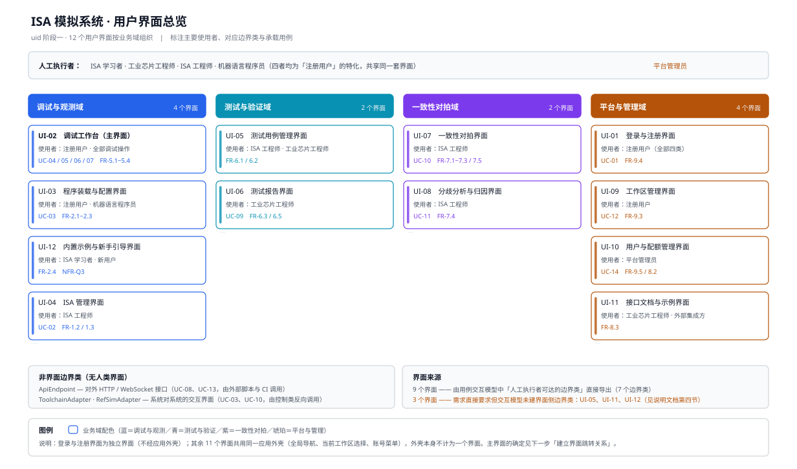

# ISA 模拟系统 用户界面初步设计说明

> **阶段**：用户界面设计（`uid`）· 第一步「初步设计用户界面」
> **本步产出**：用户界面清单、各界面元素清单、各界面操作清单
> **输入**：`需求分析/软件需求规格说明书.md`（38 条 FR / 13 条 NFR）、`需求分析/用例图.svg`、`需求分析/图/UC-01~14.svg` 与 `图/交互模型说明.md`、`需求分析/图/分析类模型说明.md`（30 个分析类）
> **配套图件**：`图/界面总览图.svg`

---

## 一、设计输入与推导方法

### 1.1 输入

| 输入 | 内容 | 在界面设计中的作用 |
| --- | --- | --- |
| 用例模型 | 14 个用例、5 类人工执行者 | 确定界面的覆盖范围与使用者 |
| 用例交互模型 | 14 张顺序图 + 逐条消息表（含参数） | **推导界面元素与操作的主要依据** |
| 分析类模型 | 边界类 10、控制类 8、实体类 12 | 判定"哪些边界类构成用户界面" |
| 软件需求规格说明书 | 38 条功能需求、13 条质量需求 | 核对界面是否覆盖全部需求 |

### 1.2 推导规则

**规则一 · 界面从边界类导出。** 边界类承担"系统与外部世界之间的界面"。其中由**人工执行者**直接驱动的那部分构成用户界面；系统对系统的边界类不构成用户界面。

| 边界类 | 驱动方 | 是否构成用户界面 |
| --- | --- | --- |
| `SessionView` | 注册用户、平台管理员 | ✅ → UI-01、UI-10 |
| `IsaView` | ISA 工程师 | ✅ → UI-04 |
| `LoadView` | 注册用户 | ✅ → UI-03 |
| `DebugView` | 注册用户 | ✅ → UI-02 |
| `TestView` | 工业芯片工程师 | ✅ → UI-06 |
| `DiffView` | ISA 工程师 | ✅ → UI-07、UI-08 |
| `WorkspaceView` | 注册用户 | ✅ → UI-09 |
| `ApiEndpoint` | 集成 API 客户端（系统） | ❌ 对外 HTTP / WS 接口 |
| `ToolchainAdapter` | 由 `LoadController` 反向调用（系统） | ❌ 系统对系统 |
| `RefSimAdapter` | 由 `DiffController` 反向调用（系统） | ❌ 系统对系统 |

**规则二 · 元素从消息参数导出。** 顺序图中"发给边界类的消息"的参数，是界面必须能录入的数据 → **静态界面元素**；"边界类返回、推送出去的消息"是界面必须呈现的数据 → **动态界面元素**。

**规则三 · 操作从边界类发出的消息导出。** 边界类每发出一条消息、每执行一次自调用，即对应界面上的一个操作，据此分三类：

- **用户命令触发的操作** —— 点按钮 / 选菜单 / 提交表单引起，对应「边界类 → 控制类」的消息；
- **动态元素变化触发的操作** —— 状态到达、断点命中、任务完成引起，对应「控制类 → 边界类」的返回消息与边界类的自调用；
- **界面跳转触发的操作** —— 进入 / 离开界面引起，对应「进入主界面」「刷新视图」一类消息。

> **关于元素分类**：技能把*静态界面元素*定义为"负责处理输入"、*动态界面元素*定义为"负责处理输出"。因此本文的"静态元素"指**用户可操作、可录入**的元素（输入框、按钮、菜单、可编辑表格、超链接、开关），"动态元素"指**随状态变化而更新**的呈现元素（结果表格、高亮、进度指示、状态栏、提示条）——与视觉上的"静止 / 动画"无关。

### 1.3 边界类 → 界面的对应，以及三处缺口

7 个人工可达的边界类中，`SessionView` 服务两类使用者（注册用户登录、平台管理员管配额），`DiffView` 服务两条用例（发起对拍、分歧归因）。按"使用者不同则职责不同"分列，得 **9 个界面**。

另有 **3 项需求没有界面侧边界类，但必须有界面承载**：

| 需求 | 内容 | 缺口 |
| --- | --- | --- |
| FR-6.1 | 导入与编辑测试用例，支持分组与标签 | UC-08 名为「管理**并**批量执行测试用例」，但交互模型只建了 `ApiEndpoint` 一条路径——"管理"半段没有界面对应物 |
| FR-8.3 | 提供接口文档与调用示例 | 需求要求系统内可查阅，交互模型无对应对象 |
| FR-2.4 | 提供内置示例程序集并配套新手引导 | 需求明写"配套新手引导"，交互模型无对应对象；NFR-Q3 的 5 分钟上手目标依赖它 |

三者补为 UI-05、UI-11、UI-12。**分析类模型不需改动**——它们的处理逻辑分别落在 `TestController`、`ApiController`、`LoadController` 上，缺的只是界面侧的边界类。详见第四节补充项 S-4 / S-5 / S-6。

---

## 二、用户界面清单

### 2.1 清单总表

| 编号 | 界面名称 | 业务域 | 主要使用者 | 对应边界类 | 承载用例 / 需求 | 优先级 |
| --- | --- | --- | --- | --- | --- | --- |
| UI-01 | 登录与注册界面 | 平台与管理 | 注册用户（全部四类） | `SessionView`（登录侧） | UC-01、FR-9.4 | P3 |
| UI-02 | **调试工作台（主界面）** | 调试与观测 | 注册用户 | `DebugView` | UC-04 / 05 / 06 / 07、FR-4.1~4.4、FR-5.1~5.4、NFR-Q3 | **P0 / P1** |
| UI-03 | 程序装载与配置界面 | 调试与观测 | 注册用户、机器语言程序员 | `LoadView` | UC-03、FR-2.1~2.3 | **P0** |
| UI-04 | ISA 管理界面 | 调试与观测 | ISA 工程师 | `IsaView` | UC-02、FR-1.2 / 1.3 | P2 |
| UI-05 | 测试用例管理界面 | 测试与验证 | ISA 工程师、工业芯片工程师 | —（补充 S-4） | FR-6.1 / 6.2 / 6.5 | P1 |
| UI-06 | 测试报告界面 | 测试与验证 | 工业芯片工程师 | `TestView` | UC-09、FR-6.3 / 6.5 | P2 |
| UI-07 | 一致性对拍界面 | 一致性对拍 | ISA 工程师 | `DiffView`（对拍侧） | UC-10、FR-7.1~7.3 / 7.5 | P1 |
| UI-08 | 分歧分析与归因界面 | 一致性对拍 | ISA 工程师 | `DiffView`（归因侧） | UC-11、FR-7.4 | P2 |
| UI-09 | 工作区管理界面 | 平台与管理 | 注册用户 | `WorkspaceView` | UC-12、FR-9.3 | P3 |
| UI-10 | 用户与配额管理界面 | 平台与管理 | 平台管理员 | `SessionView`（管理侧） | UC-14、FR-9.5 / 8.2 | P3 |
| UI-11 | 接口文档与示例界面 | 平台与管理 | 工业芯片工程师、外部集成方 | —（补充 S-5） | FR-8.3 | P2 |
| UI-12 | 内置示例与新手引导界面 | 调试与观测 | ISA 学习者、新用户 | —（补充 S-6） | FR-2.4、NFR-Q3 | P1 |

### 2.2 界面总览图

### 2.3 界面规模与共用外壳

- **12 个用户界面**：1 个独立界面（UI-01 登录与注册，不经外壳）+ **11 个外壳内界面**。
- **应用外壳**（全局导航、当前工作区选择、账号菜单、消息提示区）是 11 个界面共用的容器，**不计为一个界面**。
- 按业务域分布：调试与观测 4 个、测试与验证 2 个、一致性对拍 2 个、平台与管理 4 个。

### 2.4 主界面的初步判断

技能要求"主界面应展示系统主要功能"。本系统的主要功能是**指令级调试与架构状态观测**，故初步判断 **主界面 = UI-02 调试工作台**。正式确定放在第二步「建立用户界面间的跳转关系」中与用户确认。

---

## 三、界面元素与操作设计

> 本节逐界面给出静态元素清单（负责输入）、动态元素清单（负责输出）与操作清单。
> 表中「对应消息」一列引用 `需求分析/图/交互模型说明.md` 的消息序号，格式为 `UC-xx·n`。

### 3.1 UI-01 登录与注册界面

| 项 | 内容 |
| --- | --- |
| 界面职责 | 账号凭据录入与校验、注册入口、本地形态的匿名进入 |
| 使用者 | 注册用户（ISA 学习者 / 工业芯片工程师 / ISA 工程师 / 机器语言程序员） |
| 对应边界类 | `SessionView`（登录侧） |
| 承载用例 / 需求 | UC-01、FR-9.4 |
| 界面构成 | 单页居中卡片；登录表单与注册表单互斥切换；不含应用外壳 |

**静态界面元素（负责输入）**

| 元素 | 类型 | 承载的输入消息 / 参数 | 触发的操作 |
| --- | --- | --- | --- |
| 用户名输入框 | 输入框 | `UC-01·1`「凭据（用户名、口令）」的用户名 | — |
| 口令输入框 | 输入框（掩码） | `UC-01·1` 的口令 | — |
| 确认口令输入框 | 输入框（掩码） | 注册时的口令复核（界面内校验，不发给控制类） | — |
| 「登录」按钮 | 按钮 | — | 提交凭据 → `UC-01·2` |
| 「注册」超链接 | 超链接 | — | 切换为注册表单（界面内状态切换，不跳转） |
| 「提交注册」按钮 | 按钮 | 用户名、口令 | 提交注册（`UC-01·2` 的注册分支） |
| 「以匿名会话进入」超链接 | 超链接 | —（仅本地形态且 FR-8.2 鉴权关闭时显示） | 跳过鉴权直达 UI-02 |
| 表单字段内联提示位 | 文本 | —（占位，由动态元素填充） | — |

**动态界面元素（负责输出）**

| 元素 | 类型 | 承载的输出消息 / 数据 | 更新时机 |
| --- | --- | --- | --- |
| 登录 / 注册结果提示条 | 提示条 | `UC-01·9`「登录结果（会话令牌）」的成功与失败 | 控制类返回后 |
| 凭据校验失败原因 | 文本 | 账号不存在 / 口令错误 / 账号已停用（FR-9.5） | 同上 |
| 注册字段内联错误 | 文本 | 用户名被占用 / 两次口令不一致 | 提交注册后 |
| 处理进度指示 | 进度指示 | 登录中的等待状态（反应性原则） | 请求发出至返回之间 |
| 当前部署形态标识 | 文本 | 云端形态（必须登录）/ 本地形态（鉴权可关闭） | 进入界面时 |

**操作清单**

| 操作 | 触发方式 | 对应消息 | 处理结果 / 去向 |
| --- | --- | --- | --- |
| 登录 | 点「登录」 | 会话界面 → 会话控制器`UC-01·2` | 成功：持令牌进入 UI-02；失败：界面内提示，允许重试 |
| 注册 | 点「提交注册」 | 同上（注册分支） | 账号创建成功后自动登录并进入 UI-02 |
| 切换登录 / 注册表单 | 点超链接 | 界面内自调用 | 表单纯切换，不发生跳转 |
| 匿名进入 | 点「以匿名会话进入」 | —（本地形态专有） | 直达 UI-02，绕过 UC-01 |
| 离开界面 | 登录成功后 | `UC-01·10`「进入主界面」 | 跳转至 UI-02，本界面不再回访 |

### 3.2 UI-02 调试工作台（主界面）

| 项 | 内容 |
| --- | --- |
| 界面职责 | 系统主界面。承载执行控制、断点管理、四类状态视图与轨迹回退 |
| 使用者 | 注册用户 |
| 对应边界类 | `DebugView` |
| 承载用例 / 需求 | UC-04、UC-05、UC-06、UC-07；FR-3.5、FR-4.1~4.4、FR-5.1~5.4；NFR-Q1 / Q3 |
| 界面构成 | A 执行控制条 · B 反汇编视图 · C 寄存器视图 · D 内存视图 · E 轨迹与时间轴视图 · F 断点面板 · G 状态栏 · H 装载 / ISA / 工作区入口 |

**静态界面元素（负责输入）**

| 元素 | 类型 | 承载的输入消息 / 参数 | 触发的操作 |
| --- | --- | --- | --- |
| 「单步」按钮 | 按钮 | `UC-04·1`「触发单步或连续运行」 | 执行（步数 = 1）→ `UC-04·2` |
| 「连续运行」按钮 | 按钮 | 同上 | 执行（运行） |
| 运行步数输入框 +「运行 N 步」按钮 | 输入框 + 按钮 | `UC-04·2`「步数或运行」中的步数 | 执行（步数 = N） |
| 「暂停」按钮 | 按钮 | `UC-04·1` | 执行（暂停）；仅运行中可用 |
| 「复位」按钮 | 按钮（危险操作） | `UC-04·1` | 复位；二次确认后执行 |
| 「运行到地址」按钮 + 地址输入框 | 按钮 + 输入框 | FR-4.3 的运行目标 | 执行（运行至地址）——见补充项 S-2 |
| 视图切换选项卡（寄存器 / 内存 / 反汇编 / 轨迹） | 选项卡菜单 | `UC-06·1`「切换视图（寄存器 / 内存 / 反汇编 / 轨迹）」 | 切视图 → `UC-06·2` |
| 内存视图·地址跳转输入框 | 输入框 | FR-5.2 跳转地址 | 内存视图定位（界面内） |
| 内存视图·搜索输入框 | 输入框 | FR-5.2 搜索内容 | 内存视图搜索（界面内） |
| 内存视图·字节 / 半字 / 字单选组 | 单选框组 | FR-5.2 显示粒度 | 重排内存视图 |
| 内存视图·单元格编辑器 | 可编辑数据 | FR-5.2「编辑：写入地址与值」 | 写内存——见补充项 S-1 |
| 轨迹视图·起止步选择器 | 输入框（数值范围） | `UC-06·5`「查询轨迹（范围）」的范围 | 刷新轨迹视图 |
| 轨迹行·「回退到此步」按钮 | 按钮 | `UC-07·1`「选择历史某一步」 | 回退到指定步 → `UC-07·2` |
| 断点地址输入框 +「添加断点」按钮 | 输入框 + 按钮 | `UC-05·1`「在地址栏或反汇编视图设断点」的地址 | 登记断点 → `UC-05·2` |
| 反汇编行·沟槽点击区 | 可点击数据 | 同上（在反汇编视图设断点） | 登记断点（该行地址） |
| 断点列表·启用 / 禁用开关 | 开关 | 地址 + 启停状态（FR-4.2） | 登记断点（启用 / 禁用） |
| 断点列表·「删除」按钮 | 按钮 | 地址 | 登记断点（删除） |
| 「装载程序」按钮 | 按钮 | — | 跳转 UI-03 |
| 当前 ISA 标识 +「切换 ISA」超链接 | 文本 + 超链接 | — | 跳转 UI-04 |
| 「保存工作区」超链接 | 超链接 | — | 跳转 UI-09 / 直接触发保存（UC-12） |
| 异常处置选择（终止 / 暂停） | 单选组 | FR-3.5「按配置终止执行或暂停」 | 设定异常处置策略 |

**动态界面元素（负责输出）**

| 元素 | 类型 | 承载的输出消息 / 数据 | 更新时机 |
| --- | --- | --- | --- |
| 寄存器表格 | 数据表格 | `UC-06·7`「状态与轨迹」中的 PC / GPR / CSR | 每条执行命令返回后 |
| 本步变化高亮 | 高亮 | `UC-04·8`「高亮本步变化」、FR-5.1「高亮本步发生变化的位」 | 同上（NFR-Q3 要求变化必须有视觉高亮） |
| 反汇编列表 | 数据列表 | 当前 PC 前后若干条指令；当前指令高亮 | 同上 |
| 内存表格 | 数据表格 | 内存内容；本步被写的单元格高亮 | 同上 |
| 轨迹时间轴 | 数据列表 / 时间轴 | `UC-06·6` 的轨迹记录（指令地址、指令、操作数、状态增量） | 每步追加；回退后其后条目置灰 |
| 轨迹裁剪提示 | 提示条 | 超出可回退范围时明示用户（对应 SAD 5.6.5 的轨迹裁剪策略） | 轨迹被裁剪时 |
| 断点命中提示 | 提示条 + 高亮 | `UC-05·8`「暂停并高亮」、`UC-05·9`「断点命中呈现」 | 断点命中瞬间 |
| 运行状态与退出码 | 状态栏 | FR-3.4「结束状态与退出码」；就绪 / 运行 / 暂停 / 终止 / 异常 | 状态变化时 |
| 异常现场面板 | 提示区 | FR-3.5 异常类型、触发地址、当时架构状态 | 运行期异常时（不得使服务进程崩溃） |
| 回退完成提示 | 提示条 | `UC-07·7`「状态已回退」、`UC-07·8`「四类视图同步刷新」 | 回退完成后 |
| 单步响应时延 | 文本 | 本步端到端耗时（NFR-Q1：本地 ≤ 100 ms、云端 ≤ 300 ms） | 每次执行返回后 |

**操作清单**

| 操作 | 触发方式 | 对应消息 | 处理结果 / 去向 |
| --- | --- | --- | --- |
| 单步 / 连续运行 / 暂停 / 复位 / 运行到地址 | 点执行控制条 | 调试界面 → 调试控制器`UC-04·2` | 内核执行，返回状态增量并刷新四类视图 |
| 添加 / 删除 / 启用 / 禁用断点 | 地址输入、反汇编沟槽、列表开关与删除 | 调试界面 → 调试控制器`UC-05·2` | 断点表更新；命中时暂停并高亮 |
| 回退到历史某一步 | 点轨迹行的「回退到此步」 | 调试界面 → 调试控制器`UC-07·2` | 架构状态恢复，四类视图同步刷新 |
| 切换视图 | 点选项卡 | 调试界面 → 调试控制器`UC-06·2` | 取状态与轨迹并渲染 |
| 内存粒度切换 / 跳转 / 搜索 / 编辑 | 内存视图内操作 | `UC-06·2` 读状态；（编辑见 S-1） | 重排或更新内存视图 |
| 跳转装载 / ISA / 工作区 / 示例 | 点入口 | —（界面跳转） | 分别去 UI-03 / UI-04 / UI-09 / UI-12 |
| 刷新与高亮 | 控制类返回状态增量 | 边界类自调用`UC-04·8`、`UC-06·8` | 更新高亮，不换页 |

### 3.3 UI-03 程序装载与配置界面

| 项 | 内容 |
| --- | --- |
| 界面职责 | 提交待模拟程序（汇编源或机器码）、配置运行初态、呈现装载与汇编结果 |
| 使用者 | 注册用户、机器语言程序员 |
| 对应边界类 | `LoadView` |
| 承载用例 / 需求 | UC-03、FR-2.1 / 2.2 / 2.3 |
| 界面构成 | 源输入区（代码编辑器 + 文件上传）· 初态配置区 · 示例入口 · 结果区 |

**静态界面元素（负责输入）**

| 元素 | 类型 | 承载的输入消息 / 参数 | 触发的操作 |
| --- | --- | --- | --- |
| 代码编辑器（CodeMirror 6） | 可编辑数据 | `UC-03·1`「汇编源」 | — |
| 「上传文件」按钮 | 文件选择 | `UC-03·1`「机器码」；FR-2.1 的 bin / hex / ELF 可装载段 | 选择源或映像文件 |
| 「从工作区选择程序」超链接 | 超链接 | —（复用 UC-12 已保存程序） | 载入已保存程序 |
| 「使用内置示例」入口 | 按钮 | — | 跳转 UI-12 |
| 目标 ISA 只读显示 +「切换 ISA」超链接 | 文本 + 超链接 | — | 跳转 UI-04 |
| 基址输入框 | 输入框（十六进制） | `UC-03·1`「基址」 | — |
| 起始 PC 输入框 | 输入框（十六进制） | `UC-03·1`「起始 PC」（FR-2.3） | — |
| 栈指针输入框 | 输入框（十六进制） | `UC-03·1`「栈指针」（FR-2.3） | — |
| 内存初值表格（地址 = 值，可增删行） | 可编辑数据 | FR-2.3「内存初值」 | — |
| 「装载并初始化」按钮 | 按钮 | — | 提交 → `UC-03·2`「装载程序（源、基址、初态）」 |
| 「仅汇编不装载」按钮 | 按钮 | — | 只取机器码映像（便于先看汇编结果） |

**动态界面元素（负责输出）**

| 元素 | 类型 | 承载的输出消息 / 数据 | 更新时机 |
| --- | --- | --- | --- |
| 汇编结果摘要 | 文本区 | `UC-03·4`「机器码映像或错误行」：字节数、入口地址、反汇编预览 | 汇编返回后 |
| 汇编错误行列表 | 数据列表 | 同上：文件、行号、原文；FR-2.2 | 汇编失败时 |
| 工具链缺失告警条 | 提示条 | FR-2.2「工具链缺失时给出明确提示而不静默失败」 | 提交后发现工具链不可用时 |
| 装载结果与内核就绪状态 | 提示条 | `UC-03·9`「装载结果」、`UC-03·8`「就绪」 | 装载返回后 |
| 初态校验提示 | 文本 | 基址非对齐 / 起始 PC 越出映像 / 栈指针越界（界面内校验） | 提交前实时 |
| 装载完成提示 | 提示条 | `UC-03·10`「就绪并刷新视图」 | 就绪后 |

**操作清单**

| 操作 | 触发方式 | 对应消息 | 处理结果 / 去向 |
| --- | --- | --- | --- |
| 编辑源 / 上传文件 | 编辑器输入、点上传 | 装载界面 → 装载控制器`UC-03·2` | 走汇编或直接载入映像 |
| 配置初态 | 填基址 / 起始 PC / 栈指针 / 内存初值 | 同上（`UC-03·2` 的初态参数） | 传给内核初始化 |
| 装载并初始化 | 点「装载并初始化」 | `UC-03·2` → 内核`UC-03·7`「初始化」 | 成功：回 UI-02 并刷新四类视图 |
| 使用内置示例 | 点入口或卡片 | —（界面跳转，回填本界面） | 去 UI-12 选示例后回填 |
| 界面跳转 | 装载成功后 | `UC-03·10` | 返回 UI-02 |

### 3.4 UI-04 ISA 管理界面

| 项 | 内容 |
| --- | --- |
| 界面职责 | 上传与校验 ISA 描述、列出与切换已装载 ISA、呈现问题清单 |
| 使用者 | ISA 工程师 |
| 对应边界类 | `IsaView` |
| 承载用例 / 需求 | UC-02、FR-1.2 / 1.3 |
| 界面构成 | 已装载 ISA 列表 · 描述上传区 · 校验结果区 · 描述详情展开区 |

**静态界面元素（负责输入）**

| 元素 | 类型 | 承载的输入消息 / 参数 | 触发的操作 |
| --- | --- | --- | --- |
| 「上传 ISA 描述文件」按钮 | 文件选择 | `UC-02·1`「上传 ISA 描述文件」 | 选择 `.yaml` / `.json` 描述文件 |
| 已装载 ISA 列表 | 数据列表（可选中） | FR-1.3「查询、列出已装载的 ISA」 | 选中行 = 切换当前 ISA |
| 「设为当前 ISA」按钮 | 按钮 | FR-1.3「切换」 | 切换当前 ISA |
| 「装载并校验」按钮 | 按钮 | — | → `UC-02·2`「装载并校验（描述文件）」 |
| 「查看描述详情」超链接 | 超链接 | — | 界面内展开指令表 / 寄存器表 / 编码字段表 |
| 「删除已装载 ISA」按钮 | 按钮（危险操作） | — | 二次确认后删除 |

**动态界面元素（负责输出）**

| 元素 | 类型 | 承载的输出消息 / 数据 | 更新时机 |
| --- | --- | --- | --- |
| 问题清单表格 | 数据表格 | `UC-02·8`「装载结果或问题清单」；FR-1.2 的三类问题：语义缺失 / 编码冲突 / 字段重叠 | 校验完成后 |
| 校验规则清单 | 文本列表 | 本次校验了哪些完备性与自洽性规则 | 同上 |
| 装载结果与当前 ISA 标识 | 提示条 + 标记 | `UC-02·9`「呈现结果」 | 装载完成后 |
| 描述统计 | 文本 | 指令条数、寄存器数、编码字段数 | 选中 ISA 时 |

**操作清单**

| 操作 | 触发方式 | 对应消息 | 处理结果 / 去向 |
| --- | --- | --- | --- |
| 上传描述文件 | 点上传按钮 | ISA 管理界面 → ISA 管理控制器`UC-02·2` | 进入解析与校验 |
| 校验完备性与自洽性 | 点「装载并校验」 | 控制器自调用`UC-02·5` | 输出问题清单 |
| 装载并切换 | 点「设为当前 ISA」 | ISA 管理界面 → ISA 管理控制器`UC-02·6` | 生效为当前 ISA，UI-02 状态栏同步 |
| 查看描述详情 | 点超链接 | 界面内展开 | 不改模型状态 |
| 界面跳转 | 由 UI-02 / UI-03 进入或返回 | — | 返回 UI-02 / UI-03 |

### 3.5 UI-05 测试用例管理界面

| 项 | 内容 |
| --- | --- |
| 界面职责 | 测试用例的导入、编辑、分组与标签管理，以及从界面发起批量执行 |
| 使用者 | ISA 工程师；工业芯片工程师（主路径仍走集成 API，FR-6.4） |
| 对应边界类 | 无（补充项 **S-4**：UC-08 的"管理"半段在交互模型中无边界类） |
| 承载用例 / 需求 | FR-6.1、FR-6.2、FR-6.5 |
| 界面构成 | 用例集树 · 用例编辑器 · 期望态编辑区 · 分组与标签 · 批量执行入口 |

**静态界面元素（负责输入）**

| 元素 | 类型 | 承载的输入消息 / 参数 | 触发的操作 |
| --- | --- | --- | --- |
| 用例集树（用例集 → 用例） | 树形列表 | FR-6.1 的用例组织结构 | 选中用例载入编辑区 |
| 「导入用例」按钮 | 文件选择 | FR-6.1「导入测试用例」 | 导入用例定义 + 程序 + 期望态 |
| 代码编辑器 | 可编辑数据 | FR-6.1「编辑测试用例（程序）」 | — |
| 判定模式单选组（终态快照 / 逐条提交日志） | 单选框组 | FR-6.5 的两种判定模式 | 切换期望态录入方式 |
| 终态快照录入表（终值寄存器 / 内存） | 可编辑数据 | FR-6.5 模式一：期望态快照 | — |
| 「上传逐条提交日志」按钮 | 文件选择 | FR-6.5 模式二：逐条提交日志 | 载入期望序列 |
| 分组选择 / 新建分组输入框 | 下拉 + 输入框 | FR-6.1「分组」 | — |
| 标签输入框 | 输入框（多值） | FR-6.1「标签」 | — |
| 超时步数上限输入框 | 输入框 | FR-4.3 / NFR-Q5 的指令执行条数上限 | — |
| 「批量执行」按钮 | 按钮 | FR-6.2 | → 测试控制器`runSuite()` |
| 「另存到工作区」按钮 | 按钮 | FR-9.3 | 保存程序与用例集（UC-12） |
| 搜索框 + 分组 / 标签筛选器 | 输入框 + 筛选器 | — | 界面内过滤 |

**动态界面元素（负责输出）**

| 元素 | 类型 | 承载的输出消息 / 数据 | 更新时机 |
| --- | --- | --- | --- |
| 用例统计 | 文本 | 用例条数、分组分布、标签分布 | 用例集变化时 |
| 用例完整性校验清单 | 数据列表 | 缺程序 / 缺期望态 / 判定模式缺失 / 标签未设置 | 保存用例时 |
| 执行进度 | 进度条 | 当前用例 / 总数、已通过 / 已失败（FR-6.2） | 批量执行过程中 |
| 执行结果摘要 | 汇总卡片 | 通过率、失败条数；单用例失败不牵连其余（NFR-Q2） | 执行完成后 |
| 跳转报告入口 | 链接 | — | 执行完成后出现 |
| 导入结果提示 | 提示条 | 成功条数、失败原因（格式 / 重复） | 导入后 |

**操作清单**

| 操作 | 触发方式 | 对应消息 | 处理结果 / 去向 |
| --- | --- | --- | --- |
| 导入 / 编辑用例 | 点导入、编辑区修改 | 测试控制器管理路径（补充 S-4） | 更新用例集（实体类 `TestSuite`） |
| 设置分组 / 标签 / 判定模式 | 表单选择 | 同上 | 更新用例属性 |
| 批量执行 | 点「批量执行」 | 测试控制器 → 内核`UC-08·6` → 比对引擎`UC-08·8` | 逐条执行并判定，结果汇总为报告 |
| 另存 | 点「另存到工作区」 | 工作区保存链路（UC-12） | 程序与用例集入库 |
| 跳转报告 | 点报告入口 | — | 去 UI-06 查看报告 |

### 3.6 UI-06 测试报告界面

| 项 | 内容 |
| --- | --- |
| 界面职责 | 呈现测试报告的通过率、失败清单与失败现场快照 |
| 使用者 | 工业芯片工程师 |
| 对应边界类 | `TestView` |
| 承载用例 / 需求 | UC-09、FR-6.3、FR-6.5 |
| 界面构成 | 报告列表 · 通过率概览 · 失败清单 · 失败现场详情 |

**静态界面元素（负责输入）**

| 元素 | 类型 | 承载的输入消息 / 参数 | 触发的操作 |
| --- | --- | --- | --- |
| 报告列表（按时间 / 用例集） | 数据列表 | FR-6.3「输出测试报告」的报告选择 | 选中报告 |
| 「打开报告」按钮 | 按钮 | `UC-09·1`「打开测试报告」 | → `UC-09·2`「请求报告」 |
| 失败用例列表（行可点） | 数据列表 | `UC-09·6`「点击失败用例」 | → 取该用例的失败现场快照 |
| 过滤（分组 / 标签 / 判定模式） | 筛选器 | 复用 FR-6.1 的分组与标签 | 界面内过滤 |
| 「重新执行失败用例」按钮 | 按钮 | FR-6.2 | 重跑并生成新报告 |
| 「导出报告」按钮 | 按钮 | FR-6.3 | 导出 JSON / CSV |
| 「去对拍复核」超链接 | 超链接 | — | 跳 UI-07（把测试分歧转对拍归因） |

**动态界面元素（负责输出）**

| 元素 | 类型 | 承载的输出消息 / 数据 | 更新时机 |
| --- | --- | --- | --- |
| 通过率 | 数字 + 进度环 | `UC-09·5`「报告」；FR-6.3「通过率」 | 报告载入后 |
| 失败清单表格 | 数据表格 | `UC-09·4`「报告数据」：用例名、分组、标签、首个差异点、耗时 | 同上 |
| 失败现场快照 | 三视图复现 | `UC-09·8`「快照与首个差异点」：寄存器 / 内存 / 轨迹（复用 UI-02 的视图组件） | 点失败用例后 |
| 判定模式标识 | 标记 | FR-6.5：本报告用的是终态快照还是逐条提交日志 | 报告载入后 |
| 单用例失败标注 | 标记 | NFR-Q2：单个用例执行失败不影响其余用例 | 同上 |
| 重跑结果提示 | 提示条 | 新报告的生成结果 | 重跑完成后 |

**操作清单**

| 操作 | 触发方式 | 对应消息 | 处理结果 / 去向 |
| --- | --- | --- | --- |
| 打开报告 | 选报告后点「打开报告」 | 测试界面 → 测试控制器`UC-09·2` | 取通过率与失败清单并呈现 |
| 查看失败现场 | 点失败用例行 | 测试界面 → 测试报告`UC-09·7` | 呈现快照与首个差异点 |
| 重新执行失败用例 | 点按钮 | FR-6.2 | 生成新报告并刷新本界面 |
| 去对拍复核 | 点超链接 | — | 跳 UI-07，程序与用例集随带 |

### 3.7 UI-07 一致性对拍界面

| 项 | 内容 |
| --- | --- |
| 界面职责 | 配置比对子集、发起一致性对拍、呈现首个分歧点与双方状态 |
| 使用者 | ISA 工程师 |
| 对应边界类 | `DiffView`（对拍侧） |
| 承载用例 / 需求 | UC-10、FR-7.1 / 7.2 / 7.3、FR-7.5、NFR-I1 |
| 界面构成 | 对拍配置区 · 执行进度区 · 分歧报告区 |

**静态界面元素（负责输入）**

| 元素 | 类型 | 承载的输入消息 / 参数 | 触发的操作 |
| --- | --- | --- | --- |
| 程序选择器 | 下拉 + 文件 | `UC-10·1`「选定程序」 | — |
| 参考模拟器选择 + 可用性标识 | 下拉 + 标记 | FR-7.1「调用外部参考模拟器」；首期 Spike | — |
| 比对子集复选组（PC / 32 个 GPR / 内存写 / 被改 CSR） | 复选框组 | `UC-10·1`「比对子集」；FR-7.2 的默认四项 | — |
| 「自定义比对字段」展开区 | 复选组 | NFR-I1「比对子集可配置」 | 逐字段勾选 |
| 「发起对拍」按钮 | 按钮 | — | → `UC-10·2`「发起对拍（程序、比对子集）」 |
| 「取消对拍」按钮 | 按钮 | — | 中断长任务 |
| 「降级模式」开关 | 开关 | FR-7.5「参考模拟器不可用时的降级模式」 | 退化为基于期望态快照的断言比对 |

**动态界面元素（负责输出）**

| 元素 | 类型 | 承载的输出消息 / 数据 | 更新时机 |
| --- | --- | --- | --- |
| 对拍进度 | 进度条 + 步数 | 已推进步数、双方执行状态（反应性原则） | 对拍执行过程中 |
| 分歧报告 | 卡片 | `UC-10·13`「分歧报告」：首个分歧点、指令序号 | 对拍完成后 |
| 双方状态对照表 | 对照表格 | `UC-10·10`「首个分歧点」：本内核值 / 参考模拟器值 / 差异字段高亮 | 同上 |
| 一致结论 | 提示条 | 双方逐步一致时给出"未发现分歧" | 对拍完成后 |
| 参考模拟器不可用告警 | 告警条 | FR-7.5；出现时提示可切降级模式 | 调用失败时 |
| 降级模式提示 | 标记 | 当前处于降级模式（比对依据为期望态快照而非参考模拟器） | 开关切换时 |

**操作清单**

| 操作 | 触发方式 | 对应消息 | 处理结果 / 去向 |
| --- | --- | --- | --- |
| 选定程序与比对子集 | 下拉与复选框 | 对拍界面 → 对拍控制器`UC-10·2` | 形成对拍请求 |
| 发起对拍 | 点「发起对拍」 | `UC-10·2` → 内核`UC-10·3` / 参考模拟器适配器`UC-10·5` → 比对引擎`UC-10·9` | 返回首个分歧点或"一致" |
| 切换降级模式 | 拨开关 | FR-7.5 | 改用期望态快照断言比对 |
| 查看分歧现场 | 点分歧记录 | — | 跳 UI-08 做归因 |
| 界面跳转 | 由 UI-02 / UI-06 进入或返回 | — | 返回来源界面 |

### 3.8 UI-08 分歧分析与归因界面

| 项 | 内容 |
| --- | --- |
| 界面职责 | 呈现分歧的差异字段与双方状态，支持人工标注归因类别与说明 |
| 使用者 | ISA 工程师 |
| 对应边界类 | `DiffView`（归因侧） |
| 承载用例 / 需求 | UC-11、FR-7.4 |
| 界面构成 | 分歧记录列表 · 差异字段详情 · 归因表单 |

**静态界面元素（负责输入）**

| 元素 | 类型 | 承载的输入消息 / 参数 | 触发的操作 |
| --- | --- | --- | --- |
| 分歧记录列表（按程序 / 时间 / 归因状态） | 数据列表 | `UC-11·1`「查看分歧现场」的记录选择 | 选中分歧 |
| 分歧 ID 选择 + 「查看差异」按钮 | 列表 + 按钮 | `UC-11·2`「取差异字段（分歧 ID）」 | → 取分歧详情 |
| 归因类别单选组（实现缺陷 / 基准偏差 / 规范歧义） | 单选框组 | FR-7.4「区分实现缺陷、基准偏差与规范歧义」 | — |
| 归因说明文本框 | 输入框（多行） | `UC-11·7`「标注归因」的说明参数 | — |
| 「提交归因」按钮 | 按钮 | — | → `UC-11·7`「标注归因（分歧 ID、类别、说明）」 |
| 「定位到该步」按钮 | 按钮 | — | 跳 UI-02 并把架构状态回退到该步 |
| 「导出分歧记录」按钮 | 按钮 | — | 导出分歧记录（含归因） |

**动态界面元素（负责输出）**

| 元素 | 类型 | 承载的输出消息 / 数据 | 更新时机 |
| --- | --- | --- | --- |
| 差异字段表 | 数据表格 | `UC-11·5`「分歧详情」：字段、本内核值、参考模拟器值、是否在比对子集内 | 选中分歧后 |
| 双方状态快照 | 三视图复现 | 同上：该步的寄存器 / 内存 / CSR 双方对照 | 同上 |
| 归因状态标识 | 标记 | `UC-11·10`「已归档」：未归因 / 已归因 + 类别 | 提交归因后 |
| 归因统计 | 图表 | 按类别的分歧数量分布（辅助研判） | 列表变化时 |
| 归档确认 | 提示条 | `UC-11·9`「归档完成」 | 提交后 |

**操作清单**

| 操作 | 触发方式 | 对应消息 | 处理结果 / 去向 |
| --- | --- | --- | --- |
| 查看分歧现场 | 选中分歧记录 | 对拍界面 → 对拍控制器`UC-11·2` | 取差异字段并呈现 |
| 提交归因 | 选类别、填说明、点提交 | 对拍界面 → 对拍控制器`UC-11·7` | 更新 `Divergence.attribution` 并归档 |
| 定位到该步 | 点「定位到该步」 | —（界面跳转 + 回退） | 跳 UI-02，回退至该步 |
| 导出分歧记录 | 点按钮 | — | 导出文件 |

### 3.9 UI-09 工作区管理界面

| 项 | 内容 |
| --- | --- |
| 界面职责 | 工作区的保存与加载，程序与用例集的持久化入口 |
| 使用者 | 注册用户 |
| 对应边界类 | `WorkspaceView` |
| 承载用例 / 需求 | UC-12、FR-9.3 |
| 界面构成 | 工作区列表 · 保存配置区 · 加载与删除操作区 |

**静态界面元素（负责输入）**

| 元素 | 类型 | 承载的输入消息 / 参数 | 触发的操作 |
| --- | --- | --- | --- |
| 工作区列表（名称、创建时间、大小、占用） | 数据列表 | `UC-12·7`「加载工作区」的目标选择 | 选中工作区 |
| 「新建工作区」按钮 | 按钮 | — | 创建空工作区 |
| 工作区名称输入框 | 输入框 | 工作区名称 | 重命名 |
| 保存内容复选组（☑ 程序 ☑ 用例集 ☑ 配置） | 复选框组 | `UC-12·2`「保存（程序、用例集、配置）」的参数 | — |
| 「保存当前工作区」按钮 | 按钮 | — | → `UC-12·2` |
| 「加载」按钮（行内） | 按钮 | — | → `UC-12·8`「加载」 |
| 「设为当前工作区」按钮 | 按钮 | — | 切换当前工作区（应用外壳同步） |
| 「删除工作区」按钮 | 按钮（危险操作） | — | 二次确认后删除 |

**动态界面元素（负责输出）**

| 元素 | 类型 | 承载的输出消息 / 数据 | 更新时机 |
| --- | --- | --- | --- |
| 保存结果与持久化时间 | 提示条 | `UC-12·5`「已保存」 | 保存完成后 |
| 恢复结果 | 提示条 | `UC-12·13`「已恢复」 | 加载完成后 |
| 视图刷新提示 | 提示条 | `UC-12·14`「视图刷新」 | 加载完成后 |
| 配额占用条 | 进度条 | FR-9.5：当前占用 / 配额上限（持久化服务口径） | 列表刷新时 |
| 删除确认对话框 | 对话框 | 容错性原则：危险操作要求再次确认 | 点删除后 |

**操作清单**

| 操作 | 触发方式 | 对应消息 | 处理结果 / 去向 |
| --- | --- | --- | --- |
| 保存工作区 | 勾选内容后点保存 | 工作区界面 → 工作区控制器`UC-12·2` | 程序、用例集、配置入库 |
| 加载工作区 | 点行内「加载」 | `UC-12·8` → 控制器恢复程序与用例集 | 视图刷新，可回 UI-02 / UI-05 |
| 新建 / 重命名 | 点按钮、编辑名称 | — | 工作区元数据更新 |
| 删除工作区 | 点删除并确认 | — | 删除数据与文件，释放配额 |
| 设为当前工作区 | 点按钮 | — | 应用外壳的当前工作区切换 |

### 3.10 UI-10 用户与配额管理界面

| 项 | 内容 |
| --- | --- |
| 界面职责 | 平台管理员查看用户与资源占用、调整配额、停用或启用账号 |
| 使用者 | 平台管理员 |
| 对应边界类 | `SessionView`（管理侧） |
| 承载用例 / 需求 | UC-14、FR-9.5、FR-8.2 |
| 界面构成 | 用户列表 · 资源占用呈现 · 配额编辑 · 账号状态管理 |

**静态界面元素（负责输入）**

| 元素 | 类型 | 承载的输入消息 / 参数 | 触发的操作 |
| --- | --- | --- | --- |
| 用户列表（用户名、角色、状态、配额、占用） | 数据列表 | `UC-14·1`「查看用户列表与资源占用」 | 选中用户 |
| 「刷新」按钮 | 按钮 | — | → `UC-14·2`「查询用户与配额」 |
| 搜索框 + 角色 / 状态筛选器 | 输入框 + 筛选器 | — | 界面内过滤 |
| 配额编辑输入（并发会话数 / 单位时间请求数 / 单次请求指令执行条数） | 输入框组 | FR-8.2 的三个限额维度 | — |
| 存储配额输入框 | 输入框 | FR-9.5「按用户设置资源配额」 | — |
| 「停用 / 启用账号」开关 | 开关 | `UC-14·9`「更新（用户 ID、配额或状态）」的状态参数 | — |
| 「应用变更」按钮 | 按钮 | — | → `UC-14·9` |
| 「重置口令」按钮 | 按钮 | FR-9.4（会话管理） | 二次确认后重置 |

**动态界面元素（负责输出）**

| 元素 | 类型 | 承载的输出消息 / 数据 | 更新时机 |
| --- | --- | --- | --- |
| 用户与资源占用表 | 数据表格 | `UC-14·7`「用户与占用」：用户列表 + 工作区资源占用 | 查询 / 刷新后 |
| 变更结果提示 | 提示条 | `UC-14·12`「操作结果」、`UC-14·13`「确认」 | 应用变更后 |
| 限额越界告警 | 告警条 | 设定值低于当前占用时给出提示（容错性原则） | 输入时实时 |
| 账号状态标识 | 标记 | 正常 / 已停用 / 已超配额 | 列表刷新时 |

**操作清单**

| 操作 | 触发方式 | 对应消息 | 处理结果 / 去向 |
| --- | --- | --- | --- |
| 查看用户与占用 | 进入界面、点「刷新」 | 会话界面 → 会话控制器`UC-14·2` | 列出用户并查询资源占用 |
| 调整配额 | 编辑配额输入框 | 会话界面 → 会话控制器`UC-14·9` | 配额生效（限额在接入层前置检查） |
| 停用 / 启用账号 | 拨开关后应用变更 | 同上 | 账号状态更新 |
| 重置口令 | 点按钮并确认 | FR-9.4 | 口令重置 |

### 3.11 UI-11 接口文档与示例界面

| 项 | 内容 |
| --- | --- |
| 界面职责 | 系统内可查阅的集成 API 文档、调用示例与在线试调 |
| 使用者 | 工业芯片工程师、外部集成方 |
| 对应边界类 | 无（补充项 **S-5**：FR-8.3 直接要求） |
| 承载用例 / 需求 | FR-8.3（并旁证 FR-8.1 / 8.2） |
| 界面构成 | 接口目录树 · 端点详情与示例 · 在线试调区 |

**静态界面元素（负责输入）**

| 元素 | 类型 | 承载的输入消息 / 参数 | 触发的操作 |
| --- | --- | --- | --- |
| 接口目录树（REST 端点按功能组分组、WS 事件列表） | 树形菜单 | FR-8.1 的六类操作：装载 / 单步运行暂停 / 读状态 / 执行测试 / 发起对拍 | 选中端点 |
| 端点详情（方法、路径、鉴权要求、参数表） | 文本表格 | FR-8.2 的鉴权与限额说明 | — |
| 请求 / 响应示例（JSON 片段） | 文本区 | FR-8.3「调用示例」 | — |
| 示例语言切换（cURL / Python / JavaScript） | 选项卡菜单 | — | 切换示例体裁 |
| 「复制 cURL」/「复制代码片段」按钮 | 按钮 | — | 复制到剪贴板 |
| 令牌输入框 +「在线试调」按钮 | 输入框 + 按钮 | 调用凭据（`UC-13·1` 的凭据参数） | 发起试调请求 |
| 「下载 OpenAPI 描述文件」按钮 | 按钮 | FR-8.3 | 下载契约文件 |

**动态界面元素（负责输出）**

| 元素 | 类型 | 承载的输出消息 / 数据 | 更新时机 |
| --- | --- | --- | --- |
| 试调结果回显 | 结果面板 | 状态码、响应体、耗时（对应 `UC-13·8`「返回结果」） | 试调返回后 |
| 限额提示 | 文本 | 当前剩余配额（FR-8.2） | 试调前 / 后 |
| 试调错误提示 | 告警条 | 鉴权失败 / 限额用尽 / 参数非法 | 试调失败时 |
| 文档版本与更新时间 | 文本 | 契约版本（与 SS-6 的 REST / WS 契约同步维护） | 进入界面时 |

**操作清单**

| 操作 | 触发方式 | 对应消息 | 处理结果 / 去向 |
| --- | --- | --- | --- |
| 浏览接口 | 点目录树节点 | — | 界面内切换详情 |
| 复制示例 | 点复制按钮 | — | 剪贴板 |
| 在线试调 | 填令牌后点试调 | 集成 API 接口`UC-13·1` → 请求控制器 | 回显结构化响应 |
| 下载契约 | 点下载 | FR-8.3 | 下载文件 |

### 3.12 UI-12 内置示例与新手引导界面

| 项 | 内容 |
| --- | --- |
| 界面职责 | 提供内置示例程序集与新手引导，支撑"5 分钟上手"目标 |
| 使用者 | ISA 学习者、新用户 |
| 对应边界类 | 无（补充项 **S-6**：FR-2.4 + NFR-Q3 要求） |
| 承载用例 / 需求 | FR-2.4、NFR-Q3 |
| 界面构成 | 示例卡片列表 · 引导步骤条 · 知识点说明卡 |

**静态界面元素（负责输入）**

| 元素 | 类型 | 承载的输入消息 / 参数 | 触发的操作 |
| --- | --- | --- | --- |
| 示例程序卡片列表（寄存器运算演示 / 冒泡排序 / 斐波那契数列 …） | 卡片列表 | FR-2.4「覆盖 RV32I 常用指令的演示程序与经典算法样例」 | 选中示例 |
| 「查看源码」超链接 | 超链接 | — | 打开 UI-03 并回填该示例源码 |
| 「一键装载」按钮 | 按钮 | — | 直接触发装载（`UC-03·2`） |
| 引导步骤条（① 装载示例 → ② 单步执行 → ③ 观察寄存器变化） | 步骤条 | NFR-Q3 的可验收路径 | 点步骤可定位 |
| 「下一步」/「上一步」按钮 | 按钮 | — | 推进 / 回退引导步骤 |
| 「跳过引导 / 不再提示」按钮 | 按钮 | — | 关闭引导（用户偏好持久化） |
| 知识点说明卡 | 文本卡片 | FR-2.4「配套新手引导」：涉及的指令与观察要点 | — |

**动态界面元素（负责输出）**

| 元素 | 类型 | 承载的输出消息 / 数据 | 更新时机 |
| --- | --- | --- | --- |
| 步骤完成状态 | 步骤条勾选 / 高亮 | NFR-Q3：引导进度的达成状态 | 每步达成时 |
| 引导高亮遮罩 | 遮罩 + 指向标记 | 指向 UI-02 中对应的按钮与视图元素 | 引导进行中 |
| 目标达成提示 | 提示条 | 已完成"装载 → 单步 → 观察到寄存器变化" | 三步全部达成时 |
| 装载结果提示 | 提示条 | `UC-03·9`「装载结果」（复用 UI-03 的结果呈现） | 一键装载后 |

**操作清单**

| 操作 | 触发方式 | 对应消息 | 处理结果 / 去向 |
| --- | --- | --- | --- |
| 选择示例 | 点卡片 | — | 展示源码预览与知识点 |
| 一键装载 | 点按钮 | 装载界面 → 装载控制器`UC-03·2` | 装载示例并跳 UI-02 |
| 走引导 | 点「下一步」 | — | 依次指向 UI-02 的单步按钮与寄存器视图 |
| 跳过引导 | 点跳过 | — | 关闭引导，直达 UI-02 |
| 达成目标 | 完成三步后才算 | — | NFR-Q3 的可验收路径闭合 |

---

## 四、需求侧补充项（交互模型未覆盖、但界面必须承载）

以下 8 项由需求原文直接要求，但在 14 张顺序图中找不到对应消息；界面若不承载，需求即落空。**这些是 `uid` 阶段对需求与交互模型的补充，不属于界面设计自身的自由发挥。**

| 编号 | 补充项 | 起因（需求原文） | 界面落点 | 影响范围 |
| --- | --- | --- | --- | --- |
| S-1 | 内存**写**操作（地址 + 值） | FR-5.2 要求内存视图"支持地址跳转、搜索与**编辑**"，而 UC-06 只有"查询内存" | UI-02 内存视图的可编辑单元格 | 需内核开放调试期直接写内存，超出 FR-3.1 的"取指—译码—执行—写回"范围 |
| S-2 | 「运行到指定地址」与「运行至程序边界」 | FR-4.3 要求两种运行方式，UC-04 的消息只有"步数或运行" | UI-02 执行控制条的两个操作 | 内核需提供 `runTo(addr)` 与边界判定 |
| S-3 | 参考模拟器不可用时的**降级模式** | FR-7.5 要求降级为基于期望态快照的断言比对，UC-10 只有"适配器成功返回"一条路径 | UI-07 的降级开关与不可用告警 | 对拍控制器需分支能力 |
| S-4 | 测试用例**导入与编辑**的界面承载 | FR-6.1；UC-08 只建了 `ApiEndpoint` 路径 | 新增 **UI-05** | 处理逻辑已落在 `TestController`，分析类模型不需改 |
| S-5 | **接口文档与调用示例**的界面承载 | FR-8.3 | 新增 **UI-11** | 内容由 SS-6 的 REST / WS 契约生成与维护 |
| S-6 | **内置示例程序集与新手引导**的界面承载 | FR-2.4、NFR-Q3（5 分钟上手目标） | 新增 **UI-12** | 示例程序集是制品，需在部署时随包分发（SAD 6.1 已登记） |
| S-7 | **登出**操作 | FR-9.4 含"登出与会话管理"，14 张顺序图均无此消息 | 应用外壳的账号菜单（不计为独立界面） | 会话销毁链路 `UC-09`→ `Session` 需补 |
| S-8 | 会话超时回收的**用户提示** | NFR-Q5"空闲会话超时回收" | 应用外壳的消息提示区（回收前倒计时或续期入口） | 会话服务需可查询剩余空闲时长 |

> S-1、S-2、S-3 三项会反向影响内核与对拍控制器的方法集合，**建议在 `sdd` 阶段一并落到 `ICoreService` 与对拍服务接口上**；S-4 ~ S-6 已在本次界面清单中吸收；S-7、S-8 落在共用外壳上，不影响界面个数。

---

## 五、覆盖核对

### 5.1 用例 → 界面

| 用例 | 承载界面 | 说明 |
| --- | --- | --- |
| UC-01 注册与登录 | UI-01 | 登出见补充项 S-7（外壳） |
| UC-02 装载与管理 ISA 指令集 | UI-04 | UI-02 状态栏同步显示当前 ISA |
| UC-03 装载并配置待模拟程序 | UI-03 | 示例入口另接 UI-12 |
| UC-04 单步与连续执行 | UI-02 | — |
| UC-05 设置与管理断点 | UI-02 | 与 UC-04 / 06 / 07 同界面 |
| UC-06 查看架构状态与执行轨迹 | UI-02 | 四类视图为一界面的四个区域 |
| UC-07 回退执行历史 | UI-02 | 轨迹视图的「回退到此步」 |
| UC-08 管理并批量执行测试用例 | UI-05 | 界面侧（"管理"半段）；接口侧为 `ApiEndpoint` |
| UC-09 查看测试报告 | UI-06 | — |
| UC-10 发起 ISA 一致性对拍 | UI-07 | — |
| UC-11 分析与标注分歧归因 | UI-08 | 与 UI-07 同边界类、职责不同 |
| UC-12 保存与加载工作区 | UI-09 | — |
| UC-13 通过集成 API 驱动模拟 | （无界面） | 纯接口用例，由 UI-11 提供文档支撑 |
| UC-14 管理用户与资源配额 | UI-10 | — |

**结论**：14 个用例中 13 个有界面承载，UC-13 为纯接口用例（属正常）。

### 5.2 功能需求 → 界面

| 功能需求 | 承载界面 |
| --- | --- |
| FR-1.2 描述校验问题清单 / FR-1.3 查询列出切换 ISA | UI-04（UI-02 状态栏同步） |
| FR-2.1 载入机器码 / FR-2.2 载入汇编源与工具链提示 / FR-2.3 初态配置 | UI-03 |
| FR-2.4 内置示例程序集与新手引导 | UI-12 |
| FR-3.2 非法编码不崩溃 / FR-3.3 轨迹记录 / FR-3.4 终止判定与退出码 / FR-3.5 异常现场 | UI-02 |
| FR-4.1 单步运行暂停复位 / FR-4.2 断点 / FR-4.3 运行到地址与边界 / FR-4.4 历史回退 | UI-02（FR-4.3 见 S-2） |
| FR-5.1 寄存器视图与变化高亮 / FR-5.2 内存视图 / FR-5.3 反汇编视图 / FR-5.4 轨迹与时间轴 | UI-02（FR-5.2 编辑见 S-1） |
| FR-6.1 用例导入编辑分组标签 / FR-6.2 批量执行自动判定 / FR-6.5 两种判定模式 | UI-05（+ UI-06 重跑） |
| FR-6.3 测试报告 | UI-06 |
| FR-7.1 调用参考模拟器 / FR-7.2 可配置比对子集 / FR-7.3 首个分歧点 | UI-07 |
| FR-7.4 差异归因与人工标注 | UI-08 |
| FR-7.5 降级模式 | UI-07（见 S-3） |
| FR-8.2 鉴权与请求限额，本地可关闭 | UI-10（配额）+ UI-01（本地匿名进入） |
| FR-8.3 接口文档与调用示例 | UI-11（见 S-5） |
| FR-9.3 程序与用例集保存加载 | UI-09 |
| FR-9.4 注册登录登出与会话管理 | UI-01（登出见 S-7）+ 应用外壳 |
| FR-9.5 多用户隔离与配额 | UI-10（占用同时在 UI-09 呈现） |

**无界面承载的 6 条**：FR-1.1（抽象边界）、FR-3.1（执行循环）、FR-6.4（经 API 触发批量测试）、FR-8.1（HTTP / WS 接口）、FR-9.1（会话生命周期）、FR-9.2（双形态部署）。六条均属**后端结构、接口或部署形态**，无界面属正常；其中 FR-9.2 的当前形态在 UI-01 有标识。

### 5.3 质量需求 → 界面

| 质量需求 | 界面落点 |
| --- | --- |
| NFR-Q1 单步响应 100 / 300 ms | UI-02 的单步响应时延指示；全局避免多余跳转（易操作性） |
| NFR-Q2 单用例失败不牵连其余 | UI-05 执行进度、UI-06 失败清单中的标注 |
| NFR-Q3 5 分钟上手 + 变化高亮 | UI-12 引导三步 + UI-02 的本步变化高亮 |
| NFR-Q4 3 款浏览器近两版 × 1280×720 | 全局约束：界面不得依赖浏览器私有特性，布局按 1280×720 设计（第三步精化时给出验收矩阵） |
| NFR-Q5 鉴权限额 / 数据隔离 / 会话回收 | UI-01 鉴权入口、UI-10 配额管理、应用外壳的超时提示（S-8） |
| NFR-I1 比对子集可配置 | UI-07 的比对子集复选与自定义字段 |
| NFR-C4 许可合规 | 不由界面承载；在 UI-11 文档中标注外部依赖的许可 |

---

## 六、待确认事项（第一步检查点）

1. **界面个数与划分** —— 12 个界面，认可吗？四个我特意做过取舍的地方请点一下头：
   - **UI-05 测试用例管理界面** —— 把 UC-08 名称里"管理"半段补成界面（交互模型只建了 API 路径）；
   - **UI-11 接口文档与示例界面**、**UI-12 内置示例与新手引导界面** —— 需求明确要求，但交互模型中没有对应对象；
   - **应用外壳不计为一个界面**，只作为 11 个界面共用的容器。
2. **主界面** —— 初步定为 **UI-02 调试工作台**，同意吗？（第二步会正式定）
3. **UI-07 与 UI-08 是否合并** —— 二者同属 `DiffView`。现分为两个界面（"发起对拍"与"分析归因"变更原因不同），合并为一个"一致性对拍工作台"（标签页）也可行。你倾向哪种？
4. **UI-05 与 UI-06 是否合并** —— 同上，分为"用例管理"与"报告查看"两页，或并为"测试工作台"。
5. **第四节的 8 个补充项** —— 是否都采纳？其中 S-1（内存编辑）、S-2（运行到地址 / 边界）、S-3（降级模式）会反向影响内核与对拍服务的接口，建议在 `sdd` 一并落。
6. **本地形态的「以匿名会话进入」** —— 是否保留？它直接对应 FR-8.2"本地部署时可关闭鉴权"，但会让 UC-01 在本地形态下被旁路。
