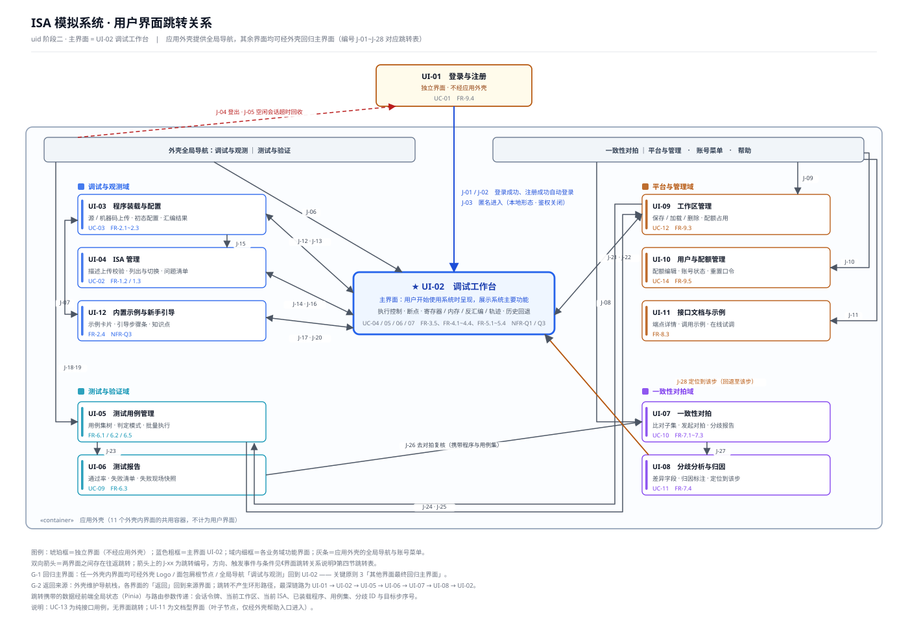

# ISA 模拟系统 用户界面跳转关系说明

> `uid` 技能 · 步骤二：建立用户界面间的跳转关系
> 输入：《初步界面设计说明》（12 个用户界面 + 各界面元素与操作清单）、`需求分析/图/交互模型说明.md`、`软件需求规格说明书.md`
> 产出：主界面确定 + 界面跳转关系图（`图/界面跳转关系图.svg`）+ 跳转关系表（28 条跳转 + 2 条通用规则）

---

## 一、本步的输入与推导方法

### 1.1 输入

| 输入 | 用途 |
| --- | --- |
| 《初步界面设计说明》2.1 节 | 12 个用户界面清单（含编号、业务域、主要使用者、对应边界类、承载用例） |
| 《初步界面设计说明》三节各界面"操作清单" | 每条操作已在第一步登记了"处理结果 / 去向"，跳转关系由此导出 |
| 《初步界面设计说明》2.3 节 | 界面规模与共用外壳的划分（1 个独立界面 + 11 个外壳内界面） |
| `需求分析/图/交互模型说明.md` | 14 个用例的逐条消息序列，用于核对跳转与用例交互动作序列是否一致 |
| `软件需求规格说明书.md` | FR-8.2（本地可关闭鉴权）、FR-9.2（双形态对等）、FR-9.4（登出与会话管理）、NFR-Q5（会话回收）等与跳转直接相关的条目 |

### 1.2 推导规则

| 规则 | 内容 |
| --- | --- |
| **R1 跳转只从"操作"导出** | 第一步给出的操作分三类：**用户命令触发**（可能产生跳转）、**动态元素变化触发**（控制类返回后刷新同界面，不产生跳转）、**界面跳转触发**（本身就是跳转）。本步只处理第一类与第三类。 |
| **R2 同界面内的区域切换不是跳转** | UI-02 的四类视图（寄存器 / 内存 / 反汇编 / 轨迹）由选项卡切换、内存跳转与搜索、断点列表开关等，均属界面内状态变化，**不计为跳转**（第一步已在其操作清单中标注"界面内"）。 |
| **R3 外壳导航是公共跳转通道** | 应用外壳（全局导航 / 当前工作区 / 账号菜单 / 消息提示）虽不计为界面，但它向外壳内的 11 个界面提供直达入口与登出、会话回收等会话级操作，故**其发起的跳转单独成组**（B 组、A 组各一部分）。 |

### 1.3 与第一步的衔接

第一步的每个界面操作清单都带"处理结果 / 去向"一列，本步把其中"去向 = 另一界面"的条目抽出，补上**触发元素、触发事件、触发条件、携带数据、来源依据**五项，形成第四节跳转表。凡第一步标为"界面内"或"不换页"的操作，本步一律不登记。

---

## 二、主界面的确定

### 2.1 结论

**主界面 = UI-02 调试工作台。**

技能要求"主界面（用户开始使用系统时呈现的界面，展示系统主要功能）"，且关键原则 3 要求"主界面应展示系统主要功能，其他界面最终回归主界面"。本系统的主要功能是**指令级调试与架构状态观测**，UI-02 正是这一功能的完整承载者。

### 2.2 判据

| # | 判据 | 证据 |
| --- | --- | --- |
| **M-1** | **需求侧直接证据** | `UC-01` 的第 10 条消息原文即"**进入主界面**"，说明登录完成后系统的落点就是主界面；这是需求模型给出的最强依据 |
| **M-2** | **承载用例最多且均为核心用例** | UI-02 承载 UC-04 / UC-05 / UC-06 / UC-07 共 4 个用例（占 14 个用例的 28.6%），且全部落在 P0 / P1 优先级；其余任一界面最多承载 1 个用例 |
| **M-3** | **承载需求最多** | 承载 FR-3.5、FR-4.1~FR-4.4、FR-5.1~FR-5.4 共 9 条功能需求与 NFR-Q1、NFR-Q3 两条质量需求，为单界面之最 |
| **M-4** | **四类界面的产物最终都汇聚到它** | 装载结果（J-13）、ISA 切换（J-16）、示例一键装载（J-20）、工作区加载（J-22）、对拍归因定位到该步（J-28）——五条业务链的产出都在 UI-02 呈现 |
| **M-5** | **使用频度与停留时长最长** | 调试会话是使用主线（连续单步、观察变化、回退），其余界面属"完成一件事即返回"的辅助界面 |
| **M-6** | **界面构成最完整** | A 执行控制条 · B 反汇编 · C 寄存器 · D 内存 · E 轨迹与时间轴 · F 断点面板 · G 状态栏 · H 其它界面入口——八区构成一个自洽的工作台 |

### 2.3 为什么不是其它界面

| 候选 | 否决策略 |
| --- | --- |
| UI-01 登录与注册 | 鉴权门槛界面，功能单一（只处理凭据）；本地形态下还可被 J-03 直接绕过，不具备"展示系统主要功能"的资格 |
| UI-03 程序装载与配置 | 装载是调试的**一次性前置动作**，装载完成后即无停留价值 |
| UI-05 / UI-06 / UI-07 / UI-08 | 任务型界面（跑测试、看报告、发起对拍、做归因），任务完成后应回主界面继续调试，不适合作为常驻落点 |
| UI-09 / UI-10 / UI-11 | 平台与管理类；UI-10 仅平台管理员可进入，UI-11 为文档型叶子界面 |

### 2.4 主界面与其它界面的关系

据此，系统的界面关系是**"一主多辅"**：UI-02 为常驻落点与汇聚点，其余 10 个外壳内界面为围绕它的功能界面，各自完成后回归 UI-02（规则 G-1）。UI-01 是唯一的门外界面，只在会话建立与销毁时出现。

---

## 三、跳转关系的总体结构

### 3.1 三层结构

| 层 | 界面 | 进入方式 | 职责 |
| --- | --- | --- | --- |
| **L0 会话入口层** | UI-01 登录与注册 | 直接访问（不经外壳） | 建立会话（登录 / 注册 / 本地匿名）；会话终止后回到此层 |
| **L1 主界面层** | UI-02 调试工作台 | 会话建立后自动进入 | 主界面；承载调试主线与四类业务链的汇聚呈现 |
| **L2 功能界面层** | UI-03、UI-04、UI-05、UI-06、UI-07、UI-08、UI-09、UI-10、UI-11、UI-12 | 由主界面或外壳导航进入 | 每个界面完成一件相对独立的事，完成后回归主界面 |

三层之外，**应用外壳**横向服务于 L1 / L2 的 11 个界面，提供全局导航、当前工作区选择、账号菜单与消息提示；它发起的跳转记入 A 组（登出、会话回收）与 B 组（业务域入口）。

**跳转深度约束**：从主界面到任一功能界面最多 **1 跳**；跨功能界面的链路最长 **3 跳**（UI-06 → UI-07 → UI-08 → UI-02）。这一约束来自"易操作性"原则（减少不必要的操作和跳转）。

### 3.2 跳转关系图

图中：琥珀框 UI-01 为独立界面（位于应用外壳之外）；蓝色粗框 UI-02 为主界面；四个业务域各成一组；灰色横条为应用外壳的全局导航与账号菜单；箭头上的 `J-xx` 为跳转编号，与第四节跳转表一一对应；`G-1` / `G-2` 为第五节的两条通用跳转规则。

### 3.3 跳转统计

| 统计项 | 值 |
| --- | --- |
| 跳转总数 | **28 条**（J-01 ~ J-28） |
| 通用规则 | **2 条**（G-1 回归主界面、G-2 返回来源） |
| 按来源分组 | 会话级 5 条（J-01 ~ J-05）· 外壳导航 6 条（J-06 ~ J-11）· 界面间 17 条（J-12 ~ J-28） |
| 按业务域关系分组 | 域内 11 条（J-12 ~ J-20、J-23、J-27）· 跨域 6 条（J-21、J-22、J-24、J-25、J-26、J-28）· 会话级 5 条 · 外壳导航 6 条 |
| 指向 UI-02 的跳转 | 9 条具体跳转（J-01、J-02、J-03、J-06、J-13、J-16、J-20、J-22、J-28）+ 通用规则 G-1 |
| 由 UI-02 发出的跳转 | 4 条（J-12、J-14、J-17、J-21） |
| 带非平凡前置条件的跳转 | 11 条（J-03、J-05、J-10、J-13、J-16、J-19、J-20、J-22、J-23、J-25、J-27）——条件不满足时目标入口不出现，或停留在原界面 |
| 携带业务数据的跳转 | 26 条（仅 J-04 登出、J-05 会话回收两条不携带业务数据） |
| 跨界面共享的状态数据项 | 11 项（见第六节） |
| 最长链路 | UI-01 → UI-02 → UI-05 → UI-06 → UI-07 → UI-08 → UI-02（6 跳） |
| 无跳转的用例 | UC-04 / UC-05 / UC-06 / UC-07（全过程在 UI-02 内）、UC-13（纯接口） |

---

## 四、跳转清单

> 列说明：**触发元素**指用户操作的界面元素（或外壳组件）；**触发事件**指该元素被激活时发生的事；**条件**为跳转生效的前置判断；**方向**＝ `前进`（沿任务流向下）/ `返回`（回到来源或主界面）/ `替换`（终止当前会话路径，不留返回历史）。

### 4.1 A 组 · 会话与会话入口（J-01 ~ J-05）

| 编号 | 源界面 | 目标界面 | 触发元素 | 触发事件 | 条件 | 方向 | 携带数据 | 来源依据 |
| --- | --- | --- | --- | --- | --- | --- | --- | --- |
| J-01 | UI-01 | UI-02 | 「登录」按钮 | 凭据校验通过后建立会话 | 用户名与口令匹配且账号未被停用 | 替换 | 会话令牌、默认工作区、当前 ISA | `UC-01·10`「进入主界面」 |
| J-02 | UI-01 | UI-02 | 「提交注册」按钮 | 注册成功后自动登录 | 用户名未被占用、两次口令一致 | 替换 | 会话令牌、新建的默认工作区、当前 ISA | `UC-01·2` 注册分支 |
| J-03 | UI-01 | UI-02 | 「以匿名会话进入」超链接 | 跳过鉴权直接建立本地会话 | **仅本地形态且 FR-8.2 鉴权关闭时显示** | 替换 | 本地匿名会话、默认工作区 | FR-8.2；第一步补充项未涉及（属 UI-01 原有元素） |
| J-04 | 应用外壳 | UI-01 | 账号菜单「登出」 | 销毁会话并回到鉴权界面 | 无（二次确认后执行） | 替换 | —（清空客户端会话状态） | FR-9.4；第一步补充项 **S-7** |
| J-05 | 应用外壳 | UI-01 | 消息提示区的超时提示 | 空闲超时后回收会话 | 空闲时长达到会话超时阈值 | 替换 | —（提示中允许"续期"，续期则不跳转） | NFR-Q5；第一步补充项 **S-8** |

### 4.2 B 组 · 应用外壳全局导航（J-06 ~ J-11）

| 编号 | 源 | 目标界面 | 触发元素 | 触发事件 | 条件 | 方向 | 携带数据 | 来源依据 |
| --- | --- | --- | --- | --- | --- | --- | --- | --- |
| J-06 | 外壳全局导航 | UI-02 | 「调试与观测」导航项 / 外壳 Logo | 切换到调试与观测域 | 已建立会话 | 前进 | 当前工作区、当前 ISA | 第一步 2.3（外壳不计为界面，其导航为公共通道） |
| J-07 | 外壳全局导航 | UI-05 | 「测试与验证」导航项 | 切换到测试与验证域 | 已建立会话 | 前进 | 当前工作区 | 同上 |
| J-08 | 外壳全局导航 | UI-07 | 「一致性对拍」导航项 | 切换到一致性对拍域 | 已建立会话 | 前进 | 当前工作区、当前 ISA | 同上 |
| J-09 | 外壳全局导航 | UI-09 | 「平台与管理」导航项 | 切换到平台与管理域 | 已建立会话 | 前进 | 当前工作区 | 同上 |
| J-10 | 外壳账号菜单 | UI-10 | 账号菜单「用户与配额管理」 | 打开管理界面 | **角色 = 平台管理员** | 前进 | — | `UC-14·1` 进入点；FR-9.5 |
| J-11 | 外壳帮助入口 | UI-11 | 「帮助 · 接口文档」 | 打开接口文档界面 | 已建立会话 | 前进 | 当前 ISA（用于过滤端点示例） | FR-8.3；第一步补充项 **S-5** |

### 4.3 C 组 · 调试与观测域（J-12 ~ J-20）

| 编号 | 源界面 | 目标界面 | 触发元素 | 触发事件 | 条件 | 方向 | 携带数据 | 来源依据 |
| --- | --- | --- | --- | --- | --- | --- | --- | --- |
| J-12 | UI-02 | UI-03 | 「装载程序」按钮（H 区） | 进入装载与配置界面 | 已有当前会话 | 前进 | 当前 ISA、当前工作区 | 第一步 3.2 操作清单"跳转装载" |
| J-13 | UI-03 | UI-02 | 装载完成提示条 | 装载成功后就绪并刷新四类视图 | **装载成功**（失败则停留本界面显示错误行） | 返回 | 装载结果、机器码映像、初始 PC / SP、内存初值 | `UC-03·10`「就绪并刷新视图」 |
| J-14 | UI-02 | UI-04 | 「切换 ISA」超链接（H 区） | 进入 ISA 管理界面 | 已有当前会话 | 前进 | 当前 ISA | 第一步 3.2 操作清单"跳转 ISA" |
| J-15 | UI-03 | UI-04 | 「切换 ISA」超链接 | 进入 ISA 管理界面 | 已有当前会话 | 前进 | 当前 ISA | 第一步 3.3 静态元素表 |
| J-16 | UI-04 | UI-02 | 「设为当前 ISA」按钮 | 生效为当前 ISA 后回主界面 | 目标 ISA 已通过校验且已装载 | 返回 | 新的当前 ISA（UI-02 状态栏同步） | `UC-02·6`；第一步 3.4 操作清单"生效为当前 ISA，UI-02 状态栏同步" |
| J-17 | UI-02 | UI-12 | 「内置示例」入口（H 区） | 进入示例与引导界面 | 已有当前会话 | 前进 | 当前 ISA | FR-2.4；第一步补充项 **S-6** |
| J-18 | UI-03 | UI-12 | 「使用内置示例」入口 | 进入示例与引导界面 | 已有当前会话 | 前进 | 当前 ISA | FR-2.4；第一步补充项 **S-6** |
| J-19 | UI-12 | UI-03 | 「查看源码」超链接 | 打开装载界面并回填源码 | 已选中某个示例 | 返回 | 示例源码、目标 ISA | FR-2.4；第一步补充项 **S-6** |
| J-20 | UI-12 | UI-02 | 「一键装载」按钮 / 「跳过引导」按钮 / 引导完成 | 装载示例后进入调试，或结束引导 | 一键装载需装载成功；引导完成需三步全部达成（NFR-Q3） | 前进 | 已装载的程序与初态 | `UC-03·2`（复用装载链路）；NFR-Q3 |

### 4.4 D 组 · 主界面 ↔ 平台与管理域（J-21 ~ J-22）

| 编号 | 源界面 | 目标界面 | 触发元素 | 触发事件 | 条件 | 方向 | 携带数据 | 来源依据 |
| --- | --- | --- | --- | --- | --- | --- | --- | --- |
| J-21 | UI-02 | UI-09 | 「保存工作区」超链接 | 进入工作区界面（含保存配置区） | 已有当前会话 | 前进 | 待保存的程序、用例集、配置 | UC-12；第一步 3.2 操作清单"跳转工作区" |
| J-22 | UI-09 | UI-02 | 「加载」按钮（行内） | 恢复工作区后回主界面并刷新视图 | **加载成功** | 返回 | 程序映像、运行配置、当前 ISA | `UC-12·13`「已恢复」、`UC-12·14`「视图刷新」 |

### 4.5 E 组 · 测试与验证域（J-23 ~ J-25）

| 编号 | 源界面 | 目标界面 | 触发元素 | 触发事件 | 条件 | 方向 | 携带数据 | 来源依据 |
| --- | --- | --- | --- | --- | --- | --- | --- | --- |
| J-23 | UI-05 | UI-06 | 执行结果摘要中的「查看报告」入口 | 打开本次执行的测试报告 | **批量执行完成**（执行中该入口不出现） | 前进 | 报告标识、用例集标识、判定模式 | FR-6.3；第一步 3.5 动态元素表"跳转报告入口" |
| J-24 | UI-05 | UI-09 | 「另存到工作区」按钮 | 进入工作区界面保存程序与用例集 | 用例集结构完整（无缺程序 / 缺期望态） | 前进 | 用例集、程序、判定模式 | UC-12 保存链路；第一步 3.5 操作清单"另存" |
| J-25 | UI-09 | UI-05 | 「加载」按钮（行内） | 恢复用例集后回用例管理界面 | 工作区中含用例集 | 返回 | 用例集、程序、判定模式 | `UC-12·13` / `UC-12·14`（复用加载链路） |

### 4.6 F 组 · 一致性对拍链路（J-26 ~ J-28）

| 编号 | 源界面 | 目标界面 | 触发元素 | 触发事件 | 条件 | 方向 | 携带数据 | 来源依据 |
| --- | --- | --- | --- | --- | --- | --- | --- | --- |
| J-26 | UI-06 | UI-07 | 「去对拍复核」超链接 | 把测试分歧转入对拍归因 | 已打开某份报告 | 前进 | 程序、用例集、失败用例的判定模式 | FR-6.5 / FR-7.3（两条业务线共用比对能力）；第一步 3.6 静态元素表 |
| J-27 | UI-07 | UI-08 | 分歧报告中的分歧记录 | 查看分歧现场并做归因 | 对拍已产出分歧（一致结论时不出现该入口） | 前进 | 分歧 ID | `UC-11·1`「查看分歧现场」 |
| J-28 | UI-08 | UI-02 | 「定位到该步」按钮 | 跳主界面并把架构状态回退到该步 | 该分歧已定位到具体步序号 | 返回 | 分歧 ID、目标步序号（触发 `UC-07` 回退链路） | `UC-11`；第一步 3.8 操作清单"跳 UI-02，回退至该步" |

---

## 五、通用跳转规则

上表 28 条为**具体跳转**；另有 2 条**通用规则**作用于全体外壳内界面，故不逐条列举。

| 编号 | 规则 | 适用范围 | 触发元素 | 触发条件 | 说明 |
| --- | --- | --- | --- | --- | --- |
| **G-1** | **回归主界面** | 11 个外壳内界面（UI-02 ~ UI-12） | 外壳 Logo / 面包屑根节点 / 全局导航「调试与观测」 | 已建立会话 | 落实技能关键原则 3"**其他界面最终回归主界面**"。任意外壳内界面（含 UI-10、UI-11 等无返回入口的界面）都能经此回到 UI-02，这是"界面图连通性"的保证 |
| **G-2** | **返回来源** | 所有界面 | 各级界面的「返回」按钮 / 浏览器后退 | 外壳导航栈非空 | 外壳维护导航栈，返回即回到来源界面。J-13、J-16、J-19、J-22、J-25、J-28 这 6 条"返回"跳转是**携带数据的具体化**，与 G-2 叠加使用：数据回填后按 G-2 落回来源界面 |

> **规则 G-1 与 G-2 的分工**：G-2 保证"从哪来、回哪去"（用户预期），G-1 保证"随时可回主界面"（系统一致性）。二者叠加后，界面跳转图是**强连通**的：任意外壳内界面 ⇄ UI-02。

---

## 六、跳转携带的数据

跳转不只是换页，还要把上一环节的产物带到下一环节。本设计的传递方式有二：**前端全局状态（Pinia store）**承载跨界面长期有效的数据；**路由参数**承载本次跳转专属的选中项。

| 数据项 | 产生界面 | 消费界面 | 传递方式 | 说明 |
| --- | --- | --- | --- | --- |
| 会话令牌 | UI-01 | 全部外壳内界面 | 全局状态 + 请求头 | J-01 / J-02 / J-03 建立；J-04 / J-05 清空 |
| 当前工作区 | UI-09 / UI-01 | 全部外壳内界面 | 全局状态 | 外壳显示；J-09、J-21 ~ J-25 依赖它 |
| 当前 ISA | UI-04 / UI-01 | UI-02、UI-03、UI-07、UI-11 | 全局状态 | J-16 更新后 UI-02 状态栏同步 |
| 机器码映像与初态 | UI-03 | UI-02 | 全局状态 | J-13 携带；对应内核"装载并初始化"的产物 |
| 示例源码 | UI-12 | UI-03 | 路由参数 | J-19 回填到装载界面的代码编辑器 |
| 已装载的程序与初态 | UI-12 | UI-02 | 全局状态 | J-20 的"一键装载"直接复用装载链路 |
| 程序与运行配置 | UI-09 | UI-02 | 全局状态 | J-22 加载工作区后刷新视图 |
| 用例集与判定模式 | UI-05 / UI-09 | UI-06、UI-07 | 全局状态 | J-23、J-24、J-25、J-26 |
| 报告标识 | UI-05 | UI-06 | 路由参数 | J-23 打开指定报告 |
| 分歧 ID | UI-07 | UI-08 | 路由参数 | J-27 选中分歧记录 |
| 目标步序号 | UI-08 | UI-02 | 路由参数 + 触发回退命令 | J-28 把"定位到该步"翻译成 `UC-07` 的回退请求 |

> 数据传递的接口归属：上述全局状态与路由参数的落地载体是 SS-7 的 `AppShell`（路由 + 全局状态 + API 客户端三合一外壳构件），与 `sad` 阶段"SS-7 前端 8 个构件"的划分一致。**跳转携带的数据不新增设计元素。**

---

## 七、跳转与用例交互序列的一致性核对

### 7.1 逐用例的执行路径

| 用例 | 界面路径 | 跳转编号 | 核对结论 |
| --- | --- | --- | --- |
| UC-01 注册与登录 | UI-01 → UI-02 | J-01 / J-02 / J-03 | 一致：`UC-01·10`「进入主界面」即 J-01 |
| UC-02 装载与管理 ISA | 外壳 → UI-02 → UI-04 → UI-02 | J-06 / J-14 / J-16 | 一致：`UC-02·6` 切换后返回主界面 |
| UC-03 装载并配置程序 | UI-02 → UI-03 → UI-02 | J-12 / J-13 | 一致：`UC-03·10`「就绪并刷新视图」即 J-13 |
| UC-04 单步与连续执行 | 全程在 UI-02 | — | 无跳转（符合 R2） |
| UC-05 设置与管理断点 | 全程在 UI-02 | — | 无跳转 |
| UC-06 查看架构状态与执行轨迹 | 全程在 UI-02 | — | 视图切换属界面内操作（符合 R2） |
| UC-07 回退执行历史 | 全程在 UI-02（可由 J-28 从 UI-08 进入） | J-28 → UI-02 | 一致：`UC-11` 的"定位到该步"落到 UI-02 的回退链路 |
| UC-08 管理并批量执行测试用例 | 外壳 → UI-05 → UI-06 | J-07 / J-23 | 一致：批量执行完成后打开报告 |
| UC-09 查看测试报告 | UI-05 → UI-06 → UI-07 | J-23 / J-26 | 一致：报告中的失败用例可转对拍归因 |
| UC-10 发起 ISA 一致性对拍 | 外壳 → UI-07 → UI-08 | J-08 / J-27 | 一致：对拍产出分歧后进入归因 |
| UC-11 分析与标注分歧归因 | UI-08 → UI-02 | J-28 | 一致 |
| UC-12 保存与加载工作区 | UI-02 ↔ UI-09；UI-05 ↔ UI-09 | J-21 / J-22 / J-24 / J-25 | 一致：`UC-12·13` / `UC-12·14` 即 J-22、J-25 的数据回填 |
| UC-13 通过集成 API 驱动模拟 | 无界面 | — | 纯接口用例，由 UI-11 提供文档支撑（一致） |
| UC-14 管理用户与资源配额 | 外壳 → UI-10 | J-10 | 一致：`UC-14·1`「查看用户列表与资源占用」为界面进入点 |

### 7.2 补充项在跳转中的体现

第一步第四节登记的 8 个需求侧补充项，其界面落点对跳转的影响如下：

| 补充项 | 对跳转的影响 |
| --- | --- |
| S-1 内存写入 | 无跳转（UI-02 内存视图内操作，符合 R2） |
| S-2 运行到地址 / 运行至边界 | 无跳转（UI-02 执行控制条内操作） |
| S-3 降级模式 | 无跳转（UI-07 内开关状态切换） |
| S-4 测试用例导入编辑 | **新增界面 UI-05**，因此新增 J-07（外壳 → UI-05）、J-23、J-24、J-25 |
| S-5 接口文档与调用示例 | **新增界面 UI-11**，因此新增 J-11 |
| S-6 内置示例与新手引导 | **新增界面 UI-12**，因此新增 J-17 ~ J-20 四条 |
| S-7 登出 | **新增 J-04**（外壳 → UI-01） |
| S-8 会话超时回收提示 | **新增 J-05**（外壳 → UI-01），且该跳转带"续期"反向分支（续期则不跳转） |

### 7.3 跳转图的两项结构性结论

1. **无孤立界面**：12 个界面均至少有一条入边与一条出边（UI-11 经 G-1 回归主界面，故有出边）。UI-11 是唯一"进入后无业务跳转"的文档型叶子界面，其回归依赖 G-1——这是 G-1 存在的直接理由。
2. **无环形路径**：除 G-1 / G-2 这类"回退型"跳转外，前进型跳转（J-06 ~ J-12、J-14、J-17、J-18、J-21、J-23、J-24、J-26、J-27）构成有向无环图，最深链为 UI-01 → UI-02 → UI-05 → UI-06 → UI-07 → UI-08 → UI-02。用户不会陷入"只能往前、回不去"的死路。

---

## 八、检查点：待确认事项

1. **主界面 = UI-02 调试工作台** —— 是否确认？六条判据（M-1 ~ M-6）尤其 **M-1**（`UC-01·10` 原文即"进入主界面"）是我认为最硬的一条依据。
2. **三层结构（L0 会话入口 / L1 主界面 / L2 功能界面）** —— 认可吗？其中 L2 的 10 个界面均为"从主界面 1 跳可达"。
3. **跳转总数 28 条 + 2 条通用规则** —— 是否有遗漏或多余的跳转？三条我特意做过取舍的地方：
   - **J-23（UI-05 → UI-06）设条件**：只有批量执行完成后才出现"查看报告"入口，执行中不出现；
   - **J-27（UI-07 → UI-08）设条件**：只有产出分歧时才出现归因入口，双方一致时不出现；
   - **G-1 回归主界面** 作为一条规则而不是 11 条跳转登记，避免表中出现 11 条同义行。
4. **UI-11 是叶子界面**（只有 G-1 一条出边）—— 可接受吗？若希望 UI-11 也能跳去试调相关界面，需新增跳转，但那会把文档界面变成操作入口，我倾向保持它为叶子。
5. **J-03（匿名进入）保留与否** —— 第一步已问过一次，此处再次提请：它直接对应 FR-8.2，但会让 UC-01 在本地形态下被旁路；若确认保留，J-03 即成立。
6. **UI-07 与 UI-08 是否合并**（第一步问题 3）、**UI-05 与 UI-06 是否合并**（第一步问题 4）—— 这两项**会直接改动跳转表**：若合并为一界面，则 J-27、J-23 由"跳转"降为"界面内切换"、撤销对应箭头。请在此一并给出结论，我据此在第三步（精化设计）执行合并或维持。

> 确认后进入 `uid` **第三步：精化用户界面设计**（查漏补缺、优化合并、调整布局、美化、统一风格、同步 UML 模型，并给出可运行原型说明）。
