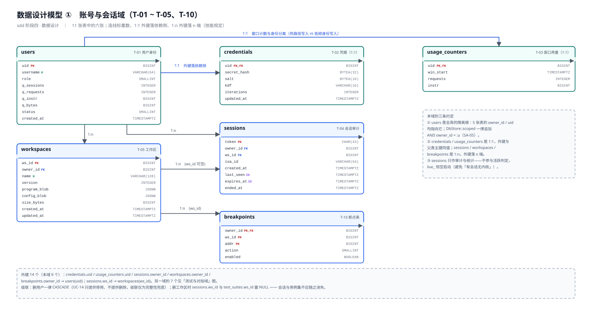
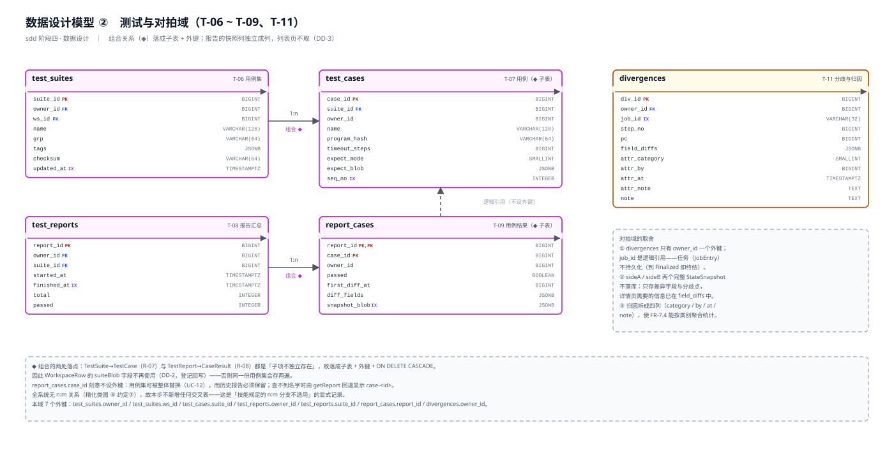

# ISA 模拟系统 · 软件详细设计（sdd）阶段四：数据设计说明

> 本文件是 `sdd` 技能「数据设计」阶段的过程稿，承接《软件体系结构设计文档》（SAD，`软件设计-v2/`）、《用户界面设计文档》（UID，`软件设计-v2/`）、《用例设计说明》（`sdd` 阶段一，`详细设计/`）与《类设计说明》（`sdd` 阶段三，`详细设计/`）。
>
> **关于「子系统和构件设计」（阶段二）**：该阶段已由用户裁定**整体跳过**——35 个构件的职责与对外接口在 SAD 5.5.2 / §5.8 已完整给出，内部类结构正是「类设计」的任务。故本文与《类设计说明》一样，不设对应章节。
>
> **本步只做数据设计**：确定需要持久保存的数据、确定存储与组织方式、设计数据操作、给出数据设计模型图。**不写代码、不定义 REST/WS 载荷字段**（后者属 FR-8.3 的接口文档，与阶段五一并交付）。
>
> **对上游文档的回写一律只登记、不执行**：本步发现的 8 条与类设计/UID 不相容之处（DD-1 ~ DD-8）集中登记在第 8.3 节，待阶段五文档化时统一处理。

---

## 1 本步的输入与工作分解

### 1.1 输入

| 来源 | 文件 | 本步用到的部分 |
| --- | --- | --- |
| 需求模型 | `需求分析/软件需求规格说明书.md` | FR-6.x（报告）、FR-7.x（分歧与归因）、FR-8.x（鉴权限额）、FR-9.x（会话与存储）；NFR-Q5（隔离与配额） |
| 体系结构设计 | `软件设计-v2/软件体系结构设计文档.md` | 5.7 基础服务（持久化服务 `IStore`）、5.6.4 配额与隔离不进内核（SA-05）、5.6.10 `DbDriver` 适配（SA-10）、6.1 制品清单（PostgreSQL 16+ / SQLite3）、6.6 双形态配置差异 |
| 用例设计 | `软件设计-v2/详细设计/用例设计说明.md` | UC-01 / UC-08 / UC-09 / UC-12 / UC-14 的持久化相关消息 |
| 类设计 | `软件设计-v2/详细设计/类设计说明.md` | §4.6 领域数据对象与 `SessionContext`、§5.3.8 `IStore` 的 18 个方法、§5.4 M-10 `login` / M-13 `runSuite` / M-14 `start`、§6.2 值类型（`User` / `Usage` / `SessionRow` / `WorkspaceRow` / `ReportRow` / `BreakpointRow` / `DivergenceRow`）、精化类图 ④ 的三条持久化约定 |
| 用户界面设计 | `软件设计-v2/用户界面设计文档.md` | UI-01/10（登录与用户管理）、UI-06（报告列表与失败现场）、UI-09（工作区列表）、UI-12（一键装载） |

### 1.2 技能动作对照

`sdd` 技能对「数据设计」规定了 4 个动作，逐一落到本文章节：

| # | 技能动作原文 | 本文落点 |
| --- | --- | --- |
| ① | 确定需要持久保存的数据：根据需求模型和**类设计模型**，确定哪些类对象及其属性取值需要持久保存 | 第 2 章（2.2 持久化清单 / 2.3 明确不持久化的数据 / 2.4 三条判据） |
| ② | 确定数据存储和组织方式：选择持久存储机制；**根据类间 1:1、1:n、n:m 关系设计关系数据库表及字段**；1:1 或 1:n 在 n 端表加外键；n:m 新增交叉表 | 第 3 章（机制选择与双形态 DDL 差异）、第 4 章（11 张表逐表字段 + 4.13 外键清单 + 4.14 谓词列 + 4.15 索引） |
| ③ | 设计数据操作：明确数据的读取、写入、修改、删除、验证等操作 | 第 5 章（5.2 逐条操作 / 5.3 事务边界 / 5.4 验证操作 / 5.5 并发与版本 / 5.6 初始化） |
| ④ | 必要时用 UML 类图或活动图描述数据设计模型 | 第 6 章（图 31 ~ 图 35：2 张数据模型类图 + 1 张映射图 + 2 张活动图） |

### 1.3 本步的四条总则

沿用《类设计说明》六条总则中的相关部分，并针对数据设计补足：

| 编号 | 总则 | 说明 |
| --- | --- | --- |
| **G-1** | 表的隔离谓词列一律叫 `owner_id` | SA-05 要求「每条数据访问语句带用户谓词」。列名统一后，`DbStore::scoped(sql, u)` 可以无条件地追加 `AND owner_id = :u`，不需要为每张表记住不同的列名 |
| **G-2** | 业务标识（`ws_id` / `suite_id` / `case_id` / `report_id` / `div_id` / `job_id` / `token`）由应用侧生成，**不用数据库自增做主键的业务含义** | 标识由 `IIdGen` 统一生成（SAD 5.7），数据库自增只在本地单机形态下作为兜底。这样云/本地两形态的标识语义一致，且 `IStore` 的接口不需要暴露「插入后取回自增」的额外步骤 |
| **G-3** | 只在**整块读写**的子结构上用 JSON 列，**凡需要按字段查询或按结构约束的都用关系列** | 判断标准是「它会不会出现在 `WHERE` / `ORDER BY` / 唯一约束里」。会 → 列；不会 → JSON。这条口径决定了 §3.3 的取舍 |
| **G-4** | 时间一律存 UTC，且**不存「至今」这类相对值** | 相对值（如 `expires_at`）允许存，因为它也是一个绝对时刻，且能让过期判定留在 SQL 里（`expires_at > now()`），不必把 TTL 传进查询 |

---

## 2 需要持久保存的数据

### 2.1 判定口径

技能要求「根据需求模型和**类设计模型**」确定持久化范围。本步采用**双向核对**：

1. **自下而上**：类设计阶段已经把「持久化能力」收敛成 5 个基础接口之一——`IStore`（SAD 5.7）。因此**凡出现在 `IStore` 方法签名里的类或值类型，都是持久化候选**；不在其中的，默认不持久化。
2. **自上而下**：需求中凡是出现「持久化 / 保存 / 加载 / 记录 / 报告 / 账号 / 配额」的条目，必须有对应的表或列落点。逐条核对见 8.2。

两条路径的交集即持久化范围；只有一侧命中的，逐一解释（见 2.3 与 8.3）。

### 2.2 持久化清单

`IStore` 的 **18 个方法**（类设计 15 个 + 本步新增 3 个：`findCredential` / `queryWorkspaces` / `queryReports`）共涉及 **9 组持久数据**，落成 **11 张表**：

| 组 | 持久实体 | 类设计来源 | `IStore` 方法 | 表 |
| --- | --- | --- | --- | --- |
| 1 | 用户身份 | `User(uid, name, role, quota, status)` | `findUser` / `findUserByName` / `saveUser` / `queryUsers` | `users`（T-01） |
| 2 | 用户凭据 | **新增** `CredentialRow`（DD-1） | **新增** `findCredential`（DD-1） | `credentials`（T-02） |
| 3 | 资源用量 | `Usage(sessions, requests, instr, bytes)` | `queryUsage` | `usage_counters`（T-03）＋ 2 处派生（DD-4） |
| 4 | 运行会话 | `SessionRow(token, uid, wsId, isaId, createdAt, lastSeen)` | `saveSession` / `dropSession` | `sessions`（T-04） |
| 5 | 工作区 | `Workspace` / `WorkspaceRow` / `WorkspaceBrief` | `putWorkspace` / `getWorkspace` / **新增** `queryWorkspaces`（DD-5） | `workspaces`（T-05） |
| 6 | 用例集与用例 | `TestSuite` / `TestCase` | 随 `putWorkspace` / `getWorkspace`（同一事务） | `test_suites`（T-06）/ `test_cases`（T-07） |
| 7 | 测试报告与用例结果 | `TestReport` / `CaseResult` | `saveReport` / `getReport` / **新增** `queryReports`（DD-5） | `test_reports`（T-08）/ `report_cases`（T-09） |
| 8 | 断点表 | `BreakpointRow` / `Breakpoint` | `saveBreakpoints` / `loadBreakpoints` | `breakpoints`（T-10） |
| 9 | 分歧记录与归因 | `Divergence` / `DivergenceRow` | `saveDivergence` / `queryDivergence` | `divergences`（T-11） |

> 共 9 组、11 张表。第 6 组不出现在 `IStore` 方法签名里（它没有独立的方法），但它是 `Workspace` 的组合子结构，随第 5 组一起持久化——这是 2.4 判据 ② 的作用。

### 2.3 明确不持久化的数据

**明确不持久化与「忘了做」在评审时长得一样**，故逐项列出并给理由：

| 数据 | 类设计来源 | 为什么不持久化 |
| --- | --- | --- |
| `ArchState`（`pc_` / `gpr_` / `csr_` / `mem_`） | SS-1 | **会话运行时状态**。SA-03 明确「会话销毁时释放内核实例与内存映像」；把 `mem_` 落库会让「4 GiB 稀疏映像」变成「每会话一份可持久化的地址空间」，成本与语义都不成立 |
| `Trace.rec_`（`StepRecord` / `WriteOp`） | SS-1 | **容量与热路径双约束**。NFR-Q1 要求 10⁷ 条/秒的执行吞吐，每条都落库不可行；`cap_` 上限 1 048 576 条也说明它是**有界内存缓冲**（SA-13 的「轨迹可裁剪」）。回退能力因此**只在会话内有效**——这是 SA-13 的既定语义，不是缺陷 |
| `TerminationGuard`（`last_` / `halted_` / `fault_`） | SS-1 | 判定过程的中间状态；`FaultRecord` 作为异常现场**随报告/分歧记录**带走（见 `report_cases` / `divergences`），本体不落库 |
| `DecodeTable`（`rows_` / `wide_`） | SS-2 | **可由 `IsaSpec` 重建**（`DecodeTable::build`）。落库等于存一份可推导的直表，且直表长度 `1 << kMaxEncBits` 体积不小 |
| `IsaSpec` 本体 | SS-2 | ISA 描述由**源文件 / 内联文本**经 `IsaService.loadSpec` 装载（FR-1.2），`IsaLoader.tables_` 是应用级单例。会话只持久化 `SpecId`（`sessions.isa_id`），不存描述正文——这样「换一份描述」不需要数据迁移 |
| `JobEntry` / `CancelToken` | SS-6 | **任务是一次性的**：`JobState` 到 `Finalized` 即终结（状态图③）。任务的**产物**（报告、分歧）才落库 |
| `ToolchainSpec` / `RunSpec` / `RunOutcome` / `Disasm` | SS-4 | 过程数据，每次调用重新产生 |
| `HttpGateway.ws_`（连接注册表） | SS-6 | 进程内资源，随进程销毁；重连即可重建 |
| `AccessGuard.rate_`（滑动窗） | SS-6 | **窗口内计数**：窗宽以秒计，跨重启保持窗口没有意义。跨重启有意义的部分（窗口起点与累计值）落在 `usage_counters`（DD-4） |
| `Router.table_` / `schema_` | SS-6 | 代码即配置（`register` 一行），落库会引入「路由表版本与代码不一致」的新故障模式 |
| 前端一切状态（`#store` / `#form` / `#regs` …） | SS-7 | 前端状态是**服务端状态的投影**，唯一例外（登录令牌）走 `localStorage`，不属于服务端数据设计 |

**一条需要显式说明的边界——会话不跨重启恢复**：

`sessions` 表**持久化**（`saveSession` 是 `IStore` 方法），但它的用途限定为**审计与会话数统计**，**不作为进程重启后的会话恢复依据**。理由：状态图① 的约定 2 明确「`SessionContext` 不可能有会话但没有内核」（组合关系 R-05 保证），而内核是进程内对象、不持久化；若允许「按旧令牌恢复会话」，就会造出「令牌有效但内核为空」这一**非法态**。因此：

> `SessionService` 启动时 `live_` **恒为空**，所有旧令牌一律按 `Unauthorized` 处理。旧 `sessions` 行留在表里做审计，但**不参与活跃判定**。

这也解释了为什么 `LiveSession` 的判定必须带时间条件（DD-4）：重启后没有清理动作，旧行靠 `expires_at` 自然失效。

### 2.4 持久化边界的三条判据

把上面的逐项判断提炼成可复用的判据，供将来新增类时套用（沿用 G-3 的精神）：

| 判据 | 内容 | 反例（不满足即不持久化） |
| --- | --- | --- |
| **判据 ①** | 该数据是否在**两个会话之间**仍需要存在？（换个会话/换个用户还要看到） | `ArchState` —— 同一次执行内有效 |
| **判据 ②** | 该数据是否是**某个持久实体的组成部分**？（随它整体存取） | `TestCase` 是 `TestSuite` 的组成部分 → **要**持久化（判据②正向命中，即使没有独立方法） |
| **判据 ③** | 该数据是否**可由已持久化的数据重建**？（能重建则不存，避免两处维护） | `DecodeTable` 可由 `IsaSpec` 重建；`Usage.sessions` 可由 `sessions` 表算出 |

> 判据 ③ 是三条里最容易被忽略的。「可派生」与「冗余一列」的差别在评审时看不出来，但冗余列一旦不一致就无法判断谁是对的——所以本设计**不为派生值设列**（`Usage.sessions` / `Usage.bytes` 都不落冗余列，见 DD-4）。

---

## 3 存储方式与组织方式

### 3.1 持久存储机制的选择

技能要求「选择持久存储机制：数据库或数据文件」。SAD 6.1 已经定了两种形态的制品：云端是 **PostgreSQL 16 实例 + 初始化 DDL**，本地是 **`workspace.db`（SQLite 单文件）**，同一套源码只靠配置项区分（SA-10 的 `DbDriver` 抽象）。

那为什么不干脆用「文件」？

| 候选机制 | 否决 / 采纳的理由 |
| --- | --- |
| 纯文件（每用户一个 JSON 文件） | 否决。①**隔离要靠文件名约定**，而 SA-05 要的是「逐语句谓词」——文件方案里这条约束无处落地，安全从「机制」退回「纪律」；②报告与分歧需要**按时间/按用例集列表查询**（UI-06），文件方案要自己实现索引；③并发写入需要自己加锁 |
| 嵌入式键值库（如 LMDB） | 否决。多一层非关系模型，而本设计的数据天然是关系型的（用户 → 工作区 → 用例集 → 用例） |
| **关系数据库（PostgreSQL / SQLite）** | **采纳**。①隔离谓词可直接写进 SQL，与 `DbStore::scoped` 严丝合缝（SA-05）；②列表查询、唯一约束、外键完整性由数据库保证；③SQLite 单文件足以支撑本地单机形态，且与 PG 的差异被 `DbDriver` 收敛到方言层（SA-10） |

> **一个补充理由**：FR-8.3 要求交付「接口文档与调用示例」，而示例脚本（UC-13）会产生大量数据。关系库让「配额统计」「资源占用」（UC-14）这类聚合查询直接由 SQL 完成，不必把数据全量读进内存再统计。

### 3.2 双形态的 DDL 差异（SA-10 的落点）

同一份逻辑模式在两套数据库上的类型映射差异，全部由 `DbDriver`（`DriverKind` ∈ {`Postgres`, `Sqlite`}，E-13）承担。本步把差异固化成下表，作为 DDL 生成与语句拼装的依据：

| 逻辑类型 | PostgreSQL | SQLite | 差异处理 |
| --- | --- | --- | --- |
| 主键 / 外键标识 | `BIGINT` | `INTEGER` | SQLite 的 `INTEGER PRIMARY KEY` 即 rowid 别名；本设计**不依赖自增**（G-2），故差异仅剩类型名 |
| 字节串（映像、散列、盐） | `BYTEA` | `BLOB` | 同义 |
| 变长文本 | `TEXT` / `VARCHAR(n)` | `TEXT` | SQLite 不强制长度；`VARCHAR(n)` 仅作为**声明性约束**，写入侧由 `Router.bind` 的 Schema 先行校验 |
| 时间戳 | `TIMESTAMPTZ` | `TEXT`（ISO-8601 UTC，如 `2026-10-13T02:37:06Z`） | SQLite 无原生时间类型；选 ISO-8601 文本是因为它**字典序即时间序**，`ORDER BY` 与 `>` 比较都正确 |
| 布尔 | `BOOLEAN` | `INTEGER`（0/1） | 读写由 `DbDriver` 转换 |
| 结构化文档列 | `JSONB` | `TEXT`（JSON 文本） | PG 可对 JSONB 建 GIN 索引；本设计的文档列**都不作为查询条件**（G-3），故两者行为一致 |
| 枚举 | `SMALLINT` | `INTEGER` | 一律存小整数，**不用 `ENUM` 类型**——枚举增删在 PG 上是 DDL 变更，在应用侧只是常量表加一行，后者成本低得多 |
| UPSERT | `INSERT … ON CONFLICT … DO UPDATE` | 同语法（SQLite 3.24+） | **无差异**，这是选 SQLite 而非其它嵌入式库的一个实际好处 |

**9 个逻辑类型、7 处需要 `DbDriver` 转换**。其余（`SELECT` / `WHERE` / `ORDER BY` / 事务控制）两库语法一致。

> **声明性约束的落地差别**：PG 侧用 `CHECK` / `UNIQUE` / `FOREIGN KEY` 由数据库强制；SQLite 侧需 `PRAGMA foreign_keys = ON`（默认关闭）才生效外键。故启动序列里必须含这条 PRAGMA —— 记入 5.6 的初始化步骤。

### 3.3 「关系列」与「JSON 文档列」的取舍口径

类设计里有几个「值对象的集合」——`TestSuite.cases_`、`ExpectedSpec.sequence`、`CaseResult.diffFields`、`Divergence.diffs_`——它们既可拆成关系列，也可整体序列化成 JSON。本步按 G-3 的口径逐一裁决：

| 候选 | 裁决 | 理由 |
| --- | --- | --- |
| `TestCase` 的**身份与查询字段**（`name` / `program_hash` / `timeout_steps` / 执行序） | **关系列** | 会被 `ORDER BY seq_no` 使用；`checksum` 校验要按字段逐项比对 |
| `ExpectedSpec` | **JSON 列**（`expect_blob`） | 它是二选一的联合（`finalAssert` 或 `sequence`），拆列会出现「一半列恒为 NULL」的稀疏表；且它**只被整体读写**，从不作为查询条件。类型标签另设一列 `expect_mode`（E-07）供查询与判定分支使用 |
| `CaseResult.diffFields` | **JSON 列** | 只在失败现场的详情里整体展示，不查询 |
| `CaseResult.snapshot`（`StateSnapshot`） | **JSON 列**（`snapshot_blob`），且**独立成列** | 理由见 DD-3：列表页不取、详情页才取，独立成列使「按需读取」成为一条 `SELECT` 列选择，而不是「读完再扔掉」 |
| `Program`（`image` 字节 + 5 个字段） | **JSON 列**（`program_blob`）；`image` 用 base64 内嵌 | `Program` 是纯值对象，无子项、不查询。与类设计的 `WorkspaceRow.programBlob` 一致 |
| `SessionConfig` | **JSON 列**（`config_blob`） | 同上；与 `WorkspaceRow.configBlob` 一致 |
| `TestSuite` / `TestSuite.tags` | `tags` 用 **JSON 数组列**；用例集本身是**关系表** | 用例集需要「按更新时间列表」（UI-05）与「按用户隔离」，必须成表；`tags` 只作展示与筛选提示，不参与 SQL 条件 |
| `TestSuite.cases_` | **关系子表**（`test_cases`） | 见 DD-2 |
| `Divergence.attribution` | **关系列**（`attr_category` / `attr_by` / `attr_at` / `attr_note`） | 归因类别要支持「按归因统计」（FR-7.4 的使用场景），拆成列才能聚合 |

**结论**：**11 张表 + 6 类文档列**（`program_blob` / `config_blob` / `tags` / `expect_blob` / `diff_fields` / `snapshot_blob` / `field_diffs`）。

### 3.4 关系与键的落点规则

技能规定「1:1 或 1:n：在 n 端表中加入外键；n:m：新增交叉表」。按类设计第 3 章的关系清单（R-01 ~ R-21）取出**跨持久实体**的部分：

| 关系 | 类别 | 类设计来源 | 落点 | 依据 |
| --- | --- | --- | --- | --- |
| `User` 1:1 `CredentialRow` | 1:1 | 本步新增（DD-1） | `credentials.uid`（PG / FK） | 依赖侧即 n 端；与 `users` 主键同值 |
| `User` 1:1 `Usage`（窗口部分） | 1:1 | R-21 的延伸 | `usage_counters.uid`（PK / FK） | 同上 |
| `User` 1:n `SessionRow` | 1:n | R-21 的延伸 | `sessions.owner_id` → `users.uid` | n 端加外键 |
| `User` 1:n `Workspace` | 1:n | R-21 的延伸 | `workspaces.owner_id` → `users.uid` | n 端加外键 |
| `User` 1:n `TestSuite` | 1:n | R-21 的延伸 | `test_suites.owner_id` → `users.uid` | n 端加外键 |
| `User` 1:n `TestReport` | 1:n | R-21 的延伸 | `test_reports.owner_id` → `users.uid` | n 端加外键 |
| `User` 1:n `Divergence` | 1:n | R-21 的延伸 | `divergences.owner_id` → `users.uid` | n 端加外键 |
| `Workspace` 1:n `SessionRow` | 1:n | 属性 `SessionRow.wsId` | `sessions.ws_id` → `workspaces.ws_id` | 可空（首次登录尚无工作区） |
| `Workspace` 1:n `TestSuite` | 1:n | 精化类图 ④ 约定① | `test_suites.ws_id` → `workspaces.ws_id` | 见 DD-8（基数由 0..1 修正为 n） |
| `Workspace` 1:n `Breakpoint` | 1:n | 精化类图 ④ 注记 | `breakpoints.ws_id` | 见 DD-6 |
| `TestSuite` 1:n `TestCase` | 1:n（组合） | R-07 / 精化类图 ④ 约定② | `test_cases.suite_id` → `test_suites.suite_id` | 级联删除；见 DD-2 |
| `TestReport` 1:n `CaseResult` | 1:n（组合） | R-08 / 精化类图 ④ 约定② | `report_cases.report_id` → `test_reports.report_id` | 级联删除；见 DD-2 |
| `JobEntry` 1:n `Divergence` | 1:n（**逻辑**） | R-10 的延伸 | `divergences.job_id`（**无外键**） | 任务不持久化（2.3），故只存标识不建外键 |

**n:m 为零**：类设计已判定全系统不存在 n:m 关系（精化类图 ④ 约定③：用例集与程序是一对多）。**因此本步不新增任何交叉表**——这是「技能规定的 n:m 分支不适用」的显式记录，避免评审时被读成遗漏。

**共 14 处关系**（13 处数据库级外键 + 1 处逻辑引用）。级联策略：

| 场景 | 策略 | 理由 |
| --- | --- | --- |
| 删除用户 → 其凭据 / 用量 / 会话 / 工作区 / 用例集 / 报告 / 断点 / 分歧 | `ON DELETE CASCADE` | 用户在 `status = Disabled` 之外**不提供删除**（UC-14 只有「停用」），级联仅为完整性兜底 |
| 删除工作区 → 会话的 `ws_id` | `ON DELETE SET NULL` | 会话是审计记录，不应因工作区消失而消失 |
| 删除工作区 → 用例集 | `ON DELETE SET NULL` | 用例集可在多个工作区间复用（`test_suites.ws_id` 可空） |
| 删除用例集 → 用例 | `ON DELETE CASCADE` | 组合关系 R-07：「子项不独立存在」 |
| 删除报告 → 用例结果 | `ON DELETE CASCADE` | 组合关系 R-08 |
| 删除报告 / 用例 → `report_cases` | **不设 `case_id` 外键** | 用例被删后，历史报告仍需保留「当时跑了哪些用例、结果如何」，否则历史报告会残缺（见 4.10） |

---

## 4 数据库表设计

### 4.1 表清单与命名约定

**命名约定**：表名与列名一律小写下划线（`snake_case`）；表名用**复数**；`group` / `order` 等保留字加短前缀或改写（`grp` / `seq_no`）。逻辑名（`UserId` / `WorkspaceId`）与物理列名（`owner_id` / `ws_id`）的对应关系在每张表的「来源」列给出。

| 表 | 逻辑名 | 用途 | 列数 |
| --- | --- | --- | --- |
| T-01 | `users` | 用户身份、角色、配额、状态 | 9 |
| T-02 | `credentials` | 口令验证材料（1:1 `users`） | 6 |
| T-03 | `usage_counters` | 窗口用量计数（1:1 `users`） | 4 |
| T-04 | `sessions` | 会话审计记录 | 8 |
| T-05 | `workspaces` | 工作区（程序 + 配置 + 元数据） | 9 |
| T-06 | `test_suites` | 用例集（元数据） | 8 |
| T-07 | `test_cases` | 用例（含期望描述） | 9 |
| T-08 | `test_reports` | 测试报告汇总 | 7 |
| T-09 | `report_cases` | 报告内的用例结果 | 7 |
| T-10 | `breakpoints` | 断点表（按用户 + 工作区） | 5 |
| T-11 | `divergences` | 分歧记录与归因 | 11 |
| | | **合计** | **83** |

### 4.2 T-01 `users` — 用户身份

| 列 | 类型（PG / SQLite） | 约束 | 来源（类设计） | 说明 |
| --- | --- | --- | --- | --- |
| `uid` | `BIGINT` / `INTEGER` | **PK** | `User.uid` : `UserId` | 由 `IIdGen` 生成（G-2） |
| `username` | `VARCHAR(64)` / `TEXT` | NOT NULL, **UNIQUE** | `User.name` | 登录名；唯一性同时防 UC-14 建档重名 |
| `role` | `SMALLINT` / `INTEGER` | NOT NULL, DEFAULT 0 | `User.role` : `Role`（**新增 E-18**） | 0 = `User`，1 = `Admin`（DD-1） |
| `q_sessions` | `INTEGER` | NOT NULL, DEFAULT 64 | `User.quota.sessions` | 并发会话数上限 |
| `q_requests` | `INTEGER` | NOT NULL, DEFAULT 600 | `User.quota.requests` | 单位时间请求数上限 |
| `q_instr` | `BIGINT` | NOT NULL, DEFAULT 10000000 | `User.quota.instr` | 单次请求指令条数上限（NFR-Q5） |
| `q_bytes` | `BIGINT` | NOT NULL, DEFAULT 67108864 | `User.quota.bytes` | 工作区存储上限（64 MiB） |
| `status` | `SMALLINT` / `INTEGER` | NOT NULL, DEFAULT 0 | `User.status` : `UserStatus`（**新增 E-19**） | 0 = `Active`，1 = `Disabled`（DD-1） |
| `created_at` | `TIMESTAMPTZ` / `TEXT` | NOT NULL | — | 建档时刻 |

```sql
-- PostgreSQL
CREATE TABLE users (
  uid         BIGINT       PRIMARY KEY,
  username    VARCHAR(64)  NOT NULL UNIQUE,
  role        SMALLINT     NOT NULL DEFAULT 0,
  q_sessions  INTEGER      NOT NULL DEFAULT 64,
  q_requests  INTEGER      NOT NULL DEFAULT 600,
  q_instr     BIGINT       NOT NULL DEFAULT 10000000,
  q_bytes     BIGINT       NOT NULL DEFAULT 67108864,
  status      SMALLINT     NOT NULL DEFAULT 0,
  created_at  TIMESTAMPTZ  NOT NULL
);
```

> **配额为什么是四列而不是一张 `quotas` 子表**：`User.quota` 是值对象且**恒有值**（无 0..1 语义），拆表只会给每次鉴权多一次 JOIN。四列同表还让 `AccessGuard.limitOf` 的一次 `SELECT` 就能取全（SA-05 的判定在热路径上）。
>
> **`role` / `status` 用小整数而不是 PG 的 `ENUM`**：见 3.2 末行。同时这两个枚举在类设计的 §6.1 里**没有登记**（E-01 ~ E-17 无此项）——登记为回写 DD-1。

### 4.3 T-02 `credentials` — 用户凭据

| 列 | 类型 | 约束 | 来源 | 说明 |
| --- | --- | --- | --- | --- |
| `uid` | `BIGINT` / `INTEGER` | **PK**, FK → `users.uid` ON DELETE CASCADE | 新增 `CredentialRow.uid` | 与 `users` 同值（1:1） |
| `secret_hash` | `BYTEA(32)` / `BLOB` | NOT NULL | `CredentialRow.secretHash` | 口令的 KDF 输出 |
| `salt` | `BYTEA(16)` / `BLOB` | NOT NULL | `CredentialRow.salt` | 每用户独立随机盐 |
| `kdf` | `VARCHAR(16)` / `TEXT` | NOT NULL, DEFAULT `'scrypt'` | `CredentialRow.kdf` | 算法标识。**用字符串而非常量枚举**：换算法时只需新行写新值，不必改代码与枚举表 |
| `iterations` | `INTEGER` | NOT NULL | `CredentialRow.iterations` | 成本参数随行存储，便于**逐用户渐进升级** |
| `updated_at` | `TIMESTAMPTZ` / `TEXT` | NOT NULL | — | 改密时刻 |

> **为什么独立成表而不是 `users` 上的五列**（DD-1），见 7.1。要点是**读取路径的列不同**：`queryUsers()` 与 `findUser()` 在 SQL 层面就不含散列列，「不小心把散列发到前端」这个错误不存在。

### 4.4 T-03 `usage_counters` — 窗口用量

| 列 | 类型 | 约束 | 来源 | 说明 |
| --- | --- | --- | --- | --- |
| `uid` | `BIGINT` / `INTEGER` | **PK**, FK → `users.uid` ON DELETE CASCADE | `Usage` 的宿主 | 1:1 |
| `win_start` | `TIMESTAMPTZ` / `TEXT` | NOT NULL | `Usage` 的窗口起点 | 判定「是否还在同一窗口」 |
| `requests` | `INTEGER` | NOT NULL, DEFAULT 0 | `Usage.requests` | 窗口内请求数 |
| `instr` | `BIGINT` | NOT NULL, DEFAULT 0 | `Usage.instr` | 窗口内累计执行指令数 |

> **`Usage.sessions` 与 `Usage.bytes` 不落列**（DD-4）：
> - `sessions` = `SELECT COUNT(*) FROM sessions WHERE owner_id = :u AND ended_at IS NULL AND expires_at > now()`；
> - `bytes` = `SELECT COALESCE(SUM(size_bytes), 0) FROM workspaces WHERE owner_id = :u`。
>
> 这两条都是**索引可覆盖的低成本查询**（`ix_sessions_owner` 与 `ix_workspaces_owner`），而冗余计数器一旦与真值不一致就无法判断谁对（判据 ③ 的反面）。

### 4.5 T-04 `sessions` — 会话审计

| 列 | 类型 | 约束 | 来源 | 说明 |
| --- | --- | --- | --- | --- |
| `token` | `CHAR(43)` / `TEXT` | **PK** | `SessionRow.token` : `Token` | 32 字节随机数的 base64url 编码（恰好 43 字符）。**不用 hash 存**：令牌是会话凭据，表本身受 `owner_id` 隔离；在 4.5 的定位口径下无需再散列 |
| `owner_id` | `BIGINT` / `INTEGER` | NOT NULL, FK → `users.uid` | `SessionRow.uid` | **SA-05 谓词列** |
| `ws_id` | `BIGINT` / `INTEGER` | NULL, FK → `workspaces.ws_id` ON DELETE SET NULL | `SessionRow.wsId` | 首次登录时尚未创建工作区行 |
| `isa_id` | `VARCHAR(64)` / `TEXT` | NULL | `SessionRow.isaId` : `SpecId` | ISA 描述不落库（2.3），故只存标识、不设外键 |
| `created_at` | `TIMESTAMPTZ` / `TEXT` | NOT NULL | `SessionRow.createdAt` | |
| `last_seen` | `TIMESTAMPTZ` / `TEXT` | NOT NULL | `SessionRow.lastSeen` | 心跳时刻，与 `SessionContext.lastSeen` 同源 |
| `expires_at` | `TIMESTAMPTZ` / `TEXT` | NOT NULL | **新增**（DD-4） | `last_seen + sessionTimeout`。**写行时算好**，使过期判定留在 SQL 里（G-4），无需把 TTL 传进每次查询 |
| `ended_at` | `TIMESTAMPTZ` / `TEXT` | NULL | **新增**（DD-4） | `dropSession` 写入；为空表示未正常结束 |

> **`last_seen` 的写入节流**：逐请求写库会造成写放大（NFR-Q1 关注的是内核热路径，网关路径的写放大同样要控）。故约定：`SessionContext.touch` 只在**距上次落库超过 `tHeartbeat`（默认 60 s）** 时才调 `saveSession`。这给 `expires_at` 带来最多 `tHeartbeat` 的滞后——在 `sessionTimeout` 为分钟量级时完全可接受。
>
> **重启语义**见 2.3：表不参与活跃判定，`live_` 恒从空开始。

### 4.6 T-05 `workspaces` — 工作区

| 列 | 类型 | 约束 | 来源 | 说明 |
| --- | --- | --- | --- | --- |
| `ws_id` | `BIGINT` / `INTEGER` | **PK** | `Workspace.wsId` | |
| `owner_id` | `BIGINT` / `INTEGER` | NOT NULL, FK → `users.uid` | `Workspace.owner` | **SA-05 谓词列** |
| `name` | `VARCHAR(128)` / `TEXT` | NOT NULL | **新增**（DD-7） | UC-12 E1「同名工作区冲突」的判定依据 |
| `version` | `INTEGER` | NOT NULL, DEFAULT 1 | `Workspace.version` : `Version` | 乐观并发（5.5） |
| `program_blob` | `JSONB` / `TEXT` | NULL | `Workspace.program_`（0..1） | `Program.toJson()`；`image` 以 base64 内嵌 |
| `config_blob` | `JSONB` / `TEXT` | NOT NULL | `Workspace.config_`（恒有值） | `SessionConfig.toJson()`（`sp` / `initMem` / `instrLimit` / `traceOn`） |
| `size_bytes` | `BIGINT` | NOT NULL, DEFAULT 0 | — | `Usage.bytes` 的来源；写入时由 `DbStore` 按 blob 长度累加 |
| `created_at` | `TIMESTAMPTZ` / `TEXT` | NOT NULL | — | |
| `updated_at` | `TIMESTAMPTZ` / `TEXT` | NOT NULL | `WorkspaceBrief.updatedAt` | UI-09 列表排序用 |

**唯一约束**：`UNIQUE (owner_id, name)` —— 注意是**复合唯一**而不是 `name` 全局唯一，因为不同用户的同名工作区是允许的（隔离的语义）。

> **`suite_blob` 为什么不见了**（DD-2）：类设计的 `WorkspaceRow` 含 `suiteBlob`，而精化类图 ④ 的约定② 又要求 `TestSuite → TestCase` 用「子表 + 外键」落库。两者并存会让**同一份用例集存两遍**。本步按技能的 1:n 规则与类图 ④ 的显式约定取**子表方案**，`suiteBlob` 因此不再使用（登记回写 DD-2，字段名保留以免破坏上游文档，标注 deprecated）。

### 4.7 T-06 `test_suites` — 用例集

| 列 | 类型 | 约束 | 来源 | 说明 |
| --- | --- | --- | --- | --- |
| `suite_id` | `BIGINT` / `INTEGER` | **PK** | `TestSuite.suiteId` | |
| `owner_id` | `BIGINT` / `INTEGER` | NOT NULL, FK → `users.uid` | — | **SA-05 谓词列**（即使经由 `ws_id` 也能推导，仍显式设列以统一 `scoped`） |
| `ws_id` | `BIGINT` / `INTEGER` | NULL, FK → `workspaces.ws_id` ON DELETE SET NULL | 本步新增（DD-8） | 随哪个工作区保存 |
| `name` | `VARCHAR(128)` / `TEXT` | NOT NULL | `TestSuite.name` | |
| `grp` | `VARCHAR(64)` / `TEXT` | NULL | `TestSuite.group` | UI-05 的分组列；`group` 是 SQL 保留字，故改名 |
| `tags` | `JSONB` / `TEXT` | NULL | `TestSuite.tags` | JSON 字符串数组，仅展示与筛选提示 |
| `checksum` | `VARCHAR(64)` / `TEXT` | NOT NULL | `TestSuite.checksum()` | 用例集完整性校验（C-12）；加载后与重算值比对 |
| `updated_at` | `TIMESTAMPTZ` / `TEXT` | NOT NULL | — | UI-05 列表排序 |

### 4.8 T-07 `test_cases` — 用例

| 列 | 类型 | 约束 | 来源 | 说明 |
| --- | --- | --- | --- | --- |
| `case_id` | `BIGINT` / `INTEGER` | **PK** | `TestCase.caseId` | |
| `suite_id` | `BIGINT` / `INTEGER` | NOT NULL, FK → `test_suites.suite_id` ON DELETE CASCADE | 组合关系 R-07 | 子表外键；用例不独立存在 |
| `owner_id` | `BIGINT` / `INTEGER` | NOT NULL | — | **冗余谓词列**：`report_cases` 要按用例查历史时，不必 JOIN `test_suites` 才能隔离 |
| `name` | `VARCHAR(128)` / `TEXT` | NOT NULL | `TestCase.name` | |
| `program_hash` | `VARCHAR(64)` / `TEXT` | NULL | `TestCase.program` : `ProgramRef.hash` | 指向工作区内的程序；`ProgramRef.workspaceId` 由 `suite_id → ws_id` 推出，不重复存 |
| `timeout_steps` | `BIGINT` | NOT NULL | `TestCase.timeoutSteps` | 用例级步数上限 |
| `expect_mode` | `SMALLINT` / `INTEGER` | NOT NULL | `ExpectedSpec.mode()` : `DiffMode`（E-07） | 供判定分支查询；与 `expect_blob` 的形态一致 |
| `expect_blob` | `JSONB` / `TEXT` | NULL | `ExpectedSpec` | 联合类型整体序列化（3.3） |
| `seq_no` | `INTEGER` | NOT NULL | — | 用例集内的执行顺序（NFR-Q2 的顺序执行） |

### 4.9 T-08 `test_reports` — 测试报告汇总

| 列 | 类型 | 约束 | 来源 | 说明 |
| --- | --- | --- | --- | --- |
| `report_id` | `BIGINT` / `INTEGER` | **PK** | `TestReport.reportId` | |
| `owner_id` | `BIGINT` / `INTEGER` | NOT NULL, FK → `users.uid` | `TestReport.owner` | **SA-05 谓词列** |
| `suite_id` | `BIGINT` / `INTEGER` | NULL, FK → `test_suites.suite_id` ON DELETE SET NULL | `TestReport.suiteId` | 用例集被删后报告仍保留 |
| `started_at` | `TIMESTAMPTZ` / `TEXT` | NOT NULL | `TestReport.startedAt` | |
| `finished_at` | `TIMESTAMPTZ` / `TEXT` | NOT NULL | `TestReport.finishedAt` | UI-06 列表排序键 |
| `total` | `INTEGER` | NOT NULL | `TestReport.total()` | 汇总列 |
| `passed` | `INTEGER` | NOT NULL | `TestReport.passRate()` 的分子 | `passRate` 由两列相除得出，**不存冗余百分比**（判据 ③） |

### 4.10 T-09 `report_cases` — 报告内的用例结果

| 列 | 类型 | 约束 | 来源 | 说明 |
| --- | --- | --- | --- | --- |
| `report_id` | `BIGINT` / `INTEGER` | **PK 之一**, FK → `test_reports.report_id` ON DELETE CASCADE | 组合关系 R-08 | |
| `case_id` | `BIGINT` / `INTEGER` | **PK 之一**（**不设外键**） | `CaseResult.caseId` | 见下 |
| `owner_id` | `BIGINT` / `INTEGER` | NOT NULL | — | **冗余谓词列**（与 4.8 同理） |
| `passed` | `BOOLEAN` / `INTEGER` | NOT NULL | `CaseResult.passed` | |
| `first_diff_at` | `BIGINT` | NULL | `CaseResult.firstDiffAt` : `optional<StepNo>` | |
| `diff_fields` | `JSONB` / `TEXT` | NULL | `CaseResult.diffFields` | JSON 数组（3.3） |
| `snapshot_blob` | `JSONB` / `TEXT` | NULL | `CaseResult.snapshot_` : `optional<StateSnapshot>` | **重字段，列表页不取**（DD-3） |

**主键 `(report_id, case_id)`**：同一报告内一个用例只有一条结果，复合主键同时充当去重约束。

> **`case_id` 为什么不设外键**：用例集可以被用户删除或覆盖（UC-12 是整体替换式保存），而**历史报告必须保留**。若设 `ON DELETE CASCADE`，删一个用例集就会连带删掉所有引用它的报告明细；若设 `ON DELETE SET NULL`，主键会变成 NULL。因此这里保留裸标识，并由 `getReport` 在读取时用 `LEFT JOIN test_cases` 补名字——**名字缺失不构成错误**（报告里本来就应该展示当时的用例名，该名字已随报告序列化的 `name` 冗余在 `diff_fields` 之外的展示层，见下）。
>
> **补充**：为了让历史报告在用例被删后仍能显示用例名，`report_cases` 的展示字段里保留了 `case_id` 与报告内的**快照**；`TestService.getReport` 对查不到名字的用例回退显示 `case-<id>`。这个取舍成本低（一个 `LEFT JOIN` + 一次判空），收益是「历史报告永不失真」。

### 4.11 T-10 `breakpoints` — 断点表

| 列 | 类型 | 约束 | 来源 | 说明 |
| --- | --- | --- | --- | --- |
| `owner_id` | `BIGINT` / `INTEGER` | **PK 之一** | `BreakpointRow.owner` | **SA-05 谓词列** |
| `ws_id` | `BIGINT` / `INTEGER` | **PK 之一** | **新增**（DD-6） | 见下 |
| `addr` | `BIGINT` / `INTEGER` | **PK 之一** | `Breakpoint.addr` : `Addr` | |
| `action` | `SMALLINT` / `INTEGER` | NOT NULL, DEFAULT 0 | `Breakpoint.op` | 命中动作；本期恒为 0（命中即暂停）。取值域待定，见 8.3 |
| `enabled` | `BOOLEAN` / `INTEGER` | NOT NULL, DEFAULT TRUE | `Breakpoint.enabled` | 与 `BreakpointTable.on_` 集合同步 |

> **`ws_id` 为什么必须在主键里**（DD-6）：`IStore.saveBreakpoints(UserId, const BreakpointRow&)` 的签名里**没有工作区维度**，而精化类图 ④ 的注记要求断点「每会话一份、随工作区持久化」。两者不相容——把 `ws_id` 放进 `BreakpointRow`（也就是放进主键）后，前者提供隔离谓词、后者提供归属，签名不必改。
>
> **不设 `ws_id` 外键**：断点表是整体替换式写入（一次 `save` 覆盖该用户该工作区的全表），加外键只增加写入顺序约束而无完整性收益。

### 4.12 T-11 `divergences` — 分歧记录与归因

| 列 | 类型 | 约束 | 来源 | 说明 |
| --- | --- | --- | --- | --- |
| `div_id` | `BIGINT` / `INTEGER` | **PK** | `Divergence.divId` | `IIdGen.newDivergenceId` |
| `owner_id` | `BIGINT` / `INTEGER` | NOT NULL, FK → `users.uid` | — | **SA-05 谓词列** |
| `job_id` | `VARCHAR(32)` / `TEXT` | NOT NULL | `DivergenceRow.jobId` | 逻辑引用任务（任务不落库，故无外键） |
| `step_no` | `BIGINT` | NOT NULL | `Divergence.stepNo` | 分歧步号 |
| `pc` | `BIGINT` | NOT NULL | `DivergenceRow.pc` | 分歧点的 PC（列表排序与展示） |
| `field_diffs` | `JSONB` / `TEXT` | NULL | `Divergence.diffs_` | JSON 数组 |
| `attr_category` | `SMALLINT` / `INTEGER` | NULL | `Divergence.attr_` : `AttributionCategory`（E-08） | 0 = `ImplDefect` / 1 = `BaselineDeviation` / 2 = `SpecAmbiguity` |
| `attr_by` | `BIGINT` / `INTEGER` | NULL | `Attribution.by` : `UserId` | 标注人 |
| `attr_at` | `TIMESTAMPTZ` / `TEXT` | NULL | `Attribution.at` | 标注时刻 |
| `attr_note` | `TEXT` | NULL | `Attribution.note` | 归因说明 |
| `note` | `TEXT` | NULL | `Divergence.note_` | 通用备注 |

> **`sideA` / `sideB` 两个 `StateSnapshot` 为什么没有列**：它们是**排查过程中的完整状态**，体积大且只在「打开某条分歧详情」时使用（UC-11）。本设计的取舍是**只持久化差异字段（`field_diffs`）与分歧点（`step_no` / `pc`）**，两侧完整快照留在**内存**里随会话消失。理由：分歧详情页展示的是「差异字段清单」（FR-7.3 原文只要求「指令序号、双方状态、差异字段」，其中「双方状态」= 差异字段所在的两个值，已在 `field_diffs` 里），把 32 个 GPR + 内存视图整份落库的收益极低而体积极高。
>
> 若将来需要长期留存完整现场，正确的做法是**新增一个可选列**而不是现在预留——这符合「不为不确定的需求预留列」的原则。登记为 8.4 的「明确不做」。

### 4.13 外键清单

| # | 子表 | 列 | 父表 | 删除策略 | 类别 |
| --- | --- | --- | --- | --- | --- |
| FK-01 | `credentials` | `uid` | `users` | CASCADE | 1:1 |
| FK-02 | `usage_counters` | `uid` | `users` | CASCADE | 1:1 |
| FK-03 | `sessions` | `owner_id` | `users` | CASCADE | 1:n |
| FK-04 | `sessions` | `ws_id` | `workspaces` | SET NULL | 1:n |
| FK-05 | `workspaces` | `owner_id` | `users` | CASCADE | 1:n |
| FK-06 | `test_suites` | `owner_id` | `users` | CASCADE | 1:n |
| FK-07 | `test_suites` | `ws_id` | `workspaces` | SET NULL | 1:n |
| FK-08 | `test_cases` | `suite_id` | `test_suites` | CASCADE | 1:n（组合） |
| FK-09 | `test_reports` | `owner_id` | `users` | CASCADE | 1:n |
| FK-10 | `test_reports` | `suite_id` | `test_suites` | SET NULL | 1:n |
| FK-11 | `report_cases` | `report_id` | `test_reports` | CASCADE | 1:n（组合） |
| FK-12 | `breakpoints` | `owner_id` | `users` | CASCADE | 1:n |
| FK-13 | `divergences` | `owner_id` | `users` | CASCADE | 1:n |
| （非外键） | `divergences` | `job_id` | （无） | — | **逻辑引用**（任务不落库） |

**14 处关系、13 个数据库级外键、1 处逻辑引用。**

> **`divergences.owner_id` 为什么单独列在 FK-13**：它是分歧记录唯一的数据库级外键，也是 `scoped` 组装语句的依据（`queryDivergence` 必须能加 `AND owner_id = :u`）。`job_id` 虽然出现在大量查询条件里，但 `JobEntry` 不持久化（2.3），故只作逻辑引用——这也说明「有外键」与「有谓词列」是两件事：**每张表都必须有谓词列，但不是每张表的每个标识列都要有外键**。

### 4.14 SA-05 隔离谓词列清单

`DbStore::scoped(sql, u)` 会对每条语句追加 `AND owner_id = :u`。哪些表有这个列，是本步必须说清的（`scoped` 的 `@pre` 要求「目标表必须有 `owner_id` 列」）：

| 表 | 谓词列 | 说明 |
| --- | --- | --- |
| `users` | `uid` | 主键即谓词列（按 `uid` 过滤） |
| `credentials` | `uid` | 同上 |
| `usage_counters` | `uid` | 同上 |
| `sessions` | `owner_id` | |
| `workspaces` | `owner_id` | |
| `test_suites` | `owner_id` | |
| `test_cases` | `owner_id` | 冗余列（也可经 `suite_id` 推导，显式设列以统一组装） |
| `test_reports` | `owner_id` | |
| `report_cases` | `owner_id` | 冗余列（同上） |
| `breakpoints` | `owner_id` | |
| `divergences` | `owner_id` | |

**11 张表全部具备谓词列**，无例外。

**两处不受 `scoped` 约束的例外（须显式说明）**：

| 例外 | 原因 |
| --- | --- |
| `findUserByName` / `findCredential`（登录前的取数） | 此刻**还不知道 `uid`**，这是「免谓词入口」。安全由「登录成功才建会话」保证，不由谓词保证 |
| `saveSession` / `dropSession`（按 `token` 定位） | `token` 是 128 位随机量，按它定位**不存在越权可能**（猜不到别人的 token）。`SessionRow` 内自带 `uid`，写入时一并落 `owner_id` 列 |

> 这三处是类设计 §5.3.8 里「每个方法的首参都含 `UserId`」这一自述的实际例外（`findUserByName` 已被标注，另两个未标）。**登记为一致性修正项**，见 8.3。

### 4.15 索引清单

| # | 索引 | 表 | 列 | 服务的操作 |
| --- | --- | --- | --- | --- |
| IX-01 | `uq_users_username`（UNIQUE） | `users` | `username` | `findUserByName` / `findCredential`；UC-14 建档重名 |
| IX-02 | `ix_sessions_owner` | `sessions` | `owner_id`, `last_seen DESC` | `Usage.sessions` 计数；会话审计列表 |
| IX-03 | `ix_sessions_expires` | `sessions` | `expires_at` | 过期计数的范围扫描 |
| IX-04 | `uq_workspaces_owner_name`（UNIQUE） | `workspaces` | `owner_id`, `name` | UC-12 E1 同名判定 |
| IX-05 | `ix_workspaces_owner` | `workspaces` | `owner_id`, `updated_at DESC` | `queryWorkspaces`（UI-09 列表） |
| IX-06 | `ix_suites_owner` | `test_suites` | `owner_id`, `updated_at DESC` | 用例集列表（UI-05） |
| IX-07 | `ix_cases_suite` | `test_cases` | `suite_id`, `seq_no` | 按序取用例（NFR-Q2） |
| IX-08 | `ix_reports_owner` | `test_reports` | `owner_id`, `finished_at DESC` | `queryReports`（UI-06 列表） |
| IX-09 | `ix_div_owner_job` | `divergences` | `owner_id`, `job_id` | `queryDivergence` |

**9 个索引**。原则：每个列表查询对应一个「谓词列 + 排序键」的复合索引（IX-02 / 05 / 06 / 08 是同一模式）；复合主键自带的索引不重复建（`report_cases(report_id, case_id)`、`breakpoints(owner_id, ws_id, addr)` 的首列已可满足按父键过滤）。

**没有为 `username` 之外设额外唯一约束的说明**：`test_suites.name`、`test_cases.name` 只要求「同一父级内不重名」，而这两个列表的规模在百量级、且用户在 UI 上连续看到全部条目——重复名不会造成歧义，故不加唯一约束（少一个写入失败路径）。

### 4.16 字段汇总

| 统计项 | 数值 |
| --- | --- |
| 表数 | **11** |
| 列总数 | **83** |
| 主键列 | 14（单列主键 9 张表；复合主键 2 张表：`report_cases` 2 列、`breakpoints` 3 列） |
| 外键列 | 13（+1 逻辑引用列） |
| 谓词列 `owner_id` / `uid` | 11 处（每表 1 处） |
| 文档（JSON）列 | 7（`program_blob` / `config_blob` / `tags` / `expect_blob` / `diff_fields` / `snapshot_blob` / `field_diffs`） |
| 时间列 | 13 |
| 索引 | 9 |
| 与 v1 对比 | v1：12 表 / 88 字段 / 15 外键。本步的差异来自「会话与用量从 2 表并为 1 表 + 新增凭据表 + 报告拆出子表」 |

---

## 5 数据操作说明

### 5.1 操作分类与命名

| 类别 | 含义 | 出现在 |
| --- | --- | --- |
| **R** 读取 | 不改数据 | `findUser` / `findUserByName` / `findCredential` / `queryUsers` / `queryUsage` / `getWorkspace` / `queryWorkspaces` / `getReport` / `queryReports` / `loadBreakpoints` / `queryDivergence` |
| **C** 新建 | 插入新行 | `saveReport` / `saveDivergence`、`putWorkspace` 的首次分支 |
| **U** 修改 | UPSERT 或字段更新 | `saveUser` / `saveSession` / `putWorkspace` 的更新分支 / `saveBreakpoints`（整表替换） |
| **D** 删除 | 逻辑删除 | `dropSession`（写 `ended_at`，不物理删） |
| **V** 验证 | 只读的一致性判定 | 5.4 统一列出 |

**共 18 个操作**（类设计的 15 个 + 本步新增 3 个：`findCredential` / `queryWorkspaces` / `queryReports`）。

### 5.2 操作清单

逐条给出：目标表、SQL 形态、隔离谓词、事务范围。

| # | 操作 | 类 | 表 | SQL 形态 | 谓词 |
| --- | --- | --- | --- | --- | --- |
| O-01 | `findUser(UserId u)` | R | `users` | `SELECT uid, username, role, q_*, status, created_at WHERE uid = :u` | `uid = :u` |
| O-02 | `findUserByName(string n)` | R | `users` | `SELECT … WHERE username = :n` | **免谓词**（4.14 例外） |
| O-03 | **`findCredential(string n)`** | R | `users` ⋈ `credentials` | `SELECT u.uid, u.status, c.secret_hash, c.salt, c.kdf, c.iterations WHERE u.username = :n` | **免谓词**（4.14 例外） |
| O-04 | `saveUser(UserId u, const User& x)` | C/U | `users` | `INSERT … ON CONFLICT (uid) DO UPDATE SET role, q_*, status` | `uid = :u` |
| O-05 | `queryUsers()` | R | `users` | `SELECT uid, username, role, q_*, status ORDER BY created_at` | 无（管理员视角；鉴权在 `AccessGuard`） |
| O-06 | `queryUsage(UserId u)` | R | `usage_counters` + `sessions` + `workspaces` | 见下 | `uid / owner_id = :u` |
| O-07 | `saveSession(Token t, const SessionRow& r)` | C/U | `sessions` | `INSERT … ON CONFLICT (token) DO UPDATE SET ws_id, isa_id, last_seen, expires_at` | `owner_id = :r.uid` |
| O-08 | `dropSession(Token t)` | D | `sessions` | `UPDATE … SET ended_at = now() WHERE token = :t` | **免谓词**（4.14 例外） |
| O-09 | `putWorkspace(UserId u, const Workspace& w)` | C/U | `workspaces` + `test_suites` + `test_cases` | 见 5.3 事务 T&#8209;1 | `owner_id = :u` |
| O-10 | `getWorkspace(UserId u, WorkspaceId id)` | R | 同 O-09 | 三次查询后组装 `Workspace`（含 `optional<Program>` / `optional<TestSuite>`） | `owner_id = :u` |
| O-11 | **`queryWorkspaces(UserId u)`** | R | `workspaces` | `SELECT ws_id, name, version, updated_at ORDER BY updated_at DESC` | `owner_id = :u` |
| O-12 | `saveReport(UserId u, const TestReport& r)` | C | `test_reports` + `report_cases` | 见 5.3 事务 T&#8209;2 | `owner_id = :u` |
| O-13 | `getReport(UserId u, ReportId id)` | R | `test_reports` + `report_cases` | 主表一行 + 明细全量（**不含 `snapshot_blob`**） | `owner_id = :u` |
| O-14 | **`queryReports(UserId u, optional<SuiteId> s)`** | R | `test_reports` | `SELECT report_id, suite_id, started_at, finished_at, total, passed WHERE (suite_id = :s)` | `owner_id = :u` |
| O-15 | `saveBreakpoints(UserId u, const BreakpointRow& b)` | U | `breakpoints` | `DELETE WHERE owner_id = :u AND ws_id = :b.ws` + 批量 `INSERT` | `owner_id = :u` |
| O-16 | `loadBreakpoints(UserId u, WorkspaceId w)` | R | `breakpoints` | `SELECT addr, action, enabled WHERE ws_id = :w` | `owner_id = :u` |
| O-17 | `saveDivergence(UserId u, span<const Divergence> d)` | C | `divergences` | 批量 `INSERT`（单事务） | `owner_id = :u` |
| O-18 | `queryDivergence(UserId u, JobId j)` | R | `divergences` | `SELECT * WHERE job_id = :j ORDER BY step_no` | `owner_id = :u` |

**O-06 `queryUsage` 的三段组装**（DD-4 的落点）：

```sql
-- ① 窗口计数（持久化部分）
SELECT win_start, requests, instr FROM usage_counters WHERE uid = :u;
-- ② 活跃会话数（派生）
SELECT COUNT(*) FROM sessions
 WHERE owner_id = :u AND ended_at IS NULL AND expires_at > now();
-- ③ 工作区占用（派生）
SELECT COALESCE(SUM(size_bytes), 0) FROM workspaces WHERE owner_id = :u;
```

三条都是索引可覆盖的查询（IX-02 / IX-03 / IX-05），合起来为一个 `Usage`。

**O-16 `loadBreakpoints` 的参数**：类设计给的是 `loadBreakpoints(UserId) : BreakpointRow`（单参），而表的主键含 `ws_id`。本步取「工作区由会话上下文提供」的口径——`DebugService` 从 `SessionContext.ws` 取 `ws_id` 后传入。**登记为签名细化项**（见 8.3）。

### 5.3 事务边界

需要原子性的只有两处（其余操作都是单语句）：

**事务 T-1 —— `putWorkspace`（保存工作区，UC-12）**

| 步 | 语句 | 失败时的效果 |
| --- | --- | --- |
| 1 | `SELECT version FROM workspaces WHERE ws_id = :id AND owner_id = :u` | 取当前版本 |
| 2 | 比较 `:expected_version`（乐观并发，5.5） | 不等 → `Err(VersionConflict)`，**回滚** |
| 3 | `INSERT … ON CONFLICT (ws_id) DO UPDATE` 主表（`version + 1`，重算 `size_bytes`） | |
| 4 | `DELETE FROM test_cases WHERE suite_id IN (SELECT suite_id FROM test_suites WHERE owner_id = :u AND ws_id = :id)` | |
| 5 | UPSERT `test_suites` 一行 | |
| 6 | 批量 `INSERT test_cases` | |
| 7 | `COMMIT` | |

**为什么要事务**：第 4~6 步是「先用例集整体替换」（UC-12 的保存语义）。任何一步失败都会留下**半套用例**——而 `checksum` 的语义是「整套的校验和」，半套数据会让校验永久失败。用事务把 4~6 圈起来后，要么整套新用例集生效，要么整套旧数据保留。

**事务 T-2 —— `saveReport`（报告落库，UC-08）**

| 步 | 语句 |
| --- | --- |
| 1 | `INSERT INTO test_reports (…)` |
| 2 | 批量 `INSERT INTO report_cases (…)` |
| 3 | `COMMIT` |

**为什么必须原子**：`test_reports.total` 与 `report_cases` 的行数必须一致，否则 UI-06 会显示「10 个用例、7 条明细」。事务是这对不变量唯一的强制点。

**不需要事务的操作及理由**：

| 操作 | 理由 |
| --- | --- |
| `saveSession` / `dropSession` | 单语句 |
| `saveDivergence`（批量） | 虽是批量，但分歧是**追加型**记录，部分写入不会造成不一致（每条独立完整）。用单语句多值 `INSERT` 即可 |
| `saveBreakpoints`（DELETE + INSERT） | 这两步之间即使中断，后果是「断点表为空」——而空断点是合法状态（`BreakpointTable` 的初值就是空）。故不加事务，避免为一个可接受的状态付出额外开销 |

### 5.4 验证操作

技能要求「明确数据的读取、写入、修改、删除、**验证**等操作」。验证分散在三处：数据库约束、`IStore` 的读操作、服务层的判定。逐项列出：

| # | 验证 | 时机 | 落点 | 失败处理 |
| --- | --- | --- | --- | --- |
| V-01 | **用户存在性** | 登录 | O-03 `findCredential` 返回空 | `Err(Unauthorized{NoSuchUser})`；**但先执行哑元 KDF**（M-10），耗时与存在路径相当 |
| V-02 | **口令正确性** | 登录 | 用 `salt` / `iterations` / `kdf` 重算后比对 `secret_hash` | `Err(Unauthorized{BadPassword})` |
| V-03 | **账号状态** | 登录 | O-03 返回的 `status` | `Err(Unauthorized{Disabled})` |
| V-04 | **重名** | 创建 / 另存工作区 | `UNIQUE (owner_id, name)`（IX-04） | 捕获唯一冲突 → `Err(NameTaken)`（UC-12 E1 提示覆盖或另存） |
| V-05 | **版本一致** | 保存工作区 | T-1 第 1~2 步 | `Err(VersionConflict)`；UC-12 E3 的「数据版本不兼容」也走此路径 |
| V-06 | **配额** | 保存工作区 / 发起请求 | `usage_counters`（O-06）+ `IConfig`；判定在 `AccessGuard` | `Err(QuotaExceeded)`；UC-12 E2 与 UC-01 E2 共用 |
| V-07 | **存储上限** | 保存工作区 | 新 `size_bytes` + 现有 `SUM(size_bytes)` 与 `q_bytes` 比较 | `Err(QuotaExceeded)`；**在事务提交前判定**，避免先写后删 |
| V-08 | **引用完整性** | 所有写入 | 外键约束（4.13） | 数据库错误 → `Err(Internal)`；正常流程不应出现（由应用侧标识生成保证） |
| V-09 | **用例集完整性** | 加载工作区 | `checksum` 与重算值比对（C-12） | `Err(ChecksumMismatch)`；UC-12 E3 的另一条路径 |
| V-10 | **数据格式版本** | 加载工作区 | `version` 与当前支持区间的比对 | `Err(VersionUnsupported)`；UC-12 E3 的第三条路径 |
| V-11 | **枚举取值合法** | 每次写入 | `Router.bind` 的 Schema 校验（写入侧） | `Err(BadRequest)`；**不依赖数据库的 CHECK 约束**（双形态下 CHECK 的行为差异不值得引入） |

> **为什么枚举合法性由应用侧而不是 `CHECK` 约束验证**：`CHECK` 在 PG 与 SQLite 上的报错信息、以及「加一个枚举值要改 DDL」这件事，都会让双形态的维护成本上升；而写入路径的唯一入口是 `Router.bind`，在那里校验一次即可（G-3 的「查询条件才用关系列」，这里的对应说法是「约束只在有必要跨应用保证时才下沉」）。

### 5.5 并发与版本控制

| 场景 | 机制 | 落点 |
| --- | --- | --- |
| 同一工作区被并发保存 | **乐观并发**：`Workspace.version` 作为前提条件（T-1 第 2 步） | UC-12 E3 的「版本不兼容」提示 |
| 同一会话的心跳写 | **写入节流**：`tHeartbeat` 内不重复落库（4.5） | 降低写放大 |
| 报告落库与查询并发 | 事务 T-2 的原子提交；`queryReports` 读到的是已提交快照 | UI-06 不会看到「用例数对不上」的中间态 |
| 分歧批量写与按任务查询 | 单语句多值 `INSERT`；同一任务的记录由同一调用写入 | `queryDivergence` 要么看不到该任务、要么看到全套 |
| 会话数上限的统计 | `live_`（内存真值）与 `COUNT(sessions)`（派生）**可能短暂不等** | 见下 |

> **最后一行的取舍要说清**：`AccessGuard.checkQuota` 判定并发会话数时以**内存 `live_` 为准**（它是会话的权威视图，见 2.3），而 `Usage.sessions`（展示用，UC-14）走 SQL 派生。两者在 `tHeartbeat` 窗口内可能差 1~2 ——展示口径与限额口径本就允许不同（前者给管理员看趋势，后者是硬约束），但**必须只有一个权威**：权威是 `live_`。这条登记为口径说明（8.3）。

### 5.6 初始化与启动序列

| 步 | 动作 | 说明 |
| --- | --- | --- |
| 1 | 按 `IConfig.dbDriver()` 选择连接（`DriverKind`） | SA-10 的落点 |
| 2 | SQLite：`PRAGMA foreign_keys = ON` | **必须**，否则外键不生效（3.2 末行） |
| 3 | 检查模式版本（`PRAGMA user_version` / 一张 `schema_version` 表） | 版本不符 → 走迁移或拒绝启动 |
| 4 | 建表（`CREATE TABLE IF NOT EXISTS` × 11） | 幂等；DDL 由 `DbDriver` 生成以吸收类型差异 |
| 5 | 建索引（`CREATE INDEX IF NOT EXISTS` × 9） | 幂等 |
| 6 | 种子数据：无 `Admin` 用户时插入一个 | 本地形态下 `authEnabled = false` 也会用到管理员视角的 UC-14 |
| 7 | `live_` 空启动 | 见 2.3：不恢复任何会话 |

> **第 3 步的「模式版本」与 `Workspace.version` 不是一回事**：前者是**数据库结构的版本**（与迁移脚本对应），后者是**单行数据的版本**（乐观并发）。同名不同义，故在 DDL 里用 `PRAGMA user_version`（SQLite）/ 独立表（PG 也可用表，保持双形态一致）——这里取**统一用一张 `schema_version` 表**，避免 `PRAGMA` 只在 SQLite 上有。

---

## 6 数据设计模型图（5 张）

数据设计的新图件编号续用：**图 31 ~ 图 35**（`详细设计/图/` 累计 35 张）。

| 图号 | 图名 | 文件 | 尺寸 | 内容 |
| --- | --- | --- | --- | --- |
| 图 31 | 数据设计模型 ① 账号与会话域 | `./图/数据设计模型-①-账号与会话域.svg` | 1400×790 | `users` / `credentials` / `usage_counters` / `sessions` / `workspaces` / `breakpoints` 六张表 + 1:1 与 1:n 关系与重数 |
| 图 32 | 数据设计模型 ② 测试与对拍域 | `./图/数据设计模型-②-测试与对拍域.svg` | 1400×730 | `test_suites` / `test_cases` / `test_reports` / `report_cases` / `divergences` 五张表 + 组合外键与派生查询 |
| 图 33 | 持久化映射图 | `./图/数据设计模型-③-持久化映射.svg` | 1400×870 | 11 行映射表：持久实体 ↔ 设计类 / 值类型 ↔ `IStore` 操作 ↔ 表；底部列「明确不持久化」的 11 项 |
| 图 34 | 活动图 ① 保存工作区的事务（UC-12） | `./图/数据设计活动图-①-保存工作区事务.svg` | 1400×1100 | T-1 的 7 步 + 三条失败分支（版本冲突 / 重名 / 配额） |
| 图 35 | 活动图 ② 报告落库与按需读取（UC-08 / UC-09） | `./图/数据设计活动图-②-报告落库与读取.svg` | 1400×880 | T-2 的原子写入 + 「列表轻 / 详情重」两条读路径的分叉与 `snapshot_blob` 的按需加载 |





其余 3 张（图 33 ~ 图 35）见 `./图/` 目录。

---

## 7 本步新作出的设计判断

技能要求的动作 ①②③ 都涉及「哪些数据、怎么组织、怎么操作」，本步在这三处共作出 **8 条判断**（编号 `DD-n`，与《类设计说明》的 `D-n` 相区分）。每条含：判断、理由、对上游的影响。

### 7.1 DD-1 凭据与身份分表，登录取数入口改为 `findCredential`

- **判断**：新增 `credentials` 表（1:1 `users`），并把登录路径的取数从 `findUserByName`（返回 `User`）改为**新增的** `findCredential(string) : optional<CredentialRow>`；`findUserByName` 保留给 UC-14 的建档重名判定。
- **理由**：`User(uid, name, role, quota, status)` **不含任何验证材料**，而 M-10 的 `@algo` 第 ② 步要求「无论账号存在与否都执行一次哈希校验」——它需要 `salt` / `iterations` / `kdf` 三个参数，却没有任何来源。分表后：①登录路径与列表路径**读出的列不同**，「散列字段被带出到界面」在 SQL 层面就不可能；②成本参数（`iterations`）随行存储，支持逐用户渐进升级。
- **对上游的影响**：`IStore` 新增方法与新值类型 `CredentialRow`；M-10 第 ① 步改述；**新增枚举 `Role`（E-18）与 `UserStatus`（E-19）**——`User.role` / `User.status` 在 §6.1 的 17 个枚举里没有登记。登记回写。

### 7.2 DD-2 用例集与用例、报告与用例结果都用子表 + 外键

- **判断**：`TestSuite → TestCase`（R-07）与 `TestReport → CaseResult`（R-08）都落成**子表 + 外键**（`test_suites` / `test_cases`、`test_reports` / `report_cases`）；`WorkspaceRow.suiteBlob` 因此**不再使用**。
- **理由**：①技能对 1:n 的规定就是「在 n 端表加外键」；②精化类图 ④ 的约定②**显式写明**「强组合……落库时以子表 + 外键实现」；③两者并存会让同一份用例集存两遍（`suite_blob` 与 `test_cases`），而不一致时无法判断谁对。
- **对上游的影响**：`WorkspaceRow.suiteBlob` 标 deprecated（字段名保留以不破坏上游文档）。登记回写。

### 7.3 DD-3 报告的重字段（`snapshot_blob`）独立成列并按需读取

- **判断**：`CaseResult.snapshot` 落 `report_cases.snapshot_blob` 独立列；`getReport` **不取**该列，只有失败现场的详情查询才取。
- **理由**：UI-06 的界面构成是「报告列表 → 通过率概览 → 失败清单 → 失败现场详情」四级，其中**只有第四级需要快照**。把快照与其余列放在一起，会让「看报告列表」这一步把全部失败现场读进内存。独立成列让「按需读取」成为一条 `SELECT` 的列选择，而不是「读完再扔掉」。
- **对上游的影响**：无（新增列，不改签名）。

### 7.4 DD-4 `Usage` 三个字段落库、一个字段派生

- **判断**：`usage_counters` 只存窗口计数（`win_start` / `requests` / `instr`）；`Usage.sessions` 由 `sessions` 表按 `ended_at IS NULL AND expires_at > now()` 计数得出；`Usage.bytes` 由 `workspaces.size_bytes` 求和得出。两者**都不设冗余列**。
- **理由**：判据 ③（可派生则不存）。冗余计数器一旦与真值不一致就无法判断谁是对的。两条派生查询都命中现成索引（IX-02 / IX-03 / IX-05），成本可忽略。
- **附带结果**：为让过期判定留在 SQL 里，`sessions` 表增加 `expires_at` 列——它使「重启后无需清理动作」成为可能（G-4）。
- **对上游的影响**：`SessionRow` 需补 `expiresAt`；`Usage` 的四个字段在「持久 / 派生」上有了不同待遇。登记回写。

### 7.5 DD-5 `IStore` 补两个列表查询

- **判断**：新增 `queryWorkspaces(UserId) : vector<WorkspaceBrief>` 与 `queryReports(UserId, optional<SuiteId>) : vector<ReportRow>`。
- **理由**：类设计的 `WorkspaceService.list(UserId) : vector<WorkspaceBrief>`（UI-09 的工作区列表）与 UI-06 的「报告列表（按时间 / 用例集）」**都要求列表查询**，而 `IStore` **原有的** 15 个方法里没有任何一个能提供——`getWorkspace` / `getReport` 都是**单条按标识读**。这是用例设计到类设计之间漏掉的一环。
- **对上游的影响**：`IStore` 新增两个方法。登记回写。

### 7.6 DD-6 `BreakpointRow` 补 `wsId`

- **判断**：`BreakpointRow` 从 `(owner, items)` 改为 `(owner, wsId, items)`；表主键为 `(owner_id, ws_id, addr)`。
- **理由**：`saveBreakpoints(UserId, const BreakpointRow&)` 的签名里**没有工作区维度**，而精化类图 ④ 的注记要求断点「每会话一份、随工作区持久化」。二者不相容——把 `ws_id` 放进行长，前者提供隔离谓词、后者提供归属，签名不必改。
- **对上游的影响**：`BreakpointRow` 值类型补一个字段。登记回写。

### 7.7 DD-7 `Workspace` 值类型补 `name`

- **判断**：`Workspace` 增加 `name : string` 只读属性；表列 `workspaces.name NOT NULL`。
- **理由**：`WorkspaceBrief` 有 `name` 而聚合根 `Workspace` 没有——但 UC-12 的 E1「同名工作区冲突」必须在**保存时**判定，而保存时手里只有 `Workspace`（`WorkspaceBrief` 是列表用的投影）。缺了它就无从判定。
- **对上游的影响**：`Workspace` 值类型补一个属性。登记回写。

### 7.8 DD-8 `TestSuite` 与工作区按 n:1 建表

- **判断**：`test_suites.ws_id` 是可空外键，一个工作区可关联**多个**用例集。
- **理由**：UI-05 的界面构成是「用例集列表」`SuiteRow[]`（`TestView.#suites`），而 `Workspace.suite_` 是 `optional<TestSuite>`（0..1）。表结构按 n 建（与界面一致，也更通用），类设计侧的 0..1 建议改为 `vector<TestSuite>`。**为什么以界面为准**：界面是需求的直接投影（UID 已通过七项评审），而 `optional` 是实现时的简化；调实现比改界面便宜。
- **对上游的影响**：`Workspace.suite_` 建议改为 `vector<TestSuite>`（`Workspace::suite()` 返回 `const TestSuite*` 的取值方式随之调整）。登记为**待裁决项**——若用户希望保持 0..1，则改为「每个工作区最多一个用例集」的约束（加唯一索引），数据侧不需要改。

---

## 8 与上游的一致性核对

### 8.1 与 SAD 的一致性

| 核对项 | SAD 原文 | 本步落实 | 结论 |
| --- | --- | --- | --- |
| 5.7 持久化服务 | 「数据访问是横切关注点，业务服务不应各自拼装 SQL」 | 11 张表的语句**全部**由 `DbStore` 组装；服务只调 `IStore` 方法 | ✓ 一致 |
| SA-05 逐语句隔离 | 「每条数据访问语句带用户谓词」 | 11 张表全部具备谓词列（4.14）；3 处免谓词例外已显式说明 | ✓ 一致，且补齐了例外清单 |
| SA-10 `DbDriver` 抽象 | 「持久化服务内部以 `DbDriver` 抽象适配，业务层只见统一接口」 | 9 个逻辑类型、7 处转换（3.2）；DDL 与语句均经 `DbDriver` 生成 | ✓ 一致 |
| 6.1 制品清单 | 云端 PostgreSQL 16 + 初始化 DDL；本地 `workspace.db` | 初始化序列（5.6）双形态共用，仅第 1~2 步与类型映射不同 | ✓ 一致 |
| 6.6 双形态配置差异 | 「区分双形态的唯一开关」（配置项） | `IConfig.dbDriver()` 决定连接与方言，业务代码零分支 | ✓ 一致 |
| 8.4 资源边界 | 「空闲会话超时回收时释放内核实例与内存映像」 | `sessions` 表不参与活跃判定（2.3）；回收只在 `live_` 上做 | ✓ 一致 |
| SA-13 差分回退 | 复用 `Trace` 的差分记录（内存）+ 轨迹可裁剪 | `Trace` / `StepRecord` / `WriteOp` **明确不落库**（2.3） | ✓ 一致，并首次明确了「回退能力仅会话内有效」 |
| SAD 未提数据规模 | — | 本步给出索引与派生查询口径，未做容量估算（SAD 第 8 章已给，不重复） | ✓ |

### 8.2 与需求的覆盖核对

| 需求 | 本步落点 | 结论 |
| --- | --- | --- |
| FR-1.1 ~ 1.3（ISA 描述） | ISA 描述不落库，只存 `sessions.isa_id`（2.3） | ✓ |
| FR-2.1 ~ 2.4（装载与示例） | `workspaces.program_blob`；内置示例随镜像分发（SAD 6.1），不落库 | ✓ |
| FR-3.x / FR-4.x / FR-5.x（执行、调试、状态） | 会话内内存，不落库（2.3）；断点例外，落 `breakpoints`（T-10） | ✓ |
| FR-6.1 ~ 6.5（测试与报告） | T-06 ~ T-09 四张表；判定模式落 `test_cases.expect_mode` | ✓ |
| FR-7.1 ~ 7.5（对拍与归因） | T-11 `divergences`（归因四列）；两侧完整快照不落库（4.12） | ✓ |
| FR-8.1（HTTP/WS 接口） | 不落库（接口不是数据）；**载荷字段留待 FR-8.3** | ✓ |
| FR-8.2（鉴权限额三条维度） | 会话数 → `live_`；请求数 / 指令数 → `usage_counters` + `IConfig`；用户配额 → `users.q_*` | ✓ |
| FR-9.1（会话创建销毁与隔离） | T-04；隔离谓词 `owner_id` | ✓ |
| FR-9.2（双形态对等） | 3.2 的 7 处差异 + 5.6 的初始化序列 | ✓ |
| FR-9.3（程序与用例集保存加载） | T-05 ~ T-07；事务 T-1 | ✓ |
| FR-9.4（注册登录登出会话管理） | T-01 / T-02 / T-04；V-01 ~ V-03 | ✓ |
| FR-9.5（多用户隔离 + 配额） | 4.14（11 处谓词列）+ T-01 的四列配额 | ✓ |
| NFR-Q1（性能） | 派生查询走索引；心跳写入节流；报告快照按需读取（DD-3） | ✓ |
| NFR-Q2（用例级顺序执行） | `test_cases.seq_no` + IX-07 | ✓ |
| NFR-Q5（安全与配额） | 4.14 + V-01 ~ V-03（防用户名枚举的哑元 KDF）+ V-06 / V-07 | ✓ |
| NFR-I1（可扩展性） | 换存储实现只改 `DbStore`；表结构不暴露给服务层 | ✓ |
| NFR-I3（可移植性） | 3.2 的类型映射表 | ✓ |
| NFR-C1 ~ C4（约束） | 未引入新第三方依赖（仅数据库驱动与既有 nlohmann/json） | ✓ |

### 8.3 与类设计的一致性核对与修正登记

**先核对我方遵守的**：

| 核对项 | 类设计原文 | 本步落实 | 结论 |
| --- | --- | --- | --- |
| `IStore` 18 个方法 | §5.3.8 逐条列出 | O-01 ~ O-18 全部覆盖，签名未改 | ✓ |
| 精化类图 ④ 约定① | `Workspace → Program / TestSuite` 是可组合（0..1） | `program_blob` / `test_suites.ws_id` 均可空 | ✓ |
| 精化类图 ④ 约定② | 强组合落库用「子表 + 外键」 | DD-2 照办（并因此触发 `suiteBlob` 弃用） | ✓ 但有连带影响 |
| 精化类图 ④ 约定③ | 全系统无 n:m | 本步**不新增交叉表**（3.4） | ✓ |
| §6.2 值类型「可序列化 + 版本化」 | `toJson` / `fromJson`，`WorkspaceRow` 带 `version` | 6 类文档列 + `workspaces.version` | ✓ |
| G-3 跨子系统类构造私有、只有 `Bootstrapper` 出现 `new` | §5.6 三条边界 | 数据层不新增类，故边界不变 | ✓ |

**再登记需要修正的 10 项**（本步**只登记、不修改上游文件**）：

| # | 上游位置 | 问题 | 本步的处置 | 建议修正 |
| --- | --- | --- | --- | --- |
| M-01 | §6.1 枚举表（E-01~E-17） | 缺 `Role` 与 `UserStatus`，而 `User.role` / `User.status` 需要它们 | 本步以 **E-18 `Role{User, Admin}` / E-19 `UserStatus{Active, Disabled}`** 使用 | 阶段五补入 §6.1 |
| M-02 | §6.2 值类型清单 | `User(uid, name, role, quota, status)` 不含凭据，M-10 却需要 `salt`/`iterations`/`kdf` | 新增值类型 `CredentialRow(uid, secretHash, salt, kdf, iterations, status)` | 阶段五补入 §6.2 |
| M-03 | §5.3.8 `IStore` 方法表 | 缺 3 个方法：`findCredential` / `queryWorkspaces` / `queryReports` | 本步以 O-03 / O-11 / O-14 使用 | 阶段五补入，并把 M-10 第①步改述为 `findCredential` |
| M-04 | §6.2 `WorkspaceRow(wsId, owner, version, programBlob, suiteBlob, configBlob)` | `suiteBlob` 与 DD-2 的子表方案冲突 | 本步不使用该字段（弃用） | 阶段五标注 deprecated 或删除该字段 |
| M-05 | §4.6 / 精化类图 ④ `Workspace` | 缺 `name`，而 UC-12 E1 需要它 | 表列 `workspaces.name`（DD-7） | 阶段五给 `Workspace` 补 `name` |
| M-06 | §6.2 `BreakpointRow(owner, items)` | 缺 `wsId`，而精化类图 ④ 要求断点随工作区持久化 | 表主键含 `ws_id`（DD-6） | 阶段五补 `wsId` 字段 |
| M-07 | §6.2 `SessionRow(token, uid, wsId, isaId, createdAt, lastSeen)` | 缺 `expiresAt`，而 `reap` 的判据需要它留在 SQL 里（G-4） | 表列 `expires_at`（DD-4） | 阶段五补 `expiresAt` 字段 |
| M-08 | §5.3.8 的说明「每个方法的首参都含 `UserId`」 | 实际有 3 处例外：`findUserByName`（已标注）、`saveSession(Token,…)`、`dropSession(Token)` | 4.14 显式列出例外及其安全依据 | 阶段五把后两处一并标注，或改述为「除 3 处免谓词入口外」 |
| M-09 | §5.3.8 `loadBreakpoints(UserId) : BreakpointRow` | 表主键含 `ws_id`，单参签名不足 | 本步取「工作区由会话上下文提供」的口径（O-16） | 阶段五细化为 `loadBreakpoints(UserId, WorkspaceId)` |
| M-10 | §4.6 `Workspace.suite_ : optional<TestSuite>` | 与 UI-05 的 `SuiteRow[]` 基数不一致 | 表按 n 建（DD-8） | 阶段五**待用户裁决**：改 `vector<TestSuite>`，或保留 0..1 并加唯一索引 |

> **注**：M-01 ~ M-09 是「上游漏写、本步补齐」；M-10 是「两种口径需要用户选一个」。九补一裁，全部留到阶段五统一处理——**这样上游文档在本步保持只读**，符合本项目的既定流程（对比《类设计说明》的 D-1 / D-2 / D-3 三条待回写项，性质相同）。

### 8.4 明确不在本步做的事

- **不做容量估算与性能建模** → SAD 第 8 章已给运行视点，本步只保证「有索引支撑」。
- **不写迁移脚本** → 本期是首次建库，`schema_version` 只占位；迁移策略在编码阶段决定。
- **不定义 REST / WS 的路径与载荷字段** → 属 FR-8.3 的接口文档，与阶段五一并交付。
- **不持久化分歧两侧的完整快照**（`Divergence.sideA` / `sideB`） → 4.12 已说明取舍；若将来需要，以**新增可选列**的方式补，不在本步预留。
- **不为 `username` 之外的名称字段加唯一约束** → 4.15 末段已给理由。
- **不引入数据库行级安全（RLS）或视图** → SA-05 明确以应用层逐语句谓词实现（L-15 的 `scoped`），两者不并用。

---

## 9 检查点

请确认以下 6 项：

1. **持久化范围的确定**（第 2 章）：9 组持久数据、11 张表；**明确不持久化的 11 项**逐条给了理由；其中一条边界值得单独看——**会话记录不跨重启恢复**（表只作审计与统计，`live_` 恒空启动），这是为了不造出状态图① 禁止的「有会话但没有内核」非法态。三条判据（跨会话需要 / 属持久实体的一部分 / 不可由已有数据重建）供将来新增类时套用。

2. **存储机制与组织方式**（第 3 章）：关系库（PostgreSQL 16 / SQLite）而非文件；**9 个逻辑类型、7 处双形态差异**由 `DbDriver` 吸收；「关系列 vs JSON 文档列」的裁决口径是「它会不会出现在 `WHERE` / `ORDER BY` / 唯一约束里」（11 张表 + 7 个文档列）。

3. **表设计**（第 4 章）：11 张表、**83 列**、**13 个外键 + 1 处逻辑引用**、**9 个索引**、**11 处 SA-05 谓词列全覆盖**；1:1 两处（凭据、用量）、1:n 十一处、**n:m 为零故无交叉表**。每张表都给了来源列（对应哪个类设计的属性）。

4. **数据操作**（第 5 章）：**18 个操作**（R 11 / C·U 6 / D 1 / V 单独 11 项）；**两个事务边界**（T-1 保存工作区、T-2 报告落库）及其「不加事务会怎样」；11 项验证操作（含防用户名枚举的哑元 KDF、乐观并发、配额与存储上限的提交前判定）；并发口径与启动序列（含 SQLite 的 `PRAGMA foreign_keys`）。

5. **5 张图件**：图 31 ~ 图 32（数据模型类图）、图 33（持久化映射图）、图 34 ~ 图 35（活动图：保存工作区事务 / 报告落库与按需读取）。`详细设计/图/` 累计 35 张。

6. **8 条新设计判断 DD-1 ~ DD-8 与 10 项上游修正登记**（第 7、8.3 章），请重点看有没有与你想法相左的：
   - **DD-1** 凭据与身份分表，登录取数改为新增的 `findCredential`（连带补两个枚举 E-18/E-19）；
   - **DD-2** 用例集/用例、报告/用例结果都落**子表 + 外键**，因此 **`WorkspaceRow.suiteBlob` 弃用**（这条会与类设计的字段直接冲突）；
   - **DD-3** 报告快照独立成列、列表页不取；
   - **DD-4** `Usage` 的 `sessions` / `bytes` **派生不落列**（连带 `SessionRow` 补 `expiresAt`）；
   - **DD-5** `IStore` 补两个**列表查询**（`list` 与 UI-06 报告列表此前无数据来源）；
   - **DD-6** `BreakpointRow` 补 `wsId`；**DD-7** `Workspace` 补 `name`；
   - **DD-8** 用例集与工作区按 **n:1** 建表（**与 `Workspace.suite_ : optional<TestSuite>` 的 0..1 不一致，需要你裁一个**——改实现用 `vector`，还是保留 0..1 并加「每工作区至多一个用例集」的唯一索引）。

确认后进 `sdd` 第五阶段：**文档化**——把用例设计、类设计、数据设计三份过程稿按技能给定的 **8 章结构**（1 文档概述 / 2 系统概述 / 3 设计目标和原则 / 4 用例设计 / 5 子系统·构件设计 / 6 类设计 / 7 数据设计 / 8 设计模式应用）合并为《软件详细设计文档》，并在此期间一并处理上面登记的 10 项回写与《类设计说明》遗留的 D-1 / D-2 / D-3 三条。
