# 用例设计说明

> 本文件是《软件详细设计文档》第 4 章「用例设计」的过程稿与依据，对应 `sdd` 技能的第一个阶段。
> 阶段产出：**用例实现方案**（14 个）+ **用例设计顺序图**（14 张）+ **设计类图**（3 张）。
> 检查点：用户确认用例实现方案和设计类图。

## 1 本步的输入与工作分解

### 1.1 输入

| 来源 | 文件 | 本步用到的内容 |
| --- | --- | --- |
| `asr` / `requirements-analysis` | `需求分析/软件需求规格说明书.md` | 14 个用例（UC-01 ~ UC-14）、38 条功能需求、13 条质量需求、优先级划分 |
| `asr` | `需求分析/图/交互模型说明.md` | 14 张分析级顺序图（对象与消息序列） |
| `asr` | `需求分析/图/分析类模型说明.md` | 30 个分析类（边界 10 / 控制 8 / 实体 12）及类间关系 |
| `sad` | `软件设计-v2/软件体系结构设计文档.md` | 8 子系统 / 35 构件、**5.4.3 分析类到设计元素的映射**、5.4.4 新增设计元素、5.6 关键决策 SA-01 ~ SA-13、5.8 子系统接口 |
| `uid` | `软件设计-v2/用户界面设计文档.md` | 12 个界面、28 条跳转、18 项补充元素 C-01 ~ C-18、可运行原型 |

### 1.2 工作分解

技能把「用例设计」规定为两件事，本文件按此组织：

| 技能动作 | 本文件章节 | 产出 |
| --- | --- | --- |
| 把分析类转换为设计类（方式一 / 二 / 三） | 第 2、3 章 | 35 个设计类的清单与逐类转换说明 |
| 逐个用例给出具体实现方案（设计类之间的协作与交互动作序列） | 第 4、5 章 | 14 个用例实现方案 |
| 构造设计类图（设计类 + 属性 + 职责（方法）+ 类间逻辑关系） | 第 6、7 章 | 设计类图 3 张 |
| 一致性核对 | 第 8 章 | 需求—用例—设计类追踪矩阵 |

### 1.3 转换方式的判据

技能给出三种转换方式，本文件的判定规则是**按"职责"逐条判定**，一个分析类可以同时出现多种方式：

| 方式 | 判据 | 判别式 |
| --- | --- | --- |
| **方式一** | 一个分析类的一项职责由一个设计元素的**单个方法**完整实现 | 职责 : 方法 = 1 : 1 |
| **方式二** | 一个分析类的一项职责由一个设计元素的**多个方法**实现 | 职责 : 方法 = 1 : n |
| **方式三** | 一个分析类的一项职责由**多个设计元素协作**完成 | 职责 : 设计元素 = 1 : n |

> 三种方式的差别只在"职责落到几个方法、几个构件上"，**不改变职责本身**。凡判为方式三的，第 5 章的用例实现方案里都能找到对应的协作消息。

## 2 设计类的确定

### 2.1 设计类来源

本步的设计类**完全来自 SAD 已定的 35 个构件**，不新增、不删除任何设计元素。理由：`sad` 阶段已经完成了"分析类 → 设计元素"的映射并经过五项评审，用例设计阶段的职责是把这张映射落到**协作与接口**上，而不是重新划分构件。

| 来源 | 数量 | 说明 |
| --- | --- | --- |
| 由分析类直接对应或合并而来 | 23 | 见第 3 章逐条转换表 |
| 由 SAD 5.4.4 引入的新增设计元素 | 12 | `TerminationGuard`、`IsaLoader`、`DecodeTable`、`Router`、`AccessGuard`、`Bootstrapper`、`AppShell` 与 5 个基础服务 |

### 2.2 设计类清单（35 个）

| 子系统 | 层 | 设计类 | `«»` | 在用例设计中的角色 |
| --- | --- | --- | --- | --- |
| SS-7 前端 | L4 | `AppShell` | `«component»` | **11 个界面的共用外壳**：路由、全局状态、API 客户端。UC-01 的 J-01 跳转、连续运行的刷新节流都由它承担 |
| | | `SessionView` | `«page»` | UI-01 登录与注册、UI-10 用户与配额（共用构件） |
| | | `IsaView` | `«page»` | UI-04 ISA 管理 |
| | | `LoadView` | `«page»` | UI-03 程序装载与配置、UI-12 内置示例与引导 |
| | | `DebugView` | `«page»` | UI-02 调试工作台：执行控制条 + B/C/D/E 四视图 + 汇编编辑器 |
| | | `TestView` | `«page»` | UI-05 测试用例管理、UI-06 测试报告 |
| | | `DiffView` | `«page»` | UI-07 一致性对拍、UI-08 分歧分析与归因 |
| | | `WorkspaceView` | `«page»` | UI-09 工作区管理、UI-11 接口文档与示例 |
| SS-6 集成 API | L3 | `HttpGateway` | `«component»` | 请求解析与响应封装、WebSocket 升级与推送 |
| | | `Router` | `«component»` | 路径到操作的映射与参数绑定 |
| | | `AccessGuard` | `«component»` | **鉴权与配额检查的唯一前置落点**（SA-05） |
| | | `Bootstrapper` | `«component»` | **组合根**：全系统唯一装配点（SA-08） |
| SS-5 领域服务 | L3 | `SessionService` | `«service»` | UC-01、UC-14 |
| | | `IsaService` | `«service»` | UC-02 |
| | | `LoadService` | `«service»` | UC-03、UC-12 |
| | | `DebugService` | `«service»` | UC-04、UC-05、UC-06、UC-07 |
| | | `TestService` | `«service»` | UC-08、UC-09 |
| | | `DiffService` | `«service»` | UC-10、UC-11 |
| | | `WorkspaceService` | `«service»` | UC-12 |
| | | `BreakpointTable` | `«entity»` | UC-05；**断点状态不进内核** |
| | | `TestSuite` / `TestReport` | `«entity»` | UC-08、UC-09、UC-12 |
| SS-3 比对 | L3 | `CompareEngine` | `«component»` | UC-08 与 UC-10 **复用同一引擎**（FR-6.5 / SA-04） |
| | | `DiffScope` | `«entity»` | 参与比对的状态字段与判定模式 |
| | | `Divergence` | `«entity»` | UC-10、UC-11 |
| SS-4 适配 | 跨层 | `ToolchainAdapter` | `«component»` | UC-03；以子进程方式调用外部工具链 |
| | | `RefSimAdapter` | `«component»` | UC-10；不可用时降级（FR-7.5） |
| SS-2 ISA 抽象 | L2 | `IsaLoader` | `«component»` | UC-02；描述装载与校验（启动期一次） |
| | | `DecodeTable` | `«component»` | UC-02、UC-04；译码表构建与 O(1) 查询（热路径） |
| SS-1 模拟执行内核 | L1 | `EmulatorCore` | `«component»` | UC-03 ~ UC-08、UC-10、UC-12、UC-13 |
| | | `ArchState` | `«component»` | UC-04、UC-06、UC-07、UC-11 |
| | | `Trace` | `«component»` | UC-04、UC-06、UC-07、UC-10 |
| | | `TerminationGuard` | `«component»` | UC-04；终止判定与异常现场 |
| SS-8 基础服务 | 跨层 | `IStore` | `«interface»` | 工作区、报告、账号与配额三类持久化 + 用户隔离谓词 |
| | | `IConfig` | `«interface»` | 双形态切换、端口与限额配置 |
| | | `ILogger` | `«interface»` | 统一日志出口 |
| | | `IIdGen` | `«interface»` | 会话令牌、工作区号、分歧记录号 |
| | | `IProcessRunner` | `«interface»` | 两个适配器共用的子进程管理 |

> 界面构件与界面的对应关系（UI-11 归入 `AppShell`）已在 `uid` 阶段确定并回填 SAD 评审登记的 ④-1 项，本步沿用。

## 3 分析类到设计类的转换

### 3.1 边界类（10 个）

| # | 分析类 | 设计类 | 方式 | 关键说明 |
| --- | --- | --- | --- | --- |
| 1 | `SessionView` | `SessionView` + `AppShell` | 三 | 表单交互与结果呈现属 `SessionView`；"进入主界面"的路由动作属 `AppShell`。分析类的一项职责（完成登录并进入主界面）由两个设计元素协作完成 |
| 2 | `IsaView` | `IsaView` + `AppShell` | 三 | 同 1；`IsaView` 的"呈现问题清单"对应 C-10 的重新校验入口 |
| 3 | `LoadView` | `LoadView` + `AppShell` | 三 | 同 1；`LoadView` 承载 UI-03 与 UI-12 两个界面 |
| 4 | `DebugView` | `DebugView` + `AppShell` | 三 | `DebugView` 内部再分为执行控制条、四个子视图、汇编编辑器；子视图的拆分在**类设计**阶段展开，本步只确认它是一个设计元素 |
| 5 | `TestView` | `TestView` + `AppShell` | 三 | UI-05 与 UI-06 同属本构件 |
| 6 | `DiffView` | `DiffView` + `AppShell` | 三 | UI-07 与 UI-08 同属本构件 |
| 7 | `WorkspaceView` | `WorkspaceView` + `AppShell` | 三 | UI-09 与 UI-11 同属本构件 |
| 8 | `ApiEndpoint` | `HttpGateway` | 三（**合并**） | 与 `ApiController` 合并为 `HttpGateway`；入站解析与出站封装留在网关，路由与鉴权再分给 `Router` / `AccessGuard` |
| 9 | `ToolchainAdapter` | `ToolchainAdapter` + `IProcessRunner` | 三 | 进程管理逻辑（起子进程、喂输入、读输出、超时回收）下沉到 SS-8，与 10 共用同一份实现 |
| 10 | `RefSimAdapter` | `RefSimAdapter` + `IProcessRunner` | 三 | 同 9；**降级判定留在 `RefSimAdapter`**（FR-7.5），不进入基础服务 |

### 3.2 控制类（8 个）

| # | 分析类 | 设计类 | 方式 | 关键说明 |
| --- | --- | --- | --- | --- |
| 11 | `SessionController` | `SessionService` + `IIdGen` + `IStore` | 一 / 二 / 三 | `verify` → 方式二（`findUser` + 口令哈希校验两步）；`createSession` → 方式一（`createSession` 单方法）；`createWorkspace` → 方式三（`SessionService` + `IStore` 隔离谓词）；`listUsers` / `updateQuota` → 方式二 |
| 12 | `IsaController` | `IsaService` + `IsaLoader` + `DecodeTable` | 三 | `loadSpec` 的解析与校验落在 `IsaLoader`（方式二：`parse` + `validate`）；"切换为当前 ISA"落在 `IsaService`；`DecodeTable` 承担译码表构建 |
| 13 | `LoadController` | `LoadService` + `ToolchainAdapter` + `EmulatorCore` | 三 | `assemble` → SS-4 的 `ToolchainAdapter`；`loadProgram` 的映像载入与初态设置 → SS-1 的 `EmulatorCore.load`；基址/对齐校验留在 `LoadService` |
| 14 | `DebugController` | `DebugService` + `EmulatorCore` + `ArchState` + `Trace` + `BreakpointTable` | 二 / 三 | `execute` → 方式二（`step` / `run` / `pause` / `reset` 四方法）；`readState` → 方式二（**`ICoreService.reads(scope)`** 分项查询，见 **D-2**）；`rollback` → 方式三（`Trace.rewindTo` + **`ICoreService.restore`**，`ArchState` 降为档 2，见 **D-2**）；`registerBreakpoint` / `checkHit` → 方式二 |
| 15 | `TestController` | `TestService` + `CompareEngine` | 三 | 用例编排与汇总留在 `TestService`；**比对下沉到 SS-3**（FR-6.5 要求两种判定模式复用同一引擎） |
| 16 | `DiffController` | `DiffService` + `CompareEngine` + `Divergence` + `RefSimAdapter` | 三 | 双执行方驱动留在 `DiffService`；比对与分歧记录在 SS-3；参考模拟器经 SS-4 |
| 17 | `WorkspaceController` | `WorkspaceService` + `IStore` | 三 | 持久化职责下沉 SS-8；`WorkspaceService` 只保留领域语义（入包范围、版本与冲突规则） |
| 18 | `ApiController` | `HttpGateway` + `Router` + `AccessGuard` | 一 / 三 | `authorize` / `checkQuota` → `AccessGuard`（**方式一**：每段职责各由单个方法实现）；`dispatch` → `Router`（方式三：路由 + 参数绑定 + 分发给领域服务）；`parseRequest` / `wrap` → `HttpGateway` |

### 3.3 实体类（12 个，按上游合并口径）

| # | 分析类 | 设计类 | 方式 | 关键说明 |
| --- | --- | --- | --- | --- |
| 19 | `EmulatorCore` | `EmulatorCore` + `TerminationGuard` | 三 | 执行循环与"何时算结束"拆开：FR-3.4 终止判定与 FR-3.5 异常记录是两条独立需求，变更原因不同（SAD 5.4.4） |
| 20 | `ArchState` | `ArchState` | 一 | 属性（`pc` / `gpr[32]` / `mem` / `csr`）与职责一一对应。**关键约束**：`apply(writes)` 接收的是**差分写操作**而非全量状态（SA-13） |
| 21 | `IsaSpec` | `IsaLoader` + `DecodeTable` | 三（**一拆为二**） | 描述装载与校验（启动期、一次性、低频）与译码查表（热路径、每秒千万次、O(1)）在性能特征与变更原因上都不同 |
| 22 | `Program` | `LoadService` 持有的 `Program` 数据对象 + `IStore` | 三 | 程序对象（`image` / `baseAddr` / `entryPC` / `stackPointer`）由装载服务创建与持有，持久化经 SS-8 |
| 23 | `Trace` | `Trace` | 二 | `append` / `query` / `rewindTo` / `trim` 四方法。**一份结构三种用途**：FR-3.3 轨迹、FR-4.4 回退、FR-7.2 比对子集 |
| 24 | `BreakpointTable` | `BreakpointTable` | 二 | `add` / `remove` / `toggle` / `checkHit` / `list`。放在 SS-5 而非 SS-1：**内核不持有断点状态** |
| 25 | `TestSuite` | `TestSuite` + `IStore` | 三 | 用例集数据（`cases` / `group` / `tags` / `expectedMode`）+ 持久化 |
| 26 | `TestReport` | `TestReport` + `IStore` | 三 | 汇总结果（`passRate` / `failures` / `snapshots`）+ 持久化；UC-09 只读 |
| 27 | `DiffScope` | `DiffScope` | 一 | `configure(fields, mode)` / `includes(f)`；比对子集与判定模式的唯一载体 |
| 28 | `CompareEngine` | `CompareEngine` | 一 | `compare` / `compareFinal` / `firstDiff`；SS-3 的核心 |
| 29 | `Divergence` | `Divergence` | 二 | `diffFields` / `annotate`；C-14 的同类批量归因走 `annotate(divIds[], ...)` 的批量入口，**不新增设计类** |
| 30 | `User` / `Session` / `Workspace` | `SessionService` 持有的数据对象 + `IStore` | 三 | 账号与工作区的领域逻辑在 `SessionService`；存储与**每语句用户谓词**在 `IStore`（SA-05，不依赖数据库行级安全） |

### 3.4 三种方式的分布

| 方式 | 出现次数 | 主要落点 |
| --- | --- | --- |
| 一 | 6 | `createSession`、`AccessGuard` 的两段职责、`ArchState`、`DiffScope`、`CompareEngine` |
| 二 | 8 | `verify`、`loadSpec` 的装载校验、`execute`、`readState`、`registerBreakpoint`、`Trace`、`BreakpointTable`、`Divergence` |
| 三 | 20 | 全部 7 个视图、`ApiEndpoint`+`ApiController` 的合并、7 个控制类的职责下沉、`IsaSpec` 的一拆为二、实体类的持久化 |

> 方式三占多数是**分层体系结构的必然结果**：分析类是问题域的概念，设计元素是解域单元，"边界类 → 控制类 → 实体类"在解域被拆成了"视图 → 网关 → 服务 → 内核 / 比对 / 存储"多跳。

## 4 用例实现方案总览

### 4.1 14 个用例与参与设计类

| 用例 | 名称 | 优先级 | 参与设计类 | 设计顺序图 |
| --- | --- | --- | --- | --- |
| UC-01 | 注册与登录 | P1 | `SessionView` `AppShell` `HttpGateway` `SessionService` `IStore` `IIdGen` | 图 1 |
| UC-02 | 装载与管理 ISA 指令集 | P1 | `IsaView` `AppShell` `HttpGateway` `IsaService` `IsaLoader` `DecodeTable` `IStore` | 图 2 |
| UC-03 | 装载并配置待模拟程序 | **P0** | `LoadView` `AppShell` `LoadService` `ToolchainAdapter` `IProcessRunner` `EmulatorCore` | 图 3 |
| UC-04 | 单步与连续执行 | **P0** | `DebugView` `AppShell` `DebugService` `EmulatorCore` `ArchState` `Trace` `TerminationGuard` | 图 4 |
| UC-05 | 设置与管理断点 | P1 | `DebugView` `AppShell` `DebugService` `BreakpointTable` `EmulatorCore` | 图 5 |
| UC-06 | 查看架构状态与执行轨迹 | P1 | `DebugView` `AppShell` `DebugService` `ArchState` `Trace` | 图 6 |
| UC-07 | 回退执行历史 | P1 | `DebugView` `AppShell` `DebugService` `Trace` `ArchState` | 图 7 |
| UC-08 | 管理并批量执行测试用例 | P1 | `HttpGateway` `AccessGuard` `TestService` `TestSuite` `EmulatorCore` `CompareEngine` `TestReport` `IStore` | 图 8 |
| UC-09 | 查看测试报告 | P2 | `TestView` `AppShell` `TestService` `TestReport` `IStore` | 图 9 |
| UC-10 | 发起 ISA 一致性对拍 | P1 | `DiffView` `AppShell` `DiffService` `EmulatorCore` `RefSimAdapter` `CompareEngine` `Divergence` | 图 10 |
| UC-11 | 分析与标注分歧归因 | P2 | `DiffView` `AppShell` `DiffService` `Divergence` `ArchState` | 图 11 |
| UC-12 | 保存与加载工作区 | P2 | `WorkspaceView` `AppShell` `WorkspaceService` `IStore` `EmulatorCore` | 图 12 |
| UC-13 | 通过集成 API 驱动模拟 | P1 | `HttpGateway` `AccessGuard` `Router` `EmulatorCore` `TestService` `DiffService` | 图 13 |
| UC-14 | 管理用户与资源配额 | P2 | `SessionView` `AppShell` `HttpGateway` `SessionService` `IStore` | 图 14 |

### 4.2 相对分析级交互模型的三处结构变化

本步的设计顺序图相对《分析类模型说明》的交互模型有三处**结构性增加**，都是"解域必然多出来的跳"，不是需求变化：

| # | 变化 | 涉及用例 | 理由 |
| --- | --- | --- | --- |
| M-1 | 边界类与控制类之间插入 `HttpGateway`（含 `Router`） | UC-01 ~ UC-14（除本地直连） | 分析类的 `ApiEndpoint` 与控制类的 `ApiController` 合并为 `HttpGateway`（SAD 5.4.4）；视图不直接持有领域服务 |
| M-2 | 实体类的持久化调用显式化为 SS-8 的 `IStore` | UC-01、UC-02、UC-08、UC-09、UC-12、UC-14 | 分析类模型把"账号/工作区/报告"当作内存对象；解域要求数据访问是横切关注点（SAD 5.7） |
| M-3 | 新增设计元素首次在调用链中出现 | 全局 | `TerminationGuard`（UC-04）、`AccessGuard`（UC-08 / UC-13）、`IIdGen`（UC-01）、`IProcessRunner`（UC-03 / UC-10） |

> 交互模型的**消息语义和顺序没有变**：设计顺序图是同一序列在解域的展开，编号一一对应。

## 5 用例实现方案

以下 14 小节逐个给出实现方案。每节的「序列」编号与对应设计顺序图上的圈号一致；「关键决策」只登记**本步新作出的设计判断**，体系结构层的决策（SA-01 ~ SA-13）只作引用。

### 5.1 UC-01 注册与登录（P1）

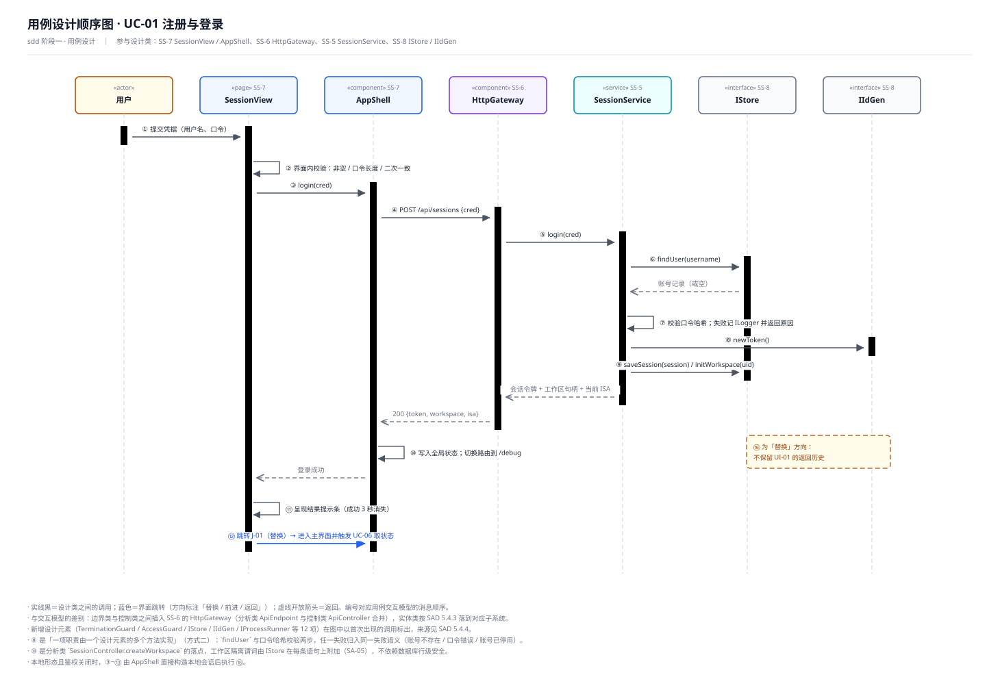

**承载需求**：FR-9.1 账号与会话、NFR-I2 隔离。**参与设计类**：`SessionView`、`AppShell`、`HttpGateway`、`SessionService`、`IStore`、`IIdGen`。

**实现方案（序列）**

1. 用户在 `SessionView` 提交用户名与口令；
2. `SessionView` 界面内校验（非空、口令长度、二次一致），不通过则禁用提交；
3. `SessionView` → `AppShell`：`login(cred)`；
4. `AppShell` → `HttpGateway`：`POST /api/sessions {cred}`；
5. `HttpGateway` → `SessionService`：`login(cred)`（路由由 `Router` 在网关内部完成）；
6. `SessionService` → `IStore`：`findUser(username)`；
7. `IStore` → `SessionService`：账号记录（或空）；
8. `SessionService` 自调用：校验口令哈希；失败时记 `ILogger` 并返回**具体失败原因**；
9. `SessionService` → `IIdGen`：`newToken()`；
10. `SessionService` → `IStore`：`saveSession(session)` / `initWorkspace(uid)`；
11. `SessionService` → `HttpGateway`：会话令牌 + 工作区句柄 + 当前 ISA；
12. `HttpGateway` → `AppShell`：`200 {token, workspace, isa}`；
13. `AppShell` 自调用：写入全局状态（token / workspace / isa），切换路由到 `/debug`；
14. `AppShell` → `SessionView`：登录成功；
15. `SessionView` 自调用：呈现结果提示条（成功 3 秒消失、失败常驻）；
16. `SessionView` → `AppShell`：**跳转 J-01（替换方向）**，进入主界面并触发 UC-06 取状态。

**关键决策**

- **方式二的口令校验**（⑧）：`findUser` 与 `verifyHash` 是同一职责下的两步，任一失败都归入同一失败语义，向界面只暴露"账号不存在 / 口令错误 / 账号已停用"三类原因，**不泄露账号是否存在以外的信息**。
- **工作区在登录时一并建立**（⑩）：对应分析类 `SessionController.createWorkspace`；隔离谓词由 `IStore` 在每条语句上附加（SA-05），`SessionService` 不拼 SQL。
- **本地形态短路**：鉴权关闭时 ③~⑬ 由 `AppShell` 直接构造本地会话，随后执行 ⑯；这是 FR-9.2 双形态对等在会话链路上的落点。
- J-01 是"替换"而非"前进"：进入主界面后**不保留 UI-01 的返回历史**（《用户界面设计文档》6.3）。

### 5.2 UC-02 装载与管理 ISA 指令集（P1）

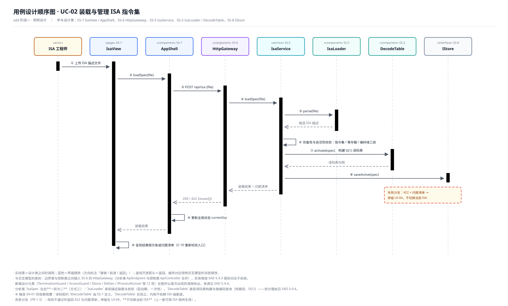

**承载需求**：FR-1.1 ~ FR-1.3。**参与设计类**：`IsaView`、`AppShell`、`HttpGateway`、`IsaService`、`IsaLoader`、`DecodeTable`、`IStore`。

**实现方案（序列）**

1. ISA 工程师上传 ISA 描述文件；
2. `IsaView` → `AppShell`：`loadSpec(file)`；
3. `AppShell` → `HttpGateway`：`POST /api/isa {file}`；
4. `HttpGateway` → `IsaService`：`loadSpec(file)`；
5. `IsaService` → `IsaLoader`：`parse(file)`；
6. `IsaLoader` → `IsaService`：候选 ISA 描述；
7. `IsaLoader`… 由 `IsaService` 自调用触发**三段校验**（指令集完备性 / 寄存器定义 / 编码域自洽）；
8. `IsaService` → `DecodeTable`：`build(spec)` 构建 O(1) 译码表；
9. `DecodeTable` → `IsaService`：译码表句柄；
10. `IsaService` → `IStore`：`saveActive(spec)`；
11. `IsaService` → `HttpGateway`：装载结果 + 问题清单；
12. `HttpGateway` → `AppShell`：`200` 或 `422 {issues[]}`；
13. `AppShell` 自调用：更新全局状态 `currentIsa`；
14. `AppShell` → `IsaView`：装载结果；
15. `IsaView` 自调用：呈现结果提示条或问题清单（含 C-10 的重新校验入口）。

**关键决策**

- **`IsaSpec` 一拆为二**：`IsaLoader` 承担解析与校验（启动期、一次性），`DecodeTable` 承担译码表构建与查询（热路径、O(1)）。两者在性能特征与变更原因上都不同，因此在设计类层面就分开。
- **失败不切换**：校验不通过时返回 422 与问题清单，**保持上一套可用 ISA 生效**（FR-1.3 的"不静默失败"在不破坏可用性上的推论）。这是本步新增的判断。
- **⑧ 触发 SA-01**：`DecodeTable` 实现的是内核侧（SS-1）定义的 `IDecodeTable` 契约，SS-2 依赖 SS-1，而不是反过来。

### 5.3 UC-03 装载并配置待模拟程序（P0）

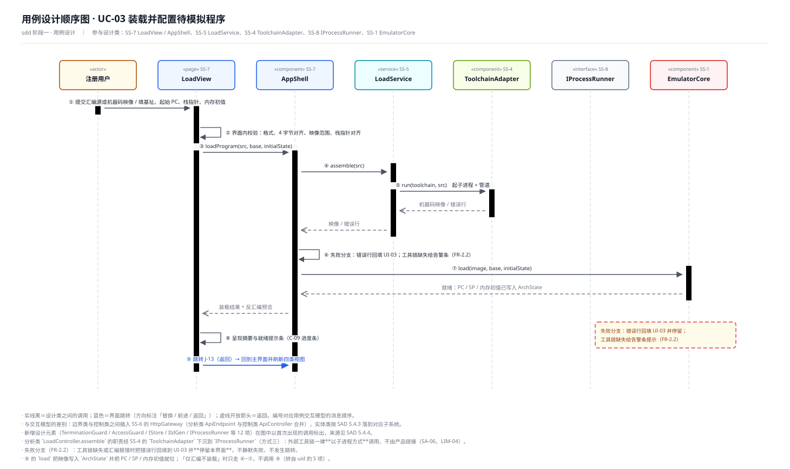

**承载需求**：FR-2.1 ~ FR-2.4。**参与设计类**：`LoadView`、`AppShell`、`LoadService`、`ToolchainAdapter`、`IProcessRunner`、`EmulatorCore`。

**实现方案（序列）**

1. 用户提交汇编源或机器码/ELF 映像，填写基址、起始 PC、栈指针、内存初值；
2. `LoadView` 界面内校验：十六进制格式、基址 4 字节对齐、起始 PC 落在映像范围内、栈指针对齐；不通过则提交按钮禁用；
3. `LoadView` → `AppShell`：`loadProgram(src, base, initialState)` → `LoadService`；
4. `LoadService` → `ToolchainAdapter`：`assemble(src)`；
5. `ToolchainAdapter` → `IProcessRunner`：`run(toolchain, src)`（起子进程 + 管道）；
6. `IProcessRunner` → `ToolchainAdapter`：机器码映像 / 错误行；
7. `ToolchainAdapter` → `LoadService`：映像 / 错误行；
8. `LoadService` 自调用：**失败分支** —— 错误行回填 UI-03；工具链缺失给告警条（FR-2.2）；
9. `LoadService` → `EmulatorCore`：`load(image, base, initialState)`；
10. `EmulatorCore` → `LoadService`：就绪（PC / SP / 内存初值已写入 `ArchState`）；
11. `LoadService` → `LoadView`：装载结果 + 反汇编预览；
12. `LoadView` 自调用：呈现摘要与就绪提示条（C-09 的进度条）；
13. **跳转 J-13（返回方向）**：回到主界面并刷新四类视图。

**关键决策**

- **适配器与进程管理分离**：`ToolchainAdapter` 只负责"工具链语义"（命令拼装、输出解析），`IProcessRunner` 负责"进程语义"（起进程、喂输入、读输出、超时回收）。两者被 `ToolchainAdapter` 与 `RefSimAdapter` 共用同一份实现（SAD 5.7）。
- **"仅汇编不装载"可单独调用**：④~⑦ 与 ⑨ 是两段可分离的调用，支持 UI-03 上"只汇编看反汇编预览"的用法（转自 `uid` 阶段登记的 S 项）。
- **⑨ 之前不做部分写入**：`EmulatorCore.load` 是整体替换，不是逐段写入；否则失败时会留下半装载状态。这是本步新增的判断。

### 5.4 UC-04 单步与连续执行（P0）

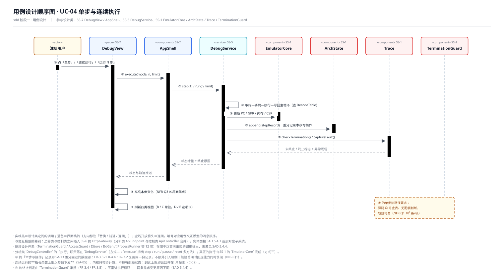

**承载需求**：FR-3.1 ~ FR-3.5、NFR-Q1（10⁷ 条/秒）、NFR-Q2（10⁸ 条连续执行）、NFR-Q3。**参与设计类**：`DebugView`、`AppShell`、`DebugService`、`EmulatorCore`、`ArchState`、`Trace`、`TerminationGuard`。

**实现方案（序列）**

1. 用户点「单步」/「连续运行」/「运行 N 步」；
2. `DebugView` → `AppShell` → `DebugService`：`execute(mode, n, limit)`；
3. `DebugService` → `EmulatorCore`：`step(1)` / `run(n, limit)`；
4. `EmulatorCore` 自调用：取指—译码—执行—写回主循环（查 `IDecodeTable`）；
5. `EmulatorCore` → `ArchState`：`apply(writes)` 更新 PC / GPR / 内存 / CSR；
6. `EmulatorCore` → `Trace`：`append(stepRecord)` 记录本步写操作（差分）；
7. `EmulatorCore` → `TerminationGuard`：`check(state)` / `captureFault()`；
8. `TerminationGuard` → `EmulatorCore`：未终止 / 终止标志 + 异常现场；
9. `EmulatorCore` → `DebugService`：状态增量 + 终止原因；
10. `DebugService` → `DebugView`：状态与轨迹推送；
11. `DebugView` 自调用：高亮本步变化（NFR-Q3 的界面落点）；
12. `DebugView` 自调用：刷新四类视图（B/C 常驻，D/E 选项卡）。

**关键决策**

- **差分写操作而非全量快照**（⑤⑥）：`ArchState.apply` 收到的是"本步实际改了哪些字段"，`Trace` 记的也是同一份。这是 SA-13 在类图与热路径上的落点：**一份记录同时服务 FR-3.3 / FR-4.4 / FR-7.2**。
- **执行循环不持有配额**（③）：指令条数上限以**参数**随运行请求下发；内核只按步计数、到达上限即返回，由界面按 C-02 呈现"已执行条数 / 上限"。内核代码中不出现"配额"这一业务概念（SA-05）。
- **终止判定独立**（⑦）：FR-3.4 与 FR-3.5 不在执行循环里判断，避免执行循环同时承担"跑"和"停"两种变更原因。
- **轨迹可关闭**：关闭轨迹时 ⑥ 与 ⑧ 一并关闭，同时回退能力关闭——保证关闭轨迹时的吞吐量要求（10⁷ 条/秒）不受影响（NFR-Q1）。
- **服务经会话上下文解析内核**（**阶段五回写，对应类设计 D-3 / R3**）：`DebugService` 不持有 `EmulatorCore` 引用。② 进入后由 `SessionService.contextOf(token)` 取到 `SessionContext&`，再 `.core()` 得到 `ICoreService&`，3~9 各步都作用在该引用上。内核实例的所有权在 `SessionContext`（`unique_ptr`），服务层只能使用、销毁不了它——这是 SA-03「每会话一个内核、随会话销毁」与 SA-08「服务为无状态单例」之间的映射点。
- **`mode` 由 `RunMode` 五取值承载**（**阶段五回写，对应类设计 D-1**）：`Step` / `RunN(n)` / `UntilAddr(addr)` / `ToBoundary` / `Continue`。「运行至边界」的**边界 = 程序映像区间端点**（FR-4.3 原文），因而是**由映像派生的量、不是用户选项**；UID 的 C-01 据此由「选择边界定义」降为「边界取值只读展示」。本条的详细论证见《类设计说明》第 10 章 D-1。

### 5.5 UC-05 设置与管理断点（P1）

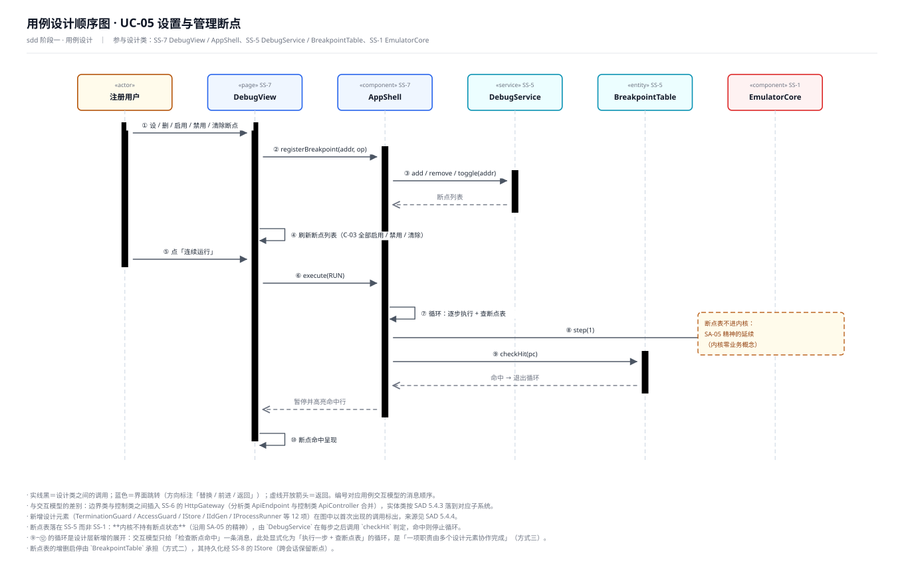

**承载需求**：FR-4.2 断点。**参与设计类**：`DebugView`、`AppShell`、`DebugService`、`BreakpointTable`、`EmulatorCore`。

**实现方案（序列）**

1. 用户设 / 删 / 启用 / 禁用 / 清除断点；
2. `DebugView` → `DebugService`：`registerBreakpoint(addr, op)`；
3. `DebugService` → `BreakpointTable`：`add` / `remove` / `toggle(addr)`；
4. `BreakpointTable` → `DebugService`：断点列表；
5. `DebugView` 自调用：刷新断点列表（C-03 的全部启用 / 禁用 / 清除按钮组）；
6. 用户点「连续运行」；
7. `DebugView` → `DebugService`：`execute(RUN)`；
8. `DebugService` 自调用：**循环** —— 逐步执行 + 查断点表；
9. `DebugService` → `EmulatorCore`：`step(1)`；
10. `DebugService` → `BreakpointTable`：`checkHit(pc)`；
11. `BreakpointTable` → `DebugService`：命中 → 退出循环；
12. `DebugService` → `DebugView`：暂停并高亮命中行；
13. `DebugView` 自调用：断点命中呈现。

**关键决策**

- **断点表放 SS-5 而不是 SS-1**：内核不持有断点状态（沿用 SA-05 的精神），由 `DebugService` 在每步之后查表。代价是"运行到断点"需要服务层参与每步判定，收益是内核零业务概念、可独立编译与单测。
- **循环在服务层展开**（⑧~⑪）：交互模型只给了"检查断点命中"一条消息；解域把它显式化为"执行一步 + 查表"的循环，属方式三。连续运行到断点的热路径因此有两次跨构件调用/步，**只在开启断点时才付出**。
- **断点可跨会话保留**：`BreakpointTable` 经 `IStore` 持久化（图中未单列，见第 8 章的追踪矩阵）。
- **驱动内核同样经会话上下文**（**阶段五回写，对应类设计 D-3 / R3**）：⑧ 的循环所驱动的内核来自 `SessionService.contextOf(token).core()`；`DebugService` 只持 `ICoreService&` 与 `BreakpointTable`（后者档 3，仅该服务可见）。服务不缓存内核引用，因为缓存会与「随会话销毁」冲突。

### 5.6 UC-06 查看架构状态与执行轨迹（P1）

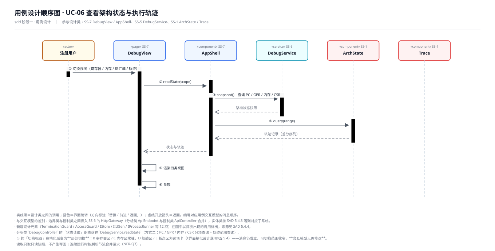

**承载需求**：FR-5.1 ~ FR-5.4、NFR-Q3。**参与设计类**：`DebugView`、`AppShell`、`DebugService`、`ArchState`、`Trace`。

**实现方案（序列）**

1. 用户切换视图（寄存器 / 内存 / 反汇编 / 轨迹）；
2. `DebugView` → `DebugService`：`readState(scope)`；
3. `DebugService` → `ArchState`：`snapshot()` 查询 PC / GPR / 内存 / CSR；
4. `ArchState` → `DebugService`：架构状态快照；
5. `DebugService` → `Trace`：`query(from, to)`；
6. `Trace` → `DebugService`：轨迹记录（差分序列）；
7. `DebugService` → `DebugView`：状态与轨迹；
8. `DebugView` 自调用：渲染四类视图；
9. `DebugView` 自调用：呈现。

**关键决策**

- **① 的"切换视图"在精化后语义收窄**：B 寄存器区与 C 内存区**常驻**，D 轨迹区与 E 断点区为**选项卡**（《界面精化设计说明》五·5.4）。消息仍然成立，只是可切换范围变了——**交互模型不需要修改**。
- **读取只取只读快照**：`snapshot()` 不产生写回，`ArchState` 的查询路径与执行路径完全分离，避免观察行为影响被观察对象。
- **刷新节流**：连续运行时由 `AppShell` 合并刷新请求（NFR-Q3 的响应性要求），`DebugService` 不做限流——限流是界面关切，不是领域关切。
- **状态读取改经内核接口**（**阶段五回写，对应类设计 D-2 / R2**）：③ 从本阶段的 `DebugService → ArchState.snapshot()` 改为 `DebugService → ICoreService.reads(scope) : StateSnapshot`；`ArchState` 降为**档 2（装配可见）**，SS-5 不再直接触达它。读路径与执行路径依然分离（`reads` 不产生写回），原结论不变，只是把「谁能读状态」也一并收进接口。

### 5.7 UC-07 回退执行历史（P1）

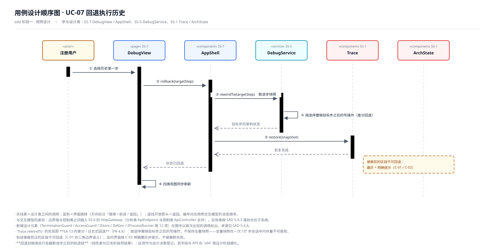

**承载需求**：FR-4.4。**参与设计类**：`DebugView`、`AppShell`、`DebugService`、`Trace`、`ArchState`。

**实现方案（序列）**

1. 用户选择历史某一步；
2. `DebugView` → `DebugService`：`rollback(targetStep)`；
3. `DebugService` → `Trace`：`rewindTo(targetStep)`；
4. `Trace` 自调用：按**逆序撤销**目标步之后的写操作（差分回退）；
5. `Trace` → `DebugService`：目标步的架构状态；
6. `DebugService` → `ArchState`：`restore(snapshot)`；
7. `ArchState` → `DebugService`：恢复完成；
8. `DebugService` → `DebugView`：状态已回退；
9. `DebugView` 自调用：四类视图同步刷新。

**关键决策**

- **差分 / 日志式回退**（SA-13 的落地）：按逆序撤销写操作，**不保存全量快照**。全量快照在一次 10⁶ 步调试会话中内存量不可接受。
- **被裁剪的区段不可回退**：轨迹超限时按 SA-13 丢弃最旧的不可回退段，此时界面按 **C-02（已执行条数 / 上限）与 C-04（执行类按钮的禁用规则）** 明确置灰并提示，不做静默失败。（原表述为"C-01 / C-02"；因 C-01 已在阶段五回写为「边界取值只读展示」，此处引用改为 C-04。）
- **回退后继续执行会截断该步之后的轨迹段**（本步新增的设计决策）：线性差分日志的自然结果，界面在读档后明确提示"后续轨迹已作废"。此项的字段与 API 在「类设计」「数据设计」阶段定稿。
- **状态回退改经内核接口**（**阶段五回写，对应类设计 D-2 / R2**）：⑥ 从本阶段的 `DebugService → ArchState.restore(snapshot)` 改为 `DebugService → ICoreService.restore(const StateSnapshot&)`——该方法是类设计阶段为 R2 **新增**的。理由：「谁能改架构状态」在类型系统上必须唯一为 `EmulatorCore`，否则服务层可绕过内核直接改状态，SA-13 的差分一致性失去保证。注意 `ICoreService.restore` 专指**状态快照的覆盖式恢复**，与 UC-12 装载工作区时的 `ICoreService.load` 语义不同，两者不共用重载。

### 5.8 UC-08 管理并批量执行测试用例（P1）

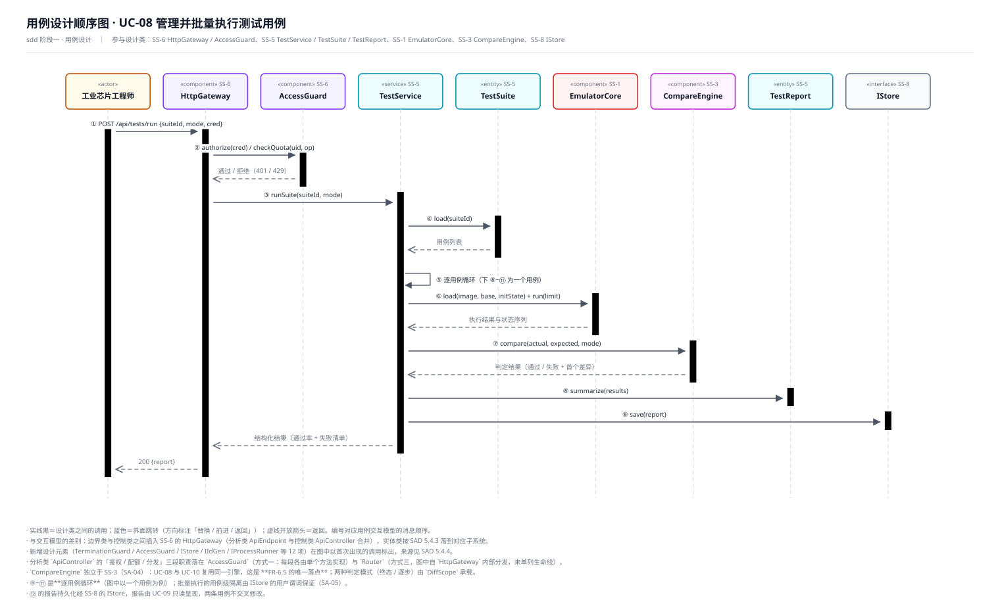

**承载需求**：FR-6.1 ~ FR-6.5。**参与设计类**：`HttpGateway`、`AccessGuard`、`TestService`、`TestSuite`、`EmulatorCore`、`CompareEngine`、`TestReport`、`IStore`。

**实现方案（序列）**

1. 工业芯片工程师调用 `POST /api/tests/run {suiteId, mode, cred}`；
2. `HttpGateway` → `AccessGuard`：`authorize(cred)` / `checkQuota(uid, op)`；
3. `AccessGuard` → `HttpGateway`：通过 / 拒绝（401 / 429）；
4. `HttpGateway` → `TestService`：`runSuite(suiteId, mode)`；
5. `TestService` → `TestSuite`：`load(suiteId)`；
6. `TestSuite` → `TestService`：用例列表；
7. `TestService` 自调用：**逐用例循环**（下 8~11 为一个用例）；
8. `TestService` → `EmulatorCore`：`load(...) + run(limit)`；
9. `EmulatorCore` → `TestService`：执行结果与状态序列；
10. `TestService` → `CompareEngine`：`compare(actual, expected, mode)`；
11. `CompareEngine` → `TestService`：判定结果（通过 / 失败 + 首个差异）；
12. `TestService` → `TestReport`：`summarize(results)`；
13. `TestService` → `IStore`：`save(report)`；
14. `TestService` → `HttpGateway`：结构化结果（通过率 + 失败清单）；
15. `HttpGateway` → 客户端：`200 {report}`。

**关键决策**

- **比对引擎独立在 SS-3**：UC-08 与 UC-10 调用的是**同一个** `CompareEngine`（SA-04），这是 FR-6.5「两种判定模式复用同一比对引擎」的唯一落点。两种模式（终态比对 / 逐步比对）由 `DiffScope.mode` 承载，不是两个引擎。
- **鉴权与配额前置**：②③ 在业务逻辑之前，`AccessGuard` 是 NFR-Q5 限额的唯一落点（SA-05）；拒绝时不进入用例编排。
- **用例级隔离**：每个用例的内核实例与数据由 `IStore` 的用户谓词保证不串扰（SA-05），`TestService` 不显式传递用户过滤条件。
- **报告持久化在 ⑬**：UC-09 只读呈现，两条用例不交叉修改。
- **内核实例的取得方式**（**阶段五回写，对应类设计 D-3 / R3**）：⑧ 的执行方由 `SessionService.contextOf(token).core()` 解析。`TestService` 是无状态单例，逐用例循环中每次都向会话上下文索取内核引用，**不跨请求缓存**——缓存会与 SA-03 的「随会话销毁」冲突，也会让两个并发请求争用同一内核。

### 5.9 UC-09 查看测试报告（P2）

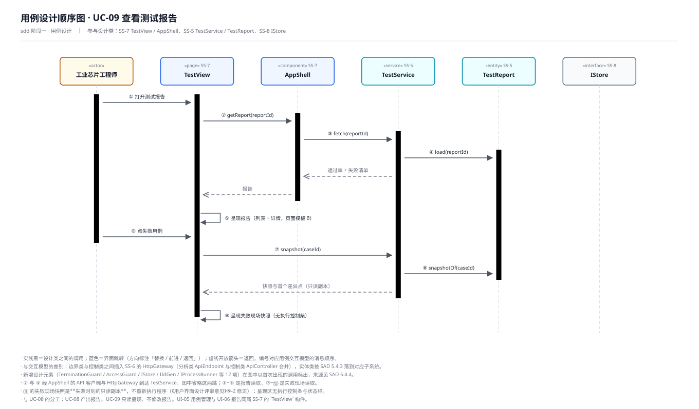

**承载需求**：FR-6.3 测试报告。**参与设计类**：`TestView`、`AppShell`、`TestService`、`TestReport`、`IStore`。

**实现方案（序列）**

1. 用户打开测试报告；
2. `TestView` → `AppShell` → `HttpGateway` → `TestService`：`getReport(reportId)`（图中省略网关两跳）；
3. `TestService` → `TestReport`：`load(reportId)`；
4. `TestReport` → `TestService`：通过率 + 失败清单；
5. `TestService` → `TestView`：报告；
6. `TestView` 自调用：呈现报告（列表 + 详情，页面模板 B）；
7. 用户点失败用例；
8. `TestView` → `TestService`：`snapshotOf(caseId)`；
9. `TestService` → `TestReport`：取失败现场快照；
10. `TestReport` → `TestView`：快照与首个差异点；
11. `TestView` 自调用：呈现失败现场快照。

**关键决策**

- **失败现场是只读副本**（⑩）：不重新执行程序，呈现区**无执行控制条与状态栏**（《用户界面设计评审意见》⑤-2 的修正）。这使 UC-09 与 UC-04 的界面职责边界清晰：能操作的只有工作台。
- **UI-05 与 UI-06 同属 `TestView` 构件**：用例管理与报告呈现共用同一视图构件，符合 SAD 的构件划分（8 个前端构件，不为每个界面单开）。
- **复用工作台的视图组件**：失败现场的三视图复用 UI-02 的视图组件（界面类图的页面→构件映射）。

### 5.10 UC-10 发起 ISA 一致性对拍（P1）

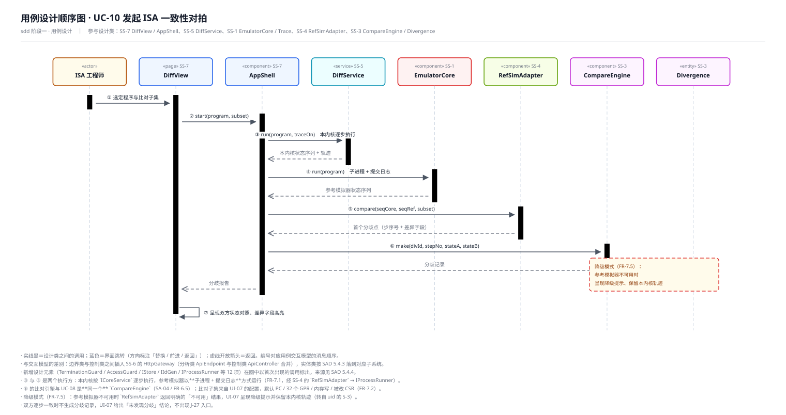

**承载需求**：FR-7.1 ~ FR-7.5。**参与设计类**：`DiffView`、`AppShell`、`DiffService`、`EmulatorCore`、`RefSimAdapter`、`CompareEngine`、`Divergence`。

**实现方案（序列）**

1. ISA 工程师选定程序与比对子集；
2. `DiffView` → `DiffService`：`start(program, subset)`；
3. `DiffService` → `EmulatorCore`：`run(program, traceOn)`（本内核逐步执行）；
4. `EmulatorCore` → `DiffService`：本内核状态序列 + 轨迹；
5. `DiffService` → `RefSimAdapter`：`run(program)`（子进程 + 提交日志）；
6. `RefSimAdapter` → `DiffService`：参考模拟器状态序列；
7. `DiffService` → `Trace`：登记双方轨迹（供 UC-11 复用，图中省略该跳）；
8. `DiffService` → `CompareEngine`：`compare(seqCore, seqRef, subset)`；
9. `CompareEngine` → `DiffService`：首个分歧点（步序号 + 差异字段）；
10. `DiffService` → `Divergence`：`make(divId, stepNo, stateA, stateB)`；
11. `Divergence` → `DiffService`：分歧记录；
12. `DiffService` → `DiffView`：分歧报告；
13. `DiffView` 自调用：呈现双方状态对照、差异字段高亮。

**关键决策**

- **两个执行方的资源边界不同**：本内核在同进程内以库形式执行（③），参考模拟器以**子进程 + 提交日志**方式执行（⑤，经 SS-4 → `IProcessRunner`）。这个差异是 SS-1 与 SS-4 分属不同子系统、资源边界不同的直接原因（SAD 5.5.1 的 R2）。
- **比对子集默认值**：PC / 32 个 GPR / 内存写 / 被改 CSR（FR-7.2），由 UI-07 的 `DiffScope` 配置覆盖。
- **降级模式**（FR-7.5）：参考模拟器不可用时 `RefSimAdapter` 返回明确的"不可用"结果，`DiffService` 呈现降级提示并**保留本内核轨迹**（转自 `uid` 阶段登记的 S-3）。
- **一致即无分歧**：双方逐步一致时不生成分歧记录，UI-07 给出"未发现分歧"结论，**不出现 J-27 入口**。
- **内核实例的取得方式与取消机制**（**阶段五回写，对应类设计 D-3 / R3 与 D-4**）：③ 的执行方由 `SessionService.contextOf(token).core()` 解析；「取消对拍」的中断由 `CancelToken` + `JobHandle.cancel()` 承载，内核在**每 4096 步**的批次边界检查一次，子进程在轮询周期内检查。检查频率是 NFR-Q1（10⁷ 条/秒）与可中断性之间的折中——每步检查会破坏吞吐量指标。

### 5.11 UC-11 分析与标注分歧归因（P2）

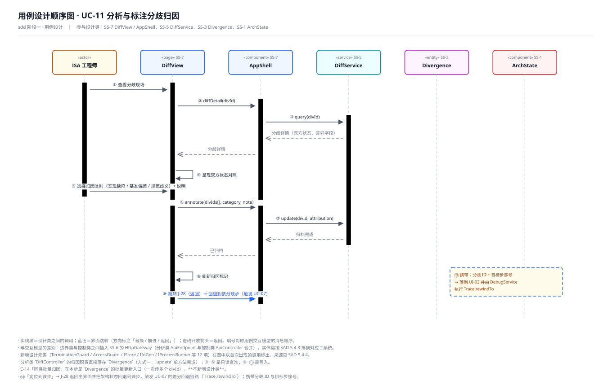

**承载需求**：FR-7.3、FR-7.4。**参与设计类**：`DiffView`、`AppShell`、`DiffService`、`Divergence`、`ArchState`。

**实现方案（序列）**

1. 用户查看分歧现场；
2. `DiffView` → `DiffService`：`diffDetail(divId)`；
3. `DiffService` → `Divergence`：`query(divId)`；
4. `Divergence` → `DiffService`：分歧详情（双方状态、差异字段）；
5. `DiffService` → `DiffView`：分歧详情；
6. `DiffView` 自调用：呈现双方状态对照；
7. 用户选择归因类别（实现缺陷 / 基准偏差 / 规范歧义）并填写说明；
8. `DiffView` → `DiffService`：`annotate(divIds[], category, note)`；
9. `DiffService` → `Divergence`：`update(divId, attribution)`；
10. `Divergence` → `DiffService`：归档完成；
11. `DiffService` → `DiffView`：已归档；
12. `DiffView` 自调用：刷新归因标记；
13. **跳转 J-28（返回方向）**：回到主界面并把架构状态回退到该分歧步（触发 UC-07 的差分回退链路），携带分歧 ID 与目标步序号。

**关键决策**

- **归因是方式一**：`Divergence.update` 单方法完成，不需要额外设计元素。
- **C-14「同类批量归因」走批量入口**：`annotate` 的第一个参数是 `divIds[]` 而非单个 ID，**不新增设计类**——一次标注多个同类分歧，避免逐个操作。
- **⑬ 与 UC-07 复用同一条回退链路**：`DiffService` 不自己实现回退，而是经 `AppShell` 把"回退到某步"转给 `DebugService` → `Trace.rewindTo`。这是跨用例复用，避免了第二套回退实现。

### 5.12 UC-12 保存与加载工作区（P2）

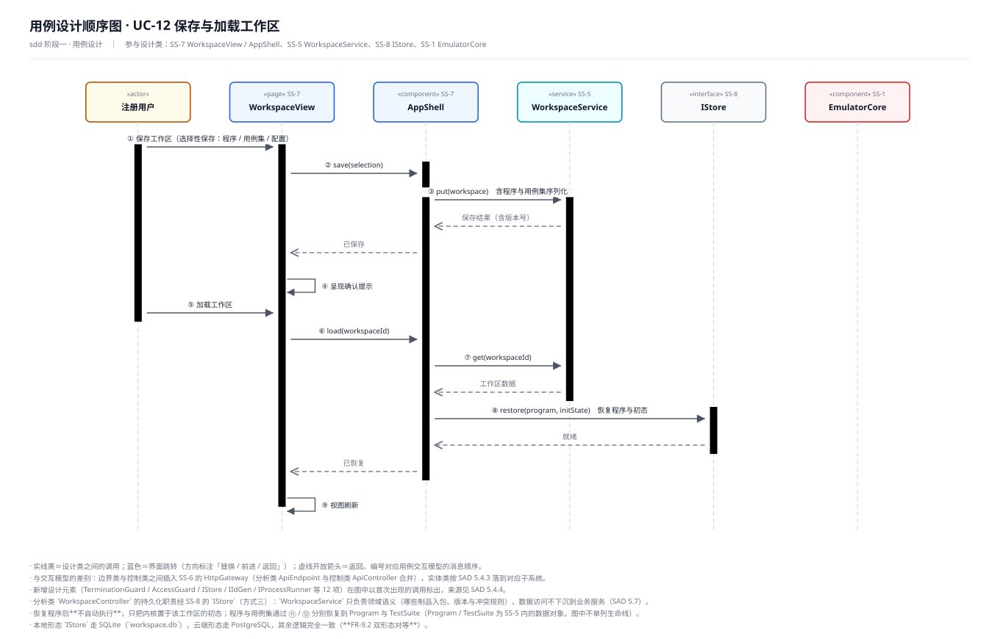

**承载需求**：FR-9.3。**参与设计类**：`WorkspaceView`、`AppShell`、`WorkspaceService`、`IStore`、`EmulatorCore`。

**实现方案（序列）**

1. 用户保存工作区（选择性保存：程序 / 用例集 / 配置）；
2. `WorkspaceView` → `WorkspaceService`：`save(selection)`；
3. `WorkspaceService` → `IStore`：`put(workspace)`（含程序与用例集序列化）；
4. `IStore` → `WorkspaceService`：保存结果（含版本号）；
5. `WorkspaceService` → `WorkspaceView`：已保存；
6. `WorkspaceView` 自调用：呈现确认提示；
7. 用户加载工作区；
8. `WorkspaceView` → `WorkspaceService`：`load(workspaceId)`；
9. `WorkspaceService` → `IStore`：`get(workspaceId)`；
10. `IStore` → `WorkspaceService`：工作区数据；
11. `WorkspaceService` → `EmulatorCore`：`restore(program, initState)`；
12. `EmulatorCore` → `WorkspaceService`：就绪；
13. `WorkspaceService` → `WorkspaceView`：已恢复；
14. `WorkspaceView` 自调用：视图刷新。

**关键决策**

- **持久化下沉 SS-8**：`WorkspaceService` 只负责领域语义（哪些制品入包、版本与冲突规则），数据访问经 `IStore`。业务服务不各自拼装 SQL（SAD 5.7）。
- **恢复后不自动执行**：恢复到工作区初态即停，由用户按下"单步/运行"才执行。这样"加载"与"运行"是两件事，符合用户对调试器的预期。
- **双形态对等**（FR-9.2）：本地走 SQLite（`workspace.db`）、云端走 PostgreSQL，**11~14 的调用完全一致**，差异只在 `Bootstrapper.selectDrivers()`。
- **选择性保存**（①）：`selection` 参数承载"只存程序""只存用例集"等用法，对应 UI-09 的选择性保存入口（评审 ③-1 / ⑤-2 的修正）。
- **恢复动作经内核接口**（**阶段五回写，对应类设计 D-3 / R3**）：⑪ 的 `WorkspaceService → EmulatorCore.restore(program, initState)` 解域后是「把映像与初态装进本会话的内核」——内核引用经 `SessionService.contextOf(token).core()` 取得，装载用 `ICoreService.load(const Image&, Addr base, const InitState&)`。此处**不用** `ICoreService.restore`：后者专指**状态快照**的覆盖式恢复（UC-07 用），两者语义不同、不共用重载（见类设计的 D-2 与 D-7）。

### 5.13 UC-13 通过集成 API 驱动模拟（P1）

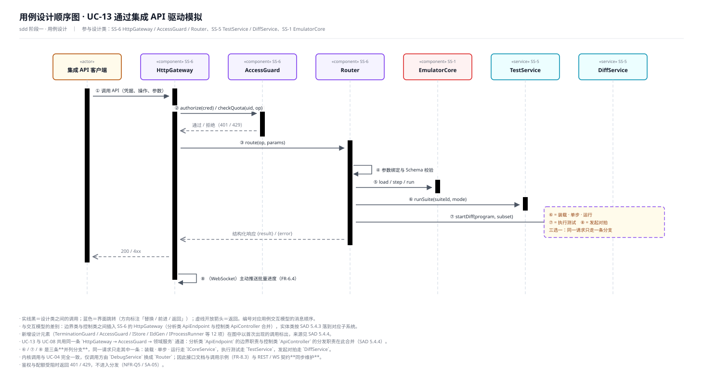

**承载需求**：FR-8.1 ~ FR-8.3、NFR-Q5。**参与设计类**：`HttpGateway`、`AccessGuard`、`Router`、`EmulatorCore`、`TestService`、`DiffService`。

**实现方案（序列）**

1. 集成 API 客户端调用 API（凭据、操作、参数）；
2. `HttpGateway` → `AccessGuard`：`authorize(cred)` / `checkQuota(uid, op)`；
3. `AccessGuard` → `HttpGateway`：通过 / 拒绝（401 / 429）；
4. `HttpGateway` → `Router`：`route(op, params)`；
5. `Router` 自调用：参数绑定与 Schema 校验；
6. `Router` → `EmulatorCore`：`load` / `step` / `run`（分支一：装载 · 单步 · 运行）；
7. `Router` → `TestService`：`runSuite(suiteId, mode)`（分支二：执行测试）；
8. `Router` → `DiffService`：`startDiff(program, subset)`（分支三：发起对拍）；
9. `Router` → `HttpGateway`：结构化响应 `{result}` / `{error}`；
10. `HttpGateway` → 客户端：`200` / `4xx`；
11. `HttpGateway` 自调用：（WebSocket）主动推送批量进度（FR-6.4）。

**关键决策**

- **通道与 UC-08 完全共用**：`HttpGateway → AccessGuard → Router → 领域服务`同一条链；分析类 `ApiEndpoint` 的边界职责与控制类 `ApiController` 的分发职责在此合并（SAD 5.4.4）。
- **⑥⑦⑧ 三选一**：同一请求只走其中一条分支；`Router` 按 `op` 分发，分发表是可独立替换的机制（增删接口不改鉴权代码）。
- **装载 / 单步走 `ICoreService`**：与 UC-04 一致，仅调用方由 `DebugService` 换成 `Router`——这使接口文档与调用示例（FR-8.3）与 REST / WS 契约**可以同步维护**。
- **限流在入口不在内核**：`AccessGuard.checkInstrLimit(n)` 在请求受理时判定，内核不感知（SA-05）。

### 5.14 UC-14 管理用户与资源配额（P2）

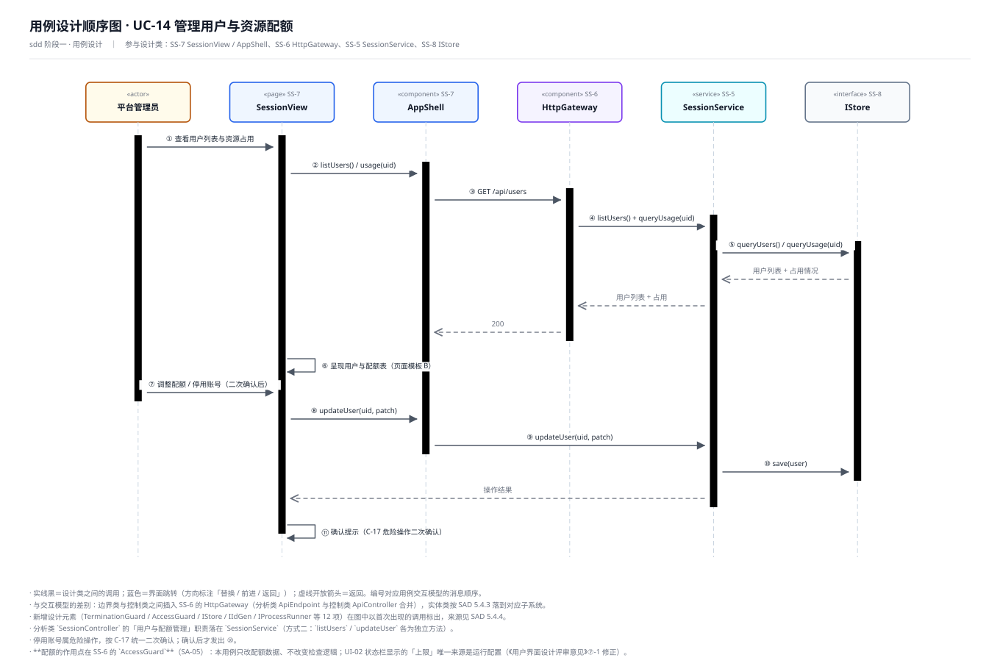

**承载需求**：FR-9.4、FR-9.5。**参与设计类**：`SessionView`、`AppShell`、`HttpGateway`、`SessionService`、`IStore`。

**实现方案（序列）**

1. 平台管理员查看用户列表与资源占用；
2. `SessionView` → `AppShell` → `HttpGateway` → `SessionService`：`listUsers()` / `usage(uid)`；
3. `HttpGateway` → `SessionService`：`GET /api/users`；
4. `SessionService` → `SessionService`：`listUsers()` + `queryUsage(uid)`；
5. `SessionService` → `IStore`：`queryUsers()` / `queryUsage(uid)`；
6. `IStore` → `SessionService`：用户列表 + 占用情况；
7. `SessionService` → `HttpGateway`：用户列表 + 占用；
8. `HttpGateway` → `AppShell`：`200`；
9. `SessionView` 自调用：呈现用户与配额表（页面模板 B）；
10. 管理员调整配额或停用账号（**二次确认后**）；
11. `SessionView` → `SessionService`：`updateUser(uid, patch)`；
12. `SessionService` → `IStore`：`save(user)`；
13. `SessionService` → `SessionView`：操作结果；
14. `SessionView` 自调用：确认提示（C-17 危险操作二次确认）。

**关键决策**

- **配额的作用点在 `AccessGuard`**：本用例只改配额**数据**、不改检查逻辑；UI-02 状态栏显示的"上限"唯一来源是运行配置（`IConfig`），与 UC-04 下发到内核的 `limit` 同源——这是《用户界面设计评审意见》⑦-1（C-02 来源悬空）在详细设计上的收口。
- **危险操作二次确认**（⑩）：停用账号按 C-17 统一二次确认，确认后才发出 ⑪，避免误操作。
- **方式二**：`listUsers` / `updateUser` 是同一职责（用户与配额管理）下的两个独立方法。

## 6 用例设计顺序图

14 张图位于 `./图/`，文件名与用例一一对应；图上编号与第 5 章的序列编号一致。

| 图号 | 用例 | 文件 |
| --- | --- | --- |
| 图 1 | UC-01 注册与登录 | `用例设计顺序图-UC-01-注册与登录.svg` |
| 图 2 | UC-02 装载与管理 ISA 指令集 | `用例设计顺序图-UC-02-装载与管理ISA.svg` |
| 图 3 | UC-03 装载并配置待模拟程序 | `用例设计顺序图-UC-03-装载并配置程序.svg` |
| 图 4 | UC-04 单步与连续执行 | `用例设计顺序图-UC-04-单步与连续执行.svg` |
| 图 5 | UC-05 设置与管理断点 | `用例设计顺序图-UC-05-断点管理.svg` |
| 图 6 | UC-06 查看架构状态与执行轨迹 | `用例设计顺序图-UC-06-查看状态与轨迹.svg` |
| 图 7 | UC-07 回退执行历史 | `用例设计顺序图-UC-07-回退执行历史.svg` |
| 图 8 | UC-08 管理并批量执行测试用例 | `用例设计顺序图-UC-08-批量执行测试用例.svg` |
| 图 9 | UC-09 查看测试报告 | `用例设计顺序图-UC-09-查看测试报告.svg` |
| 图 10 | UC-10 发起 ISA 一致性对拍 | `用例设计顺序图-UC-10-一致性对拍.svg` |
| 图 11 | UC-11 分析与标注分歧归因 | `用例设计顺序图-UC-11-分歧归因.svg` |
| 图 12 | UC-12 保存与加载工作区 | `用例设计顺序图-UC-12-保存与加载工作区.svg` |
| 图 13 | UC-13 通过集成 API 驱动模拟 | `用例设计顺序图-UC-13-集成API驱动模拟.svg` |
| 图 14 | UC-14 管理用户与资源配额 | `用例设计顺序图-UC-14-用户与配额管理.svg` |

**图的读法**：生命线按子系统着色（蓝＝SS-7 前端、紫＝SS-6 集成 API、青＝SS-5 领域服务、红＝SS-1 内核、青绿＝SS-2 ISA 抽象、品红＝SS-3 比对、草绿＝SS-4 适配、灰＝SS-8 基础服务）；实线黑箭头＝调用；蓝色箭头＝界面跳转（标注方向）；虚线开放箭头＝返回；折线＝自调用。

## 7 设计类图

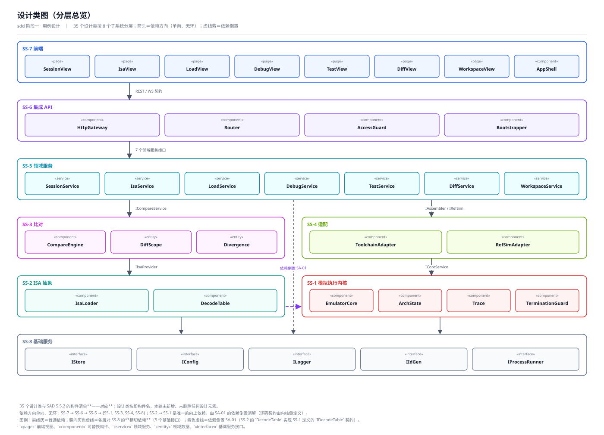

**图 15 设计类图（分层总览）**：35 个设计类按 8 个子系统分层，箭头为依赖方向。依赖关系**单向无环**：`SS-7 → SS-6 → SS-5 → {SS-1, SS-3, SS-4, SS-8}`；`SS-2 → SS-1` 是唯一的向上依赖，由 SA-01 的依赖倒置消解。

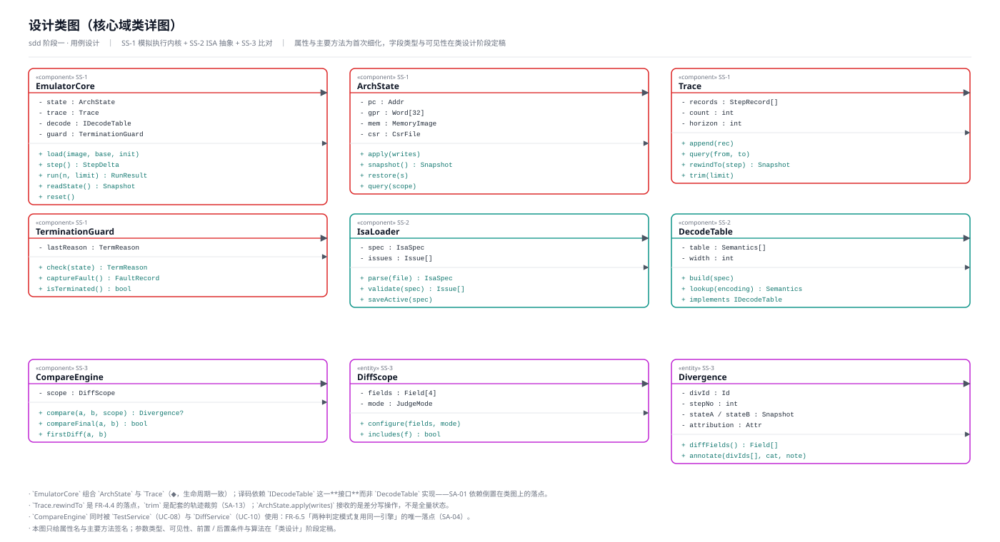

**图 16 设计类图（核心域类详图）**：SS-1 + SS-2 + SS-3 的 9 个类，含属性与主要方法。三个要点：

- `EmulatorCore` **组合** `ArchState` 与 `Trace`（◆，生命周期一致）；
- `EmulatorCore` 依赖的是**接口** `IDecodeTable` 而非 `DecodeTable` 实现——SA-01 在类图上的落点；
- `CompareEngine` 同时被 `TestService` 与 `DiffService` 使用——FR-6.5 / SA-04 的落点。

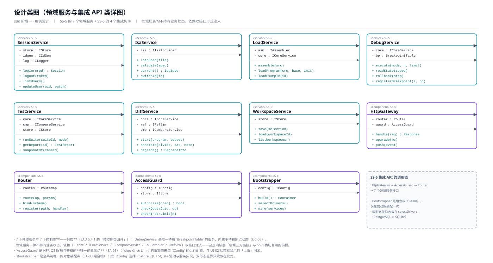

**图 17 设计类图（领域服务与集成 API 类详图）**：SS-5 的 7 个领域服务 + SS-6 的 4 个构件。领域服务与 7 个控制类一一对应（SAD 5.4.1 的"按控制类归并"），且**一律不持有业务状态**，依赖以接口注入。

> 属性类型、可见性、前置 / 后置条件与算法在 `sdd` 的「类设计」阶段定稿；本步只到"属性名 + 主要方法签名"的粒度。

## 8 一致性核对

### 8.1 需求—用例—设计类追踪矩阵

| 需求 | 用例 | 主要设计类 | 需求 | 用例 | 主要设计类 |
| --- | --- | --- | --- | --- | --- |
| FR-1.1 ~ 1.3 | UC-02 | `IsaService` `IsaLoader` `DecodeTable` | FR-6.1 ~ 6.5 | UC-08 UC-09 | `TestService` `CompareEngine` `TestReport` |
| FR-2.1 ~ 2.4 | UC-03 | `LoadService` `ToolchainAdapter` | FR-7.1 ~ 7.5 | UC-10 UC-11 | `DiffService` `RefSimAdapter` `Divergence` |
| FR-3.1 ~ 3.5 | UC-04 | `EmulatorCore` `ArchState` `Trace` `TerminationGuard` | FR-8.1 ~ 8.3 | UC-13 | `HttpGateway` `Router` `AccessGuard` |
| FR-4.1 ~ 4.4 | UC-04 ~ UC-07 | `DebugService` `Trace` `BreakpointTable` | FR-9.1 ~ 9.5 | UC-01 UC-12 UC-14 | `SessionService` `WorkspaceService` |
| FR-5.1 ~ 5.4 | UC-06 | `DebugService` `ArchState` `Trace` | NFR-Q1 / Q2 | UC-04 | `EmulatorCore`（热路径不加配额判断、差分记录） |
| NFR-Q3 | UC-04 UC-06 | `DebugView` `AppShell`（高亮 + 刷新节流） | NFR-Q5 | UC-08 UC-13 UC-04 | `AccessGuard`（限额唯一落点，SA-05） |
| NFR-I1 / I2 | UC-02 UC-04 | `DecodeTable` 可替换；内核可独立单测 | FR-7.5 | UC-10 | `RefSimAdapter.degrade()` |

### 8.2 14 个用例全部覆盖

`UC-01 ~ UC-14` 逐个有实现方案与设计顺序图，无遗漏；14 个用例的参与设计类全部落在 SAD 的 35 个构件之内，**未引入任何新设计元素**。

### 8.3 与分析类模型的闭合性

| 分析类类别 | 数量 | 是否全部有设计类承接 |
| --- | --- | --- |
| 边界类 | 10 | 是（7 视图 + `HttpGateway` + 2 适配器；`ApiEndpoint` 折入 `HttpGateway`） |
| 控制类 | 8 | 是（7 服务 + `ApiController` 折入 `HttpGateway`/`Router`/`AccessGuard`） |
| 实体类 | 12 | 是（内核族 3 + ISA 族 2 + 比对族 3 + 测试断点族 3 + 账号工作区族） |

### 8.4 与 `uid` 阶段登记项的对应

| 登记项（来源） | 本步处理 |
| --- | --- |
| S-1 内存写（FR-5.2） | `ArchState.apply(writes)` 的写操作含内存写；界面入口在 C-08（内存初值批量粘贴） |
| S-2 运行到地址 / 运行至边界（FR-4.3） | `DebugService.execute(mode, ...)` 的 `mode` 枚举 = **`RunMode` 五取值**（`Step` / `RunN(n)` / `UntilAddr(addr)` / `ToBoundary` / `Continue`）；**边界 = 程序映像区间端点**（FR-4.3 原文），已在「类设计」**D-1** 定稿，C-01 据此回写为「边界取值只读展示」（**阶段五已回写**） |
| S-3 参考模拟器降级模式（FR-7.5） | `RefSimAdapter` 的降级返回 + `DiffService.degrade()`（UC-10） |
| S-7 / S-8 会话服务能力 | `SessionService.logout(token)` + `AppShell` 的空闲回收提示 |
| UI-03「仅汇编不装载」 | UC-03 的 ④~⑦ 与 ⑨ 可分离调用 |
| UI-07「取消对拍」需任务可中断 | `DiffService.start` 返回可中断句柄；机制已在「类设计」**D-4** 定稿为 `CancelToken` + `JobHandle.cancel()`（内核每 4096 步批次边界检查） |
| UI-02「上限」的来源 | `IConfig` 的运行配置；与 `AccessGuard.checkInstrLimit`、UC-04 的 `limit` 参数**同源**（UC-14 的收口） |

### 8.5 本步未做的事（明确边界）

- 未给属性定类型与可见性、未给方法写参数类型与前后置条件 → 「类设计」阶段。
- 未设计任何数据表与字段 → 「数据设计」阶段。
- S-2 的边界语义与"取消对拍"的中断机制**本步未定**，已在「类设计」阶段定稿（**D-1** / **D-4**，见 8.4 节与《类设计说明》第 10 章），并已回写本文档（见第 10 章）。
- 未构造类状态图与活动图（技能规定为"用户要求时"）→ 待用户指定。

## 9 检查点

请确认以下 6 项：

1. **分析类 → 设计类的转换**（第 3 章 30 条）：尤其
   - `IsaSpec` 一拆为二（`IsaLoader` + `DecodeTable`）；
   - `ApiEndpoint` + `ApiController` 合并为 `HttpGateway` / `Router` / `AccessGuard`；
   - `SessionView` 等 7 个边界类同时落到"视图 + `AppShell`"两个设计元素。
2. **设计类清单**（第 2.2 节 35 个）：与 SAD 构件**一一对应**，本步不新增、不删除设计元素。
3. **14 个用例实现方案**（第 5 章）与相应的 **14 张设计顺序图**。
4. **设计类图 3 张**（第 7 章）：分层总览 + 核心域类详图 + 服务与网关类详图。
5. **本步新作出的设计判断**（共 6 条，均已在第 5 章标出）：
   - UC-02：ISA 校验失败时**保持上一套可用 ISA 生效**；
   - UC-03：`EmulatorCore.load` 为**整体替换**、不做部分写入；
   - UC-05：**断点表放 SS-5**、内核不持有断点状态；
   - UC-07：回退后继续执行**截断该步之后的轨迹段**；
   - UC-11：「同类批量归因」走 `annotate(divIds[], ...)` 的**批量入口**、不新增设计类；
   - UC-14：配额"上限"的唯一来源是 `IConfig` 运行配置，与 `AccessGuard` 同源。
6. **下一步的分岔**：`sdd` 的第二个阶段「子系统和构件设计」带**执行判定闸**（与用户讨论是否执行）。我的建议是**不执行本阶段**，理由见下：

> 本项目的 8 个子系统与 35 个构件已在 `sad` 阶段完成划分并通过评审，用例设计又已完成分析类到设计类的完整映射；"子系统/构件设计"阶段要做的"明确子系统/构件职责、细化对外接口、内部类设计"，其中**职责与对外接口**已由 SAD 5.5.2 与 5.8 给出，**内部类设计**正是「类设计」阶段的任务。此时执行本阶段会与前后两个阶段重复，且可能造成同一份内容在两处维护。

请确认以上 6 项；确认后进入 `sdd` 第二阶段（按建议为"判定不执行、直接进类设计"）。

## 10 阶段五回写登记

本阶段（`sdd` 阶段一）交付后，下游「类设计」「数据设计」两个阶段又作出了 8 + 8 = 16 条设计判断。其中 **3 条**改变了本文档的接口与协作序列，按用户在阶段五的裁定（"一并回写"）已就地回写；其余 **13 条**只细化实现、不改变上游接口，故仅登记不回写。

### 10.1 已回写的 3 条（对应类设计 D-1 / D-2 / D-3）

| 来源 | 本文档改前 | 改后 | 落点（本文件内） |
| --- | --- | --- | --- |
| **D-1** `RunMode` 五取值定稿 | `execute(mode, …)` 的 `mode` 是未展开的枚举；「运行至边界」语义未定义，边界三类取值留待定夺 | `Step` / `RunN(n)` / `UntilAddr(addr)` / `ToBoundary` / `Continue`；**边界 = 程序映像区间端点**（FR-4.3 原文），是派生量而非用户选项 | 3.2 第 14 行；`5.4` 关键决策；8.4 的 S-2 行；8.5 |
| **D-2** `ICoreService` 新增 `restore(StateSnapshot)`（R2） | UC-06 写 `DebugService → ArchState.snapshot()`；UC-07 写 `DebugService → ArchState.restore(s)` | 分别改为 `ICoreService.reads(scope)` 与 `ICoreService.restore(...)`；`ArchState` / `Trace` 降为**档 2（装配可见）** | 3.2 第 14 行；`5.6` 关键决策；`5.7` 关键决策 |
| **D-3** 会话 → 内核的解析落在 `SessionContext`（R3） | UC-04 / UC-05 / UC-08 / UC-10 / UC-12 隐含「服务持有内核引用」 | 服务经 `SessionService.contextOf(token)` 取 `SessionContext&`，再 `.core()` 取 `ICoreService&`；内核所有权唯一归 `SessionContext` | `5.4`、`5.5`、`5.8`、`5.10`、`5.12` 各自的关键决策 |

> 说明：D-1 同时回写了《用户界面设计文档》的 C-01；D-2 / D-3 只影响本文档第 5 章的调用点。三处回写均**只改调用点与语义描述，不动任何顺序图的连线与消息编号**，因此 `图/用例设计顺序图-UC-*.svg`（14 张）无需重绘——第 5 章各序列的编号 ①…⑭ 与图一一对应，本阶段保持这一对应关系。

### 10.2 仅登记不回写的 13 条

- **类设计 D-4 ~ D-8（5 条）**：`CancelToken` 原语、`IStore` 首参强制 `UserId`、零继承、`assemble` 合并、`CompareEngine` 零状态 + 参数快照——都是"怎么实现"，不改上游接口。其中 D-4 与 D-7 已在 8.4 与关键决策中顺带标注，属**说明性补充**而非接口变更。
- **数据设计 M-01 ~ M-10（10 条中的 8 条）**：枚举补 `Role` / `UserStatus`、`CredentialRow`、`IStore` 增 3 方法、`suiteBlob` 弃用、`Workspace` 补 `name`、`BreakpointRow` 补 `wsId`、`SessionRow` 补 `expiresAt` —— 全部落在《类设计说明》与《数据设计说明》内部，本文档不涉及。
- 数据设计 M-08（"首参都含 `UserId`"的 3 处实际例外）与 M-10（`suite_` 基数）不改变本文档的用例序列。
