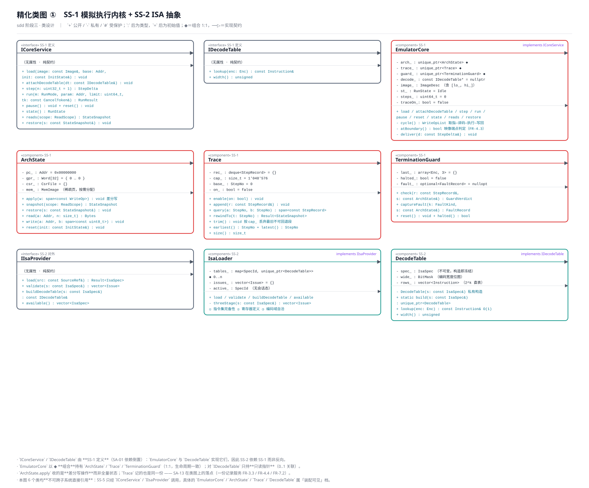
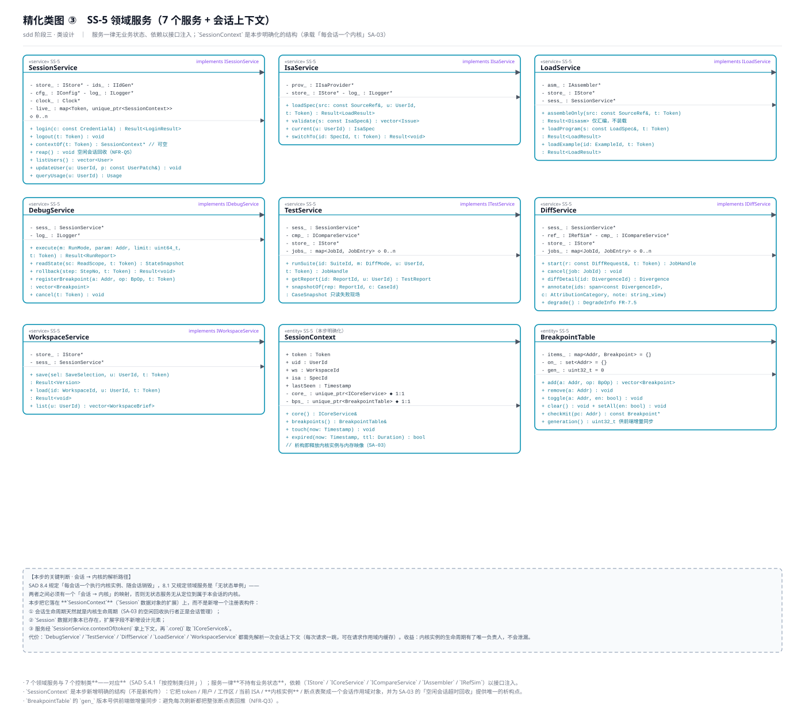
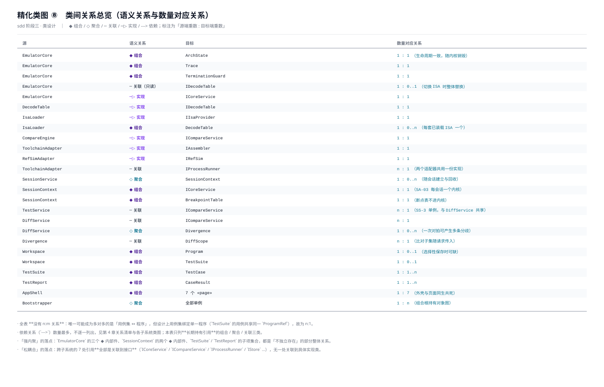
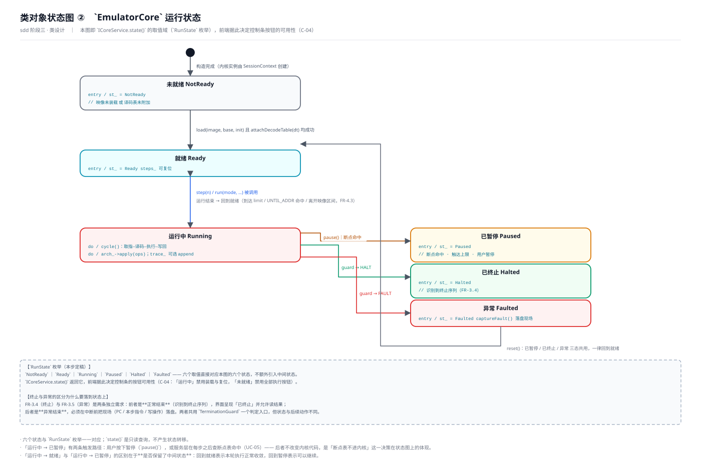
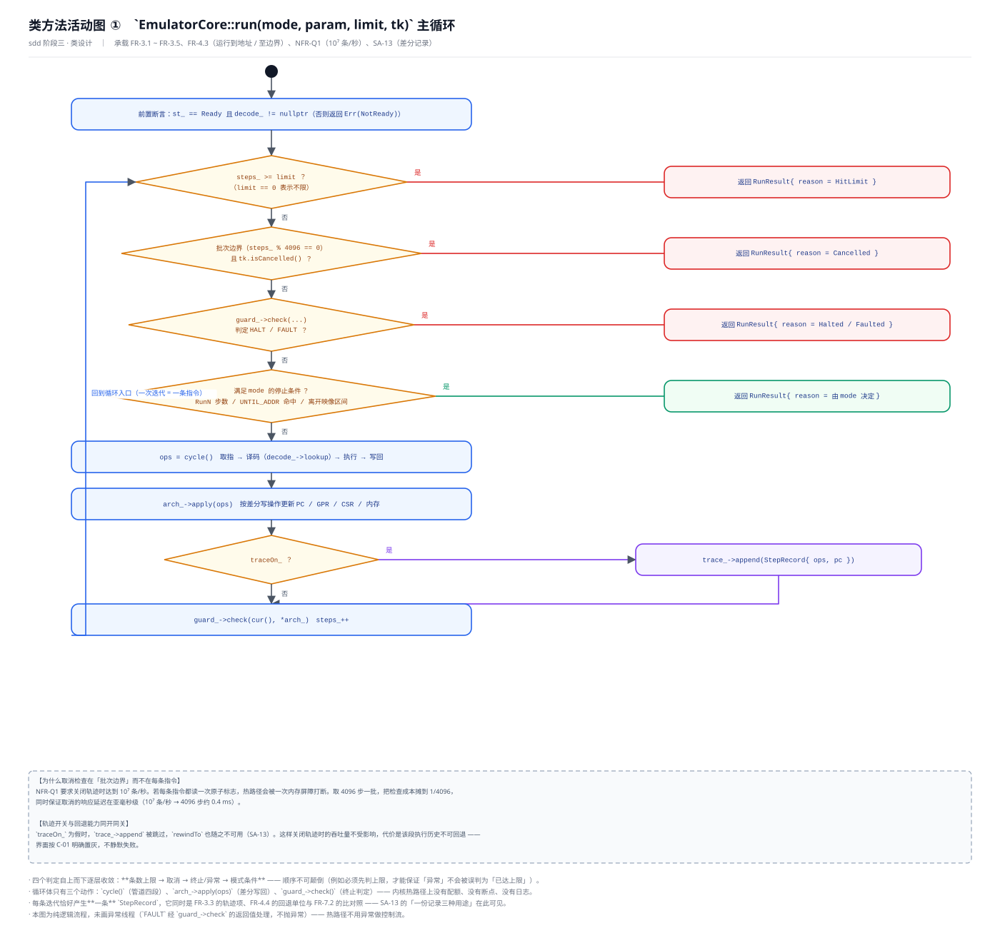

# 类设计说明

> 本文件是《软件详细设计文档》第 6 章「类设计」的过程稿与依据，对应 `sdd` 技能的第三个阶段。
> 阶段产出：**精化后的设计类图**（8 张）+ **类对象状态图**（3 张）+ **类方法活动图**（2 张）。
> 检查点：用户确认类设计。
>
> **前置说明（阶段二的执行判定）**：`sdd` 的第二阶段「子系统和构件设计」带执行判定闸，经与用户讨论后**判定不执行**，直接进入本阶段。
> 理由（会议记录的原文）：本项目的 8 个子系统与 35 个构件已在 `sad` 阶段完成划分并通过五项评审；该阶段要做的三件事中，
> **子系统/构件的职责**与**对外接口**已由 SAD 5.5.2 与 5.8 给出，**内部类设计**正是本阶段（类设计）的任务。
> 此时执行会造成同一份内容在两处维护。故本文件不设第 5 章「子系统/构件设计」的对应内容。

## 1 本步的输入与工作分解

### 1.1 输入

| 来源 | 文件 | 本步用到的内容 |
| --- | --- | --- |
| `sdd` 阶段一 | `详细设计/用例设计说明.md` | 35 个设计类的清单、30 条分析类到设计类的转换、14 个用例实现方案、**6 条待本步定稿的设计判断**（属性类型与可见性 / 方法前后置条件 / S-2 边界语义 / 取消对拍的机制） |
| `sad` | `软件设计-v2/软件体系结构设计文档.md` | 5.5.2 构件与职责、5.6 关键决策 SA-01 ~ SA-13、5.7 基础服务、5.8 子系统接口、第 8 章运行视点（并发模型、热路径、冷路径、资源边界） |
| `uid` | `软件设计-v2/用户界面设计文档.md` | 18 项补充元素 C-01 ~ C-18（其中 C-01 / C-05 / C-08 / C-14 需要类设计给出承载）、12 个界面的状态与动作 |
| `asr` | `需求分析/软件需求规格说明书.md` | FR-4.3 的**边界**定义原文（本步据此定夺 `RunMode`）、NFR-Q1 / Q2 / Q3 / Q5、NFR-I1 / I2 |

### 1.2 技能动作对照

技能把「类设计」规定为五个动作，本文件按此组织：

| 技能动作 | 本文件章节 | 产出 |
| --- | --- | --- |
| 与用户讨论，确定类的可见范围（public / protected / private），遵循信息隐藏原则，尽可能缩小可见范围 | 第 2 章 | 三档类级可见范围 + 35 类可见范围总表 + 成员级可见性规则 |
| 精化类间关系：语义关系（继承/组合/聚合/关联/依赖）、数量对应关系（1:1、1:n、0:n、n:m） | 第 3 章 | 关系清单 R-01 ~ R-21 + 重数表 + 语义关系判定 |
| 精化类的属性：名称、类型、可见范围、初始值；根据类间关系确定属性形式 | 第 4 章 | 35 类属性表 + 属性形式规则 + 类型频次统计 |
| 精化类的方法：名称、参数表、返回类型、作用范围；功能描述、前置/后置条件、实现算法；复杂方法拆分合并；对象创建与删除方法 | 第 5 章 | 各子系统方法表 + 15 个关键方法的前后置与算法 + 拆分合并记录 + 创建销毁方法 |
| （先征求用户意见）构造类对象的状态图 | 第 8 章 | 3 张状态图 |
| （用户要求时）用 UML 活动图描述方法实现算法 | 第 9 章 | 2 张活动图 |

### 1.3 本步的六条总则

以下六条约定在本步一次定下，第 4、5 章的每一行都遵循它们，后续不再逐处重复。

| # | 总则 | 内容 |
| --- | --- | --- |
| G-1 | **语言与命名** | 后端 C++17（SS-1 ~ SS-6、SS-8），前端 TypeScript 5（SS-7）。类名 `PascalCase`；方法 `camelCase`；后端成员变量**尾下划线**（`arch_`）、前端私有成员 **`#` 前缀**；常量 `k` 前缀（`kDefaultMask`）；文件名与类名一致。 |
| G-2 | **值语义优先** | 跨构件传递的数据一律用**不可变值类型**（第 6 章），不用裸指针或可变引用；只有需要身份与生命周期的对象才是**引用语义类**（35 个设计类中的构件类）。 |
| G-3 | **构造与控制反转** | 跨子系统可见的类**构造私有**，实例只由 `Bootstrapper` 创建并注入（SA-08）；同子系统内由持有者创建（`EmulatorCore` 建 `ArchState`，`SessionContext` 建内核）。**全项目只有 `Bootstrapper::build` 里出现 `new`。** |
| G-4 | **函数式核心** | 任何**纯计算**（译码、比对、终止判定、边界判定）不持有状态、不读全局、不写日志，输入输出都由参数与返回值表达。SS-3 整层无属性即由此而来。 |
| G-5 | **热路径零业务概念** | 内核（SS-1）与译码（SS-2）的代码里不出现配额、断点、用户、日志、事务等业务词；这些能力一律由外部（服务层 / 网关）以参数或回调形式带入。 |
| G-6 | **错误用返回值不用异常** | 可预期的失败（校验不通过、令牌失效、地址越界、工具链缺失、参考模拟器不可用）一律用 `Result<T>` 表达；异常只用于「不该发生的事」。（`Result<T>` 定义见 6.2。） |

## 2 可见范围的确定

### 2.1 三档类级可见范围

技能要求「尽可能缩小可见范围」。C++ 里类的可见范围不由 `public/private` 表达（那是成员的），而由**导出哪些头文件**表达。本设计把它规约为三档，并在 TS 侧用模块 `export` 对应：

| 档 | 名称 | C++ 对应 | TS 对应 | 含义 |
| --- | --- | --- | --- | --- |
| 1 | **公开契约** | 导出到 `include/` 的声名 | `export` 到 `src/api/` | 可被**其他子系统**引用 |
| 2 | **装配可见** | 仅在子系统内部头文件中声明 | 模块内导出，不进 `src/api/` | 仅 **`Bootstrapper`** 与**同子系统**可见 |
| 3 | **构件内部** | `.cpp` 内匿名命名空间 / 不导出 | 文件内非导出声明 | 仅**同一构件内**可见 |

**判定规则**（三条，按序应用）：

| 序 | 规则 | 结果 |
| --- | --- | --- |
| P1 | 该类的实例是否需要**跨子系统传递**？ | 是 → 档 1（但同时要**优先改为传递其接口**，见 2.4 的 R1） |
| P2 | 该类是否只需被**装配者**创建、由其他构件**经接口**使用？ | 是 → 档 2 |
| P3 | 该类是否只在**一个构件的内部实现**中出现？ | 是 → 档 3 |

### 2.2 35 个设计类的可见范围总表

| 子系统 | 类 | 档 | 依据 |
| --- | --- | --- | --- |
| SS-1 | `EmulatorCore` | **2 装配** | 只被 `SessionContext` 创建、被 SS-5 经 `ICoreService` 使用（P2） |
| SS-1 | `ArchState` | **2 装配** | 只被 `EmulatorCore` 创建与持有，外部一律经 `ICoreService.reads/restore`（P2 + 2.4 R2） |
| SS-1 | `Trace` | **2 装配** | 只被 `EmulatorCore` 持有；外部经 `ICoreService` 的轨迹与回退方法访问 |
| SS-1 | `TerminationGuard` | **2 装配** | `EmulatorCore` 的组合部件，外部零引用 |
| SS-2 | `IsaLoader` | **2 装配** | 只被 `Bootstrapper` 创建、被 SS-5 经 `IIsaProvider` 使用 |
| SS-2 | `DecodeTable` | **2 装配** | 由 `IsaLoader` 创建；对内核经**接口** `IDecodeTable` 暴露 |
| SS-3 | `CompareEngine` | **2 装配** | 被 SS-5 经 `ICompareService` 使用（**无状态单例**，与 `TestService` / `DiffService` 共享） |
| SS-3 | `DiffScope` | **1 公开** | 值类型：由 SS-5 / SS-6 构造并跨子系统传入（P1） |
| SS-3 | `Divergence` | **1 公开** | 数据对象：由 SS-3 产生、被 SS-5 与服务层读取并回推 |
| SS-4 | `ToolchainAdapter` | **2 装配** | 被 SS-5 经 `IAssembler` 使用 |
| SS-4 | `RefSimAdapter` | **2 装配** | 被 SS-5 经 `IRefSim` 使用 |
| SS-5 | `SessionService` | **2 装配** | 被 SS-6 经 `ISessionService` 使用；**唯二例外**：同子系统内被另 6 个服务直接引用（见 2.4 R3） |
| SS-5 | `IsaService` | **2 装配** | 被 SS-6 经 `IIsaService` 使用 |
| SS-5 | `LoadService` | **2 装配** | 被 SS-6 经 `ILoadService` 使用 |
| SS-5 | `DebugService` | **2 装配** | 被 SS-6 经 `IDebugService` 使用 |
| SS-5 | `TestService` | **2 装配** | 被 SS-6 经 `ITestService` 使用 |
| SS-5 | `DiffService` | **2 装配** | 被 SS-6 经 `IDiffService` 使用 |
| SS-5 | `WorkspaceService` | **2 装配** | 被 SS-6 经 `IWorkspaceService` 使用 |
| SS-5（**附列**） | `SessionContext` | **3 构件内部** | 只被 `SessionService` 管理与传递（经 `contextOf` 返回**引用**给同子系统的服务）。**构件内部类，不计入 35** |
| SS-5（**附列**） | `BreakpointTable` | **3 构件内部** | 由 `SessionContext` 持有；外部经 `IDebugService` 的断点方法访问。同上不计入 35 |
| SS-6 | `HttpGateway` | **2 装配** | 只被 `Bootstrapper` 创建，仅供网络层调用 |
| SS-6 | `Router` | **2 装配** | 同上 |
| SS-6 | `AccessGuard` | **2 装配** | 同上 |
| SS-6 | `Bootstrapper` | **1 公开** | 由 `main()` 调用（P1） |
| SS-7 | `AppShell` | **1 公开** | 7 个 `«page»` 都引用它 |
| SS-7 | 7 个 `«page»` | **1 公开** | 由路由按需加载 |
| SS-8 | `IStore` / `IConfig` / `ILogger` / `IIdGen` / `IProcessRunner` | **1 公开** | 跨层引用（P1） |
| SS-8 | `DbStore` / `FileConfig` / `StdLogger` / `UuidGen` / `ProcRunner` | **2 装配** | 只被 `Bootstrapper` 创建（**不计入 35 个设计类**，属构件内部实现） |

**统计口径**：本表只列 **35 个设计类**（= SAD 的 35 个构件，一一对应）：**档 1（公开契约）16 个**、**档 2（装配可见）19 个**、**档 3（构件内部）0 个** —— 16 + 19 = 35。

- **档 1 的 16 个** = `DiffScope` / `Divergence`（2）+ `Bootstrapper`（1）+ SS-7 的 8 个（`AppShell` + 7 个 `«page»`）+ SS-8 的 5 个接口。档 1 占比高是因为**数据结构本身就要求跨子系统传递**；凡是「能力」都已被收敛为接口（档 1 里是接口而非实现类）。
- **档 3 在 35 个设计类里为空**：`SessionContext` / `BreakpointTable` 虽是档 3，但它们是 `SessionService` / `DebugService` 的**构件内部类**（上表已标「附列」），不计入 35；另一类档 3 成员是**属性式的内部索引结构**（如 `DecodeTable.rows_`），不是类。

> **值类型不进入本表**：`TestSuite` / `TestCase` / `TestReport` / `CaseResult` / `Program` / `Workspace` 等是**值对象**（6.2 有权威清单），与「设计类」是两个口径。此前把它们混在本表里，使三档统计（18 / 17 / 3 = 38）与「35 个设计类」及表内列举三者互不相等 —— 这是评审 ①-3 / ⑥-3 的修正点。

### 2.3 成员级可见性规则

| 成员类别 | 可见性 | 说明 |
| --- | --- | --- |
| **数据成员** | 一律 `private` | 无例外。子类需要访问时用 `protected`（本设计**不使用继承**，故 `protected` 实际零出现） |
| **只读访问器** | `public`，且带 `const` | 值类型与数据对象的只读字段（如 `Divergence.stepNo`） |
| **契约方法** | `public` | 接口声明的方法 |
| **构件内部协作方法** | `private` | 如 `EmulatorCore::cycle()`、`IsaLoader::threeStage()` |
| **构造 / 析构** | 见 G-3 | 跨子系统类私有构造；值类型公开构造 |
| **静态工厂** | `public static` | `DecodeTable::build()`、`DiffScope::preset()` |

**不做的事**（明确边界）：

- **不使用继承**：整个设计**零继承**，只有「实现接口」。理由：35 个构件之间没有任何「是一种」的语义关系（第 3 章会逐条验证），强行用继承只会引入脆弱的基类耦合。因此 UML 里的 `#`（protected）在本设计中**不出现**。
- **不用友元**：跨类的内部访问一律经接口或值类型，不用 `friend` 开后门。

### 2.4 三处「缩小可见范围」的实例

技能要求「尽可能缩小」。本步实际做了三处收缩，都是把原本可能的宽可见性改成窄可见性：

| # | 收缩 | 改前 | 改后 | 收益 |
| --- | --- | --- | --- | --- |
| **R1** | 跨子系统传递的是**接口**而非实现类 | 用例设计阶段 UC-02 写的是 `IsaService → DecodeTable.build(spec)`，即 SS-5 直接依赖 SS-2 的具体类 | 改为 SS-5 只依赖 **`IIsaProvider`**；`DecodeTable` 由 `IsaLoader` 创建并只在 SS-2 内可见 | SS-5 的代码里不出现 `DecodeTable` 这个名字；换一套译码表实现不影响 SS-5 |
| **R2** | `ArchState` / `Trace` 从「服务层可访问」收缩为「装配可见」 | 用例设计阶段 UC-06 / UC-07 写的是 `DebugService → ArchState.snapshot()`、`DebugService → ArchState.restore(s)` | `ArchState` 与 `Trace` 降为**档 2**，SS-5 一律经 `ICoreService.reads/restore/rollback` 访问；`ICoreService` 因此**增加一个方法** `restore(StateSnapshot)` | 「谁能改架构状态」在类型系统上唯一：只有 `EmulatorCore`。这防止了「服务层绕过内核直接改状态」这类会破坏 SA-13 的写法 |
| **R3** | 会话上下文不暴露内核的**所有权** | 用例设计阶段 UC-04 写的是 `DebugService → EmulatorCore.step(1)`，隐含「服务持有内核引用」 | `DebugService` 等 5 个服务经 `SessionService.contextOf(token)` 取 `SessionContext&`，再 `.core()` 取 `ICoreService&`；`SessionContext` 为**档 3**，其 `core_` 成员的 `unique_ptr` 所有权不对外暴露 | 内核实例的生命周期只有 `SessionContext` 一个负责人（SA-03 的落点）；服务层拿到的是引用，销毁不了它 |

> **R2 与 R3 是对用例设计阶段的两处修正**，需要登记（见第 10 章 D-2、D-3）。两处都**不改变用例实现方案的协作序列**，只改变了调用点的门面（多一跳转发）。

## 3 类间关系的精化

### 3.1 语义关系的判定

技能列出五种语义关系。本设计逐类检验后的结论：

| 语义关系 | 出现 | 数量 | 说明 |
| --- | --- | --- | --- |
| **继承（ generalization ）** | ✗ | 0 | 见 2.3：「不使用继承」。35 个构件之间不存在「是一种」的关系 |
| **实现（ realization ）** | ✓ | 13 | 7 个领域服务实现各自的接口、`EmulatorCore` / `DecodeTable` / `IsaLoader` / `CompareEngine` / `ToolchainAdapter` / `RefSimAdapter` 各实现一个契约接口。**这是本设计中唯一的「is-a」关系类型** |
| **组合（ composition ）◆** | ✓ | 8 组 | 见 3.3 的 R-01 ~ R-08 |
| **聚合（ aggregation ）◇** | ✓ | 4 组 | 见 R-09 ~ R-12 |
| **关联（ association ）─** | ✓ | 9 组 | 见 R-13 ~ R-21 |
| **依赖（ dependency ）--→** | ✓ | 51 处 | 方法参数 / 局部变量 / 返回值的临时使用，不长期持有引用 |

**实现关系的 13 处对应表**（这是 SA-01 依赖倒置与「面向接口编程」的完整清单）：

| # | 实现类 | 接口 | 归属 | 依据 |
| --- | --- | --- | --- | --- |
| I-01 | `EmulatorCore` | `ICoreService` | SS-1 | SAD 5.4.2 |
| I-02 | `DecodeTable` | `IDecodeTable` | **SS-1 定义 / SS-2 实现** | **SA-01 依赖倒置** |
| I-03 | `IsaLoader` | `IIsaProvider` | SS-2 | SAD 5.8 |
| I-04 | `CompareEngine` | `ICompareService` | SS-3 | SAD 5.8 |
| I-05 | `ToolchainAdapter` | `IAssembler` | SS-4 | SAD 5.8 |
| I-06 | `RefSimAdapter` | `IRefSim` | SS-4 | SAD 5.8 |
| I-07 ~ I-13 | `SessionService` / `IsaService` / `LoadService` / `DebugService` / `TestService` / `DiffService` / `WorkspaceService` | `ISessionService` / `IIsaService` / `ILoadService` / `IDebugService` / `ITestService` / `IDiffService` / `IWorkspaceService` | SS-5 | SAD 5.4.1 |
| （附） | `DbStore` / `FileConfig` / `StdLogger` / `UuidGen` / `ProcRunner` | `IStore` / `IConfig` / `ILogger` / `IIdGen` / `IProcessRunner` | SS-8 | 构件内部实现，不计入 13 |

> **I-02 是全设计唯一一处「接口与实现分属不同子系统且方向相反」的关系**，它是 SA-01 的完整表达。除此之外所有实现关系都在同一子系统内。

### 3.2 数量对应关系

技能要求确定 1:1、1:n、0:n、n:m。本设计的完整结论：

| 重数 | 出现组数 | 清单 |
| --- | --- | --- |
| **1 : 1** | 4 | `EmulatorCore` ◆ `ArchState`；`EmulatorCore` ◆ `Trace`；`EmulatorCore` ◆ `TerminationGuard`；`SessionContext` ◆ `BreakpointTable` |
| **1 : 0..1** | 3 | `EmulatorCore` ─ `IDecodeTable`（未装载译码表时为空）；`Workspace` ◆ `Program`；`TestSuite` 用例的 `expect_` |
| **1 : 0..n** | 5 | `SessionService` ◇ `SessionContext`；`IsaLoader` ◆ `DecodeTable`；`DiffService` ◇ `JobEntry`；`TestService` ◇ `JobEntry`；**`Workspace` ◆ `TestSuite`**（**DD-8 回写 M-10**：基数由 0..1 修正为 0..n，与 UI-05 的 `SuiteRow[]` 一致） |
| **1 : 1..n** | 2 | `TestSuite` ◆ `TestCase`；`TestReport` ◆ `CaseResult` |
| **n : 1** | 4 | `ToolchainAdapter` / `RefSimAdapter` ─ `IProcessRunner`；`TestService` / `DiffService` ─ `ICompareService` |
| **n : m** | **0** | **本设计不存在多对多关系。** 唯一有嫌疑的是「用例集 ↔ 程序」，但设计上用例集绑定单一程序（`TestSuite.cases` 共享同一 `ProgramRef`），故为 n:1（见 3.4）。**数据设计阶段因此不需要任何交叉表。** |

### 3.3 关系清单

只列**长期持有引用**的组合 / 聚合 / 关联三类（依赖类的 51 处散落在第 5 章各方法表中，不单列）。每一行给出语义、重数、属性形式与理由。

**组合（◆ 部分整体，生命周期一致）**

| # | 整体 | 部分 | 重数 | 属性形式 | 理由 |
| --- | --- | --- | --- | --- | --- |
| R-01 | `EmulatorCore` | `ArchState` | 1:1 | `unique_ptr<ArchState> arch_` | 架构状态脱离内核无意义；内核销毁时状态必须同时释放 |
| R-02 | `EmulatorCore` | `Trace` | 1:1 | `unique_ptr<Trace> trace_` | 轨迹是「本内核的」执行历史，不可跨内核共享（SA-13 的差分记录与内核一一对应） |
| R-03 | `EmulatorCore` | `TerminationGuard` | 1:1 | `unique_ptr<TerminationGuard> guard_` | 终止判定需要「最近三条指令」这一跨步记忆；该记忆的生命周期与内核一致 |
| R-04 | `IsaLoader` | `DecodeTable` | 1:0..n | `map<SpecId, unique_ptr<DecodeTable>> tables_` | 每套已装载的 ISA 各有一个译码表；描述被淘汰时表同时释放 |
| R-05 | `SessionContext` | `ICoreService` | 1:1 | `unique_ptr<ICoreService> core_` | **SA-03 的核心落点**：每会话一个内核实例，随会话销毁 |
| R-06 | `SessionContext` | `BreakpointTable` | 1:1 | `unique_ptr<BreakpointTable> bps_` | 断点表是会话私有的调试状态；内核不持有它（UC-05 的决策） |
| R-07 | `TestSuite` | `TestCase` | 1:1..n | `vector<TestCase> cases_` | 用例脱离用例集无意义；子项随聚合根存取 |
| R-08 | `TestReport` | `CaseResult` | 1:1..n | `vector<CaseResult> results_` | 同上 |
| （附） | `Workspace` | `Program` | 1:0..1 | `optional<Program>` | **可选**组合：选择性保存时程序可单独缺席 |
| （附） | `Workspace` | `TestSuite` | **1:0..n** | **`vector<TestSuite>`** | **可选**组合；基数由 0..1 修正为 0..n（**DD-8 回写 M-10**，经用户裁决按 n:1 建表） |
| （附） | `AppShell` | 7 个 `«page»` | 1:7 | 前端路由表 | 外壳与页面同生共死 |

**聚合（◇ 整体部分，但部分可独立存在）**

| # | 整体 | 部分 | 重数 | 属性形式 | 理由 |
| --- | --- | --- | --- | --- | --- |
| R-09 | `SessionService` | `SessionContext` | 1:0..n | `map<Token, unique_ptr<SessionContext>> live_` | 会话由服务**创建与回收**，但每个会话上下文自身是完整对象；服务的销毁不意味着会话对象的语义消失（只是不可达）。用 ◆ 亦可，取 ◇ 是为强调**回收动作由服务显式发起**（`reap`） |
| R-10 | `DiffService` | `JobEntry` | 1:0..n | `map<JobId, JobEntry> jobs_` | 任务条目在服务内登记与清理，但任务的生命周期可以长于一次请求 |
| R-11 | `TestService` | `JobEntry` | 1:0..n | `map<JobId, JobEntry> jobs_` | 同 R-10；两个服务各自持有自己的任务表（互不可见，因为比对引擎是共享的而任务不是） |
| R-12 | `Bootstrapper` | 全部单例 | 1:n | `Container graph_` | 组合根持有整张对象图；进程退出时统一释放 |

**关联（─ 长期持有引用，但无整体部分语义）**

| # | 源 | 目标 | 重数 | 属性形式 | 理由 |
| --- | --- | --- | --- | --- | --- |
| R-13 | `EmulatorCore` | `IDecodeTable` | 1:0..1 | `const IDecodeTable* decode_`（**非拥有**） | 译码表由 SS-2 创建与持有，内核对它只有使用权（依赖倒置的另一半：**所有权不反转**） |
| R-14 | `ToolchainAdapter` | `IProcessRunner` | n:1 | `IProcessRunner* runner_` | 与 `RefSimAdapter` 共享同一份进程管理实现 |
| R-15 | `RefSimAdapter` | `IProcessRunner` | n:1 | `IProcessRunner* runner_` | 同上 |
| R-16 | `TestService` | `ICompareService` | n:1 | `ICompareService* cmp_` | 与 `DiffService` 共享 SS-3 的无状态引擎（SA-04） |
| R-17 | `DiffService` | `ICompareService` | n:1 | `ICompareService* cmp_` | 同上 |
| R-18 | `DiffService` | `IRefSim` | 1:1 | `IRefSim* ref_` | 对拍必须有一个参考执行方 |
| R-19 | `LoadService` | `IAssembler` | 1:1 | `IAssembler* asm_` | 汇编能力经适配层（SA-06） |
| R-20 | 5 个领域服务 | `SessionService` | n:1 | `SessionService* sess_` | **R3 收缩的落点**：5 个服务经它解析会话上下文，从而拿到内核引用 |
| R-21 | 7 个领域服务 + `AccessGuard` | `IStore` | n:1 | `IStore* store_` | 持久化是横切关注点（SAD 5.7） |

### 3.4 强内聚、松耦合的落点

技能要求遵循「自然抽象」与「强内聚、松耦合」。本设计的具体证据：

**强内聚的证据（三条）**

1. **组合关系 = 内聚边界**：8 组 ◆ 的「部分」都只能由「整体」创建与释放，任何一个部分都**不被第二个整体引用**（第 4 章的属性表可逐行验证）。例如 `ArchState` 只被 `EmulatorCore` 持有，`BreakpointTable` 只被 `SessionContext` 持有。
2. **n:m 为零**：全设计没有任何多对多关系，意味着不存在「两个聚合共享同一批可变子对象」这种最容易产生一致性问题的结构。
3. **SS-3 无属性**：`CompareEngine` 一个数据成员都没有——它是纯粹的算法构件。这是「一类变更原因」的极端体现：它的变更只可能来自比对规则本身。

**松耦合的证据（三条）**

1. **跨子系统的 9 组关联中，7 组的目标是接口**（R-13 ~ R-21）。唯一两个非接口目标（`SessionService`）也已在 R3 说明其必要性。**没有任何一处跨子系统关联到具体实现类。**
2. **依赖方向单向无环**，与 SAD 5.8 的依赖图一致；唯一反向的 I-02 由 SA-01 消解。
3. **属性里没有全局变量、单例访问器、服务定位器**：所有依赖都是构造注入的成员指针（第 4 章属性表里 `*` 结尾的类型），因此任何构件都能在单测里被替换成测试替身——这正是 NFR-I2「内核可独立单测」的支撑。

## 4 属性的精化

### 4.1 属性形式规则

技能要求「根据类间关系确定属性形式」。本设计只有五种形式：

| 形式 | 写法 | 何时用 | 判据 |
| --- | --- | --- | --- |
| **组合形式** | `unique_ptr<X> x_` | 整体-部分，部分随整体销毁 | 关系表里是 ◆ 或 ◇（服务持有） |
| **关联形式** | `X* x_`（非拥有）或 `X& x_` | 长期持有但不是自己的 | 关系表里是 ─ 或由构造注入的依赖 |
| **值形式** | `X x_` / `const X x_` | 不可变值类型、枚举、基本类型 | 无身份与生命周期 |
| **集合形式** | `map<..>` / `vector<..>` / `deque<..>` / `set<..>` | 一对多 | 重数是 1:n / 0:n |
| **只读形式** | `public const` 成员或只读访问器 | 值类型与数据对象的对外字段 | 构造后不再变更 |

**三条细则**：

- **不用 `shared_ptr`**：所有权必须唯一（G-3）。`CompareEngine` 被两个服务共享，但它是**无状态单例**，两个服务各持一个裸指针即可，不需要共享所有权。
- **裸指针表示「非拥有」**，且**一律在构造时注入、生命周期长于持有者**（由 `Bootstrapper` 的装配顺序保证，见精化类图 ⑤ 的装配顺序说明）。
- **`optional<T>` 表达「可空的值」**，不用空指针表达（`fault_` / `attr_` / `snapshot_` / `program_`）。

### 4.2 SS-1 模拟执行内核（4 个类）

**`EmulatorCore`**（档 2）

| # | 属性 | 类型 | 可见性 | 初始值 | 形式 | 说明 |
| --- | --- | --- | --- | --- | --- | --- |
| 1 | `arch_` | `unique_ptr<ArchState>` | private | 构造建立 | 组合 | R-01 |
| 2 | `trace_` | `unique_ptr<Trace>` | private | 构造建立 | 组合 | R-02 |
| 3 | `guard_` | `unique_ptr<TerminationGuard>` | private | 构造建立 | 组合 | R-03 |
| 4 | `decode_` | `const IDecodeTable*` | private | `nullptr` | 关联（非拥有） | R-13；未装载译码表时为空 |
| 5 | `image_` | `ImageDesc` | private | `{}` | 值 | 含 `lo_` / `hi_` / `entryPc` / `stackPtr`；`atBoundary()` 读它 |
| 6 | `st_` | `RunState` | private | `RunState::NotReady` | 值（枚举） | 状态图的六取值之一 |
| 7 | `steps_` | `uint64_t` | private | `0` | 值 | 本次装载后的累计步数；`load` / `reset` 时清零 |
| 8 | `limit_` | `uint64_t` | private | `0` | 值 | **本次运行的**条数上限（参数快照，非会话配置）——SA-05 的落点 |
| 9 | `tk_` | `const CancelToken*` | private | `nullptr` | 关联（非拥有） | 本次运行的取消令牌 |
| 10 | `traceOn_` | `bool` | private | `false` | 值 | 轨迹开关；关闭时回退能力同时关闭（SA-13） |

> **属性 8 与 9 是「参数快照」而非「会话配置」**：它们在每次 `run()` 进入时被写入、退出时不再有意义。这样内核仍然没有跨调用的业务状态，`state()` 的语义保持纯粹（只反映执行状态，不反映配额）。

**`ArchState`**（档 2）

| # | 属性 | 类型 | 可见性 | 初始值 | 形式 | 说明 |
| --- | --- | --- | --- | --- | --- | --- |
| 1 | `pc_` | `Addr` | private | `0x00000000` | 值 | 程序计数器 |
| 2 | `gpr_` | `Word[32]` | private | 全 `0`（含 `x0`） | 值（定长数组） | 32 个通用寄存器；`x0` 的零值由 `apply` 强制（写 `x0` 被忽略） |
| 3 | `csr_` | `CsrFile` | private | `{}` | 值 | `array<uint32_t, 4096>` 的稀疏封装 |
| 4 | `mem_` | `MemImage` | private | `{}` | 值 | 稀疏页实现（`map<PageNo, Page>`），按需分配；**不预分配整段地址空间** |

> 属性 2 与 4 的初始值口径：`gpr_` 全 0 是 RISC-V 的架构约定；`mem_` 为空表示「未写过的地方读为 0」，**不预分配 4 GiB**——这是 NFR-Q5「内存用量限制」在数据结构层面的落实。

**`Trace`**（档 2）

| # | 属性 | 类型 | 可见性 | 初始值 | 形式 | 说明 |
| --- | --- | --- | --- | --- | --- | --- |
| 1 | `rec_` | `deque<StepRecord>` | private | `{}` | 集合 | 双端队列：尾部追加、头部弹出（裁剪） |
| 2 | `cap_` | `size_t` | private | 构造注入（`IConfig.traceCapacity`，落地值 `1'048'576`） | 值（只读） | 轨迹长度上限（SA-13 的「可裁剪」） |
| 3 | `base_` | `StepNo` | private | `0` | 值 | 已被裁剪掉的最早步号；`rewindTo` 用它判定「不可回退」 |
| 4 | `on_` | `bool` | private | `false` | 值 | 轨迹开关（与 `EmulatorCore::traceOn_` 同步） |

**`TerminationGuard`**（档 2）

| # | 属性 | 类型 | 可见性 | 初始值 | 形式 | 说明 |
| --- | --- | --- | --- | --- | --- | --- |
| 1 | `last_` | `array<Enc, 3>` | private | `{}` | 值 | 最近三条指令的编码；用于识别多指令终止序列 |
| 2 | `halted_` | `bool` | private | `false` | 值 | 已判定的终止标志 |
| 3 | `fault_` | `optional<FaultRecord>` | private | `nullopt` | 值 | 异常现场；`captureFault` 写入，`reset` 清除 |

### 4.3 SS-2 ISA 抽象（2 个类）

**`IsaLoader`**（档 2）

| # | 属性 | 类型 | 可见性 | 初始值 | 形式 | 说明 |
| --- | --- | --- | --- | --- | --- | --- |
| 1 | `tables_` | `map<SpecId, unique_ptr<DecodeTable>>` | private | `{}` | 组合集合 | R-04；每套已装载 ISA 一个译码表 |
| 2 | `active_` | `SpecId` | private | `{}` | 值 | 最近一次成功装载的 spec，仅供 `available()` 排序提示；**无会话语义** |
| 3 | `issues_` | `vector<Issue>` | private | `{}` | 集合 | 最近一次校验的问题清单（`load` 的返回值直接从它复制） |

> **属性 2 的取舍**：`IsaLoader` 是**应用级单例**，如果让「当前 ISA」成为它的属性，多会话就会互相覆盖。因此这里只留「提示用的最近一次」，真正的「当前 ISA」在 `SessionContext::isa`（会话级）与 `EmulatorCore::decode_`（内核级）。

**`DecodeTable`**（档 2，**不可变**）

| # | 属性 | 类型 | 可见性 | 初始值 | 形式 | 说明 |
| --- | --- | --- | --- | --- | --- | --- |
| 1 | `spec_` | `const IsaSpec` | private | 构造注入 | 值（只读） | 构建它的描述，保留供 `width()` 与审计 |
| 2 | `wide_` | `const BitMask` | private | 构造计算 | 值（只读） | 编码宽度位图（哪些位参与匹配） |
| 3 | `rows_` | `const vector<Instruction>` | private | 构造计算，长度 `1 << kMaxEncBits` | 集合（只读） | 直表；`lookup` 是 O(1) 下标访问 |

> **不可变的收益**：`EmulatorCore` 持有 `const IDecodeTable*`，编译器保证它不会被写；同时一个 `DecodeTable` 实例可安全地被多个会话共享（只要 ISA 相同），省去重复构建。

### 4.4 SS-3 比对（3 个类）

**`CompareEngine`** — **零属性**（G-4 函数式核心）。三个方法全是纯函数：输入两份序列与一个 `DiffScope`，输出 `optional<Divergence>`，不读不写任何成员。

**`DiffScope`**（档 1，值类型）

| # | 属性 | 类型 | 可见性 | 初始值 | 形式 | 说明 |
| --- | --- | --- | --- | --- | --- | --- |
| 1 | `fields_` | `FieldMask` | private | `kPresetMask`（PC+GPR+内存写+被改 CSR） | 值（位掩码） | FR-7.2 的默认子集 |
| 2 | `gprMask_` | `uint32_t` | private | `0xFFFFFFFF` | 值（位掩码） | 32 个 GPR 的逐位开关——支持「只比 x10~x17」这类子集 |
| 3 | `mode_` | `DiffMode` | private | `DiffMode::Stepwise` | 值（枚举） | 逐条比对 / 终态比对 |

**`Divergence`**（档 1，数据对象）

| # | 属性 | 类型 | 可见性 | 初始值 | 形式 | 说明 |
| --- | --- | --- | --- | --- | --- | --- |
| 1 | `divId` | `DivergenceId` | public 只读 | 构造注入 | 值 | 唯一标识（`IIdGen.newDivergenceId`） |
| 2 | `stepNo` | `StepNo` | public 只读 | 构造注入 | 值 | 分歧发生的步号 |
| 3 | `sideA` | `StateSnapshot` | public 只读 | 构造注入 | 值 | 本内核该步的架构状态 |
| 4 | `sideB` | `StateSnapshot` | public 只读 | 构造注入 | 值 | 参考方该步的架构状态 |
| 5 | `diffs_` | `vector<FieldDiff>` | private | `{}` | 集合 | 差异字段清单 |
| 6 | `attr_` | `optional<Attribution>` | private | `nullopt` | 值 | 归因标注（UC-11 写入） |
| 7 | `note_` | `string` | private | `""` | 值 | 归因说明 |

> 属性 1~4 标 `public 只读`：「公开」指读得到，「只读」指构造后不再变更。第 1~4 项之外**唯一可变**的是 6、7，经 `update` 单方法写入——这正是用例设计把 UC-11 判为「方式一」的依据。

### 4.5 SS-4 适配（2 个类）

**`ToolchainAdapter`**（档 2）

| # | 属性 | 类型 | 可见性 | 初始值 | 形式 | 说明 |
| --- | --- | --- | --- | --- | --- | --- |
| 1 | `runner_` | `IProcessRunner*` | private | 构造注入 | 关联 | R-14 |
| 2 | `spec_` | `ToolchainSpec` | private | 构造注入（`IConfig.toolchainPath` + 参数模板） | 值 | 命令拼装依据 |
| 3 | `cache_` | `map<Hash, Image>` | private | `{}` | 集合 | **可选**：同源文件不重复汇编。设为空即关闭缓存（见 5.5 的拆分记录） |

**`RefSimAdapter`**（档 2）

| # | 属性 | 类型 | 可见性 | 初始值 | 形式 | 说明 |
| --- | --- | --- | --- | --- | --- | --- |
| 1 | `runner_` | `IProcessRunner*` | private | 构造注入 | 关联 | R-15 |
| 2 | `path_` | `Path` | private | 构造注入（`IConfig.spikePath`） | 值 | 可执行文件路径 |
| 3 | `degraded_` | `bool` | private | `false` | 值 | 参考模拟器不可用时的降级标志（FR-7.5） |

> **`degraded_` 与 `available()` 的分工**：`available()` 是**探测**（可执行文件是否存在且能启动），`degraded_` 是**记录**（上次调用是否失败）。前者用于启动期判定，后者用于运行期降级提示——两者都不进入基础服务（适配层是唯一知道「参考模拟器」这个概念的地方）。

### 4.6 SS-5 领域服务（7 个服务 + 6 个数据对象）

**7 个服务的属性**（一律为构造注入的关联 + 必要的聚合集合）

| 服务 | 属性 | 类型 | 可见性 | 形式 |
| --- | --- | --- | --- | --- |
| `SessionService` | `store_` / `ids_` / `cfg_` / `log_` / `clock_` | `IStore*` / `IIdGen*` / `IConfig*` / `ILogger*` / `Clock*` | private | 关联 |
| | `live_` | `map<Token, unique_ptr<SessionContext>>` | private，初值 `{}` | 聚合集合（R-09） |
| `IsaService` | `prov_` / `store_` / `log_` | `IIsaProvider*` / `IStore*` / `ILogger*` | private | 关联 |
| `LoadService` | `asm_` / `store_` / `sess_` | `IAssembler*` / `IStore*` / `SessionService*` | private | 关联 |
| `DebugService` | `sess_` / `log_` | `SessionService*` / `ILogger*` | private | 关联 |
| `TestService` | `sess_` / `cmp_` / `store_` | `SessionService*` / `ICompareService*` / `IStore*` | private | 关联 |
| | `jobs_` | `map<JobId, JobEntry>` | private，初值 `{}` | 聚合集合（R-11） |
| `DiffService` | `sess_` / `ref_` / `cmp_` / `store_` | `SessionService*` / `IRefSim*` / `ICompareService*` / `IStore*` | private | 关联 |
| | `jobs_` | `map<JobId, JobEntry>` | private，初值 `{}` | 聚合集合（R-10） |
| `WorkspaceService` | `store_` / `sess_` | `IStore*` / `SessionService*` | private | 关联 |

> **属性总量对比**：7 个服务合计 **25 个数据成员**，其中 22 个是注入的关联（17 个跨子系统 + 5 个同子系统的 `SessionService*`，见 2.4 的 R3）、3 个是任务/会话表。**没有一个服务持有业务数据**（用户、工作区、报告都不在服务里，而在 `IStore` 或每次请求的值对象里）——这就是 SAD 8.4「无状态服务单例」在属性表上的体现。

**`SessionContext`**（档 3，本步明确化的结构）

| # | 属性 | 类型 | 可见性 | 初始值 | 形式 | 说明 |
| --- | --- | --- | --- | --- | --- | --- |
| 1 | `token` | `Token` | public 只读 | 构造注入 | 值 | 会话令牌 |
| 2 | `uid` | `UserId` | public 只读 | 构造注入 | 值 | 所有者（`IStore` 隔离谓词的来源） |
| 3 | `ws` | `WorkspaceId` | public 只读 | 构造注入 | 值 | 默认工作区 |
| 4 | `isa` | `SpecId` | public 只读 | 构造注入 | 值 | 当前 ISA（会话级——多会话可各用不同 ISA） |
| 5 | `lastSeen` | `Timestamp` | public | 构造时 = `clock.now()` | 值 | `touch` 推进；`reap` 读它 |
| 6 | `core_` | `unique_ptr<ICoreService>` | private | 构造建立 | **组合** | R-05 / SA-03 |
| 7 | `bps_` | `unique_ptr<BreakpointTable>` | private | 构造建立 | **组合** | R-06 |

**`BreakpointTable`**（档 3）

| # | 属性 | 类型 | 可见性 | 初始值 | 形式 | 说明 |
| --- | --- | --- | --- | --- | --- | --- |
| 1 | `items_` | `map<Addr, Breakpoint>` | private | `{}` | 集合 | 按地址索引 |
| 2 | `on_` | `set<Addr>` | private | `{}` | 集合 | 已启用的子集（与 `items_` 的 `enabled` 字段冗余，取 `set` 是为了 `checkHit` 走 O(log n) 而不是遍历） |
| 3 | `gen_` | `uint32_t` | private | `0` | 值 | 版本号，每次变更自增；供前端做增量同步（C-03） |

**领域数据对象**（档 1）

| 类 | 属性 | 类型 | 可见性 | 形式 |
| --- | --- | --- | --- | --- |
| `Program` | `image` / `base` / `entryPc` / `stackPtr` / `sourceRef` | `Image` / `Addr` / `Addr` / `Addr` / `SourceRef` | public 只读 | 值 |
| `Workspace` | `wsId` / `owner` / `version` | `WorkspaceId` / `UserId` / `Version` | public 只读 | 值 |
| | `program_` / `suite_` / `config_` | `optional<Program>` / `optional<TestSuite>` / `SessionConfig` | private | 值（可选组合） |
| `TestSuite` | `suiteId` / `name` / `group` / `tags` | `SuiteId` / `string` / `string` / `vector<string>` | public 只读 | 值 |
| | `cases_` | `vector<TestCase>` | private | 组合集合（R-07） |
| `TestCase` | `caseId` / `name` / `program` / `timeoutSteps` | `CaseId` / `string` / `ProgramRef` / `uint64_t` | public 只读 | 值 |
| | `expect_` | `ExpectedSpec` | private | 值 |
| `TestReport` | `reportId` / `suiteId` / `owner` / `startedAt` / `finishedAt` | `ReportId` / `SuiteId` / `UserId` / `Timestamp` / `Timestamp` | public 只读 | 值 |
| | `results_` | `vector<CaseResult>` | private | 组合集合（R-08） |
| `CaseResult` | `caseId` / `passed` / `firstDiffAt` / `diffFields` | `CaseId` / `bool` / `optional<StepNo>` / `vector<FieldDiff>` | public 只读 | 值 |
| | `snapshot_` | `optional<StateSnapshot>` | private | 值 |

### 4.7 SS-6 集成 API（4 个类）

| 类 | 属性 | 类型 | 可见性 | 初始值 | 形式 | 说明 |
| --- | --- | --- | --- | --- | --- | --- |
| `HttpGateway` | `guard_` | `AccessGuard*` | private | 注入 | 关联 | |
| | `router_` | `Router*` | private | 注入 | 关联 | |
| | `ws_` | `WsRegistry` | private | `{}` | 值 | 连接 → 会话的注册表 |
| | `log_` | `ILogger*` | private | 注入 | 关联 | |
| `Router` | `table_` | `map<RouteKey, Handler>` | private | `{}` | 集合 | 分发表（**可独立替换**，SAD 5.4.4） |
| | `schema_` | `map<RouteKey, Schema>` | private | `{}` | 集合 | 参数 Schema（`bind` 用） |
| | `svcs_` | `ServiceSet` | private | 注入 | 值（引用集合） | 7 个领域服务接口的引用集 |
| `AccessGuard` | `cfg_` / `store_` / `log_` | `IConfig*` / `IStore*` / `ILogger*` | private | 注入 | 关联 |  |
| | `rate_` | `RateCounter` | private | `{}` | 值 | 滑动窗计数（会话数 / 请求数） |
| `Bootstrapper` | `cfg_` / `log_` | `unique_ptr<IConfig>` / `unique_ptr<ILogger>` | private | 构造建立 | 组合 | 组合根自己拥有配置与日志 |
| | `graph_` | `Container` | private | `{}` | 聚合 | R-12 |

> **`Router.table_` 的独立性值得单列一句**：把路由表做成**数据成员**而不是 `switch` 语句，是「增删接口不改鉴权代码」这一 SAD 要求的实现方式。新增一个 API 只需 `register` 一行，`HttpGateway` 与 `AccessGuard` 的代码零改动。

### 4.8 SS-7 前端（8 个类，TypeScript）

前端的「属性」即视图状态。**共同的私有约定**：状态一律用 `#` 前缀的私有字段 + 只读 getter，改动只经方法（不用公开可变字段），以便与 `AppShell` 的状态同步保持单点。

| 类 | 状态字段 | 类型 | 说明 |
| --- | --- | --- | --- |
| `AppShell` | `#store` | `RouteState` | Pinia store：`token` / `ws` / `isa` / `ui` 四项全局状态 |
| | `#api` | `ApiClient` | REST + WS 客户端（唯一出口） |
| | `#pump` | `RefreshThrottle` | 刷新合并器（NFR-Q3） |
| | `#idle` | `IdleTracker` | 空闲计时（S-8 回收提示） |
| | `#theme` | `ThemeTokens` | UID 六·6.2 的色彩令牌（常量） |
| `SessionView` | `#form` / `#users` / `#loading` | `LoginForm` / `UserRow[]` / `boolean` | UI-01 与 UI-10 共用 |
| `IsaView` | `#file` / `#issues` / `#status` | `FileRef` / `IssueRow[]` / `LoadStatus` | UI-04 |
| `LoadView` | `#src` / `#cfg` / `#preview` / `#samples` | `SourceRef` / `LoadForm` / `Disasm` / `SampleItem[]` | UI-03 与 UI-12 共用 |
| `DebugView` | `#ctl` / `#regs` / `#mem` / `#disasm` / `#trace` / `#bps` / `#editor` / `#marks` | `ControlBar` / `RegPanel` / `MemPanel` / `DisasmPanel` / `TracePanel` / `BpPanel` / `AsmEditor` / `DiffMark[]` | UI-02 八区；`#marks` 承载本步变化高亮 |
| `TestView` | `#suites` / `#checks` / `#report` / `#snapshot` | `SuiteRow[]` / `CheckItem[]` / `ReportModel` / `CaseSnapshot?` | UI-05 与 UI-06 共用 |
| `DiffView` | `#scope` / `#job` / `#divs` / `#detail` | `DiffScope` / `JobHandle?` / `DivergenceRow[]` / `DivergenceDetail?` | UI-07 与 UI-08 共用 |
| `WorkspaceView` | `#items` / `#sel` / `#apidoc` / `#tryIt` | `WorkspaceRow[]` / `SaveSelection` / `EndpointNode[]` / `TryForm?` | UI-09 与 UI-11 共用 |

> **`DebugView` 的 8 个状态字段对应 UI-02 的八区**，但它们是**同一构件的内部构成**，不是 8 个新设计类（第 2.2 节已声明不新增构件）。B 区（`#regs`）与 C 区（`#mem`）常驻、D 区（`#trace`）与 E 区（`#bps`）为选项卡——字段都在，只是渲染时的可见性不同。

### 4.9 SS-8 基础服务（5 个接口 + 5 个实现类）

**接口无属性**（纯契约）。实现类（档 2，**构件内部，不计入 35 个设计类**）：

| 实现类 | 属性 | 类型 | 初始值 | 说明 |
| --- | --- | --- | --- | --- |
| `DbStore` | `pool_` | `ConnectionPool*` | 注入 | 连接池（PostgreSQL / SQLite 共用同一接口） |
| | `dialect_` | `DbDriver*` | 注入 | SQL 方言适配（SA-10） |
| | `log_` | `ILogger*` | 注入 | |
| `FileConfig` | `kv_` | `map<string, string>` | 读自配置文件 + 环境变量 | 12 个配置项的取值 |
| | `src_` | `Path` | 注入 | 配置来源（用于报错定位） |
| `StdLogger` | `sink_` | `Sink*` | 注入 | 控制台 / 文件 / 汇聚 |
| | `min_` | `Level` | `Level::Info` | 最低输出级别 |
| | `base_` | `Fields` | `{}` | 结构化字段前缀 |
| `UuidGen` | `rng_` | `Random*` | 注入 | CSPRNG |
| `ProcRunner` | `timeout_` | `Duration` | 注入（`IConfig` 派生） | 每次调用的默认超时 |
| | `spawn_` | `SpawnFn*` | 注入 | 平台抽象（posix / win） |

### 4.10 属性汇总

| 统计项 | 数值 |
| --- | --- |
| 35 个设计类的数据成员总数 | **117** |
| 其中 `unique_ptr` 组合形式 | 10（`EmulatorCore` 3 + `IsaLoader.tables_` + `SessionService.live_` + `TestService.jobs_` + `DiffService.jobs_` + `Bootstrapper` 3） |
| 其中非拥有关联形式（`*`） | 32（含 7 个服务持有的 22 个） |
| 其中值形式（含枚举、位掩码、`optional`、前端视图状态） | 60 |
| 其中集合形式（`map` / `vector` / `deque` / `set`） | 15 |
| 出现次数最多的类型 | `UserId`（6 次）、`Addr`（6 次）、`IStore*`（7 次） |
| **零属性类** | **1 个**：`CompareEngine`（G-4） |
| **接口型零属性** | 5 个：SS-8 的 5 个接口 |

## 5 方法的精化

### 5.1 方法签名规则

| 规则 | 内容 |
| --- | --- |
| **参数命名** | 全小写驼峰；单字母缩写仅用于**高频且语义明确**者（`u: UserId` / `t: Token` / `a: Addr` / `n: size_t` / `dt: const IDecodeTable&`），其余一律具名（`init` / `scope` / `target`） |
| **参数传递** | 小值类型**按值**（`Addr` / `uint32_t` / 枚举）；大值类型按 `const&`（`Image` / `StateSnapshot` / `IsaSpec` / `string_view` 用于只读字符串）；需要写入的用 `span<const T>`（只读视图）或 `T&`（输出参数，本设计仅用一次，见 `apply`） |
| **返回** | 可预期失败一律 `Result<T>`（G-6）；可能无结果用 `optional<T>`；可能多个用 `span<const T>`（只读视图，避免拷贝大序列）或 `vector<T>`（需要构建的） |
| **作用范围** | 契约方法 `public`；构件内部协作 `private`；静态工厂 `public static`。**本设计不使用 `protected`**（无继承） |
| **不抛异常** | 除 `std::bad_alloc` 一类不可恢复错误外，方法都不抛。函数注释里以 `@pre` / `@post` / `@ret` 三段说明，见 5.4 的样式 |

### 5.2 契约接口（12 个）

跨子系统调用的门面。**接口不带数据成员、不带实现、不带默认参数**（默认值只写在实现类的声明里）。

| 接口 | 归属 | 方法（完整签名） |
| --- | --- | --- |
| `ICoreService` | SS-1 定义 | `load(const Image&, Addr base, const InitState&) : void` `attachDecodeTable(const IDecodeTable&) : void` `step(uint32_t n = 1) : StepDelta` `run(RunMode m, Addr param, uint64_t limit, const CancelToken& tk) : RunResult` `pause() : void`　`reset() : void`　`state() : RunState` `reads(ReadScope scope) : StateSnapshot` `restore(const StateSnapshot&) : void`（**R2 新增**） |
| `IDecodeTable` | **SS-1 定义**（SA-01） | `lookup(Enc enc) : const Instruction&` `width() : unsigned` |
| `IIsaProvider` | SS-2 | `load(const SourceRef&) : Result<IsaSpec>` `validate(const IsaSpec&) : vector<Issue>` `buildDecodeTable(const IsaSpec&) : const IDecodeTable&` `available() : vector<IsaSpec>` |
| `ICompareService` | SS-3 | `compare(span<const StepRecord> a, span<const StepRecord> b, const DiffScope& sc, DivergenceId id) : optional<Divergence>` `compareFinal(const StateSnapshot&, const StateSnapshot&, const DiffScope&, DivergenceId) : optional<Divergence>` |
| `IAssembler` | SS-4 | `assemble(const SourceRef&, const CancelToken&) : Result<Image>` |
| `IRefSim` | SS-4 | `run(const Program&, const DiffScope&, const CancelToken&) : Result<vector<StepRecord>>` `available() : bool` |
| `ISessionService` | SS-5 | 见 5.3.5 |
| `IIsaService` | SS-5 | 见 5.3.5 |
| `ILoadService` | SS-5 | 见 5.3.5 |
| `IDebugService` | SS-5 | 见 5.3.5 |
| `ITestService` | SS-5 | 见 5.3.5 |
| `IDiffService` | SS-5 | 见 5.3.5 |
| `IWorkspaceService` | SS-5 | 见 5.3.5 |
| （附）SS-8 的 5 个接口 | SS-8 | 见 5.3.8 |

### 5.3 各设计类的方法表

#### 5.3.1 SS-1 模拟执行内核

**`EmulatorCore`**

| # | 方法 | 作用范围 | 功能 |
| --- | --- | --- | --- |
| 1 | `load(const Image& img, Addr base, const InitState& init) : void` | public | 整体替换式装载：重建 `ArchState`、写映像与初态、`steps_ = 0`、`st_ = Ready` |
| 2 | `attachDecodeTable(const IDecodeTable& dt) : void` | public | 绑定译码表（可重复调用以切换 ISA）；`decode_ = &dt` |
| 3 | `step(uint32_t n = 1) : StepDelta` | public | 执行 n 步（`n` 默认 1）；返回最后一步的状态增量 |
| 4 | `run(RunMode m, Addr param, uint64_t limit, const CancelToken& tk) : RunResult` | public | 主循环（活动图①）；按模式与四个判定收敛 |
| 5 | `pause() : void` | public | 置 `st_ = Paused`；在下一次循环判定时生效 |
| 6 | `reset() : void` | public | 恢复装载初态；保留映像与译码表；`steps_ = 0`、`st_ = Ready` |
| 7 | `state() : RunState` | public | 只读查询（不产生转移） |
| 8 | `reads(ReadScope scope) : StateSnapshot` | public | 取架构状态只读快照；**查询路径与执行路径分离** |
| 9 | `restore(const StateSnapshot& s) : void` | public | 用快照覆盖 `ArchState`（UC-07 的回退落点；**R2 新增**） |
| 10 | `cycle() : WriteOpList` | **private** | 管道四段：取指 → 译码（`decode_->lookup`）→ 执行 → 写回（产生 `WriteOpList`） |
| 11 | `atBoundary() : bool` | **private** | `pc ∉ [image_.lo_, image_.hi_]`（FR-4.3 的边界判定） |
| 12 | `deliver(const StepDelta& d) : void` | **private** | 组装增量（供 `step` / `run` 的返回值） |

**`ArchState`**

| # | 方法 | 范围 | 功能 |
| --- | --- | --- | --- |
| 1 | `apply(span<const WriteOp> w) : void` | public | **差分写回**；`x0` 的写被丢弃；越界内存写触发 `FaultKind::MemAccessViolation` 由调用方（`cycle`）转为 guard 输入 |
| 2 | `snapshot(ReadScope scope) : StateSnapshot` | public | 按范围取只读快照（`ReadScope` 决定是否含内存全量、是否含 CSR） |
| 3 | `restore(const StateSnapshot& s) : void` | public | 覆盖式恢复（**仅 `EmulatorCore` 调用**，外部经 `ICoreService.restore`） |
| 4 | `read(Addr a, size_t n) : Bytes` | public | 读内存（未写过返回零页） |
| 5 | `write(Addr a, span<const uint8_t> b) : void` | public | 写内存（供 `load` 写初值、C-08 的批量粘贴） |
| 6 | `reset(const InitState& init) : void` | public | 恢复初态（`pc_ = entryPc`、`gpr_` 清 0、`csr_` 清 0、`mem_` 只留映像与初值） |

**`Trace`**

| # | 方法 | 范围 | 功能 |
| --- | --- | --- | --- |
| 1 | `enable(bool on) : void` | public | 开关轨迹；关闭时不追加、`rewindTo` 返回 `Err(TraceDisabled)` |
| 2 | `append(const StepRecord& r) : void` | public | 追加一条；若超 `cap_` 则**先 `trim()`** |
| 3 | `query(StepNo a, StepNo b) : span<const StepRecord>` | public | 取区间只读视图（`a < base_` 时返回 `[base_, b]`） |
| 4 | `rewindTo(StepNo t) : Result<StateSnapshot>` | public | **差分回退**（5.4 详述） |
| 5 | `trim() : void` | public | 从队首弹出直至 `size() <= cap_`，同时推进 `base_` |
| 6 | `earliest() / latest() : StepNo` | public | 可回退区间的两端 |
| 7 | `size() : size_t` | public | 当前记录条数 |

**`TerminationGuard`**

| # | 方法 | 范围 | 功能 |
| --- | --- | --- | --- |
| 1 | `check(const StepRecord& r, const ArchState& s) : GuardVerdict` | public | 返回 `None` / `Halt` / `Fault`（5.4 详述） |
| 2 | `captureFault(FaultKind k, const ArchState& s) : FaultRecord` | public | 采集异常现场（`kind` / `pc` / 本步指令 / 写操作 / 相关寄存器） |
| 3 | `reset() : void` | public | 清 `last_` / `halted_` / `fault_` |
| 4 | `halted() : bool` | public | 只读 |

#### 5.3.2 SS-2 ISA 抽象

**`IsaLoader`**（`implements IIsaProvider`）

| # | 方法 | 范围 | 功能 |
| --- | --- | --- | --- |
| 1 | `load(const SourceRef& src) : Result<IsaSpec>` | public | 读源 → `parse` → `validate` → 全通过则返回 `IsaSpec`，否则 `Err(issues)` |
| 2 | `validate(const IsaSpec& s) : vector<Issue>` | public | 三段校验的只读入口 |
| 3 | `buildDecodeTable(const IsaSpec& s) : const IDecodeTable&` | public | 命中缓存则返回已有实例，否则 `DecodeTable::build` 后入 `tables_` |
| 4 | `available() : vector<IsaSpec>` | public | 列出已装载的描述 |
| 5 | `threeStage(const IsaSpec& s) : vector<Issue>` | **private** | ① 指令集完备性 ② 寄存器定义 ③ 编码域自洽（5.4 详述） |

**`DecodeTable`**（`implements IDecodeTable`，不可变）

| # | 方法 | 范围 | 功能 |
| --- | --- | --- | --- |
| 1 | `DecodeTable(const IsaSpec& s)` | **private**（G-3） | 私有构造：算 `wide_`、铺 `rows_` |
| 2 | `static build(const IsaSpec& s) : unique_ptr<DecodeTable>` | public static | 唯一创建入口 |
| 3 | `lookup(Enc enc) : const Instruction&` | public | O(1) 下标访问；未命中返回 `kIllegal` 哨兵而不是抛异常 |
| 4 | `width() : unsigned` | public | 编码宽度（供反汇编对齐用） |

#### 5.3.3 SS-3 比对

**`CompareEngine`**（`implements ICompareService`）

| # | 方法 | 范围 | 功能 |
| --- | --- | --- | --- |
| 1 | `compare(span<const StepRecord> a, span<const StepRecord> b, const DiffScope& sc, DivergenceId id) : optional<Divergence>` | public | 逐步比对：取较短长度逐条比 `sc` 指定的字段；首个不等即构造 `Divergence`；全等返回 `nullopt` |
| 2 | `compareFinal(const StateSnapshot& a, const StateSnapshot& b, const DiffScope& sc, DivergenceId id) : optional<Divergence>` | public | 终态比对（降级模式与用例断言共用），`stepNo` 置为 `kFinalStep` |
| 3 | `firstDiff(const StepRecord& x, const StepRecord& y, const DiffScope& sc) : vector<FieldDiff>` | **private** | 逐字段比较，产出差异清单 |

**`DiffScope`**

| # | 方法 | 范围 | 功能 |
| --- | --- | --- | --- |
| 1 | `configure(FieldMask f, uint32_t gprMask, DiffMode m) : void` | public | 一次性设置三项（避免多次设值产生中间态） |
| 2 | `includes(Field f) : bool` | public | 查位掩码 |
| 3 | `mode() : DiffMode` / `gprMask() : uint32_t` | public | 只读访问器 |
| 4 | `static preset() : DiffScope` | public static | FR-7.2 的默认子集 |

**`Divergence`**

| # | 方法 | 范围 | 功能 |
| --- | --- | --- | --- |
| 1 | `diffFields() : span<const FieldDiff>` | public | 差异字段只读视图 |
| 2 | `update(AttributionCategory c, string_view note) : void` | public | 写入归因（UC-11 的单方法落点） |
| 3 | `attributed() : bool` | public | 已归因判定（界面据此决定按钮态） |

#### 5.3.4 SS-4 适配

**`ToolchainAdapter`**（`implements IAssembler`）

| # | 方法 | 范围 | 功能 |
| --- | --- | --- | --- |
| 1 | `assemble(const SourceRef& src, const CancelToken& tk) : Result<Image>` | public | 拼装命令 → `runner_->run` → 成功解析映像 / 失败调 2 |
| 2 | `parseErrors(string_view stderr) : vector<Issue>` | **private** | 把工具链错误输出映射为带**行号**的 `Issue`（回填 UI-03 的编辑器） |

**`RefSimAdapter`**（`implements IRefSim`）

| # | 方法 | 范围 | 功能 |
| --- | --- | --- | --- |
| 1 | `run(const Program& p, const DiffScope& sc, const CancelToken& tk) : Result<vector<StepRecord>>` | public | 写临时映像 → 起子进程 → 读提交日志 → 解析为内部序列 |
| 2 | `available() : bool` | public | 探测可执行文件（FR-7.5 的判定入口） |
| 3 | `parseCommitLog(string_view out) : vector<StepRecord>` | **private** | Spike 提交日志 → 内部 `StepRecord`（**只取比对所需字段**） |

#### 5.3.5 SS-5 领域服务

| 服务 | # | 方法 | 范围 | 功能 |
| --- | --- | --- | --- | --- |
| `SessionService` | 1 | `login(const Credential& c) : Result<LoginResult>` | public | UC-01 主入口（5.4 详述） |
| | 2 | `logout(Token t) : void` | public | 从 `live_` 移除 → 析构 `SessionContext`（释放内核） |
| | 3 | `contextOf(Token t) : SessionContext*` | public | 查 `live_`；**未命中返回 `nullptr`**（调用方转 401） |
| | 4 | `reap() : void` | public | 空闲会话扫描与回收（5.4 详述）；由定时器每分钟调一次 |
| | 5 | `listUsers() : vector<User>` | public | UC-14 |
| | 6 | `updateUser(UserId u, const UserPatch& p) : void` | public | 改配额 / 停用账号 |
| | 7 | `queryUsage(UserId u) : Usage` | public | 资源占用统计 |
| `IsaService` | 1 | `loadSpec(const SourceRef& src, UserId u, Token t) : Result<LoadResult>` | public | UC-02；校验失败保持上一套 ISA 生效 |
| | 2 | `validate(const IsaSpec& s) : vector<Issue>` | public | 供 C-10「重新校验」单独调用 |
| | 3 | `current(UserId u) : IsaSpec` | public | |
| | 4 | `switchTo(SpecId id, Token t) : Result<void>` | public | 取译码表 → `ctx.core().attachDecodeTable(dt)` |
| `LoadService` | 1 | `assemble(const SourceRef& src, Token t) : Result<Image>` | public | **仅汇编不装载**（UI-03 的用法，⑤~⑦ 与 ⑨ 可分离）。**D-7**：`ToolchainAdapter` 不再提供 `assembleOnly`，「不装载」＝本方法后**不调** `loadProgram` |
| | 2 | `loadProgram(const LoadSpec& s, Token t) : Result<LoadResult>` | public | UC-03；整体替换式装载 |
| | 3 | `loadExample(ExampleId id, Token t) : Result<LoadResult>` | public | UC-12 的示例程序 |
| `DebugService` | 1 | `execute(RunMode m, Addr param, uint64_t limit, Token t) : Result<RunReport>` | public | UC-04 主入口（活动图②） |
| | 2 | `readState(ReadScope sc, Token t) : StateSnapshot` | public | UC-06 |
| | 3 | `rollback(StepNo step, Token t) : Result<void>` | public | UC-07；`Trace.rewindTo` + `ICoreService.restore` |
| | 4 | `registerBreakpoint(Addr a, BpOp op, Token t) : vector<Breakpoint>` | public | UC-05；返回变更后的全表（供界面整体重绘） |
| | 5 | `cancel(Token t) : void` | public | 置位该会话内核的 `CancelToken`（UI-07「取消」在调试侧的对应） |
| `TestService` | 1 | `runSuite(SuiteId id, DiffMode m, UserId u, Token t) : JobHandle` | public | UC-08；返回句柄即可先回，进度走 WS |
| | 2 | `getReport(ReportId id, UserId u) : TestReport` | public | UC-09 |
| | 3 | `snapshotOf(ReportId rep, CaseId c) : CaseSnapshot` | public | 失败现场（只读副本） |
| `DiffService` | 1 | `start(const DiffRequest& r, Token t) : JobHandle` | public | UC-10；三方驱动的编排入口 |
| | 2 | `cancel(JobId j) : void` | public | 置位 `CancelToken` + `runner_->kill` |
| | 3 | `diffDetail(DivergenceId id) : Divergence` | public | UC-11 |
| | 4 | `annotate(span<const DivergenceId> ids, AttributionCategory c, string_view note) : void` | public | **C-14 的批量入口**（循环调 `Divergence.update`，不新增设计类） |
| | 5 | `degrade() : DegradeInfo` | public | FR-7.5 的降级提示 |
| `WorkspaceService` | 1 | `save(SaveSelection sel, UserId u, Token t) : Result<Version>` | public | UC-12；选择性保存 |
| | 2 | `load(WorkspaceId id, UserId u, Token t) : Result<void>` | public | 恢复工作区初态（**不自动执行**） |
| | 3 | `list(UserId u) : vector<WorkspaceBrief>` | public | |

**`SessionContext`**（档 3）

| # | 方法 | 范围 | 功能 |
| --- | --- | --- | --- |
| 1 | `core() : ICoreService&` | public | 返回内核**引用**（不转移所有权，**R3 的落点**） |
| 2 | `breakpoints() : BreakpointTable&` | public | 同上 |
| 3 | `touch(Timestamp now) : void` | public | `lastSeen = now` |
| 4 | `expired(Timestamp now, Duration ttl) : bool` | public | `now - lastSeen > ttl` |

**`BreakpointTable`**

| # | 方法 | 范围 | 功能 |
| --- | --- | --- | --- |
| 1 | `add(Addr a, BpOp op) : vector<Breakpoint>` | public | 增/改；返回全表 |
| 2 | `remove(Addr a) : void` / `clear() : void` | public | 删 / 清空 |
| 3 | `toggle(Addr a, bool en) : void` | public | 单个启用 / 禁用 |
| 4 | `setAll(bool en) : void` | public | **C-03 的「全部启用 / 全部禁用」** |
| 5 | `checkHit(Addr pc) : const Breakpoint*` | public | 命中返回指针，否则 `nullptr`；查 `on_` 集合 |
| 6 | `generation() : uint32_t` | public | 版本号（前端增量同步用） |

#### 5.3.6 SS-6 集成 API

| 类 | # | 方法 | 范围 | 功能 |
| --- | --- | --- | --- | --- |
| `HttpGateway` | 1 | `handle(const HttpRequest& r) : HttpResponse` | public | 入口：`unwrap` → `guard` → `router` → `wrap` |
| | 2 | `upgrade(const HttpRequest& r) : WsSession&` | public | WebSocket 升格并登记到 `ws_` |
| | 3 | `push(WsId id, const Event& e) : void` | public | 主动推送（批量进度 FR-6.4、状态增量 FR-5.1） |
| | 4 | `wrap(const Result<Payload>& res) : HttpResponse` | **private** | 统一响应封装（错误码映射） |
| | 5 | `unwrap(const HttpRequest& r) : Result<Payload>` | **private** | 解析与体积限制 |
| `Router` | 1 | `route(const RouteKey& k, Params p, const Caller& c) : Result<Payload>` | public | 查表 → `bind` → 调服务 |
| | 2 | `bind(Params p, const Schema& s) : Result<Bound>` | public | 参数绑定与 Schema 校验 |
| | 3 | `register(RouteKey k, Handler h) : void` | public | 登记一条路由（**增删接口的唯一改动点**） |
| `AccessGuard` | 1 | `authorize(const Credential& c) : Result<Caller>` | public | 凭据 → 调用者身份；本地形态下 `authEnabled` 为假时直接返回本地调用者 |
| | 2 | `checkQuota(UserId u, OpKind op) : Result<void>` | public | 会话数 / 请求数限额 |
| | 3 | `checkInstrLimit(uint64_t n) : Result<void>` | public | **NFR-Q5 指令条数限额的唯一判定点**（SA-05） |
| | 4 | `limitOf(UserId u) : uint64_t` | **private** | 从 `IConfig` 与用户配额取上限（**与 UC-04 的 `limit` 同源**） |
| `Bootstrapper` | 1 | `build() : Container` | public | 组合根（精化类图 ⑤ 的装配顺序） |
| | 2 | `selectDrivers(Container&) : void` | public | 双形态差异点（PostgreSQL ↔ SQLite，鉴权开 ↔ 关） |
| | 3 | `wire(Container&) : void` | public | 依赖注入 |
| | 4 | `start(Container&) : void` | public | 起监听与服务 |

#### 5.3.7 SS-7 前端

前端方法的「作用范围」一律是 `public`（组件对外接口）。

| 类 | 方法 | 功能 |
| --- | --- | --- |
| `AppShell` | `login(c: Credential) : Promise<void>` | UC-01；成功写 `#store` 并 `nav('ui-02')` |
| | `auth() : Session` | **本地形态短路**：`authEnabled` 为假时直接构造本地会话 |
| | `nav(ui: UiId, p?: Params) : void` | 唯一的路由出口（28 条跳转全经它） |
| | `exec(ui: UiId, act: string, p?: Params) : void` | 唯一的业务动作出口（视图不直接持 `ApiClient`） |
| | `throttledRefresh(cb: () => void) : void` | 合并高频刷新（NFR-Q3） |
| | `toast(kind: ToastKind, msg: string) : void` | 统一提示（C-18） |
| `SessionView` | `onSubmit() : void` | 界面内校验 → `AppShell.login`（J-01 的触发） |
| | `onFeedback(r: Result) : void` | 成功 3 s 消失 / 失败常驻 |
| | `loadUsers() / onQuota(uid) : void` | UC-14 |
| `IsaView` | `onUpload(f: FileRef) : void` | UC-02 |
| | `onIssues(is: Issue[]) : void` | 问题清单渲染（含行号定位） |
| | `revalidate() : void` | **C-10** 重新校验 |
| `LoadView` | `onAssembleOnly() : void` | 仅汇编，出反汇编预览 |
| | `onLoad() : void` | UC-03；**成功回调**触发 J-13（修正后的触发元素） |
| | `onPasteMem(bytes: string) : void` | **C-08** 内存初值批量粘贴 |
| | `onSample(id: SampleId) : void` | UI-12 |
| `DebugView` | `onStep() / onRun(mode, n) / onPause() : void` | UC-04 |
| | `onRollback(step: StepNo) : void` | UC-07 |
| | `onToggleBp(a: Addr) : void` | UC-05 |
| | `applyDelta(d: StepDelta) : void` | **增量渲染**（SA-11；高亮本步变化） |
| | `onShortcut(k: Key) : void` | **C-05**（F5 / F10 / F9 / Esc / Ctrl+S） |
| `TestView` | `runSuite(id, m) : void` | UC-08 |
| | `loadReport(id) : void` | UC-09 |
| | `openCase(c) : void` | 打开失败现场（只读） |
| | `reproduceInDebug(c: CaseId) : void` | **C-13** 在调试工作台中复现 |
| `DiffView` | `onStart() / onCancel() : void` | UC-10（取消对应 `JobHandle.cancel`） |
| | `onAnnotate(ids: DivergenceId[], c, note) : void` | UC-11 + **C-14 批量** |
| | `onLocate(id: DivergenceId) : void` | J-28：回主界面并回退到该分歧步 |
| `WorkspaceView` | `onSave(sel: SaveSelection) / onLoad(id) : void` | UC-12 |
| | `onDocSearch(q: string) : void` | UI-11 端点搜索（C-15） |

#### 5.3.8 SS-8 基础服务

| 接口 | 方法 | 说明 |
| --- | --- | --- |
| `IStore` | `findUser(UserId) : optional<User>`；`findUserByName(string) : optional<User>`；**`findCredential(string) : optional<CredentialRow>`**；`saveUser(UserId, const User&)`；`queryUsers() : vector<User>`；`queryUsage(UserId) : Usage`；`saveSession(Token, const SessionRow&)`；`dropSession(Token)`；`putWorkspace(UserId, const Workspace&) : Version`；`getWorkspace(UserId, WorkspaceId) : optional<Workspace>`；**`queryWorkspaces(UserId) : vector<WorkspaceBrief>`**；`saveReport(UserId, const TestReport&)`；`getReport(UserId, ReportId) : optional<TestReport>`；**`queryReports(UserId, optional<SuiteId>) : vector<ReportRow>`**；`saveBreakpoints(UserId, const BreakpointRow&)`；**`loadBreakpoints(UserId, WorkspaceId) : BreakpointRow`**；`saveDivergence(UserId, span<const Divergence>)`；`queryDivergence(UserId, JobId) : vector<Divergence>` | **共 18 个方法**。**首参都含 `UserId`**，但**实际有 3 处例外**：① `findUserByName` / `findCredential` 是登录前的**免谓词入口**（此刻还不知道 `uid`，安全由「登录成功才建会话」保证）；② `saveSession` / `dropSession` 按 128 位随机 `token` 定位（`SessionRow` 自带 `uid`，写入时一并落 `owner_id` 列）——**回写 M-08**。新增的 3 个方法为 `findCredential`（M-03）、`queryWorkspaces` / `queryReports`（M-03，UI-09 与 UI-06 的列表数据来源）；`loadBreakpoints` 的签名按 M-09 细化为双参。这是 SA-05 在类型系统上的强制 |
| `IConfig` | `dbDriver() : DriverKind`；`listenAddr() : Endpoint`；`authEnabled() : bool`；`instrLimit() : uint64_t`；`sessionTimeout() : Duration`；`maxSessions() : uint32_t`；`requestQuota() : uint32_t`；`traceCapacity() : size_t`；`toolchainPath() : Path`；`spikePath() : Path` | 12 个具名只读访问器（含 `tIdle` 与 `maxMemory`），**没有通用的 `get(key)`** —— 具名访问器让配置项的拼写错误在编译期暴露 |
| `ILogger` | `log(Level, string_view, Fields)`；`debug/info/warn/error(...)`；`with(Fields) : ILogger&` | `with` 返回带上下文字段的派生 logger（结构化日志） |
| `IIdGen` | `newToken() / newWorkspaceId() / newReportId() / newDivergenceId() / newJobId()` | 五种标识，**统一生成方式**（唯一性在横切层保证） |
| `IProcessRunner` | `run(const RunSpec&, const CancelToken&) : Result<RunOutcome>`；`kill(Pid) : void` | 两个适配器共用 |

**实现类的方法**（档 2，不计入 35 类）：

| 类 | 关键方法 | 功能 |
| --- | --- | --- |
| `DbStore` | `scoped(string_view sql, UserId u) : Statement` | **每条语句附加 `WHERE owner_id = :u`**（SA-05 的代码级落点） |
| | `tx(Fn f) : Result<T>` | 事务包装（报告落库等需要原子性的场景） |
| `FileConfig` | 12 个访问器的实现 | 读 `kv_` 并做类型转换与默认值填充 |
| `StdLogger` | `log(...)` | 5 级输出 + 结构化字段序列化 |
| `UuidGen` | 5 个 `newX` | CSPRNG 生成（令牌不可预测） |
| `ProcRunner` | `run(spec, tk) : Result<RunOutcome>` | 起进程 → 喂输入 → 读输出 → 超时 `kill` |
| | `waitFor(Pid, const CancelToken&, Duration) : Outcome` | 轮询 + 取消检查（协作式） |

### 5.4 关键方法的功能、前置 / 后置条件与算法

技能要求「明确功能描述、前置条件、后置条件、实现算法」。以下 15 个方法是**算法上不平凡**的那一批；其余方法（取值、赋值、单跳转发）的语义已在 5.3 的「功能」列说明，不再重复。

写法约定：`@pre` 前置、`@post` 后置、`@ret` 返回值语义、`@algo` 算法要点。**违反 `@pre` 的调用是程序员错误**（按 G-6 不抛异常，而是以 `assert` 在调试构建中断言、在发布构建中返回 `Err`）。

---

**M-01 `EmulatorCore::run(RunMode m, Addr param, uint64_t limit, const CancelToken& tk) : RunResult`**（活动图①）

- `@pre` `st_ == RunState::Ready` 且 `decode_ != nullptr`；`limit == 0` 表示不限步数。
- `@post` `st_ ∈ {Ready, Paused, Halted, Faulted}`（**不会停留在 `Running`**——`Running` 只在循环体内可见）；`steps_` 增加本次实际执行的步数；`limit_` / `tk_` 在退出时不再有意义（参数快照）。
- `@ret` `RunResult{ reason, steps, writes }`，其中 `reason ∈ {HitLimit, Cancelled, Halted, Faulted, ModeSatisfied}`。
- `@algo` 写 `limit_` / `tk_` → 置 `st_ = Running` → **循环**：依次判「步数上限 → 批次边界取消 → guard 判定 → 模式条件」四关，任一命中即跳出；否则执行 `cycle()` / `apply` / 可选 `append` / `guard_->check` / `steps_++` → 循环结束按跳出原因置 `st_`（`Halt` → `Halted`、`Fault` → `Faulted`、其余 → `Ready`，若 `tk` 由 `pause` 触发则 `Paused`）。
- **`@pre` 的强制方式**：不用异常，而是在循环前 `if (!ready()) return RunResult{Reason::NotReady}`——把「不该发生的事」也处理成可预期的错误，因为调用方（`DebugService`）**会**在并发下撞到这个前置（用户在装载过程中点了运行）。

---

**M-02 `EmulatorCore::cycle() : WriteOpList`**

- `@pre` `decode_ != nullptr`；`pc_ ∈` 映像区间。
- `@post` 不改任何状态（**纯计算**：算完把写操作返回给调用方，由 `apply` 落地）。
- `@ret` 本步引发的写操作清单（寄存器写 / 内存写 / CSR 写）。
- `@algo` `enc = arch_->read(wordAt(pc_))` → `insn = decode_->lookup(enc)` → 按 `insn.opClass` 分派到执行模板 → 生成 `WriteOp` 列表（含 `pc_` 的自增或跳转目标）。
- **为什么把「算」与「写」分开**：这是 SA-13 差分记录的结构前提。若 `cycle` 直接改 `ArchState`，「本步改了哪些字段」就无法被捕获，回退机制与比对机制都要另找信息源。分开后 `ops` 一份数据同时喂给 `apply`（写回）、`Trace`（记录）、`CompareEngine`（比对）。

---

**M-03 `ArchState::apply(span<const WriteOp> w) : void`**

- `@pre` 每个 `WriteOp` 的 `index` 在其目标空间内（`gpr` : 0~31，`csr` : 0~4095，`mem` : 任意但需页对齐可用）。
- `@post` 目标字段被改写；**对 `gpr[0]` 的写被静默丢弃**（RISC-V 的 `x0` 恒零）；越界访问不在此处理（由 `cycle` 在生成 `WriteOp` 前即判定并转为 `Fault`）。
- `@algo` 顺序遍历 `w`，按 `targetKind` 三分支写入。**顺序应用**是必要的：同一步内可能有「先写 x5、再写 `x5 + 4` 指向的内存」这类依赖。

---

**M-04 `Trace::rewindTo(StepNo t) : Result<StateSnapshot>`**（FR-4.4 / SA-13 的落点）

- `@pre` `on_ == true`；`t >= base_`（未落在已被裁剪的区间）。
- `@post` 不修改 `ArchState`（**只算不写**）；不修改 `rec_`（回退本身不产生新记录）。
- `@ret` 成功返回 `t` 步结束时的架构状态快照；失败返回 `Err(TraceDisabled)` 或 `Err(Trimmed)`。
- `@algo` 从尾部向 `t+1` 逆序遍历 `rec_`，对每条记录的每个 `WriteOp` **反序撤销**（用 `oldValue` 覆回 `newValue`），累积出一个「撤销后的状态视图」；返回它。
- **配套**：`rewindTo` 成功后由**调用方**（`DebugService`）调 `ICoreService.restore` 落地，并**截断该步之后的轨迹段**（用例设计阶段 UC-07 的判断）。截断是「线性差分日志」的自然结果：继续执行会重新 `append`，与旧记录矛盾。

---

**M-05 `Trace::trim() : void`**（SA-13 的「可裁剪」）

- `@pre` `cap_ > 0`。
- `@post` `size() <= cap_`；`base_` 推进到被弹出的最后一条的步号 +1；**被弹出的区间永久不可回退**。
- `@algo` `while (size() > cap_) { base_ = rec_.front().stepNo + 1; rec_.pop_front(); }`
- **为什么按「条数」而不是「字节数」**：条数上限可直接由 `IConfig.traceCapacity` 表述且与内存量级成正比（每条记录大小稳定）；按字节需要遍历估算。若未来出现「记录大小差异大」的场景，可改为双条件（`cap_` 与 `capBytes_` 取先到者）。

---

**M-06 `TerminationGuard::check(const StepRecord& r, const ArchState& s) : GuardVerdict`**

- `@pre` 无（纯查询）。
- `@post` 更新内部 `last_`（滑窗三条）。
- `@ret` `None` / `Halt`（识别到终止序列或终止指令）/ `Fault`（`r` 携带非法指令或越界写的标记）。
- `@algo` ① `r` 若带 `faultKind` → 返回 `Fault`；② 比对 `last_` 与终止序列模板 → 命中返回 `Halt`；③ 否则 `None`。
- **为什么独立于执行循环**：FR-3.4（终止）与 FR-3.5（异常）是两条变更原因不同的需求（SAD 5.4.4）。把它们放在 guard 里，执行循环只问「还能不能继续」，不问「为什么停」——`run` 里因此没有一处业务判断。

---

**M-07 `IsaLoader::threeStage(const IsaSpec& s) : vector<Issue>`**（FR-1.2 / FR-1.3）

- `@pre` `s` 已由 `parse` 产出（结构完整）。
- `@post` 无副作用（`issues_` 由 `load` 负责写入）。
- `@ret` 问题清单；空表示全部通过。
- `@algo` 三段独立检查，**全部执行完再返回**（不短路）：① **完备性** —— 必需指令类别是否都有实现；② **寄存器定义** —— 编号连续、宽度自洽、`x0` 语义正确；③ **编码域自洽** —— 无两条指令的匹配掩码重叠（用 `DecodeTable` 构建期的冲突检测同源算法）。
- **不短路的理由**：界面（UI-04）要一次显示全部问题供用户逐条修（C-10 的「重新校验」也是这个用途）。短路只会让用户改一轮跑一轮。

---

**M-08 `DecodeTable::lookup(Enc enc) : const Instruction&`**（热路径，NFR-Q1）

- `@pre` `enc` 的宽度 ≤ `width()`。
- `@post` 无（`const` 方法，不可变对象）。
- `@ret` 译码结果 `Instruction` 的**引用**（指向 `rows_` 内的元素，生命周期与本表相同）；未命中返回 `kIllegal` 哨兵。
- `@algo` `idx = (enc & wide_.mask) >> wide_.shift; return rows_[idx];` —— 一次位与、一次移位、一次下标，**无可变状态、无分支预测失败、无锁**。
- **返回引用而非值**：`Instruction` 约 32 字节，热路径上每秒调用千万次，按值返回会产生可观的拷贝。引用安全的依据是 `DecodeTable` 不可变且生命周期长于内核。

---

**M-09 `CompareEngine::compare(span<const StepRecord> a, span<const StepRecord> b, const DiffScope& sc, DivergenceId id) : optional<Divergence>`**（FR-6.5 / FR-7.2）

- `@pre` 两份序列都是**逐步记录**（`compareFinal` 才处理终态）。
- `@post` 无副作用（无属性、纯函数）。
- `@ret` 首个不一致处构造的 `Divergence`；逐条全等返回 `nullopt`。
- `@algo` 取 `n = min(a.size(), b.size())` 逐条 `firstDiff`；**首个非空即返回**（不扫描全部——用户只需要第一个分歧点）；到 `n` 结束仍全等时再比较长度差（长度不同本身是一个分歧，`stepNo = n`）。
- **「取较短长度」的语义**：一方多执行的步数不做逐条比对（无法对齐），只作为长度分歧报告。

---

**M-10 `SessionService::login(const Credential& c) : Result<LoginResult>`**（UC-01）

- `@pre` `c.username` 非空（界面已校验，但服务端重做一次）。
- `@post` 成功时 `live_` 新增一项（**含内核实例与断点表**）；`lastSeen = now`；失败时 `live_` 不变。
- `@ret` `LoginResult{ token, workspace, isa }`；失败为 `Err(Unauthorized{reason})`，`reason ∈ {NoSuchUser, BadPassword, Disabled}`。
- `@algo` ① `store_->findUserByName(name)`；② **无论账号存在与否都执行一次哈希校验**（对不存在的账号用哑元哈希），使两条路径耗时相当 —— 防用户名枚举；③ 通过后 `ids_->newToken()`；④ `store_->saveSession` + 初始化工作区；⑤ 构造 `SessionContext`（此处 `new` 内核）并放入 `live_`。
- **「不泄露账号是否存在」的实现位置**：在 ② 的哑元哈希，而不在错误消息的措辞上——后者只是表面功夫。

---

**M-11 `SessionService::reap() : void`**（NFR-Q5 / S-8 的服务端）

- `@pre` 无。
- `@post` `live_` 中所有 `expired(now, cfg_->sessionTimeout())` 的项被移除并析构（**内核实例与内存映像随之释放**）。
- `@algo` 遍历 `live_`，对每项调 `expired`，命中则 `erase`（`unique_ptr` 析构即完成资源回收）。
- **为什么不做增量索引**：会话数上限由 `maxSessions` 约束（默认 64），遍历成本可忽略；引入「按到期时间排序的辅助结构」会让每次 `touch` 都变成写操作，得不偿失。
- **与界面 S-8 的分工**：`reap` 只负责回收，不负责通知。界面侧的「空闲将回收」提示由 `AppShell` 的 `#idle` 计时器独立完成（前端知道 `tIdle` 与 `sessionTimeout` 两个配置值）。

---

**M-12 `DebugService::execute(RunMode m, Addr param, uint64_t limit, Token t) : Result<RunReport>`**（活动图②）

- `@pre` `t` 有效；`m == UntilAddr` 时 `param ∈ [image.base, image.end)`。
- `@post` 内核状态按模式推进；`limit` 不作为会话配置留存。
- `@ret` `RunReport{ snapshot, reason, writes }`。
- `@algo` ① 三段前置校验（会话 → 内核就绪 → 地址合法）；② **按 `m` 分派**：`Step` / `RunN` / `UntilAddr` / `ToBoundary` 都是一次 `core.run(...)`（`Step` 用 `core.step(1)`）；`Continue`（运行到断点）是**本层的循环**：`core.step(1)` 后 `ctx->breakpoints().checkHit(pc)` 命中即停；③ 统一组装 `RunReport`。
- **`Continue` 循环为什么在服务层**：内核不持有断点表（UC-05 的判断）。代价是「运行到断点」每步多两次跨构件调用，但**只在开启断点时才付出**（无断点时的连续运行走 `ToBoundary` 或 `RunN`，仍然是一次 `run` 调用）。
- **`limit` 的来源**：`AccessGuard.checkInstrLimit` 与 `IConfig` 同源（UC-14 收口的悬空项）。

---

**M-13 `TestService::runSuite(SuiteId id, DiffMode m, UserId u, Token t) : JobHandle`**（UC-08）

- `@pre` 调用方已通过 `AccessGuard`（本方法不再鉴权——鉴权的唯一落点是网关，SA-05）。
- `@post` 登记一个 `JobEntry`；**立即返回句柄**，实际执行在后台串行队列（用例级顺序执行，NFR-Q2）。
- `@algo` ① `store_->getWorkspace` 取用例集；② 逐用例：`core.load` → `core.run(ToBoundary, …)` → `cmp_->compare(actual, expected, scope)` → 收集 `CaseResult`；③ `summarize` 成 `TestReport` → `store_->saveReport`；④ `HttpGateway.push` 回推进度与结果。
- **判定模式由 `DiffScope.mode` 承载**：`m` 只是构造 `DiffScope` 的输入，不是两条代码路径——这是 FR-6.5「复用同一引擎」的完整表达。

---

**M-14 `DiffService::start(const DiffRequest& r, Token t) : JobHandle` / `cancel(JobId j) : void`**（UC-10，含取消）

- `@pre` `r.program` 有效；`ref_->available()` 为真时走双执行方，为假时走降级（FR-7.5）。
- `@post` `jobs_` 登记一项，状态 `Queued → Running`；`cancel` 后转为 `Cancelled` 并**必定**经 `Finalized` 回推结论（状态图③）。
- `@algo` `start`：建 `JobEntry`（内含本次的 `CancelToken`）→ ① `core.run(program, traceOn)` → ② `ref_->run(program, scope, tk)` → ③ `cmp_->compare(seqA, seqB, scope, id)` → ④ 有分歧则 `store_->saveDivergence` → ⑤ `push` 结论。`cancel`：置位 `CancelToken`，若 ② 正在执行则同时 `runner_->kill`。
- **取消是协作式**：`cancel` 只置位，真正的退出发生在内核的「批次边界」检查（活动图①）与 `ProcRunner.waitFor` 的轮询检查。**服务层无法中断一个已进入 `run()` 的调用**——这是取消机制必须下沉到执行者的原因。

---

**M-15 `DbStore::scoped(string_view sql, UserId u) : Statement`**（SA-05 的代码级落点）

- `@pre` `sql` 的 `FROM` / `UPDATE` / `DELETE` 目标表**必须有 `owner_id` 列**。
- `@post` 返回一个已绑定 `:u` 的语句对象；**所有行级过滤由它完成**。
- `@algo` 在 `sql` 的 `WHERE` 子句上追加（或与既有条件以 `AND` 连接）`owner_id = :u`，绑定 `u`。
- **为什么把隔离放在这一层而不是每个服务的查询里**：把它做成 `IStore` 方法的必经之路后，**忘记加谓词的写法不存在**——服务的每个方法首参都是 `UserId`，实现类统一经 `scoped` 组装语句。这是「不依赖数据库行级安全」（SAD 5.6.4）的落地方式，也是把安全约束从「纪律」变成「机制」的做法。

### 5.5 方法的拆分与合并记录

技能要求「对复杂方法进行拆分或合并，确保高内聚低耦合」。本步实际发生的 6 处调整：

| # | 动作 | 对象 | 理由 |
| --- | --- | --- | --- |
| 1 | **拆分** | `EmulatorCore::execute()` → `cycle()`（四段管道）+ `atBoundary()` + `deliver()` | 用例设计阶段的 `EmulatorCore` 只列了 `step` / `run`。类设计时发现 `run` 的主循环（调度与收敛）与单步执行（管道）是两种变更原因：加一条新指令类别改 `cycle`，改收敛条件改 `run`。拆开后 `cycle` 成为可独立单测的纯函数（无状态、无 IO） |
| 2 | **拆分** | `IsaLoader::load()` → `parse` + `threeStage` | 解析（格式）与校验（语义）的变更原因不同；且 UI-04 的 C-10「重新校验」需要**只跑校验不重新解析**（同一份描述反复调） |
| 3 | **拆分** | `HttpGateway::handle()` → `unwrap` + `wrap` | 入站解析与出站封装都不依赖路由与鉴权，独立成私有方法后可单独测试错误码映射 |
| 4 | **合并** | `ToolchainAdapter` **不再提供** `assembleOnly` → 只保留 `assemble` | 用例设计阶段 UC-03 曾把「仅汇编」写成 `ToolchainAdapter` 上的独立方法；类设计时发现两者是**同一段逻辑**（都只到汇编为止），差别只在**调用方要不要接着调 `loadProgram`**。故只在适配器上留 `assemble`，「仅汇编不装载」的**决策点在 `LoadService`**（调用方）—— 少一个方法，且归属更准确 |
| 5 | **新增（对象创建）** | `DecodeTable::build` / `DiffScope::preset` / `SessionContext` 的构造 | G-3 要求跨子系统类不能公开构造，`build` 是所有权的唯一入口；`preset` 把 FR-7.2 的默认子集固化，避免三处各写一遍默认值 |
| 6 | **新增（对象删除）** | `SessionContext::expired` + `SessionService::reap` | SA-03 要求「空闲会话超时回收时释放内核实例与内存映像」。C++ 里释放由 `unique_ptr` 析构完成，但**触发析构的条件**需要一个显式方法，故补 `expired` 与 `reap` 这一对 |

> **未做的事**：没有为「对象池」「资源句柄包装」等方法引入额外方法。`EmulatorCore` 与 `SessionContext` 是一一对应的，池化会让 SA-03「随会话销毁」的语义复杂化，而本期的会话数上限（默认 64）不构成性能压力。

### 5.6 对象的创建与销毁

技能要求「用户要求时补充对象创建方法和对象删除方法」。本设计的完整生命周期约定：

| 类别 | 创建者 | 销毁者 | 机制 |
| --- | --- | --- | --- |
| **全部单例**（7 服务、SS-1/2/3/4 实现、SS-6 三构件、SS-8 实现） | `Bootstrapper::build`（**全项目唯一的 `new` 现场**，G-3） | 进程退出（`Container` 析构） | `unique_ptr` |
| **`EmulatorCore` + `ArchState` + `Trace` + `TerminationGuard`** | `SessionContext` 的构造函数（`login` 时） | `SessionContext` 析构（`logout` 或 `reap` 时） | 外层 `unique_ptr<ICoreService>` + 内层三个 `unique_ptr` 组合（R-01~R-03、R-05） |
| **`BreakpointTable`** | `SessionContext` 的构造函数 | 同上 | R-06 |
| **`DecodeTable`** | `IsaLoader::buildDecodeTable`（`DecodeTable::build`） | `IsaLoader` 析构或该 ISA 被淘汰时 | R-04；`unique_ptr` 存于 `tables_` |
| **`Divergence`** | `CompareEngine::compare` 内的局部分值构造（返回给调用方） | 调用方作用域结束 | **值语义**（`optional<Divergence>`），无显式销毁 |
| **`JobEntry`** | `TestService::runSuite` / `DiffService::start` | 任务 `Finalized` 后由定时清理或服务析构 | `unique_ptr` 存于 `jobs_` |
| **`Trace` 的记录** | `EmulatorCore` 每步 `append` | `trim()`（超限）或 `Trace` 析构 | `deque` 元素 |
| **`CancelToken`** | 任务创建方（`JobEntry` 构造时） | 随 `JobEntry` 释放 | 值语义 + 内部 `atomic<bool>` |

**三条边界约定**：

1. **只有 `Bootstrapper` 与 `SessionContext` 两处出现 `new`**，其余全部是值构造或 `unique_ptr` 的移交（`std::move`）。这条约定可用静态检查（`grep -n "new " src/` 只应命中两处）在 CI 里强制。
2. **内核实例的销毁点唯一**：`SessionContext` 被移出 `live_` 的那一刻。不设「手动释放内核」的接口——否则会出现「会话还在但没有内核」的非法态。
3. **不需要显式的 `dispose()` / `close()`**：本设计中没有需要「手动归还」的资源句柄（数据库连接由连接池的 RAII 管理，子进程由 `ProcRunner` 即起即收）。故不引入技能提到的「对象删除方法」，以析构代替。

## 6 共享枚举与值类型

跨子系统传递的数据必须是**具名的类型**，否则「传一个 int 表示模式」这类写法会让接口不可读、不可校验。本章是全部共享类型的权威清单（后续数据设计与编码都以此为准）。

### 6.1 枚举（19 个）

| # | 枚举 | 取值 | 归属 | 承载 |
| --- | --- | --- | --- | --- |
| E-01 | `RunState` | `NotReady` / `Ready` / `Running` / `Paused` / `Halted` / `Faulted` | SS-1 | 状态图②；前端控制条按钮可用性（C-04） |
| E-02 | `RunMode` | `Step` / `RunN` / `UntilAddr` / `ToBoundary` / `Continue` | SS-1 | **FR-4.3 的全部语义**（活动图②） |
| E-03 | `RunReason` | `HitLimit` / `Cancelled` / `Halted` / `Faulted` / `ModeSatisfied` / `NotReady` | SS-1 | `RunResult.reason` |
| E-04 | `GuardVerdict` | `None` / `Halt` / `Fault` | SS-1 | `TerminationGuard::check` 的返回 |
| E-05 | `FaultKind` | `IllegalInstruction` / `MemAccessViolation` / `MisalignedAccess` / `UnknownCsr` | SS-1 | `FaultRecord.kind`（FR-3.5） |
| E-06 | `Field`（位掩码） | `Pc` / `Gpr` / `Mem` / `Csr` | SS-3 | `DiffScope.fields_`（FR-7.2） |
| E-07 | `DiffMode` | `Stepwise` / `Final` | SS-3 | FR-6.5 的两种判定模式 |
| E-08 | `AttributionCategory` | `ImplDefect` / `BaselineDeviation` / `SpecAmbiguity` | SS-3 | FR-7.4 的三类归因 |
| E-09 | `BpOp` | `Add` / `Remove` / `Toggle` / `Enable` / `Disable` / `Clear` / `EnableAll` / `DisableAll` | SS-5 | UC-05 + C-03 |
| E-10 | `SaveSelection`（位掩码） | `Program` / `Suite` / `Config` | SS-5 | UC-12 的选择性保存 |
| E-11 | `OpKind` | `Load` / `Step` / `Run` / `Test` / `Diff` / `Workspace` / `User` | SS-6 | `AccessGuard.checkQuota` 的分类 |
| E-12 | `Level` | `Debug` / `Info` / `Warn` / `Error` | SS-8 | `ILogger` |
| E-13 | `DriverKind` | `Postgres` / `Sqlite` | SS-8 | 双形态切换（FR-9.2） |
| E-14 | `JobState` | `Queued` / `Running` / `Cancelled` / `Completed` / `Finalized` | SS-5 | 状态图③ |
| E-15 | `UiId` | `ui-01` ~ `ui-12` | SS-7 | 路由与跳转（28 条 J-xx） |
| E-16 | `ToastKind` | `Success` / `Warn` / `Error` / `Info` | SS-7 | C-18 的统一提示 |
| E-17 | `Severity` | `Error` / `Warn` / `Info` | SS-2 | `Issue.severity` |
| **E-18** | `Role` | `User` / `Admin` | SS-5 | `User.role`；登录与 `AccessGuard` 的角色判定（**数据设计 DD-1 回写 M-01**：原 E-01 ~ E-17 缺此项，而 `User` 值类型已引用它） |
| **E-19** | `UserStatus` | `Active` / `Disabled` | SS-5 | `User.status`；登录拒绝（V-03）与 UI-10 的停用（**同上**） |

> `E-15 UiId` 的取值与 `uid` 阶段的 12 个界面编号**一一对应**，这使「跳转目标」在代码里是枚举而不是裸字符串。

### 6.2 值类型（53 个结构型 + 20 个标识 / 基础别名）

**分组合计**：结构型 **53** 个 = (B) 10 + (C) 6 + (D) 13 + (E) 10 + (F) 14；另有 (A) 组的 20 个标识 / 基础别名。每组的标签数**即该组实列条目数**（评审 ①-2：此前组标签与实列不符、且与节标题的 40 三者互不相等，本步按实列重算）。

**（A）标识与基础别名（20 个）** —— 都是 `uint64_t` / `string` / `chrono` 的具名封装，为接口可读性服务：

`Addr` / `Word` / `Enc` / `RegIdx` / `StepNo` / `UserId` / `Token` / `WorkspaceId` / `SpecId` / `SuiteId` / `CaseId` / `ReportId` / `DivergenceId` / `JobId` / `ExampleId` / `Pid` / `Hash` / `Version` / `Timestamp` / `Duration`

> `Duration` 用 `std::chrono::seconds`；`Timestamp` 用 `std::chrono::system_clock::time_point`。都不用裸整数。

**（B）内核与 ISA（10 个）**

| 值类型 | 字段 | 说明 |
| --- | --- | --- |
| `WriteOp` | `kind : WriteKind`（`Gpr`/`Mem`/`Csr`/`Pc`）；`index : uint32_t`；`oldValue : Word`；`newValue : Word`；`len : uint8_t` | **差分记录的最小单元**；同时被 `apply` / `Trace` / `CompareEngine` 使用（SA-13） |
| `StepRecord` | `stepNo : StepNo`；`pc : Addr`；`enc : Enc`；`writes : span<const WriteOp>`；`faultKind : optional<FaultKind>` | **一份记录三种用途**（FR-3.3 / FR-4.4 / FR-7.2） |
| `Instruction` | `opClass : OpClass`；`rd` / `rs1` / `rs2` : `RegIdx`；`imm : int32_t`；`width : uint8_t` | 译码结果；`OpClass` 是内核侧的操作类别枚举（SA-01 的语义模板） |
| `IsaSpec` | `specId` / `name`；`registers : vector<RegDef>`；`instructions : vector<InsnDef>`；`encodings : vector<EncDef>` | ISA 描述的内存表示 |
| `Image` / `ImageDesc` | bytes / `lo_` / `hi_` / `entryPc` / `stackPtr` | `ImageDesc` 是内核持有的**摘要**（只有区间与入口，不含字节） |
| `InitState` | `sp : Addr`；`memInit : vector<pair<Addr, Bytes>>` | 装载初值（C-08 的数据来源） |
| `StateSnapshot` | `pc`；`gpr : array<Word,32>`；`csr : span<const pair<CsrId,Word>>`；`mem : optional<MemView>` | `mem` 可选：`ReadScope` 不含内存时为空，避免大拷贝 |
| `StepDelta` | `stepNo`；`pc`；`writes : span<const WriteOp>`；`reason : RunReason` | 回推进界面的**增量**（SA-11） |
| `GuardVerdict` → 见 E-04 | | |
| `FaultRecord` | `kind : FaultKind`；`stepNo`；`pc`；`enc`；`writes`；`regs : array<Word,32>` | 异常现场（FR-3.5 落盘） |

**（C）对拍与比对（6 个）**

| 值类型 | 字段 |
| --- | --- |
| `FieldDiff` | `field : Field`；`index : uint32_t`；`valueA : Word`；`valueB : Word` |
| `Attribution` | `category : AttributionCategory`；`note : string`；`by : UserId`；`at : Timestamp` |
| `DivergenceRow` | 持久化行：`divId` / `jobId` / `stepNo` / `pc` / `fieldDiffs`（JSON）/ `attribution` / `note` / `owner` |
| `DiffRequest` | `program : ProgramRef`；`scope : DiffScope`；`jobId : JobId` |
| `ExpectedSpec` | `finalAssert : optional<StateSnapshot>` **或** `sequence : vector<StepRecord>`（二选一，由 `mode()` 报告是哪一种） |
| `CaseSnapshot` | `caseId`；`snapshot : StateSnapshot`；`firstDiffAt : optional<StepNo>`；`diffFields : vector<FieldDiff>` |

**（D）测试、账号与工作区（13 个）**

`Credential(username, secret)` / **`CredentialRow(uid, secretHash, salt, kdf, iterations)`** / `User(uid, name, role, quota, status)` / `UserPatch(quota?, status?)` / `Usage(sessions, requests, instr, bytes)` / `LoginResult(token, workspace, isa)` / `SessionRow(token, uid, wsId, isaId, createdAt, lastSeen, **expiresAt**, **endedAt**)` / `SessionConfig(sp, initMem, instrLimit, traceOn)` / `WorkspaceBrief(wsId, name, version, updatedAt)` / `WorkspaceRow(wsId, owner, version, programBlob, ~~suiteBlob~~, configBlob)` / `ReportRow(reportId, owner, suiteId, summary, results)` / `BreakpointRow(owner, **wsId**, items)` / `Breakpoint(addr, op, enabled)`

> **本组在数据设计阶段有 5 处回写**（`M-02` / `M-04` / `M-05` / `M-06` / `M-07`），已在上面的清单中就地标出：
> - **新增 `CredentialRow`**（M-02）：`User` 不含验证材料，而登录的哈希比算需要 `salt` / `iterations` / `kdf`（DD-1）；
> - **`WorkspaceRow.suiteBlob` 标注 deprecated**（M-04）：组合关系改走 `test_suites` / `test_cases` 子表，保留 `suiteBlob` 会让同一份用例集存两遍（DD-2）；
> - **`Workspace` 值类型补 `name`**（M-05）：UC-12 E1 是「同名工作区冲突」，没有名字则冲突判定无从下手；`name` 为 `VARCHAR(128)`，配合 `UNIQUE (owner_id, name)`（DD-7）；
> - **`BreakpointRow` 补 `wsId`**（M-06）：`saveBreakpoints(UserId, const BreakpointRow&)` 的签名里没有工作区维度，而断点要求「每会话一份、随工作区持久化」；补 `wsId` 后前者提供隔离谓词、后者提供归属，签名不必改（DD-6）；
> - **`SessionRow` 补 `expiresAt` / `endedAt`**（M-07）：让过期判定留在 SQL 里（`expires_at > now()`），且使「重启后无需清理动作」成立（DD-4）。

**（E）适配与服务契约（10 个）**

`SourceRef(kind, pathOrInline)` / `Issue(line, col, severity, code, message)` / `ToolchainSpec(path, args)` / `RunSpec(cmd, args, stdin, timeout)` / `RunOutcome(exitCode, stdout, stderr, timedOut)` / `LoadSpec(source, base, entryPc, stackPtr, initMem)` / `LoadResult(program, disasm, issues)` / `Disasm(lines)` / `ProgramRef(workspaceId, hash)` / `RunReport(snapshot, reason, writes)`

**（F）集成与并发（14 个）**

`HttpRequest(method, path, headers, body, cred)` / `HttpResponse(status, headers, body)` / `RouteKey(method, pathPattern)` / `Caller(userId, role, authEnabled)` / `Params(map<string, string>)` / `Payload(variant)` / `Schema(fields)` / `Bound(typed values)` / `WsId` / `Event(kind, payload)` / `WsSession` / `JobHandle(jobId, progress(), cancel())` / `JobEntry(state, token, startedAt, progress)` / **`CancelToken`**

**`CancelToken` 单列说明（本步引入的原语）**

| 项 | 内容 |
| --- | --- |
| 形式 | 值语义的小对象，内部持 `shared_ptr<atomic<bool>>`（**唯一使用共享所有权的地方**，因为多个执行者需要看到同一个标志） |
| 方法 | `cancel() : void`（置位）、`isCancelled() : bool`（读）、`reset() : void` |
| 检查点 | 内核：每 **`IConfig.cancelCheckInterval`** 步（默认 **4096**，`steps_ % interval == 0`）读一次（**评审 ⑦-1 回写**：原来硬编码 4096）；子进程：`waitFor` 的轮询周期内读一次 |
| 为什么不用 `std::stop_token` | C++20 的 `stop_token` 是更好的选择，但本项目工具链定为 C++17（SAD 5.1.4 的构建约束）。若升级到 C++20，本类型的实现可直接换成 `std::stop_source`，签名不变 |
| 为什么 `shared_ptr` 而非引用 | 取消标志的生命周期必须**长于所有执行者**：`JobEntry` 可能先被清理而内核仍在收尾。用共享所有权让标志随最后一个持有者释放 |

### 6.3 值类型的四条约定

1. **不可变**：所有字段 `const` 或用值语义整体替换；需要「修改」时构造新值（如 `DiffScope.configure` 内部整体重建）。
2. **可比较**：需要参与比对的类型（`WriteOp` / `FieldDiff` / `StateSnapshot`）提供 `operator==`，`CompareEngine` 直接用它，不写字段逐项比较。
3. **可序列化**：跨进程（REST / WS）与持久化的类型提供 `toJson` / `fromJson`（用 nlohmann/json），且**版本化**（`WorkspaceRow` 带 `version`，为将来的格式演进留余地）。
4. **不带行为**：值类型不写业务方法（`Divergence::update` 是唯一例外，因为它的归因状态需要就地修改且需要版本号语义）。

## 7 精化后的设计类图（8 张）

精化类图相对 `sdd` 阶段一的三张设计类图的差别：**补上了类型、可见性、初始值、完整方法签名与关系语义**，并按子系统拆细到可读的粒度。

| 图号 | 图名 | 文件 | 尺寸 | 内容 |
| --- | --- | --- | --- | --- |
| 图 18 | 精化类图 ① 内核与 ISA | `./图/精化类图-①-内核与ISA.svg` | 1400×1160 | SS-1 的 4 类 + SS-2 的 2 类 + `ICoreService` / `IDecodeTable` / `IIsaProvider` 三个契约 |
| 图 19 | 精化类图 ② 比对与适配 | `./图/精化类图-②-比对与适配.svg` | 1400×1080 | SS-3 的 3 类 + SS-4 的 2 类 + `ICompareService` / `IAssembler` / `IRefSim` + `IProcessRunner` 与 `ProcRunner` |
| 图 20 | 精化类图 ③ 领域服务 | `./图/精化类图-③-领域服务.svg` | 1400×1240 | SS-5 的 7 个服务 + `SessionContext` + `BreakpointTable`（含 7 个服务接口） |
| 图 21 | 精化类图 ④ 领域数据对象 | `./图/精化类图-④-领域数据对象.svg` | 1400×760 | `Program` / `Workspace` / `TestSuite` / `TestCase` / `TestReport` / `CaseResult`——**数据设计的建表候选** |
| 图 22 | 精化类图 ⑤ 集成 API 与装配 | `./图/精化类图-⑤-集成API与装配.svg` | 1400×900 | SS-6 的 4 类 + `IConfig` / `IStore` + 装配顺序说明 |
| 图 23 | 精化类图 ⑥ 基础服务 | `./图/精化类图-⑥-基础服务.svg` | 1400×820 | SS-8 的 5 个接口 + 5 个构件内部实现类的实现关系 |
| 图 24 | 精化类图 ⑦ 前端构件 | `./图/精化类图-⑦-前端构件.svg` | 1400×940 | SS-7 的 `AppShell` + 7 个 `«page»`，含 12 个界面的多对一映射 |
| 图 25 | 精化类图 ⑧ 类间关系总览 | `./图/精化类图-⑧-类间关系总览.svg` | 1400×900 | 第 3 章的 25 组组合 / 聚合 / 关联关系表，含语义与重数 |

其余 5 张（图 19、21、22、23、24）见 `./图/` 目录。

## 8 类对象状态图（3 张）

技能规定「针对具有复杂状态和行为的类，绘制状态图」，且**需先征求用户意见**——本步已与用户确认构造这 3 张。选取依据：这三个对象的状态迁移**直接对应需求条目**，且都有「非法态」的约束需要显式表达。

| 图号 | 图名 | 文件 | 尺寸 | 选取依据 |
| --- | --- | --- | --- | --- |
| 图 26 | 状态图 ① `SessionContext` 会话生命周期 | `./图/状态图-①-Session会话生命周期.svg` | 1400×880 | 4 个状态、2 条回边；承载 NFR-Q5 / FR-9.1 / SA-03；**内核实例的释放点必须唯一** |
| 图 27 | 状态图 ② `EmulatorCore` 运行状态 | `./图/状态图-②-EmulatorCore运行状态.svg` | 1400×930 | 6 个状态 = `RunState` 枚举；承载 C-04（按钮可用性）；区分 FR-3.4 与 FR-3.5 |
| 图 28 | 状态图 ③ 对拍任务 `JobEntry` | `./图/状态图-③-对拍任务状态.svg` | 1400×1010 | 5 个状态 + 取消分支；承载 UI-07「取消对拍」与 FR-7.5 降级 |

**三张状态图的共同设计要点**：

1. **状态判据是单一时戳或单一标志**：`SessionContext` 只由 `lastSeen` 判定活跃 / 空闲（没有第二个「是否活跃」布尔），`EmulatorCore` 只由 `st_` 一个枚举，`JobEntry` 只由 `state`。**避免两处状态相互矛盾**。
2. **非法态不存在**：`SessionContext` 不可能「有会话但没有内核」（组合关系 R-05 保证）；`EmulatorCore` 不可能在下一次调用中从 `Halted` 直接到 `Running`（必须先 `reset`）；`JobEntry` 不可能从 `Finalized` 回到 `Running`。
3. **取消与回收都有明确终点**：`Cancelled` 必经 `Finalized`；`Recycled` 必到终态。不做静默失败（FR-1.3 的精神推广到生命周期）。

## 9 类方法活动图（2 张）

技能规定「用户要求时用 UML 活动图描述方法实现算法」——本步已与用户确认构造这 2 张。选取标准：**算法有多个判定分支、或与性能约束直接相关**。

| 图号 | 图名 | 文件 | 尺寸 | 对应方法 |
| --- | --- | --- | --- | --- |
| 图 29 | 活动图 ① `EmulatorCore::run` 主循环 | `./图/活动图-①-EmulatorCore主循环.svg` | 1400×1300 | M-01；四个判定收敛 + 批次边界取消 + 轨迹开关 |
| 图 30 | 活动图 ② `DebugService::execute` 执行模式分支 | `./图/活动图-②-DebugService执行模式.svg` | 1400×1020 | M-12；`RunMode` 五取值即 C-01 与 FR-4.3 的收口 |

**其余方法不画活动图**（共 3 类）：取值 / 赋值型（`state()` / `list()` / `diffFields()`）、单跳转发型（`contextOf` / `core()`）、以及判定已经很短的（`expired` 是一个不等式）。这些方法的实现在 5.3 的「功能」列与 5.4 的 `@algo` 里已经完备，画图反而降低信息密度。

## 10 本步新作出的设计判断

本步在类设计的四个动作中作出了 **8 条**新判断。全部标注了「改前 → 改后」与理由，供评审逐条核对。

| # | 判断 | 改前（用例设计阶段） | 改后（本步） | 理由 |
| --- | --- | --- | --- | --- |
| **D-1** | **`RunMode` 五取值定稿** | `DebugService.execute(mode, …)` 的 `mode` 是一个未展开的枚举；「运行至边界」的语义**未定义** | `Step` / `RunN(n)` / `UntilAddr(addr)` / `ToBoundary` / `Continue` 五个取值。**边界 = 程序映像区间端点**（FR-4.3 原文），UID 的 C-01 由「选择边界定义」降为「边界取值只读展示」 | 需求 FR-4.3 原文已定义边界；C-01 的三类候选中两类无需求依据（用户已确认取需求原文） |
| **D-2** | **`ICoreService` 新增 `restore(StateSnapshot)`**（R2） | UC-07 写 `DebugService → ArchState.restore(snapshot)` | 改为 `ICoreService.restore(...)`；`ArchState` 降为档 2 | 「谁能改架构状态」在类型系统上唯一为 `EmulatorCore`，防止服务层绕过内核破坏 SA-13 |
| **D-3** | **会话 → 内核的解析落在 `SessionContext`**（R3） | UC-04/05/08/10 隐含「服务持有内核引用」 | 服务经 `SessionService.contextOf(token)` 取上下文再 `.core()`；`SessionContext` 持 `unique_ptr<ICoreService>` | SAD 8.4 的「每会话一个内核、随会话销毁」与 8.1 的「服务无状态单例」之间必须有一个映射；放在会话上下文上使内核生命周期有唯一负责人，且不新增构件 |
| **D-4** | **引入 `CancelToken`（协作式取消原语）** | UC-10 的「取消对拍」只写「`DiffService.start` 返回可中断句柄」，机制未定 | `CancelToken` + `JobHandle.cancel()`；内核在**每 `IConfig.cancelCheckInterval` 步**（默认 **4096**）的批次边界检查，子进程在轮询周期内检查 | 服务层无法中断已进入 `run()` 的调用；检查放在批次边界是为了不破坏 NFR-Q1 的 10⁷ 条/秒。**间隔提为配置项**（评审 ⑦-1）：它决定「取消延迟 ≈ 0.4 ms」这一可验收指标，是换平台时最可能需要调的一个数 |
| **D-5** | **`IStore` 的每个方法首参为 `UserId`，实现类走 `scoped(sql, u)`** | SA-05 只说「每条数据访问语句带用户谓词」，未定落点 | 类型系统强制：服务的每个 `IStore` 调用都要传 `UserId`；`DbStore.scoped` 是唯一的语句组装入口 | 把安全约束从「纪律」变成「机制」——忘记加谓词的写法不存在 |
| **D-6** | **不引入继承、不使用 `protected`、不用 `friend`** | 未明确 | 35 个构件**零继承**，只有实现接口；`protected` 实际零出现 | 构件之间没有「是一种」的关系；强行用继承只引入脆弱的基类耦合。这条已用「全设计仅 13 处实现关系」验证 |
| **D-7** | **`ToolchainAdapter` 不再提供 `assembleOnly`** | UC-03 曾列 `ToolchainAdapter` 的 `assemble` 与 `assembleOnly` 两个方法 | `ToolchainAdapter` 只保留 `assemble`；「仅汇编不装载」由 **`LoadService.assemble` 后不调 `loadProgram`** 表达 | 两者是同一段逻辑（都只到汇编为止），差别只在调用方要不要继续；**决策点在 `LoadService`**（调用方），故不在适配器上留两个方法。少一个方法且语义更准确 |
| **D-8** | **`CompareEngine` 零属性；`EmulatorCore` 的 `limit_` / `tk_` 是参数快照** | `CompareEngine` 曾有一个 `scope_` 属性；内核是否持配额未定 | `CompareEngine` 完全无状态；内核的 `limit_` / `tk_` 在每次 `run` 进入时写入、退出后无意义 | 前者的依据是 SA-04（被两个服务共享，不能有会话态）；后者的依据是 SA-05（内核不持配额状态） |

> **对应处置（阶段五已执行）**：D-1 已在《用户界面设计文档》的 **C-01** 处回写（由「选择边界定义」降为「边界取值只读展示」，连带 7 处引用，另新增该文档的附录 D）；D-2 / D-3 已在《用例设计说明》第 5 章的 **UC-04 / UC-05 / UC-06 / UC-07 / UC-08 / UC-10 / UC-12** 七处回写（调用点改为经 `SessionContext` 解析、经 `ICoreService` 访问状态），并新增该文档第 10 章登记。其余五条（D-4 ~ D-8）**不影响任何上游文档**，因为它们只细化实现而不改变接口与协作序列。

## 11 与上游的一致性核对

### 11.1 与 SAD 的一致性

| 核对项 | SAD 原文 | 本步落实 | 结论 |
| --- | --- | --- | --- |
| 设计元素数量 | 8 子系统 / 35 构件 | 35 个设计类 + 12 个契约接口；SS-8 的 5 个实现类是构件内部类，**不计入** | ✓ 一致 |
| SA-01 依赖倒置 | 译码契约由内核侧定义、ISA 抽象层实现 | `IDecodeTable` 归 SS-1、`DecodeTable implements IDecodeTable`（I-02）；**所有权不反转**（`EmulatorCore` 持非拥有指针） | ✓ 一致，且明确了所有权的方向 |
| SA-04 比对独立 | `CompareEngine` 被测试与对拍共用 | 两服务各持 `ICompareService*`（R-16 / R-17），引擎零属性 | ✓ 一致 |
| SA-05 配额与隔离不进内核 | 限额在 `AccessGuard`，隔离在逐语句谓词 | 内核无配额成员（`limit_` 是参数快照）；`IStore` 首参 `UserId`（**3 处免谓词例外**已登记）+ `DbStore.scoped` | ✓ 一致 |
| SA-06 外部依赖经适配层 | 一律子进程、不链接 | `ToolchainAdapter` / `RefSimAdapter` 只经 `IProcessRunner`（R-14 / R-15） | ✓ 一致 |
| SA-08 组合根 | `Bootstrapper` 唯一装配点 | 全项目只有 `Bootstrapper::build` 与 `SessionContext` 构造出现 `new`（5.6 的边界 1） | ✓ 一致（`SessionContext` 的 `new` 是会话级实例，属装配的延伸） |
| SA-11 状态增量 | 推送增量而非全量 | `StepDelta` 值类型 + `DebugView.applyDelta` | ✓ 一致 |
| SA-13 差分回退 | 复用 `Trace` 的差分记录 + 轨迹可裁剪 | `WriteOp` / `StepRecord` 同时服务 `apply` / `append` / `compare`；`Trace.cap_` + `trim()` + `base_` | ✓ 一致 |
| 8.2 单步热路径 | 内核热路径无额外开销 | `cycle()` 是纯计算，`run` 循环体三个动作，取消检查每 4096 步一次 | ✓ 一致 |
| 8.4 资源边界 | 每会话一个内核、线程封闭、空闲回收 | `SessionContext` 组合内核（R-05）+ `expired` / `reap`（M-11） | ✓ 一致 |

### 11.2 与需求的覆盖核对

| 需求 | 承载设计元素（本步细化后） | 结论 |
| --- | --- | --- |
| FR-1.1 ~ 1.3 | `IsaLoader`（`threeStage` 三段校验）+ `DecodeTable`（`lookup` 的 O(1)）+ `IsaService` | ✓ |
| FR-2.1 ~ 2.4 | `LoadService`（`loadProgram` / `assemble`）+ `ToolchainAdapter` + `ImageDesc` | ✓ |
| FR-3.1 ~ 3.5 | `EmulatorCore`（`run` / `cycle`）+ `ArchState.apply` + `Trace` + `TerminationGuard` + `FaultRecord` | ✓ |
| FR-4.1 ~ 4.4 | `RunMode` 五取值（**D-1**）+ `DebugService` + `Trace.rewindTo` + `BreakpointTable` | ✓ |
| FR-5.1 ~ 5.4 | `ICoreService.reads` + `ReadScope` + `Trace.query` + `StepDelta` | ✓ |
| FR-6.1 ~ 6.5 | `TestService.runSuite` + `TestSuite` / `TestReport` + `DiffScope.mode` | ✓ |
| FR-7.1 ~ 7.5 | `DiffService.start` + `RefSimAdapter`（`available` / `degraded_`）+ `Divergence` + `AttributionCategory` | ✓ |
| FR-8.1 ~ 8.3 | `HttpGateway` + `Router`（`table_` 可替换）+ `AccessGuard` | ✓ |
| FR-9.1 ~ 9.5 | `SessionService` + `SessionContext` + `IStore`（`UserId` 谓词）+ `IConfig`（`dbDriver` / `authEnabled`） | ✓ |
| NFR-Q1 | `cycle()` 纯计算 + `lookup` O(1) + 取消检查批次化 + 轨迹可关 | ✓ |
| NFR-Q2 | 轨迹可裁剪（`trim`）+ 用例级顺序执行（`JobState.Queued`） | ✓ |
| NFR-Q3 | `StepDelta` 增量 + `AppShell.throttledRefresh` + `BreakpointTable.gen_` | ✓ |
| NFR-Q4 | 前端零第三方库（`#theme` 为常量令牌） | ✓ |
| NFR-Q5 | `AccessGuard.checkInstrLimit` + `SessionService.reap` + `MemImage` 稀疏页 | ✓ |
| NFR-I1 / I2 | 13 处实现关系（换实现不改调用方）+ 内核零业务概念（G-5）+ 依赖全注入 | ✓ |
| NFR-C1 ~ C4 | 本步未引入任何新第三方依赖（第 6 章的类型全是自研值类型） | ✓ |

### 11.3 与 `uid` 登记项的对应

| UID 登记项 | 本步处理 |
| --- | --- |
| **C-01**「运行至边界」的边界定义选择 | **按需求原文定夺**（D-1）：边界 = 映像区间端点。C-01 由「选择边界定义」降为「边界取值只读展示」——**已在阶段五回写《用户界面设计文档》的 C-01** |
| **C-02** 已执行条数 / 上限 | `EmulatorCore.steps_` + `IConfig.instrLimit`（同源，`AccessGuard.limitOf` 是唯一取值点） |
| **C-03** 断点全部启用 / 禁用 / 清除 | `BreakpointTable.setAll(bool)` / `clear()` + `gen_` 版本号（前端增量同步） |
| **C-04** 运行中按钮禁用规则 | `ICoreService.state()` 返回的 `RunState` 六取值直接决定（状态图②） |
| **C-05** 全局快捷键 | `DebugView.onShortcut(k)`；**仅界面侧**，不产生服务端调用（阶段五需补注「原型不绑定键盘事件」） |
| **C-08** 内存初值批量粘贴 | `InitState.memInit` + `ArchState.write` |
| **C-10** ISA 重新校验 | `IsaService.validate(spec)`（独立于 `loadSpec`，可反复调） |
| **C-13** 在调试工作台中复现 | 跨用例复用的第三处：`TestView.reproduceInDebug` 经 `AppShell.exec` 转 `LoadService.loadProgram` + `DebugService` |
| **C-14** 同类批量归因 | `DiffService.annotate(span<const DivergenceId>, …)` 批量入口（**不新增设计类**，D-8 的延伸） |
| S-2 运行到地址 / 至边界 | `RunMode.UntilAddr` / `RunMode.ToBoundary`（D-1 定稿） |
| S-3 参考模拟器降级 | `RefSimAdapter.available()` / `degraded_` + `DiffService.degrade()` |
| S-7 / S-8 会话服务能力 | `SessionService.logout` / `reap` + `AppShell.#idle` 提示 |
| UI-03「仅汇编不装载」 | `LoadService.assemble`（**D-7**：`ToolchainAdapter` 不再提供 `assembleOnly`，由服务层决定要不要接着调 `loadProgram`） |
| UI-07「取消对拍」 | `CancelToken` + `JobHandle.cancel` + 状态图③（D-4） |
| UI-02「上限」的来源 | `IConfig` 运行配置；与 `AccessGuard.checkInstrLimit`、UC-04 的 `limit` 参数同源（**UID 评审 ⑦-1 的最终收口**） |

### 11.4 明确不在本步做的事

- **不设计任何数据库表、字段与索引** → 「数据设计」阶段（本步只给出建表候选清单，见精化类图 ④）。
- **不写代码实现**（只有签名与算法描述；`@algo` 是给编码者的指引，不是伪代码级实现）。
- **不定义 REST / WS 的具体路径与载荷字段** → 属于「接口文档与调用示例」（FR-8.3）的产物，与阶段五的文档化一并交付。
- **不做性能估算与容量规划** → SAD 第 8 章已给，本步不重复。

## 12 检查点

请确认以下 7 项：

1. **可见范围的确定**（第 2 章）：三档类级可见范围 + 35 类归属表；**三处收缩 R1 / R2 / R3**（跨子系统只传接口、`ArchState`/`Trace` 降为装配可见、会话上下文不暴露内核所有权）。
2. **类间关系的精化**（第 3 章）：**零继承**、13 处实现关系、**n:m 为零**（数据设计阶段因此不需要交叉表）；关系清单 R-01 ~ R-21 与语义 / 重数。
3. **属性的精化**（第 4 章）：**117** 个数据成员（口径见 4.10：只数 35 个设计类）、5 种属性形式、**1 个零属性类**（`CompareEngine`）。
4. **方法的精化**（第 5 章）：12 个契约接口的完整签名 + 35 类的方法表 + **15 个关键方法的前置 / 后置条件与算法** + **6 处拆分合并记录** + 对象创建销毁的三条边界约定。
5. **共享枚举与值类型**（第 6 章）：**19 个枚举 + 53 个结构型值类型 + 20 个标识别名**（枚举数在阶段五由 17 补为 19，见 M-01 的 E-18 / E-19；结构型总数由 40 按实列重算为 53，见评审 ①-2）；其中 **`CancelToken` 是本步引入的新原语**，请特别看一下它的检查点设计（内核每 `IConfig.cancelCheckInterval` 步、默认 4096；子进程轮询）。
6. **13 张图件**：8 张精化类图（图 18~25）+ 3 张状态图（图 26~28）+ 2 张活动图（图 29~30）。
7. **本步新作出的 8 条设计判断**（第 10 章 D-1 ~ D-8），请重点看有没有与你想法相左的：
   - **D-1**「运行至边界」按需求原文 = 映像区间端点，C-01 降为只读展示（**已回改 UID 文档**，见附录 D）；
   - **D-2** `ICoreService` 新增 `restore`，`ArchState` 不再被服务层直接引用（**阶段五已回改用例设计说明的 UC-06 / UC-07**）；
   - **D-3** 会话 → 内核的解析落在 `SessionContext`（**阶段五已回改用例设计说明的 UC-04/05/06/08/10/12 的文案**）；
   - **D-4** `CancelToken` 的引入与「批次边界检查」的性能取舍；
   - **D-5** `IStore` 首参 `UserId` + `DbStore.scoped` 把隔离变成机制；
   - D-6 ~ D-8（不引入继承 / 合并 `assemble` / 零状态与参数快照）为局部细化，不影响上游文档。

确认后进 `sdd` 第四阶段：**数据设计**（持久数据识别、数据库表与字段设计、数据操作说明）。

