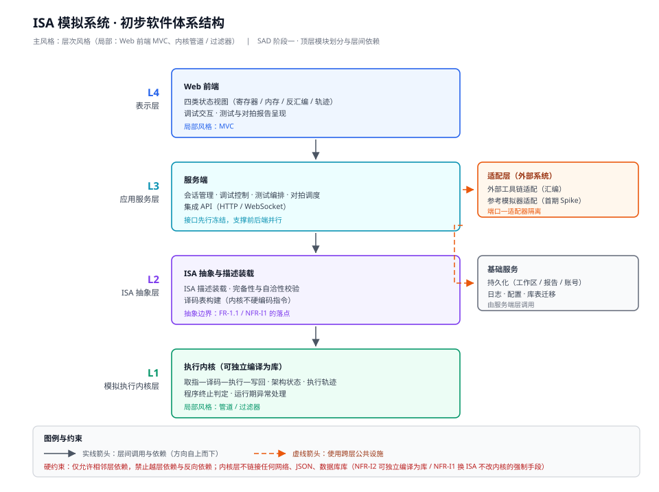
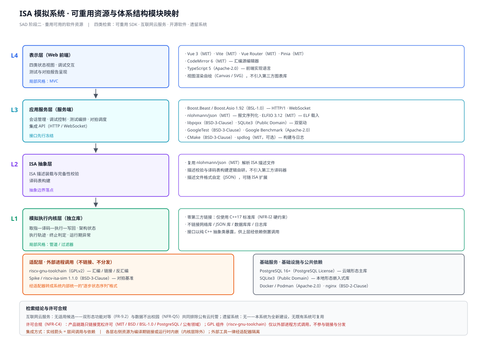
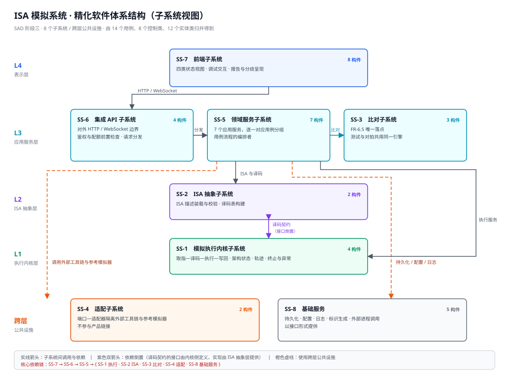
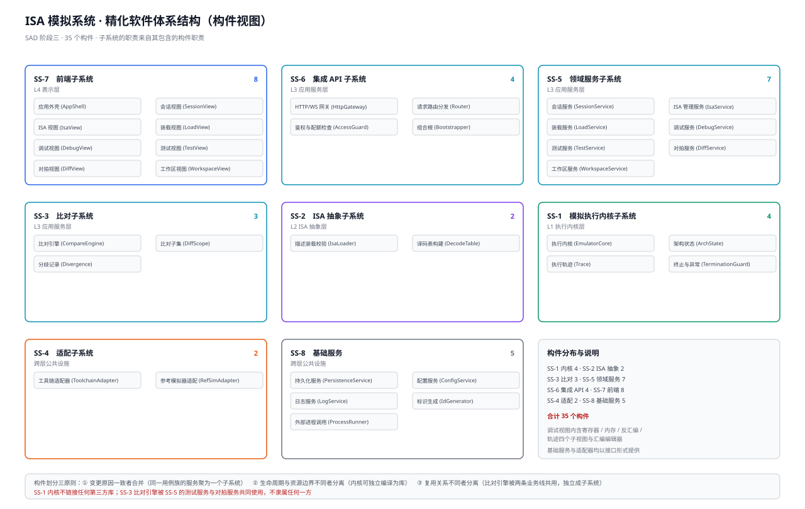
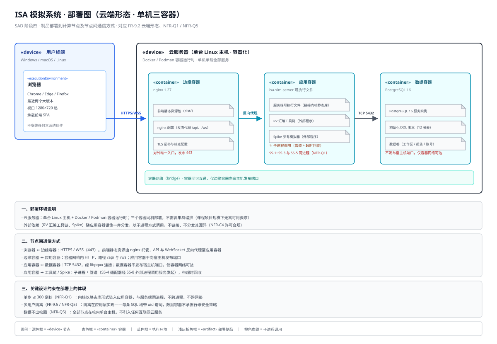
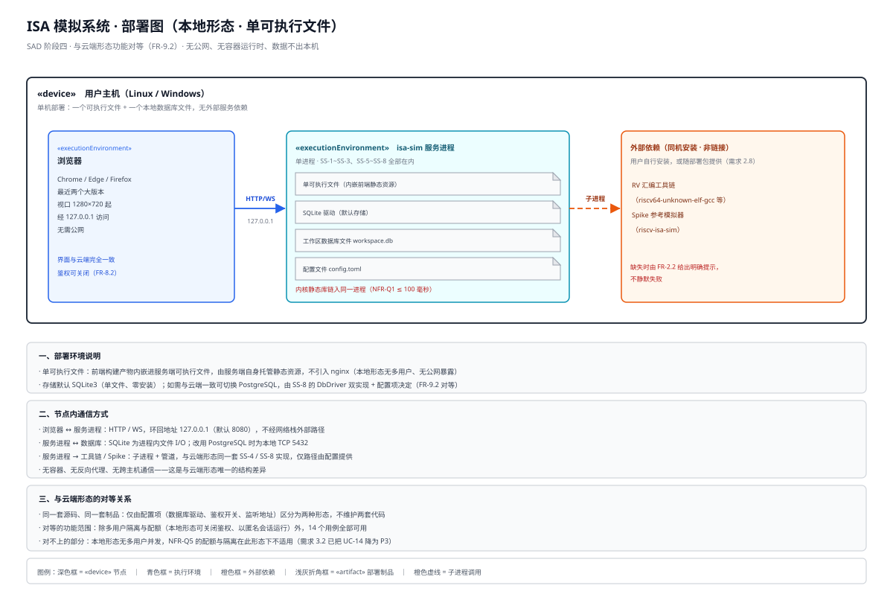
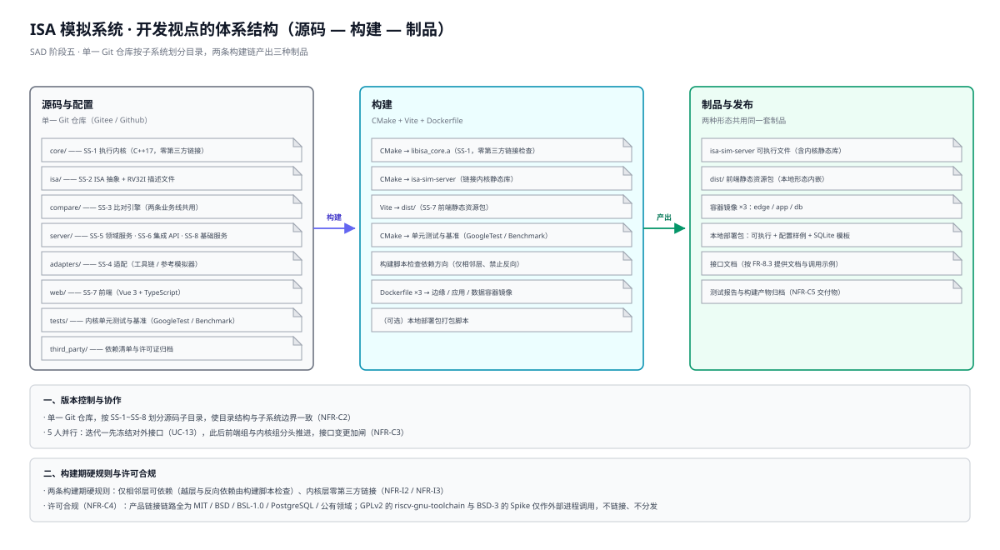
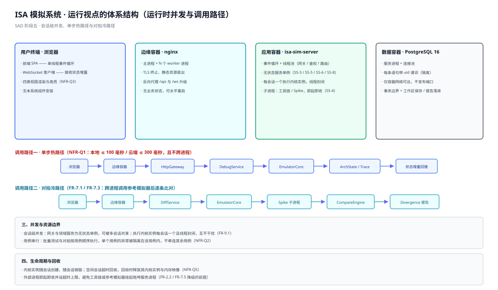

# 软件体系结构设计文档

**项目**：ISA 模拟系统
**文档版本**：v2.0
**编制日期**：2026-10-13
**上游文档**：《软件需求规格说明书》（38 条功能需求 / 13 条质量与约束需求 / 14 个用例 / 30 个分析类）
**下游文档**：《用户界面设计文档》（`uid`）、《软件详细设计文档》（`sdd`）

---

## 1 文档概述

### 1.1 编写目的

本文档给出 ISA 模拟系统的软件体系结构设计结果。它把《软件需求规格说明书》中的需求模型转换为**可指导详细设计与实现的结构决策**——确定体系结构风格、划分层与子系统、给出构件及其接口、确定可重用资源的集成方式、确定部署模型与运行时刻的行为约束。

本文档回答四个问题：

1. **系统由哪些部分构成**，各部分职责与依赖关系是什么（逻辑视点）；
2. **这些部分部署到哪里**，制品如何分发、节点之间如何通信（部署视点）；
3. **这些部分如何被构建与维护**，源码如何组织、依赖方向如何被强制（开发视点）；
4. **系统如何运行**，并发模型、关键调用路径与资源边界是什么（运行视点）。

按需求规格说明书 1.2 的约定，本文档**不覆盖**：界面视觉与交互细节（由 `uid` 阶段产出）、类与数据结构的具体设计（由 `sdd` 阶段产出）、测试方案与测试用例集。

### 1.2 组织结构

| 章节 | 内容 | 对应的体系结构视点 |
| --- | --- | --- |
| 1 文档概述 | 编写目的、组织结构、读者对象、术语定义、参考文献 | — |
| 2 系统概述 | 建设目标、主要功能、边界和范围、目标用户、运行环境 | — |
| 3 设计目标和原则 | 设计目标、需实现的需求、设计原则、设计考虑 | — |
| 4 设计约束和现实限制 | 必须遵循的约束、实际情况与限制及其对设计的影响 | — |
| 5 逻辑视点的体系结构设计 | 风格、层次、可重用资源、子系统、构件、接口、关键决策 | 逻辑视点 |
| 6 部署视点的体系结构设计 | 制品、计算节点、节点间通信、双形态对等 | 部署视点 |
| 7 开发视点的体系结构设计 | 源码组织、构建与制品、依赖检查、团队并行 | 开发视点 |
| 8 运行视点的体系结构设计 | 运行时并发、单步热路径、对拍冷路径、生命周期 | 运行视点 |
| 附录 A | 图件索引 | — |
| 附录 B | 需求追踪矩阵（功能需求 / 质量与约束需求 / 用例） | — |
| 附录 C | 体系结构设计决策编号表（SA-01 ~ SA-13） | — |

### 1.3 读者对象

| 读者 | 关注点 | 建议重点阅读 |
| --- | --- | --- |
| 项目组 · 内核组 | 内核边界、可以链接什么、不可以链接什么 | 5.2、5.6.1、7.3、8.2 |
| 项目组 · 服务端组 | 子系统边界、对外接口、并发的资源边界 | 5.4、5.8、8.1、8.4 |
| 项目组 · 前端组 | 前端在结构中的位置、与后端的接口形态 | 5.1.2、5.4、5.8 |
| 指导教师 / 评审教师 | 设计是否完整覆盖需求、决策是否有依据 | 3、4、5.6、附录 B |
| 后续维护者 | 部署与运行形态、可替换点在哪里 | 6、7、8 |

### 1.4 术语定义

本文档沿用《软件需求规格说明书》1.3 的术语。下表只补充体系结构层新增的术语；两处术语的含义**同名同义**，不存在冲突。

| 术语 / 缩略语 | 含义 | 说明 |
| --- | --- | --- |
| 体系结构风格 | 描述系统整体组织方式的惯用范式 | 本文档选定层次风格为风格 |
| 层（Layer） | 按抽象级别划分的一组子系统 | 本文档有 L4 表示层 / L3 应用服务层 / L2 ISA 抽象层 / L1 执行内核层 |
| 子系统（SS） | 职责内聚、可独立开发与替换的结构单元 | 编号 `SS-1` ~ `SS-8` |
| 构件 | 子系统内可独立分配职责与接口的组成单元 | 共 35 个 |
| 设计类 | 构件内承担具体职责的类 | 由 `sdd` 阶段细化 |
| 跨层公共设施 | 被多个层使用、不属于任何单层的公共部分 | 即 SS-4 适配子系统与 SS-8 基础服务 |
| 基础服务 | 不由目标系统实现、但多个应用功能都依赖的服务 | 以构件形态呈现、以接口形式提供，共 5 个 |
| 端口—适配器 | 以接口（端口）屏蔽外部系统差异、以适配器实现具体访问 | 用于隔离工具链与参考模拟器 |
| 依赖倒置 | 上层定义接口、下层提供实现的依赖组织方式 | 用于 SS-1 与 SS-2 之间的译码契约 |
| 组合根 | 全系统唯一的对象装配点 | 即 `Bootstrapper`，位于 SS-6 |
| 双形态 | 云端部署与本地部署两种交付形态 | 由 FR-9.2 要求，功能对等 |

### 1.5 参考文献

> 本文档的参考文献编号（`R1` ~ `R6`）作用域为本文件，独立于《软件需求规格说明书》1.4 中的同名编号。

| 编号 | 名称 | 说明 |
| --- | --- | --- |
| R1 | 《项目选题.docx》 | 项目组提交的选题文档，需求的最初来源 |
| R2 | 《软件需求规格说明书.md》 | 本文档的直接输入；38 条 FR / 13 条 NFR / 14 个用例 / 30 个分析类 |
| R3 | 《分析类模型说明.md》 | 30 个分析类的职责、属性与关系说明 |
| R4 | 《交互模型说明.md》 | 14 张用例顺序图及其消息序列说明 |
| R5 | 《用例图.svg》与 14 张用例顺序图（`需求分析/图/UC-01~14.svg`） | 用例模型与交互模型的可视化表达 |
| R6 | 各可重用资源的官方技术文档 | Vue 3 / Vite / CodeMirror 6 / Boost.Beast / nlohmann-json / ELFIO / libpqxx / PostgreSQL / SQLite3 / Spike / riscv-gnu-toolchain 等 |

### 1.6 文档约定

- 需求编号沿用上游，不做任何改动：功能需求 `FR-x.y`、质量需求 `NFR-Qx` / `NFR-Ix`、开发约束 `NFR-Cx`、用例 `UC-xx`、需求来源 `S1` ~ `S9`；
- 本文档新增三类编号：设计目标 `T1` ~ `T8`、设计原则 `P1` ~ `P8`、体系结构设计决策 `SA-01` ~ `SA-13`；现实限制用 `LIM-01` ~ `LIM-10`；
- 层次简称：L4 表示层 / L3 应用服务层 / L2 ISA 抽象层 / L1 执行内核层；
- 子系统简称 `SS-1` ~ `SS-8`；
- 正文中的图均以相对路径引用 `./图/xxx.svg`；每张图在正文中至少被引用一次，图件清单见附录 A。

---

## 2 系统概述

> 本章与《软件需求规格说明书》第 2 章保持一致，仅按体系结构表达的需要精简重述；**凡两者表述不一致处，以需求规格说明书为准**。

### 2.1 系统建设目标

本系统是一个**纯软件的 ISA 模拟系统**，以解释执行的方式重建指令级行为，并提供可视化、可调试、可批量验证、可与外部参考模拟器比对的能力。系统的四项业务目标与所回应的四类问题如下（来源：需求规格说明书 2.5）。

| 编号 | 业务目标 | 对应问题 |
| --- | --- | --- |
| G1 | 让 ISA 学习者在无硬件条件下，以可视化单步的方式理解指令语义 | P1 指令执行过程不可观察 |
| G2 | 让工业芯片工程师在秒级完成指令级功能冒烟验证，不依赖 EDA 工具链 | P2 指令级功能验证成本高 |
| G3 | 让 ISA 工程师通过两套独立实现的行为对拍，发现规范本身的歧义与不一致 | P3 指令集规范本身的歧义难以发现 |
| G4 | 让机器语言程序员在可回退、可重放的模拟环境中调试裸机程序 | P4 机器语言与汇编程序缺乏轻量调试环境 |

四项业务目标是体系结构设计的第一约束：**G1 / G4 要求观测与调试能力必须在关键路径上足够快，G2 / G3 要求比对能力必须被复用而不是各自实现**。前者落到 5.6.1 的同进程约束，后者落到 5.6.2 的比对子系统独立。

### 2.2 主要功能

系统的功能归为**九个功能组**，共 **38 条功能需求**（`FR-1.1` ~ `FR-9.5`），覆盖 **14 个用例**。

| 功能组 | 内容 | 需求编号 | 数量 |
| --- | --- | --- | --- |
| 执行内核 | 取指—译码—执行—写回，维护架构状态，记录轨迹，处理终止与异常 | FR-3.1 ~ FR-3.5 | 5 |
| ISA 描述装载 | 抽象边界、描述校验、装载与切换 | FR-1.1 ~ FR-1.3 | 3 |
| 程序装载 | 机器码 / 汇编源载入、运行初态配置、示例程序 | FR-2.1 ~ FR-2.4 | 4 |
| 调试控制 | 单步、运行、暂停、复位、断点、运行到地址、历史回退 | FR-4.1 ~ FR-4.4 | 4 |
| 状态可视化 | 寄存器、内存、反汇编、执行轨迹四类视图 | FR-5.1 ~ FR-5.4 | 4 |
| 测试验证 | 用例管理、批量执行、报告输出、判定模式 | FR-6.1 ~ FR-6.5 | 5 |
| 一致性对拍 | 参考模拟器调用、逐条比对、分歧报告、归因、降级 | FR-7.1 ~ FR-7.5 | 5 |
| 集成 API | 接口能力、鉴权限额、接口文档 | FR-8.1 ~ FR-8.3 | 3 |
| 会话与存储 | 运行会话、双形态部署、工作区持久化、账号体系 | FR-9.1 ~ FR-9.5 | 5 |
| **合计** | | | **38** |

> **说明**：需求规格说明书 3.1 原称"归为十个功能组"，但其表内实列 9 行，且功能组与 `FR-1` ~ `FR-9` 的九个需求组一一对应。**该项已于 2026-10-13 由需求侧订正为"九个功能组"**（见《软件体系结构设计评审意见》R-1）。本文档按九组记录。

用例优先级沿需求 3.2.2：`P0` = UC-03、UC-04；`P1` = UC-13、UC-06、UC-08、UC-10、UC-05；其余为 `P2` / `P3`。

### 2.3 边界和范围

**本期功能范围（本系统负责）**：ISA 描述装载与校验（首期 RISC-V RV32I）、程序装载与运行配置、指令解释执行、程序终止与运行期异常处理、指令级单步与断点调试、寄存器与内存可视化、示例程序与新手引导、测试用例组织与批量验证、与 Spike 的一致性对拍、集成 API、多用户会话与隔离。

**本期不在范围内**

| 排除项 | 说明 |
| --- | --- |
| 周期精确的微架构建模 | 不建模流水线、缓存时序，仅做体系结构级（功能级）模拟 |
| 完整外设与中断建模 | 仅处理约定的终止序列与运行期异常 |
| 操作系统级全系统仿真 | 不运行操作系统，面向裸机程序 |
| 第二套指令集的完整实现 | 本期仅在架构上保留 ISA 抽象边界 |
| QEMU 等其他外部参考模拟器的接入 | 本期对拍基准锁定 Spike |

**边界划分**

| 由本软件实现 | 由环境或第三方提供 |
| --- | --- |
| 指令语义解释、架构状态维护、调试控制、状态可视化、示例程序、测试编排与判定、对拍调度与差异归因、API 服务、用户与会话管理 | 浏览器渲染容器、宿主操作系统、外部汇编工具链、外部参考模拟器（Spike）、Git 托管服务 |

该边界直接决定体系结构的两条边：**第三方资源一律经适配层进入**（5.6.3），**浏览器只承担渲染与交互、不承担任何判定逻辑**（5.1.2）。

### 2.4 目标用户

| 类别 | 用户 | 关注点 |
| --- | --- | --- |
| 需求方 · 人工 | ISA 学习者 | 免硬件、可视化、看得懂每条指令的执行过程 |
| 需求方 · 人工 | 工业芯片工程师 | 免 EDA 工具链，快速批量跑指令级功能冒烟验证；**以程序接口为主要路径** |
| 需求方 · 人工 | ISA 工程师 | 通过双实现对拍发现规范本身的歧义与不一致 |
| 需求方 · 人工 | 机器语言程序员 | 可下断点、可回放地调试机器码 / 汇编程序 |
| 管理方 · 人工 | 平台管理员 | 用户与资源配额管理（云端形态） |
| 交互方 · 系统 | 外部汇编工具链、外部参考模拟器（Spike） | 以子进程方式被调用，返回机器码或逐步提交日志 |
| 交互方 · 系统 | 浏览器 / 宿主操作系统 | 提供渲染容器与运行环境 |
| 交互方 · 系统 | Git 托管平台 | 源码与用例集的版本管理 |

> **对结构的影响**：工业芯片工程师以程序接口为路径，因此**集成 API（FR-8.x）被排到 P1 并在迭代一交付**，且接口一经冻结，前端组与内核组即可并行——这是 5.8 与 7.4 的直接依据。

### 2.5 运行环境

| 项 | 云端部署 | 本地部署 |
| --- | --- | --- |
| 服务端 | Linux 主机（容器化） | Linux / Windows 主机 |
| 前端 | 现代浏览器（Chrome / Edge / Firefox 近两个大版本） | 同左 |
| 外部依赖 | 汇编工具链、Spike 随服务端部署 | 由用户安装或随部署包提供 |
| 网络 | 需公网可达 | 无需公网 |

运行环境在体系结构上的落点见第 6 章（部署视点）。

---

## 3 设计目标和原则

### 3.1 体系结构设计欲达成的目标

| 编号 | 设计目标 | 达成的判据 | 主要落点 |
| --- | --- | --- | --- |
| T1 | 完整覆盖需求 | 38 条 FR 与 13 条 NFR 均有对应的设计元素，无悬空需求 | 附录 B |
| T2 | 关键路径低延迟 | 内核与服务端同进程，单步路径不跨进程、不跨网络 | SA-02、8.2 |
| T3 | 抽象边界成立 | 内核不含任何 RV32I 具体指令的硬编码；新增 ISA 不改内核执行逻辑 | SA-01、5.6.1 |
| T4 | 复用优先 | 先集成成熟资源，自研只保留差异点 | 5.3、P6 |
| T5 | 双形态同源 | 一套源码、一套制品，形态由配置区分，功能对等 | SA-09、6.6 |
| T6 | 支持 5 人并行 | 接口在迭代一早冻结，子系统边界与人员分工一致 | 5.8、7.4 |
| T7 | 内核可独立验证 | 内核可脱离前端与服务端独立编译为库并做单元测试 | SA-02、7.3 |
| T8 | 许可与交付合规 | 产品链接链路全部为宽松许可；交付物齐备 | 5.3.3、7.3 |

### 3.2 需实现的功能需求及其对结构的要求

| 需求组 | 对体系结构提出的要求 |
| --- | --- |
| FR-1.x ISA 描述装载 | 内核与 ISA 定义之间必须是"接口 + 数据"关系，不能是编译期硬编码；译码必须可查表而不能每条指令解析文件 |
| FR-2.x 程序装载 | 需一条可隔离的对外通道调用工具链；装载产物（程序映像）要能被内核直接使用 |
| FR-3.x 执行内核 | 执行循环、状态维护、轨迹记录、终止判定、异常处理四件事的变更原因不同，需分开；**异常不得使服务进程崩溃**，即不能靠进程隔离兜底 |
| FR-4.x 调试控制 | 单步与断点属热路径；历史回退要求内核维护**可回溯的状态序列**，全量快照内存不可接受 |
| FR-5.x 状态可视化 | 前后端之间传的应是**状态增量**而非全量状态，否则无法满足 NFR-Q1 与 NFR-Q3 的高亮要求 |
| FR-6.x 测试验证 | 批量执行需要"每个用例一个干净初态"，不能共用同一份可变状态 |
| FR-7.x 一致性对拍 | 需要跨进程驱动外部模拟器；比对必须能定位到"指令序号 + 差异字段"，因此双方都要能输出**本步引发的写操作** |
| FR-8.x 集成 API | 需要一个独立的对外边界，承担请求解析、鉴权、限额、分发四件事 |
| FR-9.x 会话与存储 | 会话之间状态隔离；双形态对等只能靠配置切换，不能维护两套代码；**隔离必须落到每一条数据访问语句上** |

### 3.3 需实现的质量需求及其对结构提出的硬要求

| 编号 | 类别 | 对结构提出的硬要求 |
| --- | --- | --- |
| NFR-Q1 | 性能 | 内核必须以**库**的形式同进程被调用；轨迹记录必须可开关，且关闭时不得引入额外开销 |
| NFR-Q2 | 可靠性 | 每个会话 / 每个用例要有**独立的内核实例**，生命周期受管；运行期异常须在内核内被拦住 |
| NFR-Q3 | 易用性 | 状态增量是"变化高亮"的前提，落点在 FR-5.1 的数据形态上 |
| NFR-Q4 | 兼容性 | 前端不得使用浏览器私有特性；界面须在 1280×720 下可用 |
| NFR-Q5 | 安全性 | 需要一个**独立的前置检查层**；限额与隔离**不能下沉进内核**；空闲会话须可回收 |
| NFR-I1 | 可扩展性 | 内核与 ISA 之间只能是"接口 + 数据"关系；比对子集须可配置 |
| NFR-I2 | 可测试性 | 内核**零外部依赖**：不链接网络、序列化、数据库等任何第三方库 |
| NFR-I3 | 可移植性 | 内核不得依赖特定操作系统或图形界面 |
| NFR-C1 | 技术栈 | 核心 C++，前端 Web；两边的构建与制品必须能被同一套流程管理 |
| NFR-C2 | 版本控制 | 单一 Git 仓库，目录结构宜与子系统边界一致 |
| NFR-C3 | 团队与工期 | 接口必须早冻结，以支撑 5 人并行 |
| NFR-C4 | 许可合规 | 链接链路须为宽松许可；GPL 组件只能以外部进程方式使用 |
| NFR-C5 | 交付物 | 需求文档、设计文档、源代码与测试报告须可从同一仓库与构建流程产出 |

### 3.4 遵循的设计原则

| 编号 | 原则 | 具体含义 | 对应目标 |
| --- | --- | --- | --- |
| P1 | 抽象边界优先于实现便利 | 宁可多一层接口，也不把 ISA 细节编进内核 | T3 |
| P2 | 关键路径不做进程 / 网络跳转 | 单步与状态读取在内核进程内完成 | T2 |
| P3 | 按变更原因划分构件 | 同一变更原因者合并，变更原因不同者分离 | T6 |
| P4 | 外部系统一律经端口—适配器隔离 | 第三方差异被封闭在适配层，不扩散到业务层 | T4、T8 |
| P5 | 依赖单向、仅相邻层 | 禁止越层依赖与反向依赖，由构建脚本强制 | T3、T6 |
| P6 | 复用优先于自建 | 自研只保留差异点（内核、译码、比对） | T4 |
| P7 | 一份源码、配置区分形态 | 不为双形态维护两套代码 | T5 |
| P8 | 接口先冻结、实现后并行 | 迭代一交付并冻结集成 API | T6 |

### 3.5 设计考虑（主要取舍）

| 取舍 | 选择 | 理由 |
| --- | --- | --- |
| 内核是同进程库还是独立服务 | **同进程库** | 独立服务需跨进程 / 跨网络通信，无法满足 NFR-Q1 的单步 100/300 毫秒；且 NFR-I2 本就要求内核可独立编译为库 |
| 比对能力放测试服务内还是独立 | **独立成子系统 SS-3** | FR-6.5 明写"两种判定模式复用同一比对引擎"；放进任一方都会导致另一方跨子系统复用，或把引擎写第二遍 |
| 前端四类视图用第三方图表 / 波形库还是自绘 | **自绘** | 四类视图的数据形态是"状态增量 + 差字段标记"，通用图表库不提供该语义；且自绘可完全避开浏览器私有特性（NFR-Q4） |
| 限额检查放在内核还是网关 | **网关（SS-6）** | 限额是"请求级"概念，不属于指令语义；放进内核会让内核被迫理解业务规则，破坏 T3 |
| 本地形态是否也部署 nginx | **不部署** | 本地形态无多用户、无公网暴露，静态资源由服务端自身托管即可，少一个需要维护的进程 |
| "起子进程 / 喂输入 / 读输出 / 超时回收"是否两处各写一遍 | **抽为基础服务**（SS-8 外部进程调用） | 工具链适配器与参考模拟器适配器需要完全相同的进程管理逻辑，抽取后避免重复实现与重复的错误处理 |

---

## 4 设计约束和现实限制

### 4.1 必须遵循的约束

| 类型 | 约束 | 来源 |
| --- | --- | --- |
| 技术栈 | 核心使用 C++ 实现，前端采用 Web 技术；开发工具为 Visual Studio Code | NFR-C1 |
| 版本控制 | 使用 Git，仓库托管于 Gitee 或 Github | NFR-C2 |
| 团队与工期 | 项目组 5 人，须在课程周期内完成 | NFR-C3 |
| 许可合规 | 外部工具链、外部参考模拟器与所用第三方库的许可证须与本项目的分发方式兼容 | NFR-C4 |
| 交付物 | 需求文档、设计文档、源代码与测试报告 | NFR-C5 |
| 功能范围 | 首期仅完整实现 RISC-V RV32I；对拍基准首期锁定 Spike | 需求 S2-8 |
| 界面 | 支持 Chrome / Edge / Firefox 最近两个大版本；最低适配 1280×720 | NFR-Q4 |

### 4.2 实际情况

| 项 | 实际情况 |
| --- | --- |
| 团队 | 5 名学生，无专职运维与测试人员；技术栈需统一，便于互相接手 |
| 课业周期 | 一个学期的课余时间，可支撑四轮迭代（见 7.4） |
| 部署场地 | 校园内单台主机（云端形态）与个人主机（本地形态），无云预算 |
| 外部工具 | 汇编工具链与 Spike 均为成熟开源软件，可直接使用；但二者的输出形态都不是本系统需要的内部形态 |
| 参照基准 | Spike 的逐步提交日志是对拍的事实基准（需求假设 A1） |
| 硬件条件 | 无真实处理器、无 EDA 工具链、无 FPGA 环境 |

### 4.3 现实限制

| 编号 | 限制 | 对设计的直接影响 |
| --- | --- | --- |
| LIM-01 | 5 人一学期，无运维投入 | 不引入需要专门运维的中间件（消息队列、服务注册、集群编排）；云端形态用单机三容器 |
| LIM-02 | 无预算，且数据不出校园 | 四类可重用资源检索中"互联网云服务"一类**无适用候选**，全部数据落在校内主机 |
| LIM-03 | Spike 只提供 `--log-commits` 文本日志（且 1.1.0 起带 hart 前缀） | 对拍必须经 `RefSimAdapter` 解析日志并转成内部统一序列；无法直接获得结构化状态 |
| LIM-04 | `riscv-gnu-toolchain` 为 GPLv2 | 只能以**外部进程**方式调用，不链接、不随包分发其源码；工具链由环境预装 + 启动探测 |
| LIM-05 | 内核须零第三方链接（NFR-I2） | 内核只能使用 C++ 标准库；任何 JSON、网络、数据库能力都不得进入内核 |
| LIM-06 | 单机部署，无高可用与横向扩展要求 | 容器不做编排；会话级并发即系统的并发上限 |
| LIM-07 | 浏览器兼容面固定且较窄 | 前端不使用浏览器私有 API 与新特性，构建目标须覆盖近两个大版本 |
| LIM-08 | 首期只完整实现 RV32I | ISA 抽象边界以"**架构预留**"为交付形态：边界成立由 RV32I 验证，第二套 ISA 属后续演进（需求 S2-1 与 S2-8 的收敛关系） |
| LIM-09 | 无真实硬件与 EDA 环境 | 正确性验证只能依赖"内置示例程序 + 单元测试 + 与 Spike 对拍"三者 |
| LIM-10 | 学生团队不具备容器编排与多机运维经验 | 部署方式必须简单到"一条命令起、一条命令停" |

### 4.4 限制与设计的对应关系

| 限制 | 被它决定或排除的设计选择 |
| --- | --- |
| LIM-01 / LIM-06 / LIM-10 | 云端单机三容器、本地单可执行；不引入消息总线（否则需要异步中间件）；不选 SOA（其前提是独立部署与服务治理） |
| LIM-02 | 持久化只能用自建 PostgreSQL / SQLite，不能用云数据库；无不引入对象存储 |
| LIM-03 / LIM-04 | 适配层（SS-4）成为必需；对拍与汇编能力均以子进程方式获得 |
| LIM-05 | 内核与 ISA 抽象层之间只能靠"接口 + 数据结构"通信；译码契约必须由内核侧定义（SA-01） |
| LIM-08 | 5.6.1 的依赖倒置方案必须把"新增指令"与"新增指令类别"两种情况区分开，并在文档中写明其限制 |
| LIM-09 | 比对引擎必须支持两种判定模式（终态快照 / 逐条提交日志），才能同时服务批量测试与对拍 |
| LIM-07 | 前端不引入第三方图表 / 波形库（其内部实现未必兼容窄浏览器面） |

---

## 5 逻辑视点的体系结构设计



### 5.1 体系结构风格

#### 5.1.1 主风格：层次风格

系统的主风格选定为**层次风格**，划分为四层，自上而下为 L4 表示层、L3 应用服务层、L2 ISA 抽象层、L1 执行内核层，另有两类**跨层公共设施**：SS-4 适配子系统与 SS-8 基础服务。

选择依据（逐条对应到需求）：

1. 需求规格说明书 2.2 本身已明确"系统采用分层结构"，并给出了四层职责对照——层次风格是该需求的直接表达；
2. **NFR-I2 要求内核可独立编译为库并单元测试**。层次风格允许在**构建期**把内核物理隔离为一个不链接任何第三方库的库目标（见 7.3），这是其他四种风格都不天然提供的；
3. **NFR-I1 要求新增 ISA 时不改内核执行逻辑**。层次 + 依赖倒置可以精确表达"上层定契约、下层给实现"（5.6.1）；
4. **NFR-Q1 要求单步 100 / 300 毫秒**。层次风格层内不做进程或网络跳转，关键路径可以完全留在一个进程内；
5. **NFR-C3 要求 5 人并行**。四层天然切成四个可并行推进的开发单元（前端 / 服务端 / ISA 描述与译码 / 内核）。

#### 5.1.2 局部风格

| 位置 | 局部风格 | 理由 |
| --- | --- | --- |
| L4 表示层（SS-7） | MVC | 视图、视图模型与后端服务职责分明；前端只做渲染与交互，判定逻辑不发散到界面 |
| L1 执行内核层（SS-1） | 管道 / 过滤器 | 取指 → 译码 → 执行 → 写回是天然的数据驱动分级处理；各阶段可独立替换与观察（译码阶段可单独替换为另一套译码表） |

#### 5.1.3 候选风格比较

| 风格 | 与本系统的契合度 | 结论 |
| --- | --- | --- |
| 管道 / 过滤器 | 只契合内核内部与"轨迹 → 比对 → 报告"这一条链，表达不了前端、持久化与多用户 | 不作主风格，仅局部采用 |
| **层次风格** | 四层职责齐备；支持构建期物理隔离；支持依赖倒置表达 ISA 边界；层内无跳转满足延迟要求 | **选定为主风格** |
| MVC | 只覆盖前端 | 仅作局部风格 |
| SOA | 对外确实是 API 形态，但内部服务不是独立部署单元；FR-9.2 要求本地单可执行，与 SOA 的独立部署前提直接冲突；LIM-01 / LIM-10 也排除了服务治理开销 | 否决 |
| 消息总线 | 全系统只有 WebSocket 推送一处事件流，其余全是同步调用；为 5 人项目引入异步与消息中间件，性价比为负 | 否决 |

#### 5.1.4 两条构建期硬规则

层次风格能否成立，取决于依赖是否被真正约束。本设计给出两条**可由构建脚本强制检查**的硬规则：

| 编号 | 规则 | 强制方式 | 服务的目标 |
| --- | --- | --- | --- |
| 规则一 | **仅相邻层可依赖**，禁止越层依赖与反向依赖 | 构建脚本检查各层目标的链接与包含关系 | T3、P5 |
| 规则二 | **内核层零第三方链接** | 内核库目标只允许链接 C++ 标准库 | T7、NFR-I2 |

> 两条规则在"依赖倒置"处（SS-1 ↔ SS-2）的表现形式较为特殊，见 5.6.1。

### 5.2 层与职责

| 层 | 编号 | 包含子系统 | 职责 | 不做什么 |
| --- | --- | --- | --- | --- |
| 表示层 | L4 | SS-7 前端 | 四类状态视图、调试交互、测试与对拍报告呈现、示例程序与新手引导入口 | 不做任何判定与状态推导，不直接访问数据库 |
| 应用服务层 | L3 | SS-6 集成 API、SS-5 领域服务、SS-3 比对 | 会话与鉴权、请求分发、用例编排、对拍调度、比对与判定 | 不实现指令语义，不直接管理内存映像 |
| ISA 抽象层 | L2 | SS-2 ISA 抽象 | 描述装载与校验、译码表构建 | 不执行指令，不持有运行期状态 |
| 执行内核层 | L1 | SS-1 模拟执行内核 | 取指—译码—执行—写回、架构状态、执行轨迹、终止与异常 | 不感知网络、数据库、会话与用户 |

**跨层公共设施**

| 设施 | 编号 | 包含子系统 | 说明 |
| --- | --- | --- | --- |
| 适配设施 | 跨层 | SS-4 适配 | 隔离外部工具链与参考模拟器；**不参与产品链接**，只在运行期以子进程方式被调用 |
| 基础服务 | 跨层 | SS-8 基础服务 | 持久化、配置、日志、标识生成、外部进程调用；以构件形态呈现、以接口形式提供 |

> **关于"适配层是否应提升为独立一层"**：不提升。理由是适配设施**同时被 L1/L2 侧与 L3 侧使用**，提升为层会破坏"仅相邻层依赖"这条硬规则（层间只能相邻，而适配要与上下都对话）。以"跨层公共设施 + 端口"的形式表达，既保持了层次规则，也保留了"外部系统必须经适配层"这条设计原则（P4）。

### 5.3 可重用资源及其集成



#### 5.3.1 四类资源的检索结论

| 类别 | 结论 |
| --- | --- |
| 可重用软件开发工具包（SDK） | 有候选，见 5.3.2 |
| 互联网云服务 | **无适用候选**。逐项否决了云托管数据库、对象存储、容器托管三类：FR-9.2 要求双形态功能对等（同一套代码靠配置切换），NFR-Q5 要求数据不出校园，且无预算（LIM-02） |
| 开源软件 | 有候选，见 5.3.2 |
| 遗留系统 | **无**。本系统为全新建设，无既有系统可复用 |

#### 5.3.2 选定资源及集成方式

| 资源 | 版本 / 许可证 | 归属层 | 集成方式 |
| --- | --- | --- | --- |
| Vue 3 + Vite + Vue Router + Pinia | MIT | L4 | 源码依赖，前端构建为静态资源包 |
| CodeMirror 6 | MIT | L4 | 源码依赖，用于汇编源与 ISA 描述的编辑 |
| TypeScript 5 | Apache-2.0 | L4 | 编译期依赖 |
| Boost（Beast + Asio） | 1.92 / BSL-1.0 | L3 | 源码 / 库依赖，提供 HTTP 与 WebSocket 服务端能力 |
| nlohmann/json | MIT | L3 | 头文件依赖，报文的序列化与反序列化 |
| ELFIO | 3.12 / MIT | L3 | 头文件依赖，实现 FR-2.1 的"ELF 可装载段载入" |
| libpqxx | BSD-3-Clause | L3 | 库依赖，PostgreSQL 访问 |
| SQLite3 | Public Domain | L3 | 库依赖，本地形态存储 |
| GoogleTest / Google Benchmark | BSD-3 / Apache-2.0 | 构建期 | 仅测试目标链接，不进产品 |
| CMake | BSD-3-Clause | 构建期 | 构建系统 |
| spdlog | MIT | L3 | 可选，日志服务实现之一 |
| PostgreSQL | 16+ / PostgreSQL License | 部署期 | 独立服务进程 |
| Docker / Podman | Apache-2.0 | 部署期 | 云端形态的容器运行时 |
| nginx | BSD-2-Clause | 部署期 | 云端形态的边缘容器（本地形态不使用） |
| Spike（riscv-isa-sim） | 1.1.0 / BSD-3-Clause | 外部 | **子进程调用**，对拍基准 |
| riscv-gnu-toolchain | GPLv2 | 外部 | **子进程调用**，汇编与链接 |

#### 5.3.3 许可合规判定（NFR-C4）

- **产品链接链路**（前端包 + 服务端可执行 + 内核库）全部落在宽松许可：MIT / BSD-2 / BSD-3 / BSL-1.0 / Apache-2.0 / PostgreSQL License / 公有领域；
- **GPLv2 的 riscv-gnu-toolchain 不进入链接链路**：仅以外部进程方式调用，本项目不链接其库、不分发其源码，因此不产生传染；
- 交付形态为"源码 + 构建脚本"，工具链与参考模拟器由环境预装并在启动时探测（LIM-04）。

#### 5.3.4 需要适配的资源

| 资源 | 为什么不能直接用 | 适配方案 |
| --- | --- | --- |
| Spike | 输出为 `--log-commits` 文本日志（1.1.0 起带 hart 前缀），而比对引擎需要"逐步状态序列 + 可比对子集" | `RefSimAdapter`：进程调用 + 日志解析 → 内部统一序列。备选方案（链接其 `libriscv`）被否决，会破坏服务端依赖洁净度 |
| riscv-gnu-toolchain | 输出为 `.elf` / `.bin` 等文件产物，且为 GPL 组件 | `ToolchainAdapter`：子进程调用 + 产物读取；工具链缺失时由 FR-2.2 给出明确提示（不静默失败） |
| PostgreSQL 与 SQLite | 两套数据库在 DDL、UPSERT 语法（`ON CONFLICT`）、类型系统上都有差异 | 持久化服务内部以 `DbDriver` 抽象适配，业务层只见统一接口（SA-10） |
| 前端构建产物与 C++ 服务端 | 两套技术栈、两套构建流程，但交付形态要求"双形态同源" | 云端由边缘容器托管静态资源，本地把前端产物内嵌进服务端可执行文件（见 6.6） |

### 5.4 子系统的划分



#### 5.4.1 划分依据

按技能规定的三条策略各做一遍，并取三者结果的一致部分：

| 策略 | 输入 | 做法 | 结果 |
| --- | --- | --- | --- |
| 按用例归类 | 14 个用例、四轮迭代主题 | 按业务相关性把用例归族 | 8 个用例族 |
| 按控制类归并 | 8 个控制类 | 按职责相关性重新分组 | 7 个应用服务 |
| 按实体类归并 | 12 个实体类（含 3 个合并书写的账号族） | 按数据相关性归组 | 内核族 / ISA 族 / 比对族 / 测试族 / 账号工作区族 |

三条策略的结论在子系统层面收敛：**领域服务子系统 SS-5 的 7 个构件与 7 个控制类一一对应**，这是"控制类归并"的直接结果；**比对子系统 SS-3 独立**，是"实体类归并"发现的（`CompareEngine` 同时挂在 `TestController` 与 `DiffController` 上）。

#### 5.4.2 子系统清单

| 编号 | 子系统 | 层 | 构件数 | 职责 | 对外接口 |
| --- | --- | --- | --- | --- | --- |
| SS-1 | 模拟执行内核 | L1 | 4 | 取指—译码—执行—写回；架构状态；执行轨迹；终止与异常 | `ICoreService` |
| SS-2 | ISA 抽象 | L2 | 2 | ISA 描述的装载与校验；译码表构建 | `IIsaProvider` |
| SS-3 | 比对 | L3 | 3 | 逐条比对定位首个分歧；程序终态比对 | `ICompareService` |
| SS-4 | 适配 | 跨层 | 2 | 隔离外部工具链与参考模拟器 | `IAssembler` / `IRefSim` |
| SS-5 | 领域服务 | L3 | 7 | 会话 / ISA 管理 / 装载 / 调试 / 测试 / 对拍 / 工作区 | 7 个服务接口 |
| SS-6 | 集成 API | L3 | 4 | HTTP / WebSocket 边界；鉴权与配额；请求分发；对象装配 | REST / WS 契约 |
| SS-7 | 前端 | L4 | 8 | 应用外壳 + 7 个视图 | 用户界面 |
| SS-8 | 基础服务 | 跨层 | 5 | 持久化 / 配置 / 日志 / 标识生成 / 外部进程调用 | 5 个基础接口 |
| | **合计** | | **35** | | |

各子系统的职责等于其包含构件的职责之和。

#### 5.4.3 分析类到设计元素的映射

| 分析类类别 | 数量 | 映射结果 |
| --- | --- | --- |
| 边界类 | 10 | 7 个视图（SS-7）+ `HttpGateway`（SS-6）+ `ToolchainAdapter` / `RefSimAdapter`（SS-4）。其中 `ApiEndpoint` 的职责折入 `HttpGateway` |
| 控制类 | 8 | 7 个应用服务（SS-5）+ `ApiController` 的职责折入 `HttpGateway`（SS-6） |
| 实体类 | 12（其中账号族按 3 个类合计 1 组） | 内核族 3 → SS-1；ISA 族 2 → SS-2；比对族 3 → SS-3；测试与断点族 3 → SS-5（数据由 SS-8 持久化）；账号与工作区族 → SS-5（领域逻辑）与 SS-8（存储） |

映射遵循"同类职责合、异类职责分"：分析类是**问题域**的概念，设计元素是**解域**的单元，因此必然出现"一个分析类拆成两个设计元素"（如 `IsaSpec` 拆为 `IsaLoader` 与 `DecodeTable`）与"两个分析类并成一个设计元素"（如边界类 `ApiEndpoint` 与控制类 `ApiController` 并成 `HttpGateway`）。

> **计数口径说明（供一致性核查）**：上游《软件需求规格说明书》3.3.3 记作"共 30 个分析类：边界类 10 个、控制类 8 个、实体类 12 个"。其边界类表实列 10 项、控制类表实列 8 项均与计数一致；实体类表实列为 11 个独立类名 + 1 行合并书写的账号族（`User` / `Session` / `Workspace` 三个类并为一行），按**合并行计 1 个**得 12 个，按**逐类计**得 14 个。本表采用上游的合并口径，故总数为 30。两组口径的差异只在账号族一行，**不影响任何映射结论**。

#### 5.4.4 新增设计元素及其引入理由

下表列出 **12 个不由分析类直接对应的新增设计元素**——它们的引入都源于需求中明确的质量约束或构建约束，而非设计者的偏好。

| 新增设计元素 | 归属 | 引入理由 |
| --- | --- | --- |
| `TerminationGuard` | SS-1 | FR-3.4 终止判定与 FR-3.5 运行期异常是两条独立需求；塞进 `EmulatorCore` 会让执行循环同时承担"跑"和"停"两种变更原因，违反 P3 |
| `IsaLoader` | SS-2 | 由分析类 `IsaSpec` 拆出：描述装载与校验在启动期执行一次，与译码查表的热路径在性能特征与变更原因上都不同 |
| `DecodeTable` | SS-2 | 由分析类 `IsaSpec` 拆出：译码表在热路径上每秒被调用千万次，须为预构建 + O(1) 查表（FR-1.1 与 NFR-Q1 的交叉点） |
| `HttpGateway` | SS-6 | 由 `ApiEndpoint` + `ApiController` 合并：边界类与控制类在同一处调用链上，分开会产生无意义的转发 |
| `Router` | SS-6 | 请求分发是可独立替换的机制（增删接口不应改鉴权代码） |
| `AccessGuard` | SS-6 | **NFR-Q5 限额与鉴权的唯一前置落点**（SA-05） |
| `Bootstrapper` | SS-6 | **组合根**：全系统唯一的对象装配点，使装配逻辑不散落到各服务（SA-08） |
| `AppShell` | SS-7 | 路由、全局状态、API 客户端三合一外壳，被 7 个视图共用；不显式化会导致三个东西被重复实现 7 次 |
| 持久化服务 | SS-8 | 被工作区、测试报告、账号与配额三处依赖 |
| 配置服务 | SS-8 | 双形态切换（FR-9.2）与端口、限额配置的统一来源 |
| 日志服务 | SS-8 | 网关、服务、适配器三类构件都需要，统一出口便于排查与交付 |
| 标识生成 | SS-8 | 会话令牌、工作区号、分歧记录号需要统一且唯一的生成方式 |
| 外部进程调用 | SS-8 | 工具链适配器与参考模拟器适配器需要完全相同的进程管理逻辑（见 3.5 的取舍） |

> **计数说明**：上表 13 行中，`HttpGateway` 由边界类 `ApiEndpoint` 与控制类 `ApiController` 合并而来，属职责归并而非新增，不计入；其余 **12 个**均为"不由分析类直接对应"的新增设计元素——其中 `IsaLoader` 与 `DecodeTable` 由同一分析类 `IsaSpec` 一拆为二（计 2 个），`TerminationGuard`、`Router`、`AccessGuard`、`Bootstrapper`、`AppShell` 与 5 个基础服务共 10 个在分析类模型中无对应项。

### 5.5 构件的划分



#### 5.5.1 构件划分规则

| 编号 | 规则 | 含义 | 例证 |
| --- | --- | --- | --- |
| R1 | 变更原因一致者合并 | 一个构件只应因一类需求变化而变化 | 7 个应用服务按用例族划分 |
| R2 | 生命周期与资源边界不同者分离 | 资源边界不同的部分不能共处一个构件 | SS-1 内核可独立编译为库，与网络、数据库资源边界完全不同 |
| R3 | 复用关系不同者分离 | 被多方复用的能力独立出来 | `CompareEngine` 被测试与对拍两条业务线共用，独立为 SS-3 |

#### 5.5.2 各子系统构件清单

| 子系统 | 构件 | 职责 | 承载需求 |
| --- | --- | --- | --- |
| SS-1 模拟执行内核（4） | 执行内核 `EmulatorCore` | 取指—译码—执行—写回主循环 | FR-3.1 |
| | 架构状态 `ArchState` | PC、GPR、内存、CSR 的持有与更新；快照与恢复 | FR-3.1、FR-4.4、FR-5.1 |
| | 执行轨迹 `Trace` | 逐步记录指令地址、指令、操作数、状态增量 | FR-3.3、FR-5.4、FR-7.2 |
| | 终止与异常 `TerminationGuard` | 终止序列识别、终止标志、运行期异常现场记录 | FR-3.2、FR-3.4、FR-3.5 |
| SS-2 ISA 抽象（2） | 描述装载校验 `IsaLoader` | 描述文件的解析、完备性与自洽性校验、问题清单输出 | FR-1.2、FR-1.3 |
| | 译码表构建 `DecodeTable` | 由描述构建 O(1) 译码表；按编码取译码规则 | FR-1.1、FR-3.2 |
| SS-3 比对（3） | 比对引擎 `CompareEngine` | 逐条比对两份状态序列，定位首个分歧；程序终态比对 | FR-6.5、FR-7.2、FR-7.3 |
| | 比对子集 `DiffScope` | 配置参与比对的状态字段，判定某字段是否纳入比对 | FR-7.2、NFR-I1 |
| | 分歧记录 `Divergence` | 分歧现场、差异字段与归因标注 | FR-7.3、FR-7.4 |
| SS-4 适配（2） | 工具链适配器 `ToolchainAdapter` | 调用外部汇编工具链，回收机器码映像或错误行 | FR-2.2 |
| | 参考模拟器适配 `RefSimAdapter` | 调用 Spike，解析逐步提交日志为内部序列；不可用时降级 | FR-7.1、FR-7.5 |
| SS-5 领域服务（7） | 会话服务 `SessionService` | 凭据校验、会话建立与销毁、用户与配额管理 | FR-9.1、FR-9.4、FR-9.5、UC-01、UC-14 |
| | ISA 管理服务 `IsaService` | 提交描述、装载校验、查询与切换当前 ISA | FR-1.2、FR-1.3、UC-02 |
| | 装载服务 `LoadService` | 汇编转码、按基址载入、PC 与栈指针初始化、示例程序 | FR-2.1 ~ FR-2.4、UC-03、UC-12 |
| | 调试服务 `DebugService` | 单步 / 运行 / 暂停 / 复位、断点登记与命中、状态读取、历史回退 | FR-4.1 ~ FR-4.4、UC-04、UC-05、UC-07 |
| | 测试服务 `TestService` | 用例编排、判定模式选择、批量执行与汇总、报告读取 | FR-6.1 ~ FR-6.4、UC-08、UC-09 |
| | 对拍服务 `DiffService` | 驱动双方执行、调度比对、组装分歧报告与归因 | FR-7.1 ~ FR-7.5、UC-10、UC-11 |
| | 工作区服务 `WorkspaceService` | 工作区持久化与恢复、程序与用例集的保存与加载 | FR-9.3、UC-12 |
| SS-6 集成 API（4） | HTTP/WS 网关 `HttpGateway` | 请求解析、响应封装、WebSocket 升级与推送 | FR-8.1、FR-6.4 |
| | 请求路由分发 `Router` | 路径到操作的映射与参数绑定 | FR-8.1 |
| | 鉴权与配额检查 `AccessGuard` | 凭据校验入口、限额检查（会话数 / 请求数 / 指令条数） | FR-8.2、NFR-Q5 |
| | 组合根 `Bootstrapper` | 全系统唯一装配点；按配置选择驱动与服务实现 | FR-9.2、NFR-Q1 |
| SS-7 前端（8） | 应用外壳 `AppShell` | 路由、全局状态、API 客户端 | NFR-Q3 |
| | 会话视图 `SessionView` | 注册 / 登录 / 用户与配额呈现 | UC-01、UC-14 |
| | ISA 视图 `IsaView` | 描述提交、装载结果与问题清单呈现 | UC-02 |
| | 装载视图 `LoadView` | 程序提交、基址与初态配置、结果呈现 | UC-03 |
| | 调试视图 `DebugView` | 单步 / 运行 / 暂停控制 + 寄存器 / 内存 / 反汇编 / 轨迹四类子视图 + 汇编编辑器 | FR-5.1 ~ FR-5.4、UC-04 ~ UC-07 |
| | 测试视图 `TestView` | 用例集管理与报告呈现 | UC-08、UC-09 |
| | 对拍视图 `DiffView` | 比对子集选择、分歧现场呈现与归因提交 | UC-10、UC-11 |
| | 工作区视图 `WorkspaceView` | 工作区保存 / 加载与恢复结果呈现 | UC-12 |
| SS-8 基础服务（5） | 持久化服务 | 统一数据访问；`DbDriver` 适配 PostgreSQL / SQLite | FR-9.3 |
| | 配置服务 | 双形态与端口、限额配置的统一来源 | FR-9.2 |
| | 日志服务 | 统一日志出口 | FR-3.5（异常现场） |
| | 标识生成 | 会话令牌、工作区号、分歧记录号 | FR-9.1、FR-7.3 |
| | 外部进程调用 | 起子进程、喂输入、读输出、超时回收 | FR-2.2、FR-7.1 |

### 5.6 关键设计决策

#### 5.6.1 SS-1 与 SS-2 之间的依赖倒置（SA-01）

**问题**：L1 的内核需要一个译码表才能执行指令，而这个译码表由 L2 的 ISA 抽象层构建。按层次风格的常规依赖方向"上层依赖下层"，L1 不能依赖 L2——但内核确实需要 L2 的产物。

**方案**：采用**依赖倒置**。译码契约的**接口由内核侧（L1）定义**，ISA 抽象层（L2）提供实现：

- 内核侧定义译码契约：一张按编码取"指令语义"的查表接口，以及"指令语义"这一数据结构（含操作类别、源 / 目标操作数、立即数形式等）；
- ISA 抽象层实现该接口：`DecodeTable` 由 ISA 描述文件构建译码表并实现查询；
- 结果：**L1 不依赖 L2；L2 依赖 L1**。这是层次风格里"向上依赖"的唯一一处，用倒置消解后，依赖方向仍然是单向的。

**收益**：内核可脱离 ISA 抽象层独立编译与单元测试（T7 / NFR-I2）；新增 ISA 时只需在 L2 侧给出新的 `DecodeTable` 实现（NFR-I1）。

**限制（必须写明，供详细设计与后续演进参考）**：

| 项 | 限制 | 说明 |
| --- | --- | --- |
| (a) | 新增指令**语义**落在既有操作类别之内时，是纯数据变化 | 只需扩充 ISA 描述文件，内核二进制无需改动 |
| (b) | 新增指令**操作类别**时，需要扩充内核侧的语义模板表 | 内核代码需改动，但改动集中在模板表的登记，执行循环本身不变 |
| (c) | 本期只以 RV32I 验证边界成立 | 边界是否真正支撑第二套 ISA，需在第二套 ISA 实现时才能最终确认（LIM-08） |

> 项 (b) 是本方案的代价，也是"抽象边界不能无限外推"的诚实说明：**不存在"新增任意指令都不改内核"的免费方案**——要达到那个强度就得引入通用解释器，性能将显著下降，与 NFR-Q1 直接冲突。本设计选择在"边界强度"与"关键路径性能"之间取后者。

**演进触发条件（何时需要重新审视 SA-01）**

| 触发条件 | 应做的架构动作 |
| --- | --- |
| 新增 ISA 的指令全部落在既有操作类别内 | 无需改动本决策，只扩充描述文件 |
| 新增 ISA 引入了新的操作类别，且类别数在少数几个 | 扩充内核语义模板表；本决策仍成立 |
| 第二套 ISA 与 RV32I 在**架构状态模型**上根本不同（如寄存器堆规模、地址空间、特权模型差异过大） | 此时问题已不在译码层而在状态层，需要重新审视 L1 与 L2 的边界划分，而非继续扩模板表 |

#### 5.6.2 比对能力独立成子系统（SA-04）

FR-6.5 明确要求"两种判定模式复用同一比对引擎"。分析类模型给出了同样的信号：`CompareEngine` 同时挂在 `TestController`（UC-08）与 `DiffController`（UC-10）上。

因此 `CompareEngine` 及其配套的 `DiffScope`、`Divergence` 独立为 **SS-3**，不隶属测试服务，也不隶属对拍服务。SS-5 的 `TestService` 与 `DiffService` 都只使用 `ICompareService`。

这样做的直接后果是**迭代三必须把 UC-08 与 UC-10 绑定交付**（需求 3.2.3 已写明）：若分轮实现，比对引擎会被写第二遍。

#### 5.6.3 外部依赖一律经适配层（SA-06）

所有对外部系统（工具链、参考模拟器）的访问都经 SS-4，且**以子进程方式**进行，不由产品链接。这同时满足三个约束：许可合规（LIM-04）、依赖洁净度（LIM-05）、失败可降级（FR-7.5）。

适配层内部再向下使用 SS-8 的"外部进程调用"基础服务，使进程管理逻辑只存在一份。

#### 5.6.4 配额与隔离不进入内核（SA-05）

NFR-Q5 要求限制指令条数与内存用量。若把限额实现为内核的实时计数器，会让内核理解"配额"这一业务概念，破坏 T3，也会给热路径增加每步一次判断。

方案：限额检查集中在 SS-6 的 `AccessGuard`；**指令条数上限以下发参数的形式随运行请求传入**（每次运行前的上限判断），内存用量在装载阶段校验，都不让内核持有配额状态。多用户隔离则由持久化服务在**每一条数据访问语句**上带用户谓词实现，不依赖数据库的行级安全策略。

#### 5.6.5 历史回退的实现策略（FR-4.4）

FR-4.4 要求"可回到任意已执行步的架构状态"。**全量快照在体系结构层不可行**：架构状态含 32 个 GPR、PC、CSR 与整个内存映像，若每一步都保存完整快照，一次 10⁶ 步的调试会话将占用不可接受的内存量。

本设计采用的策略：

| 项 | 决定 | 理由 |
| --- | --- | --- |
| 回退机制 | **差分 / 日志式回退**：`Trace` 逐步记录"本步引发的写操作"（寄存器写、内存写、CSR 写），回退时按逆序撤销 | 这正是 FR-3.3（执行轨迹）与 FR-7.2（比对子集含内存写与 CSR 改动）已经要求的数据形态，**复用同一份记录**，不额外引入机制 |
| 内存量级 | 与轨迹长度成正比，而非与状态规模 × 步数成正比 | 差分记录的量级是"每步实际改动量"，通常远小于全量状态 |
| 必要的配套 | 轨迹必须**可裁剪**：设长度上限或分段策略，超出时丢弃最旧的不可回退段并明示用户 | 否则长时间连续运行会耗尽内存（与 NFR-Q2 的 10⁸ 条连续执行直接相关） |
| 与 NFR-Q1 的关系 | 轨迹记录可开关；关闭时回退能力同时关闭 | 保证关闭轨迹时的吞吐量要求（10⁷ 条 / 秒）不受影响 |

> 这一策略把 FR-3.3、FR-4.4、FR-7.2、NFR-Q1、NFR-Q2 五项需求统一到同一份数据结构（`Trace` 的差分记录）上，是体系结构层面的复用，其具体字段与 API 留给 `sdd` 阶段细化。

### 5.7 基础服务与公共基础设施

**基础设施**（不自行开发，直接使用）：Linux 容器环境或 Windows / Linux 主机、C++17 工具链、Node.js 20 LTS 及以上、PostgreSQL 16+ 与 SQLite3、Docker / Podman、Git；nginx 仅在云端形态使用。

**基础服务**（不由目标系统实现，但多个应用功能都依赖；以构件形态呈现、以接口形式提供）：

| 基础服务 | 接口 | 被谁依赖 | 为什么它属于"基础服务"而不是"业务构件" |
| --- | --- | --- | --- |
| 持久化服务 | `IStore` | 工作区、测试报告、账号与配额 | 数据访问是横切关注点，业务服务不应各自拼装 SQL |
| 配置服务 | `IConfig` | 双形态切换、端口与限额 | 配置来源唯一，否则双形态会出现两处判断 |
| 日志服务 | `ILogger` | 网关、领域服务、适配器 | 统一日志出口是排障与交付的基础 |
| 标识生成 | `IIdGen` | 会话令牌、工作区号、分歧记录号 | 唯一性要求在横切层统一保证 |
| 外部进程调用 | `IProcessRunner` | 工具链适配器、参考模拟器适配器 | 两个适配器需要相同的进程管理逻辑（超时、回收、输出读取） |

### 5.8 子系统之间的接口与依赖

| 接口 / 契约 | 提供方 | 使用方 | 主要操作 | 承载需求 |
| --- | --- | --- | --- | --- |
| `ICoreService` | SS-1 | SS-5（调试 / 测试 / 对拍） | 装载映像、单步、运行、读取状态、取轨迹、复位 | FR-3.x、FR-4.x |
| `IDecodeTable`（译码契约） | **SS-1 定义** | SS-2 实现 | 按编码取指令语义 | FR-1.1（SA-01） |
| `IIsaProvider` | SS-2 | SS-5（ISA 管理、装载） | 装载描述、校验、列出与切换当前 ISA | FR-1.2、FR-1.3 |
| `ICompareService` | SS-3 | SS-5（测试、对拍） | 逐条比对、终态比对、取首个分歧 | FR-6.5、FR-7.2、FR-7.3 |
| `IAssembler` / `IRefSim` | SS-4 | SS-5（装载、对拍） | 汇编、运行参考模拟器 | FR-2.2、FR-7.1 |
| 7 个领域服务接口 | SS-5 | SS-6 | 会话、ISA、装载、调试、测试、对拍、工作区 | 全部功能需求 |
| REST / WS 契约 | SS-6 | SS-7、外部脚本与 CI | 装载、单步 / 运行 / 暂停、读状态、执行测试、发起对拍 | FR-8.1、FR-6.4、UC-13 |
| 接口文档与调用示例 | SS-6 | 外部脚本与 CI、SS-7 | 与 REST / WS 契约**同步维护**，随迭代一冻结的契约一并交付 | FR-8.3 |
| 5 个基础接口 | SS-8 | 各层 | 持久化、配置、日志、标识、外部进程 | 横切 |

**依赖方向总览**（单向、无环）：

```
SS-7 ──▶ SS-6 ──▶ SS-5 ──▶ SS-1（同进程，内核以库形式链接）
                          ├─▶ SS-3
                          ├─▶ SS-4 ──▶ 外部进程（工具链 / Spike）
                          └─▶ SS-8
SS-2 ──▶ SS-1（依赖倒置：SS-2 实现 SS-1 定义的译码契约）
```

**接口冻结策略**：迭代一交付并冻结 SS-6 的对外契约与 SS-1 的 `ICoreService`（P8）。此后前端组按 REST / WS 契约开发视图，内核组按 `ICoreService` 开发执行与调试能力，两边不需要互相等待。

---

## 6 部署视点的体系结构设计

### 6.1 制品清单

| 制品 | 内容 | 云端形态 | 本地形态 |
| --- | --- | --- | --- |
| 前端静态资源包 | SS-7 的构建产物（`dist/`） | 边缘容器镜像层，由 nginx 托管 | **编译期内嵌进服务端可执行文件**，由服务端自托管 |
| 服务端可执行文件 | SS-1 / SS-2 / SS-3 / SS-5 / SS-6 / SS-8 的编译产物；内核以静态库形式链接 | 应用容器镜像 | 独立可执行文件 |
| 内置示例程序集 | RV32I 演示程序与经典算法样例（FR-2.4），由 SS-5 `LoadService` 读取 | 随应用容器镜像分发 | 内嵌进可执行文件 |
| 内核静态库 | SS-1 单独编译的库目标（零第三方链接） | 编译期链入服务端，不单独分发 | 同左 |
| 数据库 | PostgreSQL 16 实例 + 初始化 DDL / SQLite 单文件 | 数据容器 + 数据卷 | `workspace.db`（默认）或可选 PostgreSQL |
| 外部程序 | RV 汇编工具链、Spike | 随应用容器镜像分发 | 由用户安装或随部署包提供 |
| 配置 | 云端：容器环境变量 + 挂载配置；本地：`config.toml` + 环境变量 | 区分双形态的唯一开关 | 同左 |

### 6.2 云端形态



云端形态为**单台 Linux 主机 + 容器运行时，三个容器**，不做集群编排（LIM-01 / LIM-06 / LIM-10）。

| 容器 | 内容 | 端口 |
| --- | --- | --- |
| 边缘容器（nginx） | 前端静态资源包、TLS 终止、反向代理 `/api` 与 `/ws` | **唯一发布 443** |
| 应用容器（`isa-sim-server`） | 服务端可执行文件（含内核静态库）、RV 工具链、Spike | 不发布宿主机端口 |
| 数据容器（PostgreSQL 16） | 数据库实例、初始化 DDL、数据卷 | 不发布宿主机端口 |

### 6.3 本地形态



本地形态为**用户主机上的"一个可执行文件 + 一个数据库文件"**：

- 前端构建产物内嵌进可执行文件，由服务端自身托管静态资源，**不引入 nginx**（本地形态无多用户、无公网暴露）；
- 存储默认 SQLite3（单文件、零安装），可配置切换为 PostgreSQL；
- 外部依赖（工具链与 Spike）由用户安装或随部署包提供；缺失时由 FR-2.2 给出明确提示，不静默失败；
- 浏览器经 `127.0.0.1` 访问；鉴权可关闭（FR-8.2）。

### 6.4 子系统 / 构件到计算节点的映射

| 子系统 | 云端 | 本地 |
| --- | --- | --- |
| SS-7 前端（8 构件） | 静态资源 → 边缘容器；运行期在浏览器 | 内嵌进可执行文件；运行期在浏览器 |
| SS-6 集成 API（4） | 应用容器，同进程 | 同一进程 |
| SS-5 领域服务（7） | 应用容器，同进程 | 同一进程 |
| SS-3 比对（3） | 应用容器，同进程 | 同一进程 |
| SS-1 内核（4） | 应用容器，以静态库链入 | 静态库链入同一进程 |
| SS-2 ISA 抽象（2） | 应用容器，同进程 | 同一进程 |
| SS-4 适配（2） | 应用容器；调容器内的工具链与 Spike | 同一进程；调宿主机的工具链与 Spike |
| SS-8 基础服务（5） | 持久化 → 数据容器；配置 / 日志 / 标识 / 外部进程调用 → 应用容器 | 持久化 → 本地 `workspace.db`；其余同进程 |

**关键一点**：除 SS-7 的静态资源与 SS-8 的持久化之外，**全部子系统都落在同一个应用容器、同一个进程内**。这不是省事，而是 NFR-Q1 的必然结果——单步 100 / 300 毫秒不允许跨进程或跨网络的来回。

### 6.5 节点间通信方式

| 通信对 | 方式 | 说明 |
| --- | --- | --- |
| 浏览器 ↔ 边缘容器 | HTTPS / WSS（443） | 前端静态资源由 nginx 托管；API 与 WebSocket 反向代理至应用容器 |
| 边缘容器 ↔ 应用容器 | 容器网络内 HTTP，路径 `/api` 与 `/ws` | 应用容器不向宿主机发布端口 |
| 应用容器 ↔ 数据容器 | TCP 5432，经 libpqxx | 数据容器不发布宿主机端口，仅容器网络可达 |
| 应用容器 → 工具链 / Spike | 子进程 + 标准输入输出管道，带超时回收 | 由 SS-4 经 SS-8 的外部进程调用服务发起 |
| 浏览器 ↔ 本地服务进程 | HTTP / WS，环回地址 `127.0.0.1` | 本地形态不经外部网络路径 |
| 本地服务进程 ↔ 数据库 | SQLite 为进程内文件 I/O；PostgreSQL 时为本地 TCP | — |

### 6.6 双形态对等的实现方式（FR-9.2）

**一份源码、一套制品、两种形态**，形态由配置项区分：

| 配置项 | 云端取值 | 本地取值 |
| --- | --- | --- |
| 数据库驱动 | PostgreSQL | SQLite3（可切换为 PostgreSQL） |
| 鉴权开关 | 开启 | 可关闭（匿名会话） |
| 监听地址 | 容器网络地址 | `127.0.0.1` |
| 静态资源来源 | 边缘容器托管 | 服务端内嵌自托管 |

配置的读取与驱动、服务实现的选择全部集中在**组合根 `Bootstrapper`**（SS-6），系统其他部分不出现"if 本地 / else 云端"的判断。这是 T5 的落地方式，也是"双形态不维护两套代码"的唯一保证。

**对不上的部分**：本地形态没有多用户并发，因此 NFR-Q5 的配额与用户隔离在此形态下不适用。需求 3.2.2 已将 UC-14（管理用户与资源配额）降为 P3，并允许在进度吃紧时整体裁剪——这一降级不会伤及核心价值链。

### 6.7 部署对结构约束的影响

部署模型的引入**没有松动任何结构约束**，反而把三条约束固定得更死：

| 约束 | 在部署上的体现 |
| --- | --- |
| NFR-Q1 单步 100 / 300 毫秒 | 内核与服务端同容器、同进程；容器间通信只用于持久化与静态资源 |
| FR-9.5 / NFR-Q5 多用户隔离 | 隔离在应用层实现（每条 SQL 带用户谓词），数据容器不承担行级安全策略 |
| NFR-Q5 数据不出校园 | 全部节点位于校内单台主机，不引入任何互联网云服务（LIM-02） |

---

## 7 开发视点的体系结构设计

### 7.1 源码组织



单一 Git 仓库（NFR-C2），按子系统划分源码子目录，使**目录结构就是体系结构图**：

| 目录 | 对应子系统 | 说明 |
| --- | --- | --- |
| `core/` | SS-1 | C++17，零第三方链接 |
| `isa/` | SS-2 | ISA 抽象实现 + RV32I 描述文件 |
| `compare/` | SS-3 | 比对引擎、比对子集、分歧记录 |
| `server/` | SS-5 / SS-6 / SS-8 | 领域服务、集成 API、基础服务 |
| `adapters/` | SS-4 | 工具链适配器、参考模拟器适配器 |
| `web/` | SS-7 | Vue 3 + TypeScript 前端 |
| `tests/` | — | 内核单元测试与基准 |
| `third_party/` | — | 依赖清单与许可证归档 |

### 7.2 构建与制品

| 构建链 | 输入 | 输出 |
| --- | --- | --- |
| CMake（内核） | `core/` | `libisa_core.a`（静态库；零第三方链接检查） |
| CMake（服务端） | `server/` + `libisa_core.a` + ISA 抽象与比对 | `isa-sim-server` 可执行文件 |
| Vite | `web/` | `dist/` 前端静态资源包 |
| CMake（测试） | `tests/` + GoogleTest / Benchmark | 单元测试与基准可执行文件（不进产品） |
| Dockerfile ×3 | 上述制品 | 边缘 / 应用 / 数据三个容器镜像 |
| 打包脚本（可选） | 服务端可执行 + 前端产物 | 本地部署包 |

### 7.3 依赖方向与许可合规的自动化检查

5.1.4 的两条硬规则不能只写在文档里，必须由构建流程强制：

| 检查项 | 强制方式 | 违反时的后果 |
| --- | --- | --- |
| 仅相邻层可依赖 | 构建脚本检查各层目标的链接与包含关系 | 构建失败 |
| 内核层零第三方链接 | `libisa_core.a` 目标只允许链接 C++ 标准库 | 构建失败（NFR-I2 / NFR-I3 的机械保证） |
| 许可合规 | `third_party/` 归档各依赖的许可证原文；发布前核对链接链路 | 人工核对 + 归档（NFR-C4） |

### 7.4 团队分工与迭代计划

子系统边界与人员分工一致（T6）：

| 迭代 | 主题 | 用例 | 主要交付 |
| --- | --- | --- | --- |
| 迭代一 | 内核与接口基线 | UC-03、UC-04、UC-13 | SS-1 执行与状态、SS-6 对外契约、SS-8 基础服务；**接口冻结** |
| 迭代二 | 可视化与调试 | UC-06、UC-05、UC-07 | SS-7 四类视图、调试服务、轨迹与回退 |
| 迭代三 | 比对与验证 | UC-08、UC-10、UC-09、UC-11 | SS-3 比对子系统、测试服务与对拍服务（绑定交付） |
| 迭代四 | 架构与工程完善 | UC-02、UC-01、UC-12、UC-14 | SS-2 ISA 抽象、账号体系、工作区与配额 |

三条排序依据（沿用需求 3.2.3）：迭代一即交付 UC-13 以拆开串行链；迭代三必须绑定 UC-08 与 UC-10；UC-01 置于末轮以便进度吃紧时整体后延。

---

## 8 运行视点的体系结构设计

### 8.1 运行时并发模型



| 节点 | 运行时元素 |
| --- | --- |
| 用户终端 · 浏览器 | 前端 SPA（单线程事件循环）、WebSocket 客户端、四类视图渲染与高亮 |
| 边缘容器 · nginx | 主进程 + N 个 worker 进程；TLS 终止、静态资源直出、反向代理与 WebSocket 升级 |
| 应用容器 · `isa-sim-server` | 事件循环 + 线程池（网关 / 鉴权 / 路由）；无状态服务单例（SS-3 / SS-5 / SS-6 / SS-8）；**每会话一个执行内核实例，线程封闭**；子进程（工具链 / Spike，即起即收） |
| 数据容器 · PostgreSQL | 服务进程 + 连接池；每条语句带用户谓词；仅容器网络可达 |

### 8.2 单步热路径

```
浏览器 ─HTTPS/WSS→ 边缘容器 ─HTTP→ HttpGateway ─→ DebugService ─→ EmulatorCore（同进程）
                                                       │
                                        ArchState / Trace（状态增量）
                                                       ↓
                                                  状态增量回推 ─→ 浏览器（增量渲染与高亮）
```

关键点：

- 从 `HttpGateway` 到 `EmulatorCore` 全程在**同一进程内**，没有跨进程调用、没有序列化往返（只有网络段需要序列化）；
- 回推的是**状态增量**而非全量状态，这是 NFR-Q3"变化高亮"与 NFR-Q1"低延迟"的共同前提；
- 内核的轨迹记录**可开关**：关闭时不为热路径增加额外开销（NFR-Q1 的 10⁷ 条 / 秒只在关闭轨迹时要求）。

### 8.3 对拍冷路径

```
浏览器 ─→ 边缘容器 ─→ HttpGateway ─→ DiffService ─┬─→ EmulatorCore（本系统逐步状态序列）
                                                 └─→ Spike 子进程 ─→ 解析提交日志
                                                          ↓
                                          CompareEngine（按 DiffScope 逐条比对）
                                                          ↓
                                          Divergence 报告 ─→ 数据容器（落库）─→ 浏览器
```

关键点：

- 对拍是**冷路径**，可以接受跨进程调用外部模拟器的开销；
- 双方都必须能输出"本步引发的写操作"（内存写与 CSR 改动），否则无法定位到差异字段（FR-7.2 / FR-7.3）；
- Spike 不可用时降级为基于期望态快照的断言比对（FR-7.5），比对引擎的两种判定模式在此复用（FR-6.5）。

### 8.4 资源边界与生命周期

| 资源 | 边界 | 回收 |
| --- | --- | --- |
| 执行内核实例 | 每会话一个，线程封闭，不跨会话共享 | 随会话销毁；空闲会话超时回收，回收时释放内核实例与内存映像（NFR-Q5） |
| 无状态服务单例 | 应用进程内共享 | 随进程退出 |
| 外部进程 | 每次调用即起即收，带超时上限 | 超时强制回收，避免工具链或参考模拟器挂起拖垮服务进程（FR-2.2 / FR-7.5 降级的前提） |
| 数据库连接 | 连接池管理 | 随进程退出 |

| 并发维度 | 展开方式 | 依据 |
| --- | --- | --- |
| 会话级 | 多会话并发，各持有独立内核实例 | FR-9.1、FR-9.5 |
| 用例级 | 批量测试与对拍**按用例顺序执行** | NFR-Q2（单用例失败不牵连其余用例，靠隔离而非并行实现） |
| 进程级 | 仅外部工具以子进程形式并行 | FR-2.2、FR-7.1 |

> **已知演进点**：本设计把内核实例**内存驻留**在应用进程内（SA-02 / SA-03），这是 NFR-Q1 的必然结果，但也意味着**单个应用进程的内存上限就是系统的会话上限**。本期需求（LIM-06 单机部署、无横向扩展要求）不构成问题；若未来要求多机横向扩展，需要把"会话亲和"从进程内升级为可路由的会话池——这是一次结构性改动，故在此登记，供后续演进参考。

---

## 附录 A 图件索引

| 图号 | 图名 | 文件 | 尺寸 | 用于章节 |
| --- | --- | --- | --- | --- |
| 图 5-1 | 初步软件体系结构（层次视图） | `./图/初步体系结构-层次图.svg` | 960×716 | 5.1、5.2 |
| 图 5-2 | 可重用资源与体系结构模块的集成映射 | `./图/可重用资源-集成映射图.svg` | 1200×850 | 5.3 |
| 图 5-3 | 精化后的软件体系结构（子系统视图） | `./图/精化体系结构-子系统图.svg` | 1080×800 | 5.4 |
| 图 5-4 | 精化后的软件体系结构（构件视图） | `./图/精化体系结构-构件图.svg` | 1280×810 | 5.5 |
| 图 6-1 | 部署图（云端形态） | `./图/部署图-云端.svg` | 1200×830 | 6.2 |
| 图 6-2 | 部署图（本地形态） | `./图/部署图-本地.svg` | 1200×810 | 6.3 |
| 图 7-1 | 开发视点（源码 — 构建 — 制品） | `./图/开发视点-构建与制品.svg` | 1200×660 | 7.1 ~ 7.3 |
| 图 8-1 | 运行视点（运行时并发与调用路径） | `./图/运行视点-运行时并发与调用路径.svg` | 1200×700 | 8.1 ~ 8.3 |

图件共 **8 张**，均为矢量图（SVG），白底深字，可直接插入 Word / PDF 文档。生成脚本位于 `%TEMP%/gen_v2_*.py`，采用"脚本生成 SVG → 无头浏览器渲染 PNG 目视自检 → 全量 XML 校验"的流程。

## 附录 B 需求追踪矩阵

### B.1 功能需求 → 设计元素

| 需求 | 承载设计元素 | 关键决策 |
| --- | --- | --- |
| FR-1.1 | SS-2 `DecodeTable`；SS-1 的译码契约接口 | SA-01 |
| FR-1.2 | SS-2 `IsaLoader`；SS-5 `IsaService` | — |
| FR-1.3 | SS-5 `IsaService`；SS-2 `IsaLoader` | — |
| FR-2.1 | SS-5 `LoadService`；SS-1 `ArchState`（程序映像） | — |
| FR-2.2 | SS-4 `ToolchainAdapter`；SS-8 外部进程调用；SS-5 `LoadService` | SA-06 |
| FR-2.3 | SS-5 `LoadService`；SS-1 `ArchState` | — |
| FR-2.4 | SS-7 `LoadView`；SS-5 `LoadService`；内置示例程序集（数据） | — |
| FR-3.1 | SS-1 `EmulatorCore` | SA-02 |
| FR-3.2 | SS-1 `TerminationGuard`；SS-2 `DecodeTable`（未定义编码） | — |
| FR-3.3 | SS-1 `Trace` | — |
| FR-3.4 | SS-1 `TerminationGuard` | — |
| FR-3.5 | SS-1 `TerminationGuard`；SS-1 `ArchState`；SS-8 日志服务 | — |
| FR-4.1 | SS-5 `DebugService`；SS-1 `EmulatorCore` | SA-02 |
| FR-4.2 | SS-5 `DebugService`（断点登记与命中） | — |
| FR-4.3 | SS-5 `DebugService`；SS-1 `EmulatorCore`；SS-6 `AccessGuard`（条数上限） | SA-05 |
| FR-4.4 | SS-1 `Trace`（差分 / 日志式回退）；SS-5 `DebugService` | SA-13 |
| FR-5.1 | SS-7 `DebugView`（寄存器子视图）；SS-1 `ArchState`；SS-6 `HttpGateway`（增量推送） | SA-11 |
| FR-5.2 | SS-7 `DebugView`（内存子视图） | — |
| FR-5.3 | SS-7 `DebugView`（反汇编子视图）；SS-2 `DecodeTable` | — |
| FR-5.4 | SS-7 `DebugView`（轨迹子视图）；SS-1 `Trace` | — |
| FR-6.1 | SS-5 `TestService`；SS-7 `TestView` | — |
| FR-6.2 | SS-5 `TestService`；SS-1（每用例独立内核实例） | SA-03 |
| FR-6.3 | SS-5 `TestService`；SS-3 `CompareEngine` | — |
| FR-6.4 | SS-6 `HttpGateway`；SS-5 `TestService` | — |
| FR-6.5 | **SS-3 `CompareEngine`**（唯一落点）；SS-3 `DiffScope` | SA-04 |
| FR-7.1 | SS-4 `RefSimAdapter`；SS-8 外部进程调用 | SA-06 |
| FR-7.2 | SS-3 `DiffScope`；SS-3 `CompareEngine` | — |
| FR-7.3 | SS-3 `Divergence`；SS-3 `CompareEngine` | — |
| FR-7.4 | SS-3 `Divergence`；SS-5 `DiffService`；SS-7 `DiffView` | — |
| FR-7.5 | SS-4 `RefSimAdapter`（降级）；SS-3 `CompareEngine`（快照模式） | SA-04 |
| FR-8.1 | SS-6 `HttpGateway`；SS-6 `Router` | — |
| FR-8.2 | SS-6 `AccessGuard` | SA-05 |
| FR-8.3 | SS-6 接口文档与调用示例（随 REST / WS 契约同步维护） | — |
| FR-9.1 | SS-5 `SessionService`；SS-1（每会话一内核实例） | SA-03 |
| FR-9.2 | SS-8 配置服务；SS-6 `Bootstrapper`；第 6 章部署视点 | SA-09 |
| FR-9.3 | SS-5 `WorkspaceService`；SS-8 持久化服务 | SA-10 |
| FR-9.4 | SS-5 `SessionService`；SS-7 `SessionView` | — |
| FR-9.5 | SS-6 `AccessGuard`；SS-5 `SessionService`；SS-8 持久化服务（逐语句隔离） | SA-05 |

### B.2 质量需求与开发约束 → 设计元素

| 需求 | 承载设计元素 / 决策 | 验证方式 |
| --- | --- | --- |
| NFR-Q1 性能 | SA-02 同进程；SA-11 状态增量；轨迹可开关；6.7 部署约束 | 基准测试（内核吞吐）+ 端到端单步计时 |
| NFR-Q2 可靠性 | SA-03 每会话独立内核实例；SS-1 `TerminationGuard` | 10⁸ 条连续执行压测；批量用例故障注入 |
| NFR-Q3 易用性 | SS-7（高亮与引导）；SS-1 `Trace`（状态增量） | 由 `uid` 阶段给出可验收操作路径 |
| NFR-Q4 兼容性 | SS-7（不使用浏览器私有特性）；6.x 浏览器与视口要求 | 三浏览器 × 两版本 × 1280×720 矩阵 |
| NFR-Q5 安全性 | SS-6 `AccessGuard` + SA-05 逐语句隔离 + SA-03 会话回收 | 越权访问测试；配额超限测试；空闲回收测试 |
| NFR-I1 可扩展性 | SA-01 依赖倒置；SS-3 `DiffScope` 可配置 | 新增指令（不改内核）验证；比对子集切换验证 |
| NFR-I2 可测试性 | SA-02 内核独立库；7.3 构建期规则二 | 内核库单独构建 + 单元测试通过 |
| NFR-I3 可移植性 | SS-1 仅用 C++17 标准库；7.3 构建期规则二 | Linux 与 Windows 双平台构建 |
| NFR-C1 技术栈 | 全系统技术选型；第 7 章构建流程 | 构建产物检查 |
| NFR-C2 版本控制 | 7.1 单一仓库与目录结构 | 仓库结构检查 |
| NFR-C3 团队与工期 | 5.8 接口冻结策略；7.4 迭代计划 | 迭代交付物评审 |
| NFR-C4 许可合规 | SA-06 外部进程调用；5.3.3 合规判定；7.3 检查项 | `third_party/` 许可归档核对 |
| NFR-C5 交付物 | 各阶段文档；7.2 构建产物归档 | 交付清单核对 |

### B.3 用例 → 子系统

| 用例 | 主要子系统 | 涉及其他子系统 |
| --- | --- | --- |
| UC-01 注册与登录 | SS-5 `SessionService` | SS-6、SS-7、SS-8 |
| UC-02 装载与管理 ISA 指令集 | SS-5 `IsaService` | SS-2、SS-7 |
| UC-03 装载并配置待模拟程序 | SS-5 `LoadService` | SS-4、SS-1、SS-7 |
| UC-04 单步与连续执行 | SS-5 `DebugService` | SS-1、SS-7 |
| UC-05 设置与管理断点 | SS-5 `DebugService` | SS-1、SS-7 |
| UC-06 查看架构状态与执行轨迹 | SS-5 `DebugService` | SS-1、SS-6、SS-7 |
| UC-07 回退执行历史 | SS-5 `DebugService` | SS-1、SS-7 |
| UC-08 管理并批量执行测试用例 | SS-5 `TestService` | SS-3、SS-1、SS-6、SS-8 |
| UC-09 查看测试报告 | SS-5 `TestService` | SS-7、SS-8 |
| UC-10 发起 ISA 一致性对拍 | SS-5 `DiffService` | SS-3、SS-4、SS-1、SS-6 |
| UC-11 分析与标注分歧归因 | SS-5 `DiffService` | SS-3、SS-7、SS-8 |
| UC-12 保存与加载工作区 | SS-5 `WorkspaceService` | SS-8、SS-7 |
| UC-13 通过集成 API 驱动模拟 | SS-6 `HttpGateway` | SS-5、SS-1 |
| UC-14 管理用户与资源配额 | SS-5 `SessionService` | SS-6、SS-7、SS-8 |

**覆盖检查**：14 个用例全部有承载子系统；SS-1 ~ SS-8 八个子系统全部被至少一个用例使用（SS-2 由 UC-02 与 UC-03 使用，SS-4 由 UC-03 与 UC-10 使用，SS-8 由全部用例间接使用）。

## 附录 C 体系结构设计决策编号表

| 编号 | 决策 | 章节 | 承载需求 |
| --- | --- | --- | --- |
| SA-01 | SS-1 与 SS-2 之间采用依赖倒置：译码契约由内核侧定义、ISA 抽象层实现 | 5.6.1 | FR-1.1、NFR-I1、NFR-I2 |
| SA-02 | 内核以静态库形式链入服务端，与业务同进程 | 5.6、6.4、8.2 | NFR-Q1、NFR-I2、T2、T7 |
| SA-03 | 每个会话一个独立内核实例，线程封闭；空闲会话超时回收 | 5.4.4、8.4 | FR-6.2、FR-9.1、NFR-Q2、NFR-Q5 |
| SA-04 | 比对能力独立成子系统 SS-3，被测试与对拍共用 | 5.6.2 | FR-6.5、FR-7.5 |
| SA-05 | 鉴权、限额与用户隔离集中在 SS-6 `AccessGuard` 与应用层逐语句谓词，不下沉到内核与数据库 | 5.6.4 | FR-8.2、FR-9.5、NFR-Q5 |
| SA-06 | 外部系统一律经 SS-4 适配层，且以子进程方式调用 | 5.6.3、6.5 | FR-2.2、FR-7.1、NFR-C4 |
| SA-07 | 前端四类视图自绘，不引入第三方图表 / 波形库 | 3.5、5.1.2 | NFR-Q4 |
| SA-08 | 组合根 `Bootstrapper` 作为全系统唯一装配点 | 5.4.4、6.6 | FR-9.2 |
| SA-09 | 双形态共用一套源码与制品，仅由配置区分 | 6.6 | FR-9.2、NFR-I3 |
| SA-10 | 持久化经 `DbDriver` 抽象适配 PostgreSQL / SQLite | 5.3.4、6.6 | FR-9.2、FR-9.3 |
| SA-11 | 状态推送采用状态增量而非全量状态 | 8.2 | NFR-Q1、NFR-Q3、FR-5.1 |
| SA-12 | 跨层公共设施（SS-4 适配、SS-8 基础服务）不提升为独立层 | 5.2 | 层次风格硬规则一 |
| SA-13 | 历史回退采用差分 / 日志式，复用 `Trace` 的差分记录，并配套轨迹可裁剪 | 5.6.5 | FR-4.4、FR-3.3、FR-7.2、NFR-Q1、NFR-Q2 |
