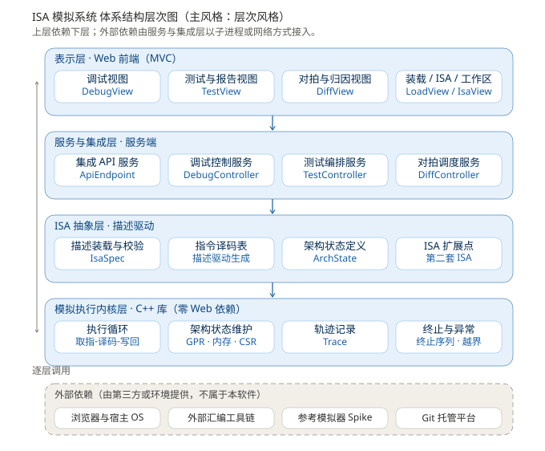
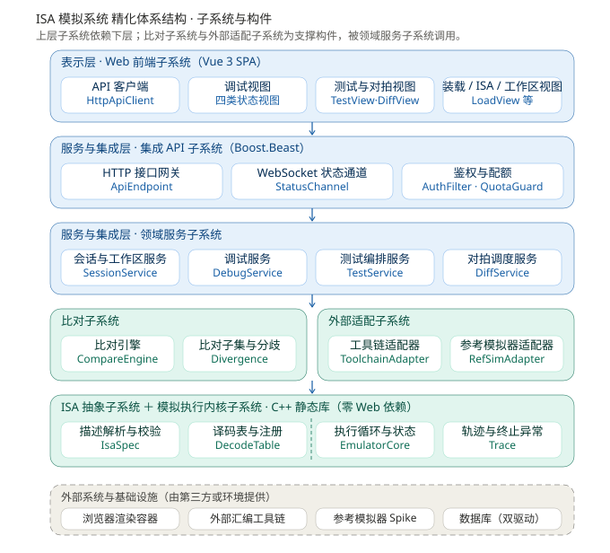
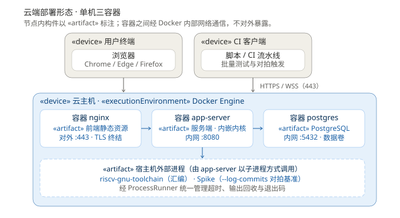
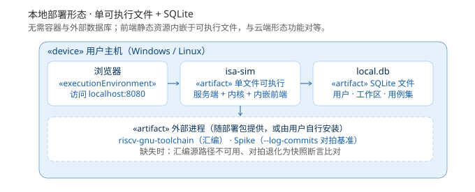

# ISA 模拟系统 软件体系结构设计文档

> 项目组：张帛昊、张豫君、上官源博、韩中贤、黄文康
> 文档阶段：软件体系结构设计
> 版本：v1.0
> 日期：2026-10-12

---

## 1 文档概述

### 1.1 编写目的

本文档是 ISA 模拟系统在软件体系结构设计阶段的正式产出，承接《软件需求规格说明书》，作用有三：

1. **固化结构**——把需求阶段确立的 14 个用例、38 条功能需求与 13 条质量与约束需求，落成可指导后续详细设计的子系统、构件与接口，使"做什么"转变为"由哪些结构承担"；
2. **确定风格与规则**——明确体系结构风格、层间依赖规则与接口稳定性分级，作为设计评审与代码评审的共同基准；
3. **划定实现边界**——明确哪些部分由本软件开发、哪些复用第三方、哪些由运行环境提供，避免后期的重复建设与责任争议。

本文档不覆盖：类内部的详细设计（属性与方法实现、用例实现模型、数据设计模型，属 `sdd` 阶段）、界面视觉设计（属 `uid` 阶段）、测试用例设计与测试报告。

### 1.2 组织结构

| 章节 | 内容 |
| --- | --- |
| 1 文档概述 | 编写目的、组织结构、读者对象、术语、参考文献 |
| 2 系统概述 | 建设目标、主要功能、边界和范围、目标用户、运行环境 |
| 3 设计目标和原则 | 设计目标、关键性软件需求、设计原则、体系结构风格选择 |
| 4 设计约束和现实限制 | 技术、许可、工期约束与客观限制 |
| 5 逻辑视点的体系结构设计 | 分层结构、七个子系统、构件职责、接口定义、基础服务、关键设计决策 |
| 6 部署视点的体系结构设计 | 云端与本地两种部署形态、节点与构件映射、通信方式、部署制品 |
| 7 开发视点的体系结构设计 | 源码组织、构建产物、与迭代次序的对应 |
| 8 运行视点的体系结构设计 | 三个关键运行场景的构件协作 |
| 附录 A | 设计元素与需求追踪矩阵 |

### 1.3 读者对象

项目组全体成员（设计与实现的主要依据）、课程指导教师、后续接手维护者。读者应已了解《软件需求规格说明书》中的用例模型、交互模型与分析类模型。

### 1.4 术语与缩略语

本文档沿用《软件需求规格说明书》1.3 节的术语表，另补充体系结构层面的术语：

| 术语 / 缩略语 | 含义 | 说明 |
| --- | --- | --- |
| 子系统 | Subsystem，承担一组相关职责的构件集合 | 本系统共 7 个 |
| 构件 | Component，可独立编译与替换的软件单元 | 本文档共 34 个 |
| 端口—适配器 | Port-Adapter，以抽象接口隔离外部系统变化的模式 | 用于隔离工具链与参考模拟器 |
| 冻结级接口 | 在迭代一即冻结、后续不得随意变更的接口 | 见 5.10 |
| 领域服务 | Domain Service，承载用例流程的服务构件 | 位于 SS-5 |
| 管道式分解 | Pipe-Filter，把执行过程拆为职责单一、可独立测试的若干级 | 用于内核的执行循环 |

### 1.5 参考文献

| 编号 | 名称 | 说明 |
| --- | --- | --- |
| D1 | 《软件需求规格说明书》v1.0 | 本设计文档的直接输入 |
| D2 | 《初步软件需求.md》v1.2 | 需求获取阶段产出 |
| D3 | 《项目选题.docx》 | 项目组提交的选题文档 |
| D4 | RISC-V 指令集规范（RV32I） | 指令编码与语义的权威依据 |
| D5 | Spike（riscv-isa-sim）仓库文档 | `--log-commits` 选项与许可条款 |
| D6 | riscv-arch-test 仓库文档 | 测试用例来源与许可条款 |

---

## 2 系统概述

> 本节与《软件需求规格说明书》2.2、2.5、2.6、2.7、2.8 节保持一致，仅作体系结构视角的必要补充。

### 2.1 系统建设目标

本系统是一个**纯软件的 ISA 模拟系统**，以解释执行的方式重建指令级行为，并提供可视化、可调试、可批量验证、可与外部参考模拟器比对的能力。系统在执行内核与指令集定义之间保留抽象边界，指令的格式与语义以 ISA 描述文件形式提供，内核不硬编码具体指令。

四项业务目标（来源 D1 的 2.5 节）：

| 编号 | 业务目标 | 对应问题 |
| --- | --- | --- |
| G1 | 让 ISA 学习者在无硬件条件下，以可视化单步的方式理解指令语义 | 指令执行过程不可观察 |
| G2 | 让工业芯片工程师在秒级完成指令级功能冒烟验证，不依赖 EDA 工具链 | 指令级功能验证成本高 |
| G3 | 让 ISA 工程师通过两套独立实现的行为对拍，发现规范本身的歧义与不一致 | 指令集规范歧义难以发现 |
| G4 | 让机器语言程序员在可回退、可重放的模拟环境中调试裸机程序 | 机器语言与汇编程序缺乏轻量调试环境 |

### 2.2 主要功能

系统功能归为十个功能组：执行内核、ISA 描述装载、程序装载、调试控制、状态可视化、测试验证、一致性对拍、集成 API、会话与存储。完整条目见 D1 的 3.3(4) 节，共 38 条功能需求，覆盖 14 个用例。

### 2.3 边界和范围

**本软件负责**：指令语义解释、架构状态维护、调试控制、状态可视化、示例程序、测试编排与判定、对拍调度与差异归因、API 服务、用户与会话管理。

**由外部提供**：浏览器渲染容器、宿主操作系统、外部汇编工具链、外部参考模拟器（Spike）、Git 托管服务。

**本期不在范围内**：周期精确的微架构建模、完整外设与中断建模、操作系统级全系统仿真、第二套指令集的完整实现、QEMU 等其他参考模拟器的接入。

### 2.4 目标用户

| 用户类型 | 关注点 | 与体系结构相关的作业方式 |
| --- | --- | --- |
| ISA 学习者 | 可视化理解指令语义 | 浏览器内交互，依赖表示层与状态推送通道 |
| 工业芯片工程师 | 快速批量跑指令级功能冒烟验证 | **主路径经集成 API 与 CI 脚本驱动**，Web 界面非必需路径 |
| ISA 工程师 | 通过双实现对拍发现规范歧义 | 依赖对拍调度、参考模拟器适配与比对子系统 |
| 机器语言程序员 | 可下断点、可回放地调试机器码程序 | 依赖调试控制与执行轨迹回退能力 |

> 四类用户画像来自选题文档，其中工业芯片工程师已按"程序接口驱动"处理；其余三类仍待真实用户核实，核实结论可能影响表示层的投入分配。

### 2.5 运行环境

| 项 | 云端部署 | 本地部署 |
| --- | --- | --- |
| 服务端 | Linux 主机（容器化，三容器） | Linux / Windows 主机（单可执行文件） |
| 前端 | 现代浏览器（Chrome / Edge / Firefox 近两个大版本） | 同左 |
| 外部依赖 | 汇编工具链、Spike 随服务端部署 | 随部署包提供或由用户安装 |
| 网络 | 需公网可达 | 无需公网 |

---

## 3 设计目标和原则

### 3.1 设计目标

| 编号 | 设计目标 | 主要对应需求 |
| --- | --- | --- |
| T1 | 内核与 ISA 定义解耦：指令语义由描述文件驱动，新增 ISA 不需改动内核核心执行逻辑 | FR-1.1、NFR-I1 |
| T2 | 内核与前端彻底解耦：内核可独立编译为库并做单元测试，不引入任何 Web 依赖 | NFR-I2 |
| T3 | 支撑迭代一的并行分工：对外接口与内核接口尽早冻结，使前端组与内核组可同时推进 | NFR-C3、需求文档 3.2.3 |
| T4 | 比对能力只有一份实现：批量测试与一致性对拍复用同一比对引擎 | FR-6.5 |
| T5 | 满足性能与可靠性指标：单步响应与连续执行吞吐达标，长时执行不漂移、不泄漏 | NFR-Q1、NFR-Q2 |
| T6 | 兑现不可信输入防护：被模拟程序不得拖垮服务，用户间数据隔离 | NFR-Q5、FR-9.5 |
| T7 | 隔离外部系统的不确定性：工具链与参考模拟器的接口变化不外溢到内核与业务逻辑 | FR-2.2、FR-7.1、NFR-C4 |
| T8 | 双形态功能对等：云端与本地两种部署共用同一套代码，仅替换适配构件 | FR-9.2 |

### 3.2 关键性软件需求

体系结构由以下需求决定，其余需求只影响构件内部实现，不改变结构：

| 类别 | 需求 | 对体系结构的决定作用 |
| --- | --- | --- |
| 核心功能 | FR-3.1 取指—译码—执行—写回循环 | 必须有独立的执行内核子系统，且性能敏感 |
| 核心功能 | FR-1.1 内核与 ISA 定义保持抽象边界 | 必须有独立的 ISA 抽象子系统，指令语义不得硬编码 |
| 核心功能 | FR-6.5、FR-7.2 两种判定模式复用同一比对引擎 | 比对引擎必须成为**跨用例复用的独立构件** |
| 核心功能 | FR-7.1 调用外部参考模拟器获取逐步状态 | 必须有参考模拟器适配构件，且跨越进程边界 |
| 核心功能 | FR-8.1 HTTP/WebSocket 集成接口 | 服务端与前端分离，接口是独立契约 |
| 质量·性能 | NFR-Q1 吞吐 ≥10⁷ 条每秒（关轨迹） | 排除解释型语言实现内核；轨迹记录必须可关断 |
| 质量·可测试性 | NFR-I2 内核可独立编译为库 | 内核子系统零 Web 与服务框架依赖 |
| 质量·可扩展性 | NFR-I1 新增 ISA 不改内核 | ISA 抽象必须是独立子系统而非内核内部模块 |
| 质量·安全性 | NFR-Q5 被模拟程序视为不可信输入 | 需资源限额机制与故障隔离边界 |
| 质量·可靠性 | NFR-Q2 单用例失败不影响其余 | 决定批量测试中用例间的隔离粒度 |
| 开发约束 | NFR-C1 内核 C++、前端 Web | 存在跨语言边界，必须定义稳定接口 |
| 开发约束 | NFR-C3 5 人一学期 | 排除过度拆分，构件粒度偏粗 |

**实现难度最大的三条**：FR-7.1（Spike 提交日志对接）、FR-3.5（运行期异常不使服务崩溃）、FR-1.2（ISA 描述完备性与自洽性校验）。体系结构为这三条分别预留了 `RefSimAdapter`、`TrapUnit`、`IsaValidator` 三个独立构件。

### 3.3 设计原则

| 编号 | 原则 | 落实方式 |
| --- | --- | --- |
| P1 | **上层依赖下层，禁止反向依赖** | 内核不得调用服务层；ISA 抽象层不得引用前端 |
| P2 | **禁止跨层跳跃依赖** | 前端只能见到服务与集成层，不得直接链接内核 |
| P3 | **变化点隔离在端口之后** | 工具链与参考模拟器经端口—适配器接入，接口变化不外溢 |
| P4 | **接口先冻结、实现后填充** | 对外契约与 `ICoreService` 在迭代一冻结，支撑并行分工 |
| P5 | **核心能力单点实现** | 比对能力、子进程执行能力各自只有一份实现，多处复用 |
| P6 | **可测试性优先于实现便利** | 内核、ISA 抽象、比对三个子系统均为纯静态库，无 I/O 依赖 |
| P7 | **部署形态差异下沉到适配与配置** | 双形态共用代码，差异只体现在持久化驱动与静态资源托管方式 |

### 3.4 体系结构风格选择

**主风格：层次风格（Layered Style）。**

选择理由有三：

1. **需求已隐含分层**——NFR-I1 要求"内核与 ISA 解耦"、NFR-I2 要求"内核与前端解耦"，这两条本质上就是层次风格的定义性特征，采用其他风格反而需要额外机制去满足它们；
2. **解耦收益直接可验证**——层次风格的层间单向依赖规则，使"内核可独立编译为库"（NFR-I2）成为一条可在构建脚本中检查的约束，而不是口头约定；
3. **工程代价与团队规模匹配**——5 人一学期的规模下，层次结构的分工边界清晰（内核组、服务组、前端组），无需引入服务注册、消息中间件等分布式基础设施。

**辅助风格：**

| 位置 | 风格 | 用途 |
| --- | --- | --- |
| 表示层内部 | MVC | 视图（`DebugView` 等）与控制器（后端 `DebugService`）职责分离，状态变化经 `StateStore` 单向流动 |
| 内核执行循环内部 | 管道/过滤器式分解 | 把"取指—译码—执行—写回"拆为四级职责单一的构件级步骤，每一级可独立做单元测试 |

**明确不采用的风格及理由：**

| 风格 | 不采用的理由 |
| --- | --- |
| SOA / 微服务 | 5 人一学期规模下，服务拆分带来的通信、部署编排、一致性复杂度远超其扩展性收益；且本系统的性能敏感路径（单步执行）需低延迟进程内调用 |
| 消息总线 | 系统内不存在异构构件间的密集消息通信需求；唯一的多进程交互是与外部工具链和参考模拟器的请求—应答式调用，用端口—适配器已足够 |
| 纯管道/过滤器 | 系统的核心不是数据流的逐级变换，而是"请求—状态变更—状态呈现"的交互循环，管道风格无法表达调试与断点语义 |

---

## 4 设计约束和现实限制

### 4.1 约束

| 编号 | 类别 | 约束 | 来源 |
| --- | --- | --- | --- |
| C1 | 技术栈 | 模拟内核使用 C++17 实现；前端采用 Web 技术（本设计选定 Vue 3）；开发工具为 Visual Studio Code | NFR-C1 |
| C2 | 版本控制 | 使用 Git，仓库托管于 Gitee 或 Github | NFR-C2 |
| C3 | 团队与工期 | 项目组 5 人，须在课程周期内完成 | NFR-C3 |
| C4 | 许可合规 | 外部汇编工具链与 Spike 及所用第三方库的许可证须与本项目分发方式兼容 | NFR-C4 |
| C5 | 交付物 | 需求文档、设计文档、源代码与测试报告 | NFR-C5 |
| C6 | 平台 | 内核须可在 Linux 与 Windows 上构建，不依赖特定 IDE 或图形界面 | NFR-I3 |

### 4.2 现实限制

| 编号 | 限制 | 对设计的影响 |
| --- | --- | --- |
| L1 | 5 人一学期的工作量上限 | 子系统划分为 7 个而非更细；第二套 ISA、QEMU 接入仅保留扩展点，不实现 |
| L2 | 外部参考模拟器的状态可见性受其自身能力限制 | 对拍能力依赖 Spike 的 `--log-commits` 输出格式；`RefSimAdapter` 需容错解析，且必须具备降级路径（FR-7.5） |
| L3 | 汇编与反汇编依赖外部工具链 | 工具链缺失时须有明确提示与降级路径，不得静默失败；适配层需处理不同工具链的输出差异 |
| L4 | `riscv-arch-test` 的特权模式测试超出本期范围 | 不整体接入该套件，仅取其非特权子集作参考或自行编写用例 |
| L5 | 团队无独立的生产级云主机预算 | 云端形态以校园或自有资源承载，部署方案须保持轻量（单机三容器） |
| L6 | 团队无遗留系统可复用 | 全部构件均需新开发，仅可复用团队既有的调试比对经验 |

---

## 5 逻辑视点的体系结构设计

### 5.1 分层结构总览

系统采用四层结构：

| 层 | 职责 | 依赖 | 关键约束 |
| --- | --- | --- | --- |
| **表示层** | 四类状态视图、调试交互、装载与 ISA 管理界面、报告呈现 | 仅依赖服务与集成层（经 HTTP/WebSocket） | 不直接触碰内核；视图与调试控制分离 |
| **服务与集成层** | 会话与工作区、调试控制、测试编排、对拍调度、对外 API | ISA 抽象层、比对子系统、外部适配子系统 | 接口在迭代一冻结 |
| **ISA 抽象层** | ISA 描述装载与校验、译码表生成、架构状态定义、扩展点 | 模拟执行内核层 | 内核不得越过本层直接解释指令编码 |
| **模拟执行内核层** | 取指—译码—执行—写回、状态维护、轨迹、终止与异常 | 无（零外部依赖，可独立编译为库） | 满足 NFR-I2；不得引入 Web/服务框架依赖 |

**两条硬性依赖规则**（层次风格兑现 NFR-I1 / NFR-I2 的前提）：

1. **禁止跨层反向依赖**——内核不得调用服务层；ISA 抽象层不得引用前端；
2. **禁止跨层跳跃依赖**——前端只能见到服务与集成层，不得直接链接内核。

这两条规则在开发视点中以构建脚本的链接依赖断言强制执行（见 7.2）。

### 5.2 子系统的划分

系统划分为 **7 个子系统、34 个构件**：

| 编号 | 子系统 | 构件数 | 形态 | 对应需求组 |
| --- | --- | --- | --- | --- |
| SS-1 | 模拟执行内核子系统 | 5 | C++ 静态库 | FR-3.x |
| SS-2 | ISA 抽象子系统 | 4 | C++ 静态库 | FR-1.x |
| SS-3 | 比对子系统 | 3 | C++ 静态库 | FR-6.5、FR-7.2、FR-7.3 |
| SS-4 | 外部适配子系统 | 3 | C++ 静态库 | FR-2.2、FR-7.1、FR-7.5 |
| SS-5 | 领域服务子系统 | 7 | 服务端可执行（链接 SS-1~SS-4） | FR-2.x、FR-4.x、FR-6.x、FR-7.x、FR-9.x |
| SS-6 | 集成 API 子系统 | 4 | 服务端可执行（链接 SS-5） | FR-8.x |
| SS-7 | Web 前端子系统 | 8 | 前端构建产物（静态资源） | FR-5.x、FR-2.4 |

### 5.3 SS-1 模拟执行内核子系统

**职责**：执行取指—译码—执行—写回循环，维护架构状态，记录执行轨迹，判定终止与运行期异常。**零外部依赖，可独立编译为库并单独做单元测试**（NFR-I2）。

| 构件 | 职责 | 关键操作 | 来源分析类 |
| --- | --- | --- | --- |
| `EmulatorCore` | 执行循环的编排者，对外提供执行服务；内部按取指→译码→执行→写回四级管道式分解 | `step()`、`run(n)`、`reset()`、`loadImage()`、`readState(fields)` | `EmulatorCore` |
| `ArchState` | PC、32 个 GPR、内存、CSR 的读写、按字段查询、快照与恢复 | `read(field)`、`write(field, val)`、`snapshot()`、`restore(snap)` | `ArchState` |
| `Trace` | 逐步记录的追加、按范围查询、取某步快照；支持关闭记录以换取吞吐 | `append(record)`、`range(a, b)`、`snapshotAt(step)`、`enable(bool)` | `Trace` |
| `TrapUnit` | 终止序列识别（RV32I 的 ecall / ebreak 退出约定）、运行期异常判定与异常现场记录 | `checkTermination()`、`checkException()`、`report()` | 新增（对应 FR-3.4、FR-3.5，需求阶段无对应分析类） |
| `ProgramImage` | 机器码映像按基址装入内存、按地址取字、访问越界判定 | `load(image, base)`、`fetch(addr)`、`inRange(addr)` | `Program` |

**管道式分解的执行循环**：`EmulatorCore::step()` 内部依次调用取指（读 `ProgramImage`）、译码（查 SS-2 的 `DecodeTable`）、执行（操作 `ArchState`）、写回（写 `ArchState` 并追加 `Trace`），四级各自为独立的内部函数单元，便于对每级单独做单元测试。

**与 FR-3.5 的关系**：运行期异常（内存越界、非法访存地址、非法 CSR 访问）由 `TrapUnit` 判定并记录异常现场；是否终止执行由外部传入的策略决定，因此内核不会因被模拟程序的错误而使服务进程崩溃。

### 5.4 SS-2 ISA 抽象子系统

**职责**：定义内核与 ISA 描述文件之间的抽象边界，装载并校验描述，生成译码表。

| 构件 | 职责 | 关键操作 | 来源分析类 |
| --- | --- | --- | --- |
| `IsaSpec` | 解析 ISA 描述文件，构造指令语义表与架构状态定义 | `parse(path)`、`instructions()`、`fields()` | `IsaSpec` |
| `IsaValidator` | 校验描述文件的完备性与自洽性：语义缺失、编码冲突、字段重叠 | `validate(spec)` → 问题清单 | 由 FR-1.2 派生 |
| `DecodeTable` | 由描述生成译码表，供内核按编码取语义规则 | `build(spec)`、`lookup(word)` | 由 FR-1.1 派生 |
| `IsaRegistry` | 已装载 ISA 的列表、激活与切换；首期内置 RV32I 描述 | `list()`、`activate(specId)`、`current()` | `IsaSpec`（部分） |

**这是"不硬编码指令"的物理落点**：内核从 `DecodeTable` 取译码规则，而 `DecodeTable` 由描述文件生成。因此新增一套 ISA 只需提供描述文件，`EmulatorCore` 不需修改——NFR-I1 由这一构件边界保证。

### 5.5 SS-3 比对子系统

**职责**：对两份架构状态序列或两份终态执行比对，定位首个分歧并生成分歧记录。**独立成子系统是被需求直接决定的**：FR-6.5 要求批量测试的"终态快照"与"逐条提交日志"两种判定模式复用同一比对引擎，FR-7.2 要求对拍按可配置比对子集逐条比对。

| 构件 | 职责 | 关键操作 | 来源分析类 |
| --- | --- | --- | --- |
| `CompareEngine` | 逐条比对两份状态序列、比对两份程序终态；输出首个分歧位置 | `compareSeq(traceA, traceB, scope)`、`compareFinal(stateA, stateB, scope)` | `CompareEngine` |
| `DiffScope` | 比对子集配置（PC / 32 个 GPR / 该指令引发的内存写 / 被修改的 CSR），字段筛选 | `setFields(fields)`、`includes(field)` | `DiffScope` |
| `Divergence` | 分歧记录生成、差异字段提取、人工归因标注的承载 | `create(stepNo, stateA, stateB)`、`diffFields()`、`annotate(tag)` | `Divergence` |

**被两处共用**：`TestService`（UC-08）与 `DiffService`（UC-10）都调用 `CompareEngine`。若把比对逻辑并入任一控制器，FR-6.5 会在设计阶段丢失——这是把该能力单列为子系统的直接理由。

### 5.6 SS-4 外部适配子系统

**职责**：以端口—适配器模式封装外部系统调用，使工具链与参考模拟器的接口变化不外溢到内核与业务逻辑。

| 构件 | 职责 | 关键操作 | 来源分析类 |
| --- | --- | --- | --- |
| `ToolchainAdapter` | 启动汇编工具链、回收机器码映像或错误行；工具链不可用时返回明确错误 | `assemble(srcPath)` → {image, errors} | `ToolchainAdapter` |
| `RefSimAdapter` | 启动 Spike、解析 `--log-commits` 输出为架构状态序列 | `run(program, scope)` → trace | `RefSimAdapter` |
| `ProcessRunner` | **公共基础服务**：子进程启动、超时控制、标准输出与错误回收、退出码、资源限制 | `exec(cmd, args, timeout)` → {code, out, err} | 由两条适配链路共用派生 |

**`ProcessRunner` 的设计理由**：`ToolchainAdapter` 与 `RefSimAdapter` 都需要"启动子进程—限时—回收输出—判断退出码"这一套逻辑。若各自实现，超时与异常处理的缺陷会被写两遍。抽出为公共基础服务后，两处适配只需处理各自的输出解析。

**降级路径**：`RefSimAdapter` 不可用时（Spike 未安装或调用失败），`DiffService` 退化为基于期望态快照的断言比对（FR-7.5）；`ToolchainAdapter` 不可用时，`LoadService` 提示用户改用机器码文件（FR-2.2）。

### 5.7 SS-5 领域服务子系统

**职责**：承载 14 个用例的业务流程，协调内核、ISA 抽象、比对与适配四个支撑子系统。

| 构件 | 职责 | 关键操作 | 来源分析类 |
| --- | --- | --- | --- |
| `SessionService` | 注册、登录、登出、会话建立与回收、账号管理 | `register()`、`login()`、`createSession()`、`logout()` | `SessionController` |
| `WorkspaceService` | 工作区创建、持久化与恢复、资源占用查询 | `create()`、`save()`、`load()`、`usage()` | `WorkspaceController` |
| `LoadService` | 程序装载：经适配器汇编、按基址载入、初始化 PC 与栈指针 | `loadProgram()`、`initCore()` | `LoadController` |
| `DebugService` | 单步/运行/暂停/复位、断点登记与命中检查、状态读取、历史回退 | `execute()`、`registerBreakpoint()`、`checkHit()`、`readState()`、`rollback()` | `DebugController` |
| `TestService` | 用例集组织、批量执行、判定模式选择、结果汇总与报告读取 | `runSuite()`、`executeCase()`、`compare()`、`summarize()`、`getReport()` | `TestController` |
| `DiffService` | 对拍调度、双方执行、逐条比对、分歧报告与归因 | `startDiff()`、`invokeRefSim()`、`compare()`、`annotate()` | `DiffController` |
| `Persistence` | 持久化 DAO：用户、会话、工作区、程序、用例集与报告 | `save*()`、`load*()`、`list*()` | 由 FR-9.3、FR-9.5 派生 |

**`Persistence` 的双驱动设计**：同一套 DAO 接口，云端绑定 PostgreSQL 驱动、本地绑定 SQLite 驱动。这是 8 条设计目标中 T8（双形态功能对等）在逻辑结构上的落点——两种部署形态的差异被压缩到一个构件的驱动选择上。

**批量测试的隔离粒度**：`TestService` 为每个用例构造独立的执行上下文（独立的 `EmulatorCore` 实例与 `ArchState`），单个用例失败或触发异常不影响其余用例（NFR-Q2）。

### 5.8 SS-6 集成 API 子系统

**职责**：对外提供 HTTP 与 WebSocket 接口，承载鉴权与资源限额。

| 构件 | 职责 | 关键操作 | 来源分析类 |
| --- | --- | --- | --- |
| `HttpGateway` | 请求路由、参数校验、响应封装；装载/单步/运行/测试/对拍各操作的入口 | `handle(request)` → response | `ApiEndpoint`、`ApiController` |
| `StatusChannel` | WebSocket 状态增量推送；批量合并推送以降低前端渲染压力 | `subscribe(session)`、`push(delta)` | 由 FR-5.x、NFR-Q1 派生 |
| `AuthFilter` | 凭据校验、会话有效性检查、请求路由前的拦截 | `authorize(token)` | `ApiController`（鉴权部分） |
| `QuotaGuard` | 请求限额：并发会话数、单位时间请求数、单次请求的指令执行条数上限；本地部署可整体关闭 | `check(uid, op)`、`enable(bool)` | 由 FR-8.2、NFR-Q5 派生 |

**接口是迭代一冻结的产物**：工业芯片工程师的批量验证走程序接口，该路径不通等于系统未交付；同时接口一经冻结，前端组与内核组可真正并行。因此 `HttpGateway` 与 `StatusChannel` 定义的契约属于冻结级。

### 5.9 SS-7 Web 前端子系统

**职责**：呈现四类状态视图，提供调试交互与报告浏览。前端不直接链接内核，全部能力经服务与集成层的接口获得。

| 构件 | 职责 | 对应界面/需求 |
| --- | --- | --- |
| `HttpApiClient` | REST 调用封装、WebSocket 连接管理与重连 | 全部前端能力的出口 |
| `DebugView` | 寄存器视图、内存视图、反汇编视图、执行轨迹视图四类；代码类内容由 CodeMirror 6 承载 | FR-5.1 ~ FR-5.4 |
| `TestView` | 用例集组织、批量执行触发、测试报告与失败现场呈现 | FR-6.1 ~ FR-6.3、UC-09 |
| `DiffView` | 比对子集选择、分歧现场呈现、归因标注提交 | FR-7.2 ~ FR-7.4、UC-11 |
| `LoadView` | 程序提交、基址与初态配置、装载结果呈现、示例程序集入口 | FR-2.1 ~ FR-2.4 |
| `IsaView` | ISA 描述文件提交、装载问题清单呈现 | FR-1.2、FR-1.3 |
| `AdminViews` | 工作区保存与加载界面、账号与配额界面 | FR-9.3、FR-9.4、UC-12、UC-14 |
| `StateStore` | 前端状态集中管理（Pinia），承接状态增量并驱动各视图刷新 | NFR-Q3（变化高亮） |

> 表中 8 行即 SS-7 的 8 个构件；其中 `AdminViews` 是一个构件，含工作区与账号两个界面组。

### 5.10 构件接口定义

| 接口 | 提供方 | 使用者 | 主要操作 | 稳定性 |
| --- | --- | --- | --- | --- |
| REST / WebSocket 契约 | SS-6 | 前端（`HttpApiClient`）、CI 客户端 | 装载、单步、运行、暂停、读状态、跑测试、发起对拍 | **冻结级** |
| `ICoreService` | SS-1 `EmulatorCore` | `LoadService`、`DebugService`、`TestService`、`DiffService` | `step()`、`run(n)`、`reset()`、`readState(fields)`、`loadImage()` | **冻结级** |
| `IIsaProvider` | SS-2 | `EmulatorCore`、`LoadService` | `activate(specId)`、`lookup(word)`、`listSpecs()` | 稳定级 |
| `IComparator` | SS-3 `CompareEngine` | `TestService`、`DiffService` | `compareSeq(a, b, scope)`、`compareFinal(a, b, scope)` | 稳定级 |
| `IStore` | SS-5 `Persistence` | `SessionService`、`WorkspaceService`、`TestService`、`DiffService` | `save*()`、`load*()`、`list*()` | 稳定级 |
| `IToolchainPort` | SS-4 `ToolchainAdapter` | `LoadService` | `assemble(srcPath)` | 可演进级 |
| `IRefSimPort` | SS-4 `RefSimAdapter` | `DiffService` | `run(program, scope)` | 可演进级 |
| `IQuotaGuard` | SS-6 `QuotaGuard` | `HttpGateway`、内核调用点 | `check(uid, op)` | 稳定级 |

**稳定性分级的含义**：

- **冻结级**——迭代一（内核与接口基线）内确定并冻结，后续变更须经项目组评审；变更会同时影响多个分工组；
- **稳定级**——方向稳定，允许在不破坏语义的前提下扩展操作；
- **可演进级**——外部系统的接口本身可能变化，用端口隔离；此类接口的变更不外溢到内核与业务逻辑（设计原则 P3）。

### 5.11 公共基础设施与基础服务

**基础设施**（独立第三方软件或运行环境）：

| 设施 | 用途 | 引入方式 |
| --- | --- | --- |
| Linux / Windows 宿主操作系统 | 进程、文件、网络基础 | 环境提供 |
| Docker | 云端与本地部署包的一致性封装 | 部署工具 |
| Nginx | TLS 终结、前端静态资源托管、反向代理 | 容器（云端） |
| PostgreSQL / SQLite | 关系数据持久化 | 容器 / 单文件库 |
| CMake | 构建系统，同时承担层间依赖断言的检查 | 构建工具 |
| doctest | 单元测试框架 | 开发依赖 |
| Git / Gitee·Github | 版本管理与协作 | 环境提供 |

**基础服务**（不由系统应用功能直接实现，但多个系统应用功能都依赖）：

| 基础服务 | 承载构件 | 被依赖方 |
| --- | --- | --- |
| 会话与鉴权服务 | `SessionService` + `AuthFilter` | 全部 API 入口、工作区、配额 |
| 持久化服务 | `Persistence` | SessionService、WorkspaceService、TestService、DiffService |
| **子进程执行服务** | `ProcessRunner` | `ToolchainAdapter`、`RefSimAdapter` |
| 轨迹存储与查询服务 | `Trace` + `Persistence` | DebugService、TestService、DiffService、`DebugView` |
| 配额与限额服务 | `QuotaGuard` + 内核指令条数上限 | API 入口、批量测试、对拍 |
| 日志与配置服务 | 独立轻量构件 | 全部构件 |

### 5.12 关键设计决策与理由

| 编号 | 决策 | 备选方案 | 选择理由 |
| --- | --- | --- | --- |
| DD-1 | 主风格采用层次风格，辅以前端 MVC 与内核管道式分解 | 纯层次 / 微服务 / MVC 为主 | 需求中的解耦要求本身就是层次风格的定义性特征；微服务规模不匹配；MVC 无法表达内核与 ISA 的解耦 |
| DD-2 | 模拟内核编译为库、与服务端**同进程** | 内核独立进程 + IPC | 单步响应延迟最低（NFR-Q1 要求本地 100 毫秒内），实现与调试最简；越界防护由内核内的范围检查承担，而非依赖进程边界 |
| DD-3 | 比对引擎单列为独立子系统，位于 ISA 抽象层之上 | 并入内核 / 作为服务层公共库 | FR-6.5 要求两种判定模式复用同一引擎；并入内核会破坏内核单一职责与可独立测试性，放在服务层会使其依赖服务框架 |
| DD-4 | 工具链与参考模拟器经端口—适配器接入 | 直接调用 | 外部系统的接口最易变化，用端口隔离可使变化不外溢（原则 P3） |
| DD-5 | 子进程执行能力抽为公共基础服务 `ProcessRunner` | 两处适配各自实现 | 超时、输出回收、退出码处理只有一份实现，避免同类缺陷写两遍（原则 P5） |
| DD-6 | 持久化采用 PostgreSQL（云端）/ SQLite（本地）双驱动 | 统一 SQLite / 关系库 + 文件系统 | 兼顾云端多用户并发与本地零配置部署（T8）；纯 SQLite 在云端并发写入与配额统计上不可靠 |
| DD-7 | 内核不引入任何 Web 或服务框架依赖 | 允许内核依赖 JSON/HTTP 库 | 这是 NFR-I2「可独立编译为库并做单元测试」的成立条件；JSON 解析被限定在 SS-2 内，内核只面向 `DecodeTable` |
| DD-8 | 前端不直接链接内核，全部经 HTTP/WebSocket | 云端 HTTP、本地直连内核 | 双形态共用同一套前端代码；本地部署时前端仍访问 localhost，形态差异对前端透明 |
| DD-9 | 不接入 `riscv-arch-test` 的整体套件 | 全量接入 | 该套件特权模式测试要求可写 mtvec 与机器模式 trap handler，超出本期范围（限制 L4） |
| DD-10 | 不复用现成 RISC-V 模拟器内核库 | 复用 libriscv / rv8 等 | 现成库均硬编码指令语义，与 FR-1.1 的描述驱动边界正面冲突；且"自研解释内核"正是本项目要解决的问题本身。注意 Spike 的角色是**对照物（基准）**而非实现，与复用内核是两回事 |

### 5.13 分析类到设计元素的映射

需求阶段的 30 个分析类映射为 34 个构件，映射关系如下（未列出者为一一对应）：

| 分析类 | 设计元素 | 变换说明 |
| --- | --- | --- |
| `SessionController` / `WorkspaceController` | `SessionService` / `WorkspaceService` | 拆为两个服务构件，因会话生命周期与工作区持久化的变更原因不同 |
| `LoadController` | `LoadService` | 一一对应 |
| `DebugController` | `DebugService` | 一一对应 |
| `TestController` / `DiffController` | `TestService` / `DiffService` | 一一对应 |
| `ApiController` | `HttpGateway` + `AuthFilter` + `QuotaGuard` | 按"请求处理 / 鉴权 / 限额"三个变更原因拆分，限额能力同时被内核调用点复用 |
| `ApiEndpoint` | `HttpGateway` + `StatusChannel` | 按单向请求与双向推送两种通信形态拆分 |
| `IsaSpec` | `IsaSpec` + `IsaValidator` + `IsaRegistry` | 解析、校验、注册三种职责分离，便于对校验规则单独做测试 |
| （无对应分析类） | `DecodeTable` | 需求阶段未识别；由 FR-1.1 的"描述驱动"要求在设计阶段显式化为独立构件 |
| （无对应分析类） | `TrapUnit` | 承接 FR-3.4（终止序列）与 FR-3.5（运行期异常） |
| （无对应分析类） | `ProcessRunner` | 公共基础服务，由两处适配链路的共性抽出 |
| `Program` | `ProgramImage` | 更名以体现其"映像 + 访问范围判定"的职责 |
| `TestSuite` / `TestReport` | `Persistence`（数据部分）+ `TestService`（流程部分） | 分析阶段的数据与流程职责在设计阶段按层分离 |
| `User` / `Session` / `Workspace` | `Persistence` + `SessionService` / `WorkspaceService` | 数据承载下沉至持久化构件 |
| `BreakpointTable` | `DebugService` 内部数据结构 | 生命周期与调试会话绑定，不单列为构件 |

### 5.14 需求覆盖核对

| 需求组 | 承载子系统与构件 |
| --- | --- |
| FR-1.1 ~ FR-1.3 | SS-2 全部构件 |
| FR-2.1 ~ FR-2.4 | `LoadService`、`ToolchainAdapter`、`ProgramImage`、`LoadView` |
| FR-3.1 ~ FR-3.5 | SS-1 全部构件（`TrapUnit` 承接 FR-3.4、FR-3.5） |
| FR-4.1 ~ FR-4.4 | `DebugService`、`EmulatorCore`、`Trace` |
| FR-5.1 ~ FR-5.4 | `DebugView`、`StatusChannel`、`StateStore` |
| FR-6.1 ~ FR-6.5 | `TestService`、`CompareEngine`、`Persistence`、`TestView` |
| FR-7.1 ~ FR-7.5 | `DiffService`、`RefSimAdapter`、`CompareEngine`、`DiffScope`、`Divergence`、`DiffView` |
| FR-8.1 ~ FR-8.3 | SS-6 全部构件 |
| FR-9.1 ~ FR-9.5 | `SessionService`、`WorkspaceService`、`Persistence`、`AdminViews` |
| NFR-Q1 | `EmulatorCore` 的单步接口、`Trace` 的可关断、`StatusChannel` 的批量推送 |
| NFR-Q2 | `TestService` 的用例级执行上下文隔离、`TrapUnit` |
| NFR-Q3 | `LoadView` 的示例程序集入口、`StateStore` 的差异驱动高亮 |
| NFR-Q4 | `DebugView` 等前端的浏览器兼容与视口适配 |
| NFR-Q5 | `QuotaGuard`、`AuthFilter`、内核指令条数上限、会话超时回收 |
| NFR-I1 | SS-1 与 SS-2 之间的 `IIsaProvider` 边界、`DecodeTable` |
| NFR-I2 | SS-1 的零 Web 依赖约束（构建脚本断言） |
| NFR-I3 | 全部 C++ 构件的平台无关实现（见 7.2 的构建目标） |
| NFR-C1 ~ NFR-C5 | 约束全部构件的技术选型与交付流程 |

38 条功能需求、13 条质量与约束需求全部有承载构件，无悬空项。

---

## 6 部署视点的体系结构设计

### 6.1 云端部署

云端为**单机三容器**形态：

| 节点 | 类型 | 部署的构件 | 对外/内网端口 |
| --- | --- | --- | --- |
| 用户终端 | «device» | 浏览器（「executionEnvironment»） | — |
| CI 客户端 | «device» | 调用脚本 / CI 流水线 | — |
| 云主机 | «device» + «executionEnvironment» Docker Engine | 三个容器与宿主机外部进程 | — |
| └ 容器 nginx | «artifact» | SS-7 的前端构建产物、TLS 证书 | 对外 :443 |
| └ 容器 app-server | «artifact» | SS-1 ~ SS-6 全部（静态链接为单一可执行） | 内网 :8080 |
| └ 容器 postgres | «artifact» | 关系模式与用户数据卷 | 内网 :5432 |
| └ 宿主机外部进程 | «artifact» | `riscv-gnu-toolchain`、Spike | 由 `ProcessRunner` 启动 |

只有 nginx 容器对外暴露端口；app-server 与 postgres 仅在内网可达，前端请求经 nginx 反向代理到 app-server。这一限制使 FR-8.2 的鉴权与限额成为唯一的对外防线，同时也是 NFR-Q5 的第一层保障。

### 6.2 本地部署

本地为**单可执行文件**形态：

| 节点 | 类型 | 部署的构件 | 说明 |
| --- | --- | --- | --- |
| 用户主机 | «device» | `isa-sim` 单文件可执行 | 链接 SS-1 ~ SS-6，内嵌 SS-7 的构建产物 |
| └ 浏览器 | «executionEnvironment» | — | 访问 `localhost:8080` |
| └ SQLite 数据文件 | «artifact» | `local.db` | 用户、会话、工作区、程序与用例集 |
| └ 外部进程 | «artifact» | 工具链、Spike | 随部署包提供或由用户自行安装 |

**双形态功能对等的实现方式**：两种形态共用同一套代码，差异被压缩在三处——`Persistence` 的驱动选择、静态资源的托管方式（nginx 托管 vs 内嵌于可执行文件）、`QuotaGuard` 的开关。这使 FR-9.2 的"功能对等"成为结构上的自然结果，而非需要分别维护两套实现。

### 6.3 节点与构件的映射

| 子系统 / 构件 | 云端节点 | 本地节点 |
| --- | --- | --- |
| SS-1 模拟执行内核 | app-server 容器（静态链接） | `isa-sim` 可执行（静态链接） |
| SS-2 ISA 抽象 | app-server 容器 | `isa-sim` 可执行 |
| SS-3 比对 | app-server 容器 | `isa-sim` 可执行 |
| SS-4 外部适配 | app-server 容器 | `isa-sim` 可执行 |
| SS-5 领域服务 | app-server 容器 | `isa-sim` 可执行 |
| SS-6 集成 API | app-server 容器 | `isa-sim` 可执行 |
| SS-7 Web 前端 | nginx 容器（静态资源） | 内嵌于 `isa-sim`，经其托管 |
| `Persistence` 后端 | postgres 容器 | `local.db` 文件 |
| 外部工具链、Spike | 云主机宿主机进程 | 用户主机进程 |

### 6.4 节点间通信方式

| 通信路径 | 协议 | 内容 | 对应需求 |
| --- | --- | --- | --- |
| 浏览器 → nginx | HTTPS / WSS（443） | 页面与静态资源、API 请求、状态推送 | FR-8.1、FR-5.x |
| nginx → app-server | HTTP / WS（内网 8080） | 反向代理转发 | FR-8.1 |
| app-server → postgres | PostgreSQL 协议（内网 5432） | 用户、会话、工作区、用例集与报告读写 | FR-9.3、FR-9.5 |
| app-server → 外部工具链 | 子进程标准流 | 汇编源入、机器码映像与错误行出 | FR-2.2 |
| app-server → Spike | 子进程标准流 | 程序入、逐步提交日志出 | FR-7.1 |
| CI 客户端 → nginx | HTTPS（443） | API 驱动的批量测试与对拍 | FR-6.4、FR-8.1 |
| 浏览器 → `isa-sim`（本地） | HTTP / WS（localhost:8080） | 同云端，但未经 TLS | FR-9.2 |

**离线约束**：本地部署形态下不存在跨节点通信（浏览器与可执行文件同机），NFR-Q1 的本地响应指标因此不含网络传输开销；云端形态下的指标定义同样明确排除网络传输。

### 6.5 部署制品清单

| 制品 | 内容 | 交付形态 |
| --- | --- | --- |
| `isa-sim-server` | 服务端可执行文件（链接 SS-1 ~ SS-6） | 云端 app-server 镜像 / 本地部署包 |
| `web-dist` | 前端构建产物（SS-7） | 云端 nginx 镜像 / 本地内嵌 |
| `isa-sim` | 本地单文件可执行（服务端 + 内嵌前端） | 本地部署包 |
| 数据库模式脚本 | 建表与初始数据 | 随服务端镜像 / 随本地包 |
| `docker-compose.yml` | 三容器编排定义 | 云端部署 |
| Spike 与工具链 | 第三方二进制 | 随包提供或由用户安装 |
| 示例程序集 | RV32I 演示程序与算法样例（FR-2.4） | 随部署包 |

---

## 7 开发视点的体系结构设计

### 7.1 源码组织

源码按子系统划分顶级目录，使层间依赖在物理结构上可见：

| 目录 | 对应子系统 | 语言 | 说明 |
| --- | --- | --- | --- |
| `core/` | SS-1 | C++17 | 模拟执行内核；零外部依赖 |
| `isa/` | SS-2 | C++17 | ISA 抽象；唯一允许引入 JSON 解析库的位置 |
| `compare/` | SS-3 | C++17 | 比对引擎与分歧记录 |
| `adapter/` | SS-4 | C++17 | 工具链与参考模拟器适配、子进程执行 |
| `service/` | SS-5 | C++17 | 领域服务与持久化 DAO |
| `api/` | SS-6 | C++17 | HTTP / WebSocket 入口、鉴权与限额 |
| `web/` | SS-7 | TypeScript + Vue 3 | 前端工程，独立构建 |
| `specs/` | — | JSON | ISA 描述文件（首期 RV32I） |
| `samples/` | — | 汇编 / 机器码 | 示例程序集（FR-2.4） |
| `tests/` | — | C++ | `core` / `isa` / `compare` 的单元测试 |
| `deploy/` | — | YAML / Shell | 容器编排与本地打包脚本 |
| `docs/` | — | Markdown | 设计文档与接口文档 |

### 7.2 构建产物与依赖关系

| 构建目标 | 产物 | 依赖 | 说明 |
| --- | --- | --- | --- |
| `libisa_core` | 静态库 | **无** | 内核，零外部依赖是本设计对 NFR-I2 的承诺 |
| `libisa_spec` | 静态库 | 无（JSON 解析库为头文件内嵌） | ISA 抽象 |
| `libisa_compare` | 静态库 | `libisa_core`（只读 `Trace` 与 `ArchState` 的类型） | 比对引擎 |
| `libisa_adapter` | 静态库 | 无 | 外部适配与 `ProcessRunner` |
| `isa_sim_server` | 可执行 | `libisa_core` + `libisa_spec` + `libisa_compare` + `libisa_adapter` + Boost.Beast | 服务端（SS-5 + SS-6） |
| `web_dist` | 静态资源 | Vue 3 + Vite + CodeMirror 6 | 前端构建产物 |
| `isa_sim` | 单文件可执行 | 上述 C++ 目标 + 内嵌 `web_dist` | 本地部署形态 |
| `unit_tests` | 可执行 | `libisa_core` + `libisa_spec` + `libisa_compare` + doctest | 内核、ISA 抽象、比对三者的单元测试 |

**层间依赖断言的强制方式**：`libisa_core` 的构建目标不链接任何网络、JSON、数据库库。一旦有人在 `core/` 中引入 Web 或服务框架的头文件，链接会失败——设计原则 P1、P2 因此在构建层面获得强制力，而不是仅靠约定。

**NFR-I3 的落实**：全部 C++ 构件不使用平台特有 API；涉及文件路径与子进程的部分集中在 `adapter/` 与 `service/`，由轻量的平台抽象隔离。

### 7.3 与迭代次序的对应

需求阶段确定四轮迭代，与本设计的子系统划分对应如下：

| 迭代 | 主题 | 交付子系统与构件 | 结构意义 |
| --- | --- | --- | --- |
| 迭代一 | 内核与接口基线 | SS-1、SS-2、SS-3 的基础部分、SS-6 的契约定义 | `ICoreService` 与 REST/WS 契约在此冻结，前端组与内核组此后可并行 |
| 迭代二 | 可视化与调试 | SS-7、SS-5 的 `DebugService`、SS-1 的 `Trace` 回放 | 在可执行内核上叠加观测与调试能力 |
| 迭代三 | 比对与验证 | SS-3 完整、SS-4、`TestService`、`DiffService` | 批量测试与对拍同轮交付，共用已完成的比对子系统 |
| 迭代四 | 架构与工程完善 | SS-5 的 `SessionService`、`WorkspaceService`、`SS-7` 的 `AdminViews` | 账号体系与工作区完善；进度吃紧时整体后延不影响核心价值链 |

**迭代一同时交付 SS-6 的契约**是结构上的关键安排：接口先冻结，实现可后填，使 5 人团队中前端组与内核组从第二轮开始即可真正并行。

---

## 8 运行视点的体系结构设计

### 8.1 场景一：单步执行（UC-04）

| 步 | 参与构件 | 行为 |
| --- | --- | --- |
| 1 | `DebugView` → `HttpApiClient` | 用户触发单步，前端发出请求 |
| 2 | `HttpGateway` → `AuthFilter` → `QuotaGuard` | 鉴权与限额检查 |
| 3 | `HttpGateway` → `DebugService` | 分发到调试服务 |
| 4 | `DebugService` → `EmulatorCore` | 调用 `step()` |
| 5 | `EmulatorCore` → `ProgramImage` → `DecodeTable` | 取指、译码（译码规则来自 ISA 抽象子系统） |
| 6 | `EmulatorCore` → `ArchState` → `Trace` | 执行与写回，追加轨迹记录 |
| 7 | `EmulatorCore` → `TrapUnit` | 检查是否命中终止序列或运行期异常 |
| 8 | `DebugService` → `StatusChannel` | 回传本步状态增量 |
| 9 | `StatusChannel` → `StateStore` → `DebugView` | 前端更新四类视图并高亮变化字段 |

第 4 ~ 7 步全部在 app-server 进程内完成，**无跨进程调用**——这是 DD-2（内核与服务端同进程）在运行时的体现，也是 NFR-Q1 单步延迟指标可达的结构基础。

### 8.2 场景二：批量测试（UC-08）

| 步 | 参与构件 | 行为 |
| --- | --- | --- |
| 1 | CI 客户端 → `HttpGateway` → `AuthFilter` → `QuotaGuard` | 携带凭据触发批量测试 |
| 2 | `HttpGateway` → `TestService` | 分发到测试服务 |
| 3 | `TestService` → `Persistence` | 读取用例集与程序 |
| 4 | `TestService` → `EmulatorCore`（每用例独立实例） | 逐用例执行，用例间上下文隔离 |
| 5 | `TestService` → `CompareEngine` | 按选定判定模式比对（终态快照或逐条提交日志） |
| 6 | `CompareEngine` → `DiffScope` | 按比对子集筛选参与比对的字段 |
| 7 | `TestService` → `Persistence` | 汇总通过率与失败清单，写入报告 |
| 8 | `HttpGateway` → CI 客户端 | 返回结构化结果 |
| 9 | 存在失败用例时 → `TestView` | 用户经 Web 界面查看失败现场（UC-09 扩展） |

**第 4 步的用例级隔离**是 NFR-Q2 的落实：每个用例使用独立的 `EmulatorCore` 与 `ArchState` 实例，单个用例因越界或死循环失败时，其余用例不受影响。

**第 5 步复用 `CompareEngine`**，与 8.3 场景二共用同一构件，正是 FR-6.5 的运行期体现。

### 8.3 场景三：一致性对拍（UC-10）

| 步 | 参与构件 | 行为 |
| --- | --- | --- |
| 1 | `DiffView` 或 CI 客户端 → `HttpGateway` → `AuthFilter` → `QuotaGuard` | 选定程序与比对子集，发起对拍 |
| 2 | `HttpGateway` → `DiffService` | 分发到对拍服务 |
| 3 | `DiffService` → `EmulatorCore` | 本内核执行程序，产出逐步状态序列 |
| 4 | `DiffService` → `RefSimAdapter` | 并行请求参考模拟器执行同一程序 |
| 5 | `RefSimAdapter` → `ProcessRunner` | 启动 Spike 并传入 `--log-commits` |
| 6 | `RefSimAdapter` | 解析 Spike 提交日志为架构状态序列 |
| 7 | `DiffService` → `CompareEngine` → `DiffScope` | 按比对子集逐条比对两份序列 |
| 8 | `CompareEngine` → `Divergence` | 定位首个分歧，生成分歧记录与差异字段 |
| 9 | `DiffService` → `DiffView` | 呈现分歧现场 |
| 10 | 用户 → `DiffView` → `DiffService` → `Divergence` | 人工归因标注（UC-11 扩展） |

**第 5 步是系统中唯一的跨进程外部调用链**，也是设计目标 T7 的着力点：Spike 的调用方式与输出格式被完全封装在 `RefSimAdapter` 内部。若未来 Spike 的输出格式变化或更换参考模拟器，只需修改该构件，`DiffService`、`CompareEngine` 与内核均不受影响。

**降级路径**：第 5 步启动失败时（Spike 未安装、版本不符、超时），`RefSimAdapter` 返回明确的不可用状态，`DiffService` 按 FR-7.5 退化为基于期望态快照的断言比对，并在结果中标明已降级。

---

## 附录 A 设计元素与需求追踪矩阵

| 业务目标 | 承载用例 | 主要子系统与构件 |
| --- | --- | --- |
| G1 可视化理解指令语义 | UC-03 ~ UC-07 | SS-1（`EmulatorCore`、`ArchState`、`Trace`）、SS-5（`LoadService`、`DebugService`）、SS-6（`StatusChannel`）、SS-7（`DebugView`、`StateStore`） |
| G2 秒级冒烟验证 | UC-08、UC-09、UC-13 | SS-6（`HttpGateway`、`AuthFilter`、`QuotaGuard`）、`TestService`、SS-3（`CompareEngine`）、`Persistence`、`TestView` |
| G3 对拍发现规范歧义 | UC-10、UC-11 | `DiffService`、SS-4（`RefSimAdapter`、`ProcessRunner`）、SS-3（`CompareEngine`、`DiffScope`、`Divergence`）、`DiffView` |
| G4 可回退调试裸机程序 | UC-03 ~ UC-05、UC-07、UC-12 | `LoadService`、`DebugService`、SS-1（`Trace`、`ProgramImage`、`TrapUnit`）、`WorkspaceService`、`Persistence` |

**质量需求与设计元素的对应**：

| 需求编号 | 设计元素 | 落实方式 |
| --- | --- | --- |
| NFR-Q1 性能 | `EmulatorCore`、`Trace`、`StatusChannel` | 内核同进程调用；轨迹可关断；推送批量合并 |
| NFR-Q2 可靠性 | `TestService`、`TrapUnit` | 用例级执行上下文隔离；异常不使服务进程崩溃 |
| NFR-Q3 易用性 | `LoadView`、`StateStore` | 示例程序集入口；状态差异驱动视图高亮 |
| NFR-Q4 兼容性 | SS-7 各视图 | 前端构建目标与视口适配策略 |
| NFR-Q5 安全性 | `QuotaGuard`、`AuthFilter`、内核指令条数上限 | 三层限额；仅 nginx 对外暴露；会话超时回收 |
| NFR-I1 可扩展性 | `DecodeTable`、`IIsaProvider`、`DiffScope` | 描述驱动译码；比对子集可配置 |
| NFR-I2 可测试性 | `libisa_core` 等静态库目标 | 零 Web 依赖由构建脚本断言 |
| NFR-I3 可移植性 | 全部 C++ 构件 | 平台抽象集中在适配与服务层 |
| NFR-C1 ~ C5 开发约束 | 约束全部构件与交付流程 | 见第 4 章 |
