# ISA 模拟系统 软件需求规格说明书

> 项目组：张帛昊、张豫君、上官源博、韩中贤、黄文康
> 文档阶段：软件需求分析（软件需求分析阶段产出）
> 版本：v1.0
> 日期：2026-10-12

---

## 1 文档概述

### 1.1 编写目的

本文档是 ISA 模拟系统在软件需求分析阶段的正式产出，作用有三：

1. **固化需求**——把《初步软件需求》中按业务语言表述的需求，净化为可被设计阶段直接消费的软件需求模型（用例模型、交互模型、分析类模型）；
2. **界定范围**——明确本系统做什么、不做什么，以及各项需求的优先级与实现迭代次序，作为进度与验收的共同基准；
3. **提供追溯依据**——为每一条需求标注来源，使后续设计与测试能够反向核查"这条功能是为谁、为什么而存在"。

本文档的读者为项目组全体成员、课程指导教师，以及后续接手设计与实现的人员。

### 1.2 适用范围

本文档覆盖 ISA 模拟系统的全部软件需求，包括功能需求、质量需求与开发约束需求。不覆盖：软件体系结构设计与详细设计（后续 `sad` / `sdd` 阶段的产出）、界面视觉设计（后续 `uid` 阶段产出）、测试方案与测试用例集。

### 1.3 术语与缩略语

| 术语 / 缩略语 | 含义 | 说明 |
| --- | --- | --- |
| ISA | Instruction Set Architecture，指令集体系结构 | 软件与硬件之间的接口契约 |
| RV32I | RISC-V 32 位基础整数指令集 | 本期唯一完整实现的指令集 |
| GPR | General Purpose Register，通用寄存器 | RV32I 下有 32 个 |
| CSR | Control and Status Register，控制与状态寄存器 | RV32I 下的特权状态寄存器 |
| PC | Program Counter，程序计数器 | 指向当前指令地址 |
| ISA 描述文件 | 描述指令编码格式、指令语义与架构状态的机器可读文件 | 内核据此解释执行，不硬编码指令 |
| 外部参考模拟器 | 作为对拍基准的第三方成熟模拟器 | 本期锁定 Spike |
| 对拍 | 两套彼此独立的实现执行同一程序并逐条比对架构状态 | 用于发现实现缺陷与规范歧义 |
| 架构状态 | PC、GPR、内存、CSR 等体系结构可见状态 | 对拍与可视化的对象 |
| 执行轨迹 | 逐步记录（指令地址、指令、操作数、状态增量） | 供回放、回退与比对使用 |
| 终止序列 | 约定的程序退出指令序列（RV32I 的 ecall / ebreak 退出约定） | 用于判定程序运行结束 |
| 比对子集 | 对拍时参与比对的状态集合 | 可配置，默认含 PC、GPR、内存写、CSR |
| 边界类 | Boundary Class，系统与外部世界之间的界面 | 分析类的一种 |
| 控制类 | Control Class，协调单个用例流程的类 | 分析类的一种 |
| 实体类 | Entity Class，被维护与被流转的数据 | 分析类的一种 |
| 工业芯片工程师 | 项目选题文档所述用户类型之一 | 全文不简写为"芯片工程师" |

### 1.4 参考资料

| 编号 | 名称 | 说明 |
| --- | --- | --- |
| R1 | 《项目选题.docx》 | 项目组提交的选题文档，需求的最初来源 |
| R2 | 《初步软件需求.md》v1.2 | 需求获取阶段（`gsr`）产出，本文档的直接输入 |
| R3 | 《交互模型说明.md》 | 14 张用例顺序图及其消息序列说明 |
| R4 | 《分析类模型说明.md》 | 30 个分析类的职责、属性与关系说明 |
| R5 | RISC-V 指令集规范（RV32I） | 指令编码与语义的权威依据 |

### 1.5 文档约定

- 需求编号：功能需求 `FR-x.y`，质量需求 `NFR-Qx` / `NFR-Ix`，开发约束 `NFR-Cx`，用例 `UC-xx`；
- 需求来源编号：`S1`~`S9`（含义见附录 A），表格中"来源"列均引用该编号，以保证可追踪性；
- 分析类名用反引号包裹并采用英文类名（如 `DebugController`），中文名作为对照；
- 图中元素：灰色 = 执行者，蓝色 = 边界类，琥珀色 = 控制类，灰白 = 实体类。

---

## 2 软件系统的一般性描述

### 2.1 软件背景

指令集体系结构是软件与硬件之间的接口契约，它规定了处理器可见的指令编码、寄存器组织、内存寻址方式与特权行为。学习者、芯片设计者、指令集制定者与底层程序开发者都需要围绕这一契约开展工作，而他们共同依赖一个前提：**能够准确、便捷地观察到指令执行后体系结构状态发生了什么变化**。

近年来以 RISC-V 为代表的开放指令集迅速普及，围绕 ISA 的教学、验证与工具需求显著上升。目前满足这一需求的手段主要有三类：阅读规范手册与教材、搭建 RTL 级仿真环境（Verilator、VCS 等）、在真实硬件或 FPGA 上运行程序。这三类手段各有成本——手册是静态的、无法执行；RTL 仿真启动与编译开销大、反馈周期长；真实硬件难以逐指令观察与反复回退。

### 2.2 软件系统概述

本系统是一个**纯软件的 ISA 模拟系统**，以解释执行的方式重建指令级行为，并提供可视化、可调试、可批量验证、可与外部参考模拟器比对的能力。系统在执行内核与指令集定义之间保留抽象边界，指令的格式与语义以 ISA 描述文件形式提供，内核不硬编码具体指令。

系统采用分层结构：

| 层次 | 职责 |
| --- | --- |
| 模拟执行内核 | 取指—译码—执行—写回循环；维护架构状态；记录执行轨迹；处理终止与异常 |
| ISA 抽象层与描述装载 | 定义内核与 ISA 描述文件之间的抽象边界；校验并装载描述 |
| 服务端与集成 API | 会话管理、调试控制、测试编排、对拍调度、对外接口 |
| Web 前端 | 四类状态视图、调试交互、测试与对拍报告呈现 |

系统以 Web 形式提供，支持云端访问与本地部署两种形态，功能对等，并对外提供集成 API 供脚本与 CI 调用。

### 2.3 欲解决的问题

| 编号 | 问题 | 具体表现 | 影响 |
| --- | --- | --- | --- |
| P1 | 指令执行过程不可观察 | 只能读手册静态理解；反汇编器只做静态翻译；调试器面向真实机器上的完整程序 | 学习曲线陡峭，概念性错误难以自查 |
| P2 | 指令级功能验证成本高 | 依赖 EDA 工具链拉起完整仿真环境，编译与初始化开销远高于"跑几条指令看看结果" | 验证迭代慢，简单问题被高成本流程掩盖 |
| P3 | 指令集规范本身的歧义难以发现 | 单一实现下，实现与规范的偏差无法被察觉，规范自相矛盾之处无人暴露 | 规范缺陷被推迟到流片或编译器适配阶段才暴露 |
| P4 | 机器语言与汇编程序缺乏轻量调试环境 | 高级语言调试器无法覆盖裸机场景 | 底层程序调试效率低，错误定位依赖打印与猜测 |

**问题与相关方对应关系**

| 问题 | 受影响相关方 |
| --- | --- |
| P1 执行过程不可观察 | ISA 学习者 |
| P2 指令级功能验证成本高 | 工业芯片工程师 |
| P3 规范歧义难以发现 | ISA 工程师 |
| P4 裸机调试环境缺失 | 机器语言程序员 |

### 2.4 软件系统解决方案

以纯软件的解释执行内核重现指令级行为，把"架构状态"变成可以被程序读取、展示、回放和比对的数据对象；在内核之上叠加服务层（集成 API）与 Web 前端（可视化与交互），形成"内核可复用、界面可替换、能力可对外集成"的分层结构。

**系统组成与职责划分**

| 组成 | 由谁提供 | 承担职责 |
| --- | --- | --- |
| 模拟执行内核 | 本软件开发 | 取指—译码—执行—写回；维护架构状态；记录轨迹；识别非法编码；处理终止与异常 |
| ISA 抽象层与描述装载 | 本软件开发 | 定义内核与 ISA 描述的抽象边界；装载并校验描述；首期提供 RV32I 描述 |
| 服务端与集成 API | 本软件开发 | 会话管理；调试控制；测试编排与判定；对拍调度与差异汇总；对外 HTTP/WebSocket 接口 |
| Web 前端 | 本软件开发 | 四类视图；调试交互；报告呈现；示例程序与新手引导入口 |
| 示例程序集 | 本软件开发 | 覆盖 RV32I 常用指令的演示程序与算法样例 |
| 外部汇编工具链 | 第三方提供（复用） | 将汇编源转换为机器码 |
| 外部参考模拟器（Spike） | 第三方提供（复用） | 作为对拍基准执行程序并输出逐步架构状态 |
| 浏览器与宿主操作系统 | 环境提供 | 提供渲染容器与运行环境 |
| Git 托管平台 | 环境提供 | 源代码、用例集与文档的版本管理与协作 |

**系统间交互**

- **前端 ↔ 服务端**：经 HTTP/WebSocket 调用，发起装载、单步、运行、测试、对拍请求，接收状态增量推送与结果；
- **服务端 ↔ 外部汇编工具链**：以子进程方式调用完成汇编，读取产物与错误输出；不可用时返回明确提示，不静默失败；
- **服务端 ↔ 外部参考模拟器**：以子进程方式启动 Spike，采集其逐步提交日志作为对照状态；
- **服务端 ↔ 存储**：用户工作区持久化到用户私有空间，用户间互相隔离；
- **本地部署形态**：服务端与前端以容器或可执行文件形式部署在本地主机，功能与云端一致。

### 2.5 软件系统的业务目标

| 编号 | 业务目标 | 对应问题 |
| --- | --- | --- |
| G1 | 让 ISA 学习者在无硬件条件下，以可视化单步的方式理解指令语义 | P1 |
| G2 | 让工业芯片工程师在秒级完成指令级功能冒烟验证，不依赖 EDA 工具链 | P2 |
| G3 | 让 ISA 工程师通过两套独立实现的行为对拍，发现规范本身的歧义与不一致 | P3 |
| G4 | 让机器语言程序员在可回退、可重放的模拟环境中调试裸机程序 | P4 |

### 2.6 软件系统的范围与边界

**本期功能范围（本系统负责）**：ISA 描述装载与校验（首期 RISC-V RV32I）、程序装载与运行配置、指令解释执行、程序终止与运行期异常处理、指令级单步与断点调试、寄存器与内存可视化、示例程序与新手引导、测试用例组织与批量验证、与 Spike 的一致性对拍、集成 API、多用户会话与隔离。

**本期不在范围内**

| 排除项 | 说明 |
| --- | --- |
| 周期精确的微架构建模 | 不建模流水线、缓存时序，仅做体系结构级（功能级）模拟 |
| 完整外设与中断建模 | 仅处理约定的终止序列与运行期异常 |
| 操作系统级全系统仿真 | 不运行操作系统，面向裸机程序 |
| 第二套指令集的完整实现 | 本期仅在架构上保留 ISA 抽象边界 |
| QEMU 等其他外部参考模拟器的接入 | 本期对拍基准锁定 Spike |

**边界划分**

| 由本软件实现 | 由环境或第三方提供 |
| --- | --- |
| 指令语义解释、架构状态维护、调试控制、状态可视化、示例程序、测试编排与判定、对拍调度与差异归因、API 服务、用户与会话管理 | 浏览器渲染容器、宿主操作系统、外部汇编工具链、外部参考模拟器（Spike）、Git 托管服务 |

### 2.7 软件系统的利益相关方

| 类别 | 相关方 | 关注点 |
| --- | --- | --- |
| 提出方 | 课程教学方 / 指导教师 | 按软件工程规范完成需求—设计—实现—测试闭环 |
| 提出方 | 项目组（5 人） | 工作量可控、可分工、技术栈统一 |
| 需求方 | ISA 学习者 | 免硬件、可视化、看得懂每条指令的执行过程 |
| 需求方 | 工业芯片工程师 | 免 EDA 工具链，快速批量跑指令级功能冒烟验证 |
| 需求方 | ISA 工程师 | 通过双实现对拍发现规范本身的歧义与不一致 |
| 需求方 | 机器语言程序员 | 可下断点、可回放地调试机器码/汇编程序 |
| 交互方（人） | 上述四类用户 | 经浏览器与 Web 界面交互；经 API 与外部脚本交互 |
| 交互方（系统） | 外部汇编工具链 | 被调用完成汇编，返回机器码或错误行 |
| 交互方（系统） | 外部参考模拟器（Spike） | 被调用执行程序，返回逐步提交日志 |
| 交互方（系统） | 浏览器 / 宿主操作系统 | 提供渲染容器与运行环境 |
| 交互方（系统） | Git 托管平台 | 源码与用例集的版本管理 |

> **说明（需求验证状态）**：四类具体用户画像来自项目选题文档（来源 S1），**尚未经真实用户访谈确认**。其中"工业芯片工程师"的作业方式已在本文档中按**程序接口与 CI 脚本驱动**处理（见 3.3.1 UC-08、UC-13），Web 界面非其必需路径；其余三类画像仍待核实，核实结论可能影响 3.3.1 的用例构成与 NFR-Q4 的形态要求。

### 2.8 软件系统的运行环境

| 项 | 云端部署 | 本地部署 |
| --- | --- | --- |
| 服务端 | Linux 主机（容器化） | Linux / Windows 主机 |
| 前端 | 现代浏览器（Chrome / Edge / Firefox 近两个大版本） | 同左 |
| 外部依赖 | 汇编工具链、Spike 随服务端部署 | 由用户安装或随部署包提供 |
| 网络 | 需公网可达 | 无需公网 |

### 2.9 约束与假设

**约束**：核心用 C++ 实现，前端为 Web；开发工具为 Visual Studio Code；版本控制用 Git 并托管于 Gitee 或 Github；项目组 5 人，须在课程周期内完成。

**假设**：

| 编号 | 假设 | 若假设不成立的后果 |
| --- | --- | --- |
| A1 | 外部参考模拟器 Spike 可持续提供逐步提交日志（`--log-commits`） | 对拍粒度退化为终态快照，FR-7.2 的逐条比对能力下降 |
| A2 | 外部汇编工具链可被以子进程方式调用 | 汇编源路径不可用，用户须自行提供机器码（FR-2.2 降级） |
| A3 | 用户作业以浏览器访问为主，工业用户以程序接口为主 | 影响界面投入分配与 NFR-Q4 的必要性判断 |
| A4 | 课程周期足以覆盖四轮迭代 | 按 3.2.3 的降级预案裁剪末轮迭代 |

---

## 3 软件功能需求

### 3.1 软件功能概述

本系统的功能可归为九个功能组：

| 功能组 | 内容 | 主要需求编号 |
| --- | --- | --- |
| 执行内核 | 取指—译码—执行—写回，维护架构状态，记录轨迹，处理终止与异常 | FR-3.1 ~ FR-3.5 |
| ISA 描述装载 | 抽象边界、描述校验、装载与切换 | FR-1.1 ~ FR-1.3 |
| 程序装载 | 机器码/汇编源载入、运行初态配置、示例程序 | FR-2.1 ~ FR-2.4 |
| 调试控制 | 单步、运行、暂停、复位、断点、运行到地址、历史回退 | FR-4.1 ~ FR-4.4 |
| 状态可视化 | 寄存器、内存、反汇编、执行轨迹四类视图 | FR-5.1 ~ FR-5.4 |
| 测试验证 | 用例管理、批量执行、报告输出、判定模式 | FR-6.1 ~ FR-6.5 |
| 一致性对拍 | 参考模拟器调用、逐条比对、分歧报告、归因、降级 | FR-7.1 ~ FR-7.5 |
| 集成 API | 接口能力、鉴权限额、接口文档 | FR-8.1 ~ FR-8.3 |
| 会话与存储 | 运行会话、双形态部署、工作区持久化、账号体系 | FR-9.1 ~ FR-9.5 |

系统功能需求的完整条目见 3.3(4)，共 **38 条功能需求**（FR-1.1 ~ FR-9.5），覆盖 **14 个用例**。

### 3.2 软件功能需求的优先级

#### 3.2.1 核心需求与外围需求

判定核心/外围的判据：**若该用例完全缺失，系统是否还立得住、是否还体现得出它的设计定位。**

| 归类 | 用例 | 判据 |
| --- | --- | --- |
| 核心（8） | UC-03 程序装载、UC-04 单步与连续执行 | 缺则系统无法运行，是全部用例的地基 |
| | UC-06 状态与轨迹查看 | 对应 P1"可视化"，是系统主要卖点 |
| | UC-05 断点管理 | 属选题四大功能之"指令级单步调试" |
| | UC-08 批量测试、UC-10 一致性对拍 | 系统的差异化优势所在 |
| | UC-13 集成 API | 工业芯片工程师的主路径，且是前后端并行的前提 |
| | UC-02 ISA 装载 | 该系统区别于普通模拟器的架构特色 |
| 外围（6） | UC-09 测试报告、UC-11 分歧归因 | 分别为 UC-08、UC-10 的延伸，不阻断核心价值链 |
| | UC-07 回退历史 | 调试增强项 |
| | UC-01 注册登录、UC-12 工作区、UC-14 用户管理 | 本地部署形态下可绕过或后置 |

#### 3.2.2 软件需求优先级列表

从**需求重要性**与**软件系统用户实际需要**两个角度综合判定，结果如下：

| 序号 | 用例名 | 用例标识 | 重要性 | 优先级 |
| --- | --- | --- | --- | --- |
| 1 | 装载并配置待模拟程序 | UC-03 | 核心 | **P0 最高** |
| 2 | 单步与连续执行 | UC-04 | 核心 | **P0 最高** |
| 3 | 通过集成 API 驱动模拟 | UC-13 | 核心 | **P1 高** |
| 4 | 查看架构状态与执行轨迹 | UC-06 | 核心 | **P1 高** |
| 5 | 管理并批量执行测试用例 | UC-08 | 核心 | **P1 高** |
| 6 | 发起 ISA 一致性对拍 | UC-10 | 核心 | **P1 高** |
| 7 | 设置与管理断点 | UC-05 | 核心 | **P1 高** |
| 8 | 装载与管理 ISA 指令集 | UC-02 | 核心 | **P2 中** |
| 9 | 分析与标注分歧归因 | UC-11 | 外围 | **P2 中** |
| 10 | 查看测试报告 | UC-09 | 外围 | **P2 中** |
| 11 | 回退执行历史 | UC-07 | 外围 | **P3 低** |
| 12 | 注册与登录 | UC-01 | 外围 | **P3 低** |
| 13 | 保存与加载工作区 | UC-12 | 外围 | **P3 低** |
| 14 | 管理用户与资源配额 | UC-14 | 外围 | **P3 低** |

**两处反直觉判断的理由**

- **UC-13 排到 P1 第三位**：工业芯片工程师的批量验证走程序接口，这条路径不通，系统对该类用户等于未交付；且接口一经冻结，前端组与内核组即可真正并行，是 5 人团队拆开串行链的关键。
- **UC-01 降到 P3**：它虽是"注册用户"这一抽象执行者的入口，但在本地部署形态下可用匿名会话绕过；且它是全系统最重（账号、鉴权、配额、隔离）却最不体现系统特色的部分，后置可在进度吃紧时整体裁剪而不伤核心价值链。

#### 3.2.3 用例分析与实现的迭代次序

| 迭代 | 主题 | 用例 | 说明 |
| --- | --- | --- | --- |
| 迭代一 | 内核与接口基线 | UC-03、UC-04、UC-13 | 先把执行内核与对外接口做出来并冻结，使前端组与内核组可并行 |
| 迭代二 | 可视化与调试 | UC-06、UC-05、UC-07 | 在可执行内核上叠加观测与调试能力，形成"看得见"的系统 |
| 迭代三 | 比对与验证 | UC-08、UC-10、UC-09、UC-11 | 批量测试与一致性对拍同轮交付，二者复用同一比对引擎 |
| 迭代四 | 架构与工程完善 | UC-02、UC-01、UC-12、UC-14 | ISA 描述装载、账号体系、工作区与配额管理 |

**三条排序依据**

1. **迭代一即交付 UC-13**，而不是等前端就绪。理由见 3.2.2。
2. **迭代三把 UC-08 与 UC-10 绑定**。这是硬约束：FR-6.5 与用例关系表已写明二者复用同一比对引擎，若分轮实现，比对引擎必然被写第二遍。
3. **UC-01 置于末轮**。与可行性分析中的降级预案配套：进度吃紧时可整体后延，系统核心价值链完好。

### 3.3 软件功能需求描述

按 3.2.2 的优先级由高到低逐项描述。

#### 3.3.1 软件的用例模型及描述

**（一）用例图**

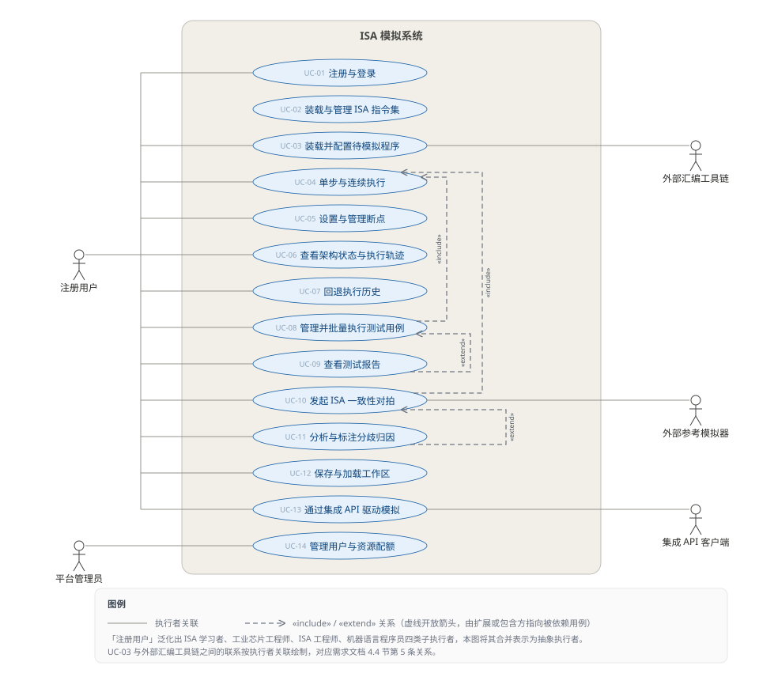

> 图中四种具体用户类型（ISA 学习者、工业芯片工程师、ISA 工程师、机器语言程序员）泛化自"注册用户"，为保持图面清晰已合并表示；用例间的 «include» / «extend» 关系**已画入图中**（虚线开放箭头，由扩展或包含方指向被依赖用例），关系说明见下表；关联线采用总线汇聚画法，仅表示执行者与用例的连接，不代表用例之间存在依赖。

**（二）执行者**

**人类执行者**

| 执行者 | 说明 |
| --- | --- |
| 注册用户（抽象执行者） | 所有已登录用户的共性行为集合 |
| └ ISA 学习者 | 泛化自注册用户，关注指令语义的可视化理解 |
| └ 工业芯片工程师 | 泛化自注册用户，关注批量测试与验证报告，**作业主路径为经程序接口与 CI 脚本驱动，Web 界面非其必需路径** |
| └ ISA 工程师 | 泛化自注册用户，关注 ISA 描述管理与对拍归因 |
| └ 机器语言程序员 | 泛化自注册用户，关注断点调试与裸机程序运行 |
| 平台管理员 | 负责用户管理与资源配额管理 |

**系统执行者（次要执行者）**：外部汇编工具链、外部参考模拟器（Spike）、集成 API 客户端。浏览器与宿主操作系统作为环境执行者，不参与用例划分。

**（三）用例列表与用例间关系**

| 用例 | 标识 | 主要执行者 | 优先级 | 来源 |
| --- | --- | --- | --- | --- |
| 注册与登录 | UC-01 | 注册用户 | P3 | S2-6 |
| 装载与管理 ISA 指令集 | UC-02 | ISA 工程师 | P2 | S2-1、S5 |
| 装载并配置待模拟程序 | UC-03 | 注册用户 | P0 | S2-5、S3、S6 |
| 单步与连续执行 | UC-04 | 注册用户 | P0 | S1 |
| 设置与管理断点 | UC-05 | 注册用户 | P1 | S3 |
| 查看架构状态与执行轨迹 | UC-06 | 注册用户 | P1 | S1、S3 |
| 回退执行历史 | UC-07 | 注册用户 | P3 | S3 |
| 管理并批量执行测试用例 | UC-08 | 工业芯片工程师 | P1 | S4 |
| 查看测试报告 | UC-09 | 工业芯片工程师 | P2 | S4 |
| 发起 ISA 一致性对拍 | UC-10 | ISA 工程师 | P1 | S2-3、S1 |
| 分析与标注分歧归因 | UC-11 | ISA 工程师 | P2 | S5 |
| 保存与加载工作区 | UC-12 | 注册用户 | P3 | S3、S6 |
| 通过集成 API 驱动模拟 | UC-13 | 集成 API 客户端 | P1 | S2-2 |
| 管理用户与资源配额 | UC-14 | 平台管理员 | P3 | S2-6、S7 |

**用例间关系**

| 关系 | 说明 | 来源 |
| --- | --- | --- |
| UC-08 «include» UC-04 | 批量测试必须复用同一执行内核 | 由需求结构导出 |
| UC-10 «include» UC-04 | 一致性对拍必须复用同一执行内核 | 由需求结构导出 |
| UC-09 «extend» UC-08 | 扩展条件：用例集中存在失败用例 | 由需求结构导出 |
| UC-11 «extend» UC-10 | 扩展条件：对拍过程中出现分歧 | 由需求结构导出 |
| UC-03 «include» 调用外部工具链 | 仅在提交"汇编源"的分支触发，提交机器码分支不触发 | S2-5 |

**（四）用例描述**

以下按优先级由高到低逐个描述每个用例的功能与行为。

---

##### UC-03 装载并配置待模拟程序

| 项 | 内容 |
| --- | --- |
| 用例标识 | UC-03 |
| 优先级 | P0 最高 |
| 主要执行者 | 注册用户 |
| 参与对象 | 装载界面、装载控制器、工具链适配器（仅汇编源分支）、程序、模拟内核 |
| 涉及功能需求 | FR-2.1、FR-2.2、FR-2.3、FR-2.4 |
| 目标 | 把待模拟的程序装入内存并配置好运行初态，使内核进入就绪态 |
| 前置条件 | 用户已进入系统，当前 ISA 已装载（UC-02 完成或已载入默认 RV32I 描述） |
| 后置条件 | 程序位于指定基址，PC 与栈指针已设定，内核就绪可执行 |
| 来源 | S2-5、S3、S6 |

**基本流**

1. 用户提交待模拟程序：汇编源文件、机器码文件（bin / hex / ELF 可装载段），或从内置示例程序集中选择（FR-2.4）；
2. 用户在装载界面填写基址、起始 PC 与栈指针，并可为内存区设定初值（FR-2.3）；
3. **若提交的是汇编源**，装载控制器调用外部汇编工具链适配器完成汇编，取得机器码映像；工具链缺失或版本不符时，系统给出明确提示而不静默失败（FR-2.2）；
4. **若提交的是机器码**，跳过第 3 步；
5. 装载控制器按指定基址把映像载入程序对象（FR-2.1）；
6. 装载控制器调用模拟内核完成初始化：设置 PC、栈指针与内存初值；
7. 内核进入就绪态，装载界面刷新并呈现装载结果（含载入字节数、起始 PC）。

**扩展流**

- **E1 汇编失败**：工具链返回非零退出码并给出出错行号，系统在装载界面呈现错误行与原始信息，程序保持在未装载状态，用户可修改源码后重试；
- **E2 工具链不可用**：系统中未配置或无法启动工具链，提示用户改用机器码文件；
- **E3 基址越界或映像超出内存范围**：装载中止，提示冲突的地址区间；
- **E4 用户选用内置示例程序**：跳过用户提交与汇编，直接从示例程序集取出映像并沿用其预设初态（FR-2.4）。

---

##### UC-04 单步与连续执行

| 项 | 内容 |
| --- | --- |
| 用例标识 | UC-04 |
| 优先级 | P0 最高 |
| 主要执行者 | 注册用户 |
| 参与对象 | 调试界面、调试控制器、模拟内核、架构状态、执行轨迹 |
| 涉及功能需求 | FR-3.1、FR-3.2、FR-3.3、FR-3.4、FR-3.5、FR-4.1、FR-4.3 |
| 目标 | 驱动内核执行指令，向用户逐条呈现架构状态的变化 |
| 前置条件 | 程序已装载且内核就绪（UC-03 完成） |
| 后置条件 | 内核执行了指定的步数或运行至结束，架构状态与执行轨迹更新，变化被推送到界面 |
| 来源 | S1 |

**基本流**

1. 用户在调试界面触发单步执行或连续运行（FR-4.1）；
2. 调试控制器按步数或运行模式驱动模拟内核；
3. 内核完成取指、译码、执行、写回（FR-3.1）；若遇到非法、未定义或保留编码，则定位到该指令地址并报告，不使系统崩溃（FR-3.2）；
4. 内核更新架构状态：PC、GPR、内存与 CSR（FR-3.1）；
5. 内核把本步记录追加到执行轨迹（指令地址、指令、操作数、状态增量）（FR-3.3）；
6. 内核向调试控制器返回状态增量；
7. 调试控制器把状态与轨迹推送到调试界面；
8. 调试界面高亮本步发生变化的部分（FR-5.1）；
9. 命中终止序列或运行期异常时，按约定结束运行并返回结束状态与退出码（FR-3.4、FR-3.5）。

**扩展流**

- **E1 非法 / 未定义编码**：报告指令地址与编码，按配置暂停或终止（FR-3.2）；
- **E2 运行期异常**：内存越界、非法访存地址、非法 CSR 访问等，记录异常现场（异常类型、触发地址、当时架构状态）并按配置终止或暂停，不得使服务进程崩溃（FR-3.5）；
- **E3 命中终止序列**：设置终止标志，返回结束状态与退出码（FR-3.4）；
- **E4 "运行到指定地址"**：连续执行至 PC 等于目标地址后暂停（FR-4.3）；
- **E5 连续运行中命中断点**：转入 UC-05 的暂停分支；
- **E6 云端运行超配额**：指令条数或时限超出配额时强制终止并返回原因（NFR-Q5）。

---

##### UC-13 通过集成 API 驱动模拟

| 项 | 内容 |
| --- | --- |
| 用例标识 | UC-13 |
| 优先级 | P1 高 |
| 主要执行者 | 集成 API 客户端（外部脚本或 CI） |
| 参与对象 | 集成 API 接口、接口请求控制器、会话、模拟内核 |
| 涉及功能需求 | FR-8.1、FR-8.2、FR-8.3 |
| 目标 | 让外部程序以结构化接口驱动装载、调试、测试与对拍，取回结构化结果 |
| 前置条件 | 服务端已启动，客户端持有有效凭据（本地部署可关闭鉴权） |
| 后置条件 | 请求的操作被执行，客户端收到结构化结果 |
| 来源 | S2-2 |

**基本流**

1. 客户端携带凭据调用接口，请求中指定操作与参数（FR-8.1）；
2. 集成 API 接口把请求交给接口请求控制器解析；
3. 请求控制器经会话校验凭据，并核查配额（FR-8.2）；
4. 校验通过后，请求控制器把操作分发到对应能力：装载程序、单步 / 运行 / 暂停、读取状态、执行测试或发起对拍；
5. 内核返回执行结果；
6. 请求控制器把结果封装为结构化响应；
7. 集成 API 接口把响应回送客户端。

**扩展流**

- **E1 鉴权失败**：返回统一鉴权错误，不泄露账号是否存在；
- **E2 超出配额**：返回配额错误并附剩余额度信息；
- **E3 本地部署关闭鉴权**：跳过第 3 步（FR-8.2）；
- **E4 请求参数非法**：返回参数错误与定位信息，不执行任何操作。

> 本用例是 UC-08 与 UC-10 的程序接口入口：批量测试与对拍经此接口触发，结果亦经此接口返回（见 3.3.2 中 UC-08 的顺序图）。

---

##### UC-06 查看架构状态与执行轨迹

| 项 | 内容 |
| --- | --- |
| 用例标识 | UC-06 |
| 优先级 | P1 高 |
| 主要执行者 | 注册用户 |
| 参与对象 | 调试界面、调试控制器、架构状态、执行轨迹 |
| 涉及功能需求 | FR-5.1、FR-5.2、FR-5.3、FR-5.4 |
| 目标 | 把架构状态与执行历史以可视方式呈现，支撑指令语义的理解 |
| 前置条件 | 内核可执行，已有当前架构状态（可尚未执行过任何指令） |
| 后置条件 | 四类视图按最新状态渲染完成 |
| 来源 | S1、S3 |

**基本流**

1. 用户切换视图（寄存器 / 内存 / 反汇编 / 执行轨迹）；
2. 调试界面向调试控制器请求当前状态；
3. 调试控制器查询架构状态中的 PC、GPR、内存与 CSR（FR-5.1），并查询指定范围的执行轨迹（FR-5.4）；
4. 调试控制器把状态与轨迹返回调试界面；
5. 调试界面渲染四类视图：寄存器视图高亮本步变化的位（FR-5.1）；内存视图按字节 / 半字 / 字显示（FR-5.2）；反汇编视图显示当前 PC 前后若干条并高亮当前指令（FR-5.3）；轨迹视图以时间轴呈现（FR-5.4）；
6. 视图呈现给用户。

**扩展流**

- **E1 用户跳转地址**：内存视图与反汇编视图跳到指定地址重新渲染（FR-5.2、FR-5.3）；
- **E2 用户搜索内存**：按值或按模式检索并列出命中地址（FR-5.2）；
- **E3 用户编辑内存**：在允许的范围内修改内存字并刷新视图（FR-5.2）；
- **E4 用户点击轨迹某步**：定位到该步，转入 UC-07 的回退分支。

---

##### UC-08 管理并批量执行测试用例

| 项 | 内容 |
| --- | --- |
| 用例标识 | UC-08 |
| 优先级 | P1 高 |
| 主要执行者 | 工业芯片工程师（**主路径经集成 API 驱动**） |
| 参与对象 | 集成 API 接口、接口请求控制器、测试控制器、测试用例与用例集、模拟内核、比对引擎、测试报告 |
| 涉及功能需求 | FR-6.1、FR-6.2、FR-6.3、FR-6.4、FR-6.5，«include» FR-3.x / FR-4.x |
| 目标 | 批量执行测试用例集并自动判定通过 / 失败，输出结构化结果 |
| 前置条件 | 用例集已导入或编辑完成，内核与 ISA 就绪 |
| 后置条件 | 用例集全部执行完毕，结果汇总为测试报告，结果经接口返回 |
| 来源 | S4 |

**基本流**

1. 工业芯片工程师经集成 API 提交批量测试请求，含用例集与判定模式（终态快照 / 逐条提交日志）（FR-6.1、FR-6.4、FR-6.5）；
2. 集成 API 接口解析并鉴权，交由接口请求控制器；
3. 请求控制器把批量执行请求转给测试控制器；
4. 测试控制器加载用例集，取得用例列表（FR-6.1）；
5. 测试控制器逐用例调用模拟内核执行用例程序（«include» UC-04）；
6. 内核返回执行结果与轨迹；
7. 测试控制器按选定判定模式调用比对引擎比对实际与期望（FR-6.5）；比对引擎为 UC-08 与 UC-10 共用；
8. 比对引擎返回判定结果；
9. 测试控制器把结果集汇总为测试报告（FR-6.3）；
10. 测试控制器把结构化结果经接口返回客户端。

**扩展流**

- **E1 存在失败用例**：汇总后转入 UC-09 查看失败现场；
- **E2 单个用例执行失败**：记录该用例的失败现场并继续执行其余用例，不中断整批（NFR-Q2）；
- **E3 判定模式为逐条提交日志**：比对引擎逐条比对提交序列，报告首个差异点；
- **E4 用例程序触发运行期异常**：按 FR-3.5 记录异常现场后判定该用例失败；
- **E5 用例集尚未准备**：用户先在测试界面或经接口导入、编辑用例集（程序加期望态，支持分组与标签）（FR-6.1），再触发批量执行。此活动是本用例的前置活动。

---

##### UC-10 发起 ISA 一致性对拍

| 项 | 内容 |
| --- | --- |
| 用例标识 | UC-10 |
| 优先级 | P1 高 |
| 主要执行者 | ISA 工程师 |
| 参与对象 | 对拍界面、对拍控制器、模拟内核、参考模拟器适配器、执行轨迹、比对引擎、分歧记录 |
| 涉及功能需求 | FR-7.1、FR-7.2、FR-7.3、FR-7.4、FR-7.5，«include» FR-3.x |
| 目标 | 让本系统内核与外部参考模拟器执行同一程序，逐条比对其架构状态，定位首个分歧点 |
| 前置条件 | 程序已装载且内核就绪；参考模拟器可用（否则走降级模式 FR-7.5） |
| 后置条件 | 得到一致性结论；若有分歧，生成分歧记录供分析与归因 |
| 来源 | S2-3、S1 |

**基本流**

1. ISA 工程师在对拍界面选定程序与比对子集（默认含 PC、32 个 GPR、该指令引发的内存写、被修改的 CSR）（FR-7.2）；
2. 对拍控制器驱动本系统内核执行程序，取得本内核的状态轨迹（«include» UC-04）；
3. 对拍控制器经参考模拟器适配器调用 Spike 执行同一程序，采集其逐步提交日志（FR-7.1）；
4. 对拍控制器把双方轨迹登记到执行轨迹对象；
5. 对拍控制器调用比对引擎，按比对子集逐条比对双方状态（FR-7.2）；
6. 比对引擎返回首个分歧点（指令序号、双方状态、差异字段）（FR-7.3）；
7. 对拍控制器据此生成分歧记录；
8. 对拍界面呈现分歧现场与差异字段（FR-7.4）。

**扩展流**

- **E1 全程一致**：报告"未发现分歧"，附比对指令条数与比对子集，流程结束；
- **E2 用户裁剪比对子集**：仅比对 PC 与 GPR 等子集，比对引擎据 `DiffScope` 调整（FR-7.2）；
- **E3 参考模拟器不可用**：转入降级模式，退化为基于期望态快照的断言比对（FR-7.5）；
- **E4 出现分歧**：转入 UC-11 分析并标注分歧归因；
- **E5 Spike 提交日志粒度和本内核不一致**：按可对齐的最小粒度比对，不匹配处标记为"不可比对"而非分歧（A1 相关）。

---

##### UC-05 设置与管理断点

| 项 | 内容 |
| --- | --- |
| 用例标识 | UC-05 |
| 优先级 | P1 高 |
| 主要执行者 | 注册用户 |
| 参与对象 | 调试界面、调试控制器、断点表、模拟内核 |
| 涉及功能需求 | FR-4.2、FR-4.3 |
| 目标 | 让程序在指定地址暂停，便于观察该处的架构状态 |
| 前置条件 | 程序已装载，内核可执行 |
| 后置条件 | 断点被登记并生效，命中时程序暂停并高亮 |
| 来源 | S3 |

**基本流**

1. 用户在反汇编视图或地址栏指定地址设置断点；
2. 调试界面把登记请求交给调试控制器；
3. 调试控制器在断点表中添加断点，取得更新后的断点列表；
4. 若当前正在运行，调试控制器向内核登记断点并检查命中（FR-4.2）；
5. 命中断点时暂停执行并高亮该位置；
6. 断点命中信息呈现给用户。

**扩展流**

- **E1 禁用 / 启用断点**：更新断点状态，不删除记录；
- **E2 删除断点**：从断点表移除；
- **E3 同一地址重复设置**：识别为已存在，不重复登记；
- **E4 命中后用户选择继续**：恢复执行，转入 UC-04。

---

##### UC-02 装载与管理 ISA 指令集

| 项 | 内容 |
| --- | --- |
| 用例标识 | UC-02 |
| 优先级 | P2 中 |
| 主要执行者 | ISA 工程师 |
| 参与对象 | ISA 管理界面、ISA 管理控制器、ISA 描述 |
| 涉及功能需求 | FR-1.1、FR-1.2、FR-1.3 |
| 目标 | 装载并校验 ISA 描述，使其成为内核的当前指令集定义 |
| 前置条件 | 用户已登录，持有符合格式的 ISA 描述文件 |
| 后置条件 | 描述通过校验并装载为当前 ISA，或返回问题清单 |
| 来源 | S2-1、S5 |

**基本流**

1. ISA 工程师上传 ISA 描述文件；
2. ISA 管理界面把"装载并校验"请求交给 ISA 管理控制器；
3. 控制器解析描述文件，得到候选 ISA 描述（FR-1.1）；
4. 控制器对描述执行完备性与自洽性校验：语义缺失、编码冲突、字段重叠（FR-1.2）；
5. 校验通过则装载并切换为当前 ISA（FR-1.3）；
6. 控制器把装载结果返回界面并呈现。

**扩展流**

- **E1 校验不通过**：返回问题清单（逐条指出语义缺失、编码冲突或字段重叠的位置），当前 ISA 保持不变；
- **E2 查询 / 列出已装载 ISA**：返回已装载 ISA 列表及当前生效项（FR-1.3）；
- **E3 切换当前 ISA**：在内核无可执行程序的状态下切换生效。

---

##### UC-11 分析与标注分歧归因

| 项 | 内容 |
| --- | --- |
| 用例标识 | UC-11 |
| 优先级 | P2 中 |
| 主要执行者 | ISA 工程师 |
| 参与对象 | 对拍界面、对拍控制器、分歧记录 |
| 涉及功能需求 | FR-7.4 |
| 目标 | 对分歧进行归类标注，区分实现缺陷、基准偏差与规范歧义 |
| 前置条件 | 已由 UC-10 产生至少一条分歧记录 |
| 后置条件 | 分歧记录带有归因类别与说明，归档留存 |
| 来源 | S5 |

**基本流**

1. ISA 工程师查看分歧现场与差异字段；
2. 对拍界面按分歧标识向控制器取差异字段；
3. 控制器查询分歧记录，返回分歧详情；
4. 工程师选择归因类别（实现缺陷 / 基准偏差 / 规范歧义）并提交说明；
5. 控制器更新分歧记录的归因标注并归档；
6. 界面确认标注完成。

**扩展流**

- **E1 判定为规范歧义**：记录中标记为规范歧义并附规范条目引用，可作为对规范本身的反馈依据（对应业务目标 G3）；
- **E2 判定为实现缺陷**：归档后转回开发修正，修正后可重跑 UC-10 验证；
- **E3 暂无法判定**：允许延后标注，记录保持"待定"状态。

---

##### UC-09 查看测试报告

| 项 | 内容 |
| --- | --- |
| 用例标识 | UC-09 |
| 优先级 | P2 中 |
| 主要执行者 | 工业芯片工程师 |
| 参与对象 | 测试界面、测试控制器、测试报告 |
| 涉及功能需求 | FR-6.3 |
| 目标 | 呈现批量测试的结果，支撑失败定位 |
| 前置条件 | 已完成至少一轮批量测试（UC-08） |
| 后置条件 | 用户看到通过率、失败清单与失败现场快照 |
| 来源 | S4 |

**基本流**

1. 用户打开测试报告；
2. 测试界面向测试控制器请求报告；
3. 测试控制器从测试报告对象取通过率与失败清单（FR-6.3）；
4. 报告数据返回界面并呈现；
5. 用户点击某个失败用例；
6. 界面按用例标识取失败现场快照；
7. 呈现失败现场状态快照与首个断言差异点。

**扩展流**

- **E1 全部通过**：报告显示通过率 100%，无失败清单；
- **E2 失败原因为运行期异常**：失败现场附带异常类型与触发地址。

---

##### UC-07 回退执行历史

| 项 | 内容 |
| --- | --- |
| 用例标识 | UC-07 |
| 优先级 | P3 低 |
| 主要执行者 | 注册用户 |
| 参与对象 | 调试界面、调试控制器、执行轨迹、架构状态 |
| 涉及功能需求 | FR-4.4 |
| 目标 | 回到任意已执行步的架构状态，便于反复观察 |
| 前置条件 | 执行轨迹中已有至少一步记录 |
| 后置条件 | 架构状态恢复到目标步，全部视图同步刷新 |
| 来源 | S3 |

**基本流**

1. 用户选择历史中的某一步；
2. 调试界面把"回退到指定步"请求交给调试控制器；
3. 调试控制器从执行轨迹取该步的状态快照（FR-4.4）；
4. 调试控制器用快照恢复架构状态；
5. 控制器通知界面状态已回退；
6. 四类视图同步刷新。

**扩展流**

- **E1 目标步超出轨迹范围**：拒绝并提示有效范围；
- **E2 回退后继续执行**：从回退点之后重新执行，轨迹按策略截断或分叉（由设计阶段确定）。

---

##### UC-01 注册与登录

| 项 | 内容 |
| --- | --- |
| 用例标识 | UC-01 |
| 优先级 | P3 低 |
| 主要执行者 | 注册用户 |
| 参与对象 | 会话界面、会话控制器、用户、会话、工作区 |
| 涉及功能需求 | FR-9.4、FR-9.1 |
| 目标 | 建立用户身份与隔离的运行工作区 |
| 前置条件 | 服务端已启动；云端部署下需网络可达 |
| 后置条件 | 会话建立，用户私有工作区就绪，默认 ISA 描述已载入 |
| 来源 | S2-6 |

**基本流**

1. 用户提交注册或登录凭据（用户名、口令）；
2. 会话界面把凭据交给会话控制器校验；
3. 控制器查询账号记录；
4. 校验通过后创建会话，取得会话令牌（FR-9.4、FR-9.1）；
5. 控制器为用户建立隔离工作区（FR-9.5）；
6. 载入默认 ISA 描述（RV32I）；
7. 返回登录结果，界面进入主界面。

**扩展流**

- **E1 凭据错误**：返回统一错误提示，不区分账号不存在与口令错误；
- **E2 注册时用户名冲突**：提示已占用，要求更换；
- **E3 账号被停用**：拒绝登录并提示联系管理员（对应 UC-14）；
- **E4 本地部署匿名会话**：跳过凭据校验，直接建立匿名工作区（FR-9.2、NFR-Q5）。

---

##### UC-12 保存与加载工作区

| 项 | 内容 |
| --- | --- |
| 用例标识 | UC-12 |
| 优先级 | P3 低 |
| 主要执行者 | 注册用户 |
| 参与对象 | 工作区界面、工作区控制器、工作区、程序、测试用例与用例集 |
| 涉及功能需求 | FR-9.3 |
| 目标 | 把程序、用例集与配置持久化到用户私有空间，并可恢复 |
| 前置条件 | 用户已建立会话与工作区 |
| 后置条件 | 工作区内容被保存或恢复，视图刷新 |
| 来源 | S3、S6 |

**基本流**

1. 用户触发保存工作区；
2. 工作区界面把保存请求（程序、用例集、配置）交给工作区控制器；
3. 控制器把内容持久化到工作区（FR-9.3）；
4. 返回保存结果；
5. 用户触发加载工作区；
6. 控制器从工作区读取数据；
7. 控制器恢复程序与用例集；
8. 界面刷新视图。

**扩展流**

- **E1 同名工作区冲突**：提示覆盖或另存；
- **E2 配额不足**：拒绝保存并提示剩余额度（对应 UC-14、NFR-Q5）；
- **E3 加载的数据版本不兼容**：提示并保持当前工作区不变。

---

##### UC-14 管理用户与资源配额

| 项 | 内容 |
| --- | --- |
| 用例标识 | UC-14 |
| 优先级 | P3 低 |
| 主要执行者 | 平台管理员 |
| 参与对象 | 会话界面、会话控制器、用户、工作区 |
| 涉及功能需求 | FR-9.5、FR-8.2 |
| 目标 | 查看用户与资源占用，调整配额或停用账号 |
| 前置条件 | 管理员已登录并具有管理权限 |
| 后置条件 | 配额或账号状态变更生效 |
| 来源 | S2-6、S7 |

**基本流**

1. 管理员查看用户列表与资源占用；
2. 会话界面把查询请求交给会话控制器；
3. 控制器列出用户，并查询各用户工作区的资源占用（FR-9.5）；
4. 结果返回界面并呈现；
5. 管理员调整配额或停用账号；
6. 控制器把变更应用到用户记录；
7. 界面确认操作结果。

**扩展流**

- **E1 停用账号**：该用户在下次请求时被拒绝（对应 UC-01 E3）；
- **E2 调低配额导致现有占用超限**：允许变更但标记为超限，后续写入受限；
- **E3 管理员无权限**：拒绝操作并记录。

#### 3.3.2 用例的交互模型及描述

为 14 个用例各建立一张 UML 顺序图，并逐一给出其消息序列描述。

> **排序说明**：本节按用例编号 UC-01 ~ UC-14 排列；3.3.1 的用例描述则按优先级由高到低排列，两处顺序不同，交叉查阅时以用例编号为准。

**图例**：灰色 = 执行者，蓝色 = 边界类，琥珀色 = 控制类，灰白 = 实体类；实线三角箭头 = 调用（同步消息），虚线开放箭头 = 返回（应答消息），折线 = 自调用。

**UC-01 注册与登录**

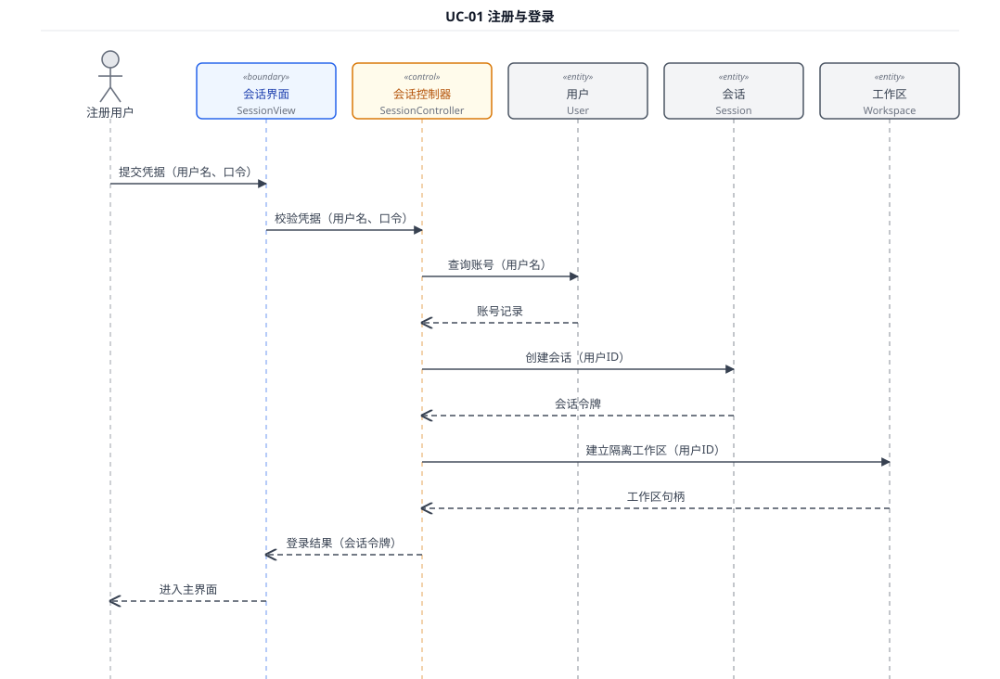

| 序 | 发送方 | 消息（含参数） | 接收方 | 类型 |
| --- | --- | --- | --- | --- |
| 1 | 注册用户 | 提交凭据（用户名、口令） | 会话界面 | 调用 |
| 2 | 会话界面 | 校验凭据（用户名、口令） | 会话控制器 | 调用 |
| 3 | 会话控制器 | 查询账号（用户名） | 用户 | 调用 |
| 4 | 用户 | 账号记录 | 会话控制器 | 返回 |
| 5 | 会话控制器 | 创建会话（用户 ID） | 会话 | 调用 |
| 6 | 会话 | 会话令牌 | 会话控制器 | 返回 |
| 7 | 会话控制器 | 建立隔离工作区（用户 ID） | 工作区 | 调用 |
| 8 | 工作区 | 工作区句柄 | 会话控制器 | 返回 |
| 9 | 会话控制器 | 登录结果（会话令牌） | 会话界面 | 返回 |
| 10 | 会话界面 | 进入主界面 | 注册用户 | 返回 |

**UC-02 装载与管理 ISA 指令集**

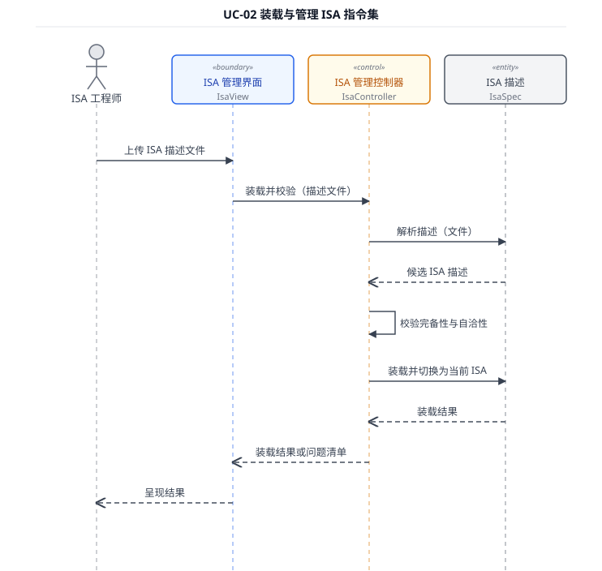

| 序 | 发送方 | 消息（含参数） | 接收方 | 类型 |
| --- | --- | --- | --- | --- |
| 1 | ISA 工程师 | 上传 ISA 描述文件 | ISA 管理界面 | 调用 |
| 2 | ISA 管理界面 | 装载并校验（描述文件） | ISA 管理控制器 | 调用 |
| 3 | ISA 管理控制器 | 解析描述（文件） | ISA 描述 | 调用 |
| 4 | ISA 描述 | 候选 ISA 描述 | ISA 管理控制器 | 返回 |
| 5 | ISA 管理控制器 | 校验完备性与自洽性 | ISA 管理控制器 | 自调用 |
| 6 | ISA 管理控制器 | 装载并切换为当前 ISA | ISA 描述 | 调用 |
| 7 | ISA 描述 | 装载结果 | ISA 管理控制器 | 返回 |
| 8 | ISA 管理控制器 | 装载结果或问题清单 | ISA 管理界面 | 返回 |
| 9 | ISA 管理界面 | 呈现结果 | ISA 工程师 | 返回 |

**UC-03 装载并配置待模拟程序**

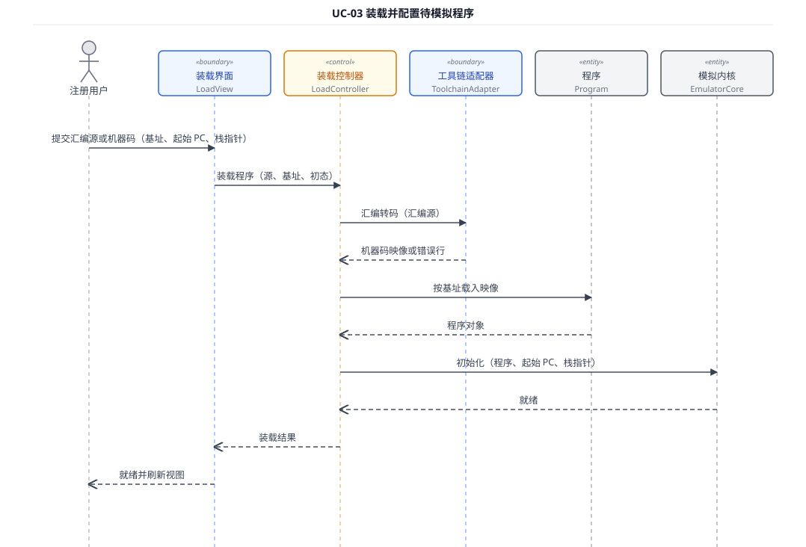

| 序 | 发送方 | 消息（含参数） | 接收方 | 类型 |
| --- | --- | --- | --- | --- |
| 1 | 注册用户 | 提交汇编源或机器码（基址、起始 PC、栈指针） | 装载界面 | 调用 |
| 2 | 装载界面 | 装载程序（源、基址、初态） | 装载控制器 | 调用 |
| 3 | 装载控制器 | 汇编转码（汇编源） | 工具链适配器 | 调用 |
| 4 | 工具链适配器 | 机器码映像或错误行 | 装载控制器 | 返回 |
| 5 | 装载控制器 | 按基址载入映像 | 程序 | 调用 |
| 6 | 程序 | 程序对象 | 装载控制器 | 返回 |
| 7 | 装载控制器 | 初始化（程序、起始 PC、栈指针） | 模拟内核 | 调用 |
| 8 | 模拟内核 | 就绪 | 装载控制器 | 返回 |
| 9 | 装载控制器 | 装载结果 | 装载界面 | 返回 |
| 10 | 装载界面 | 就绪并刷新视图 | 注册用户 | 返回 |

**UC-04 单步与连续执行**

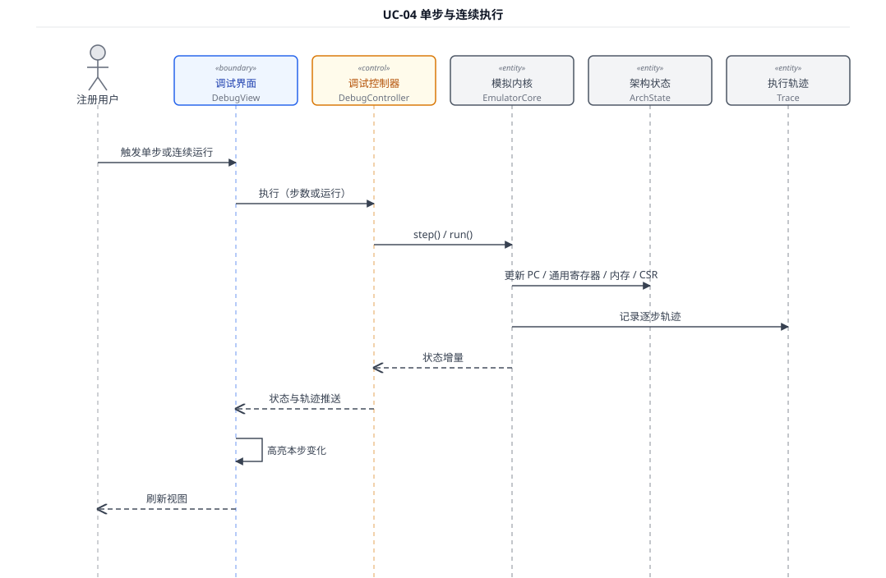

| 序 | 发送方 | 消息（含参数） | 接收方 | 类型 |
| --- | --- | --- | --- | --- |
| 1 | 注册用户 | 触发单步或连续运行 | 调试界面 | 调用 |
| 2 | 调试界面 | 执行（步数或运行） | 调试控制器 | 调用 |
| 3 | 调试控制器 | step() / run() | 模拟内核 | 调用 |
| 4 | 模拟内核 | 更新 PC / GPR / 内存 / CSR | 架构状态 | 调用 |
| 5 | 模拟内核 | 记录逐步轨迹 | 执行轨迹 | 调用 |
| 6 | 模拟内核 | 状态增量 | 调试控制器 | 返回 |
| 7 | 调试控制器 | 状态与轨迹推送 | 调试界面 | 返回 |
| 8 | 调试界面 | 高亮本步变化 | 调试界面 | 自调用 |
| 9 | 调试界面 | 刷新视图 | 注册用户 | 返回 |

**UC-05 设置与管理断点**

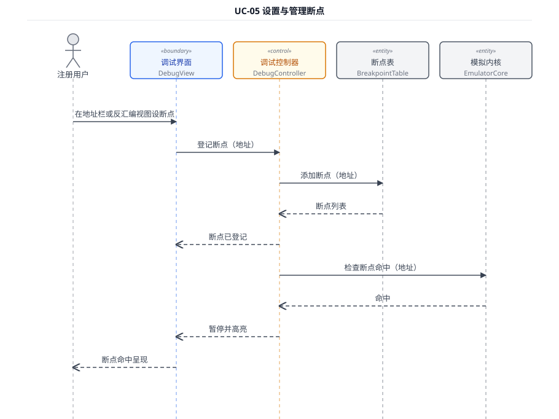

| 序 | 发送方 | 消息（含参数） | 接收方 | 类型 |
| --- | --- | --- | --- | --- |
| 1 | 注册用户 | 在地址栏或反汇编视图设断点 | 调试界面 | 调用 |
| 2 | 调试界面 | 登记断点（地址） | 调试控制器 | 调用 |
| 3 | 调试控制器 | 添加断点（地址） | 断点表 | 调用 |
| 4 | 断点表 | 断点列表 | 调试控制器 | 返回 |
| 5 | 调试控制器 | 断点已登记 | 调试界面 | 返回 |
| 6 | 调试控制器 | 检查断点命中（地址） | 模拟内核 | 调用 |
| 7 | 模拟内核 | 命中 | 调试控制器 | 返回 |
| 8 | 调试控制器 | 暂停并高亮 | 调试界面 | 返回 |
| 9 | 调试界面 | 断点命中呈现 | 注册用户 | 返回 |

**UC-06 查看架构状态与执行轨迹**

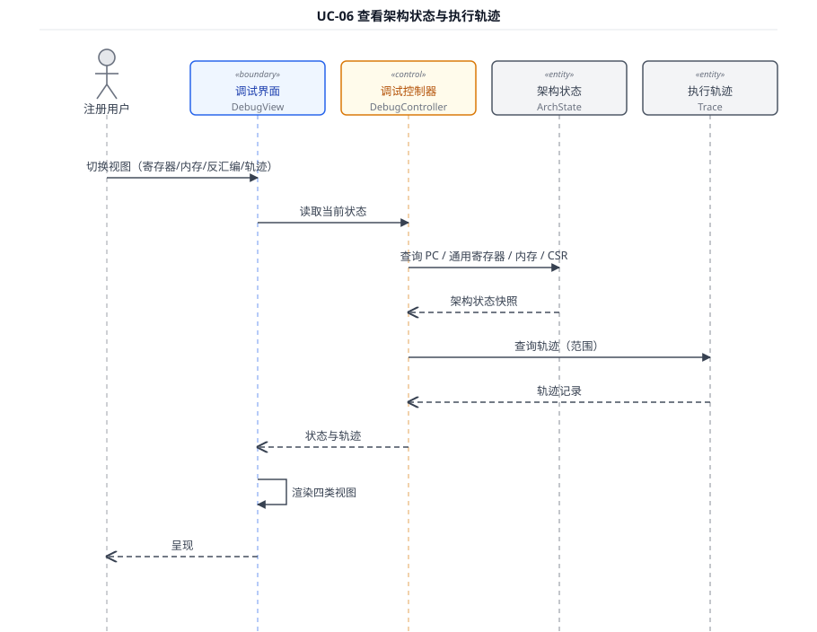

| 序 | 发送方 | 消息（含参数） | 接收方 | 类型 |
| --- | --- | --- | --- | --- |
| 1 | 注册用户 | 切换视图（寄存器 / 内存 / 反汇编 / 轨迹） | 调试界面 | 调用 |
| 2 | 调试界面 | 读取当前状态 | 调试控制器 | 调用 |
| 3 | 调试控制器 | 查询 PC / GPR / 内存 / CSR | 架构状态 | 调用 |
| 4 | 架构状态 | 架构状态快照 | 调试控制器 | 返回 |
| 5 | 调试控制器 | 查询轨迹（范围） | 执行轨迹 | 调用 |
| 6 | 执行轨迹 | 轨迹记录 | 调试控制器 | 返回 |
| 7 | 调试控制器 | 状态与轨迹 | 调试界面 | 返回 |
| 8 | 调试界面 | 渲染四类视图 | 调试界面 | 自调用 |
| 9 | 调试界面 | 呈现 | 注册用户 | 返回 |

**UC-07 回退执行历史**

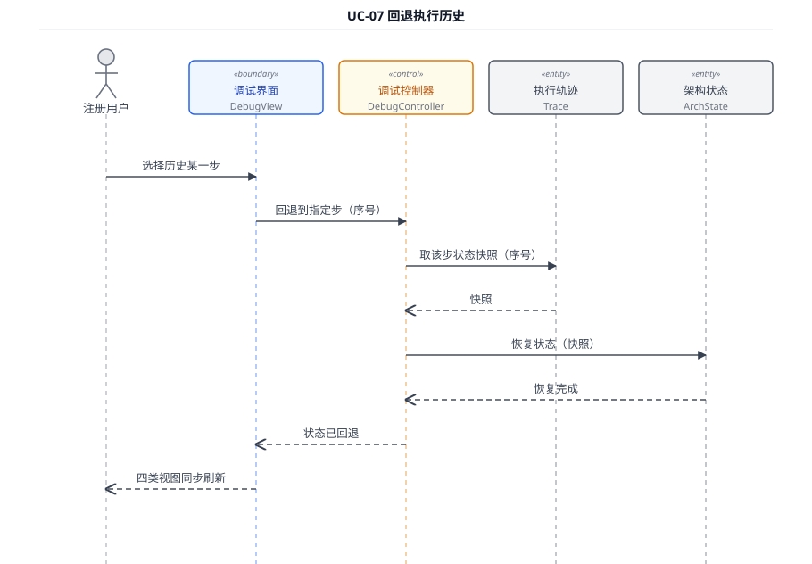

| 序 | 发送方 | 消息（含参数） | 接收方 | 类型 |
| --- | --- | --- | --- | --- |
| 1 | 注册用户 | 选择历史某一步 | 调试界面 | 调用 |
| 2 | 调试界面 | 回退到指定步（序号） | 调试控制器 | 调用 |
| 3 | 调试控制器 | 取该步状态快照（序号） | 执行轨迹 | 调用 |
| 4 | 执行轨迹 | 快照 | 调试控制器 | 返回 |
| 5 | 调试控制器 | 恢复状态（快照） | 架构状态 | 调用 |
| 6 | 架构状态 | 恢复完成 | 调试控制器 | 返回 |
| 7 | 调试控制器 | 状态已回退 | 调试界面 | 返回 |
| 8 | 调试界面 | 四类视图同步刷新 | 注册用户 | 返回 |

**UC-08 管理并批量执行测试用例**

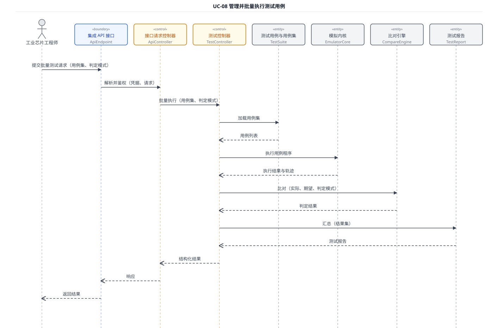

| 序 | 发送方 | 消息（含参数） | 接收方 | 类型 |
| --- | --- | --- | --- | --- |
| 1 | 工业芯片工程师 | 提交批量测试请求（用例集、判定模式） | 集成 API 接口 | 调用 |
| 2 | 集成 API 接口 | 解析并鉴权（凭据、请求） | 接口请求控制器 | 调用 |
| 3 | 接口请求控制器 | 批量执行（用例集、判定模式） | 测试控制器 | 调用 |
| 4 | 测试控制器 | 加载用例集 | 测试用例与用例集 | 调用 |
| 5 | 测试用例与用例集 | 用例列表 | 测试控制器 | 返回 |
| 6 | 测试控制器 | 执行用例程序 | 模拟内核 | 调用 |
| 7 | 模拟内核 | 执行结果与轨迹 | 测试控制器 | 返回 |
| 8 | 测试控制器 | 比对（实际、期望、判定模式） | 比对引擎 | 调用 |
| 9 | 比对引擎 | 判定结果 | 测试控制器 | 返回 |
| 10 | 测试控制器 | 汇总（结果集） | 测试报告 | 调用 |
| 11 | 测试报告 | 测试报告 | 测试控制器 | 返回 |
| 12 | 测试控制器 | 结构化结果 | 接口请求控制器 | 返回 |
| 13 | 接口请求控制器 | 响应 | 集成 API 接口 | 返回 |
| 14 | 集成 API 接口 | 返回结果 | 工业芯片工程师 | 返回 |

**UC-09 查看测试报告**

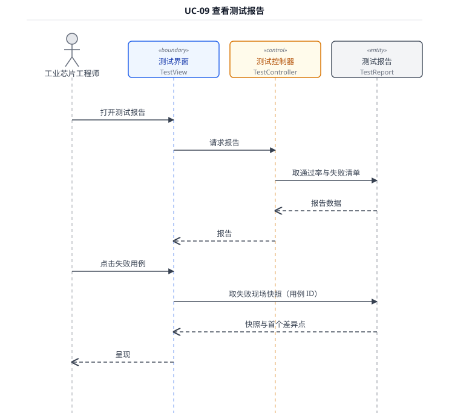

| 序 | 发送方 | 消息（含参数） | 接收方 | 类型 |
| --- | --- | --- | --- | --- |
| 1 | 工业芯片工程师 | 打开测试报告 | 测试界面 | 调用 |
| 2 | 测试界面 | 请求报告 | 测试控制器 | 调用 |
| 3 | 测试控制器 | 取通过率与失败清单 | 测试报告 | 调用 |
| 4 | 测试报告 | 报告数据 | 测试控制器 | 返回 |
| 5 | 测试控制器 | 报告 | 测试界面 | 返回 |
| 6 | 工业芯片工程师 | 点击失败用例 | 测试界面 | 调用 |
| 7 | 测试界面 | 取失败现场快照（用例 ID） | 测试报告 | 调用 |
| 8 | 测试报告 | 快照与首个差异点 | 测试界面 | 返回 |
| 9 | 测试界面 | 呈现 | 工业芯片工程师 | 返回 |

**UC-10 发起 ISA 一致性对拍**

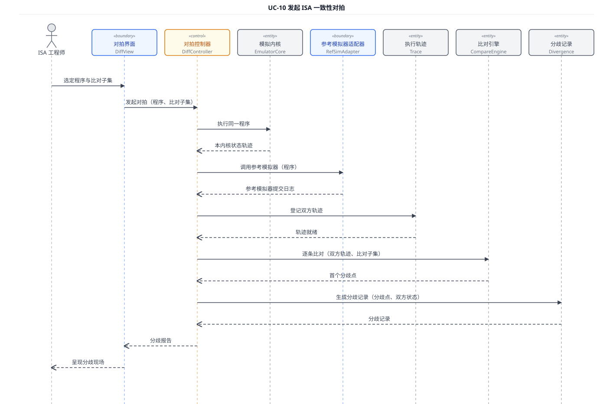

| 序 | 发送方 | 消息（含参数） | 接收方 | 类型 |
| --- | --- | --- | --- | --- |
| 1 | ISA 工程师 | 选定程序与比对子集 | 对拍界面 | 调用 |
| 2 | 对拍界面 | 发起对拍（程序、比对子集） | 对拍控制器 | 调用 |
| 3 | 对拍控制器 | 执行同一程序 | 模拟内核 | 调用 |
| 4 | 模拟内核 | 本内核状态轨迹 | 对拍控制器 | 返回 |
| 5 | 对拍控制器 | 调用参考模拟器（程序） | 参考模拟器适配器 | 调用 |
| 6 | 参考模拟器适配器 | 参考模拟器提交日志 | 对拍控制器 | 返回 |
| 7 | 对拍控制器 | 登记双方轨迹 | 执行轨迹 | 调用 |
| 8 | 执行轨迹 | 轨迹就绪 | 对拍控制器 | 返回 |
| 9 | 对拍控制器 | 逐条比对（双方轨迹、比对子集） | 比对引擎 | 调用 |
| 10 | 比对引擎 | 首个分歧点 | 对拍控制器 | 返回 |
| 11 | 对拍控制器 | 生成分歧记录（分歧点、双方状态） | 分歧记录 | 调用 |
| 12 | 分歧记录 | 分歧记录 | 对拍控制器 | 返回 |
| 13 | 对拍控制器 | 分歧报告 | 对拍界面 | 返回 |
| 14 | 对拍界面 | 呈现分歧现场 | ISA 工程师 | 返回 |

**UC-11 分析与标注分歧归因**

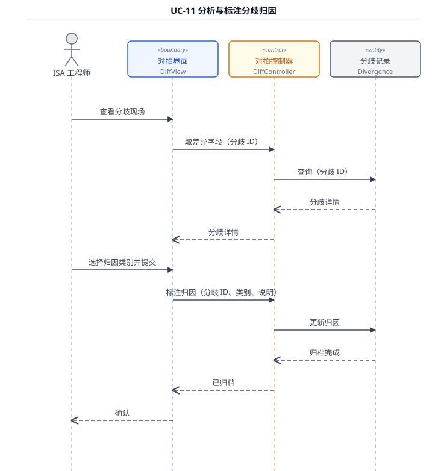

| 序 | 发送方 | 消息（含参数） | 接收方 | 类型 |
| --- | --- | --- | --- | --- |
| 1 | ISA 工程师 | 查看分歧现场 | 对拍界面 | 调用 |
| 2 | 对拍界面 | 取差异字段（分歧 ID） | 对拍控制器 | 调用 |
| 3 | 对拍控制器 | 查询（分歧 ID） | 分歧记录 | 调用 |
| 4 | 分歧记录 | 分歧详情 | 对拍控制器 | 返回 |
| 5 | 对拍控制器 | 分歧详情 | 对拍界面 | 返回 |
| 6 | ISA 工程师 | 选择归因类别并提交 | 对拍界面 | 调用 |
| 7 | 对拍界面 | 标注归因（分歧 ID、类别、说明） | 对拍控制器 | 调用 |
| 8 | 对拍控制器 | 更新归因 | 分歧记录 | 调用 |
| 9 | 分歧记录 | 归档完成 | 对拍控制器 | 返回 |
| 10 | 对拍控制器 | 已归档 | 对拍界面 | 返回 |
| 11 | 对拍界面 | 确认 | ISA 工程师 | 返回 |

**UC-12 保存与加载工作区**

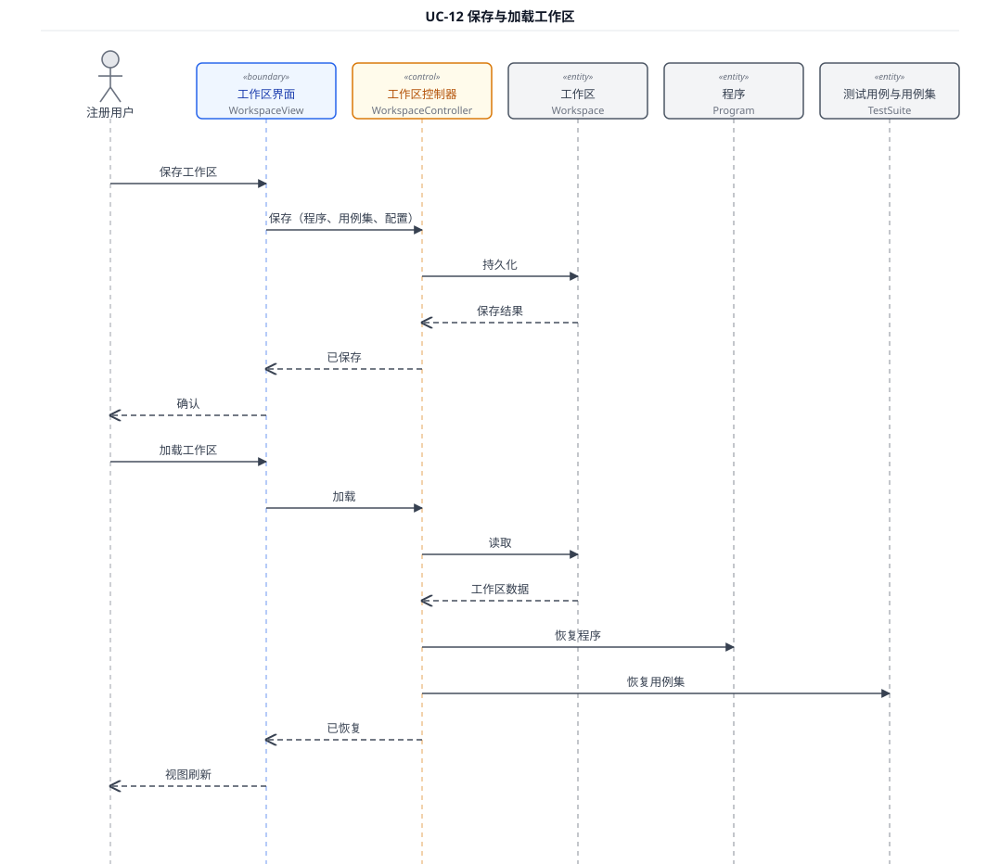

| 序 | 发送方 | 消息（含参数） | 接收方 | 类型 |
| --- | --- | --- | --- | --- |
| 1 | 注册用户 | 保存工作区 | 工作区界面 | 调用 |
| 2 | 工作区界面 | 保存（程序、用例集、配置） | 工作区控制器 | 调用 |
| 3 | 工作区控制器 | 持久化 | 工作区 | 调用 |
| 4 | 工作区 | 保存结果 | 工作区控制器 | 返回 |
| 5 | 工作区控制器 | 已保存 | 工作区界面 | 返回 |
| 6 | 工作区界面 | 确认 | 注册用户 | 返回 |
| 7 | 注册用户 | 加载工作区 | 工作区界面 | 调用 |
| 8 | 工作区界面 | 加载 | 工作区控制器 | 调用 |
| 9 | 工作区控制器 | 读取 | 工作区 | 调用 |
| 10 | 工作区 | 工作区数据 | 工作区控制器 | 返回 |
| 11 | 工作区控制器 | 恢复程序 | 程序 | 调用 |
| 12 | 工作区控制器 | 恢复用例集 | 测试用例与用例集 | 调用 |
| 13 | 工作区控制器 | 已恢复 | 工作区界面 | 返回 |
| 14 | 工作区界面 | 视图刷新 | 注册用户 | 返回 |

**UC-13 通过集成 API 驱动模拟**

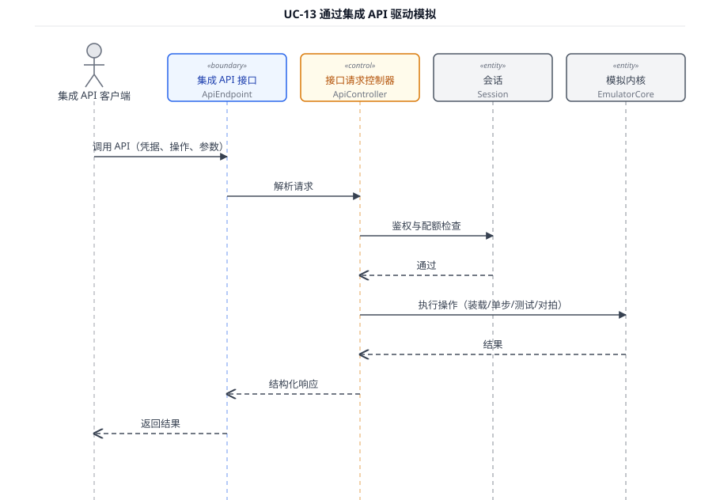

| 序 | 发送方 | 消息（含参数） | 接收方 | 类型 |
| --- | --- | --- | --- | --- |
| 1 | 集成 API 客户端 | 调用 API（凭据、操作、参数） | 集成 API 接口 | 调用 |
| 2 | 集成 API 接口 | 解析请求 | 接口请求控制器 | 调用 |
| 3 | 接口请求控制器 | 鉴权与配额检查 | 会话 | 调用 |
| 4 | 会话 | 通过 | 接口请求控制器 | 返回 |
| 5 | 接口请求控制器 | 执行操作（装载 / 单步 / 测试 / 对拍） | 模拟内核 | 调用 |
| 6 | 模拟内核 | 结果 | 接口请求控制器 | 返回 |
| 7 | 接口请求控制器 | 结构化响应 | 集成 API 接口 | 返回 |
| 8 | 集成 API 接口 | 返回结果 | 集成 API 客户端 | 返回 |

**UC-14 管理用户与资源配额**

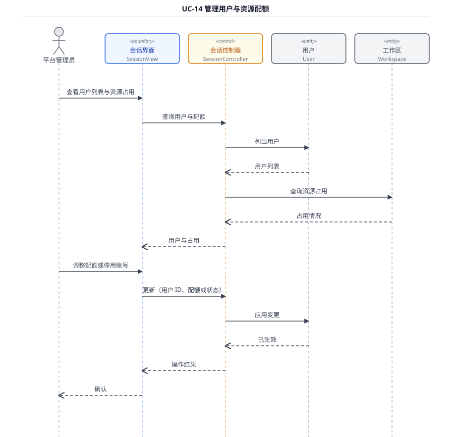

| 序 | 发送方 | 消息（含参数） | 接收方 | 类型 |
| --- | --- | --- | --- | --- |
| 1 | 平台管理员 | 查看用户列表与资源占用 | 会话界面 | 调用 |
| 2 | 会话界面 | 查询用户与配额 | 会话控制器 | 调用 |
| 3 | 会话控制器 | 列出用户 | 用户 | 调用 |
| 4 | 用户 | 用户列表 | 会话控制器 | 返回 |
| 5 | 会话控制器 | 查询资源占用 | 工作区 | 调用 |
| 6 | 工作区 | 占用情况 | 会话控制器 | 返回 |
| 7 | 会话控制器 | 用户与占用 | 会话界面 | 返回 |
| 8 | 平台管理员 | 调整配额或停用账号 | 会话界面 | 调用 |
| 9 | 会话界面 | 更新（用户 ID、配额或状态） | 会话控制器 | 调用 |
| 10 | 会话控制器 | 应用变更 | 用户 | 调用 |
| 11 | 用户 | 已生效 | 会话控制器 | 返回 |
| 12 | 会话控制器 | 操作结果 | 会话界面 | 返回 |
| 13 | 会话界面 | 确认 | 平台管理员 | 返回 |

**三处建模判断**

1. **UC-08 的执行者直连 `ApiEndpoint`，不是 `TestView`**。这体现了"工业芯片工程师走程序接口"的结论：批量执行的**主路径**是程序接口，Web 界面（UC-09）只承担看报告。
2. **UC-10 中 `RefSimAdapter` 是边界类而非实体类**。它与 `DiffController` 之间是"请求—应答"两跳，形态与 UC-03 的 `ToolchainAdapter` 同构——两者都是系统对**系统执行者**的接口。
3. **`CompareEngine` 在 UC-08 与 UC-10 中以同一身份出现**，被 `TestController` 和 `DiffController` 分别调用，是 FR-6.5「两种判定模式复用同一比对引擎」的可见证据。

**两处有意的简化**

- **UC-13 把装载 / 单步 / 测试 / 对拍四类操作收成一条 `ApiController → EmulatorCore` 的"执行操作"**，重点在"鉴权 → 配额 → 结构化响应"的外壳；
- **UC-03 的"汇编转码"两步只对汇编源发生**，机器码分支不经过 `ToolchainAdapter`；简式图不画 `alt` 帧，靠消息文字标明。

#### 3.3.3 软件需求的分析类模型及描述

**（一）分析类图**

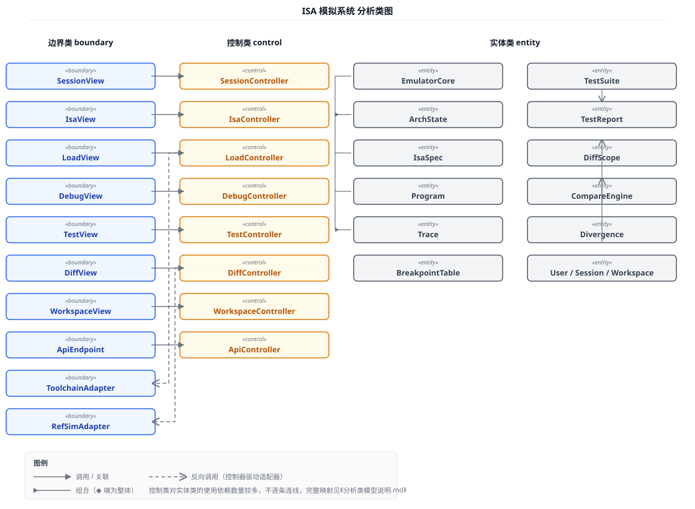

实体类的属性与职责信息量最大，另出详图放大：

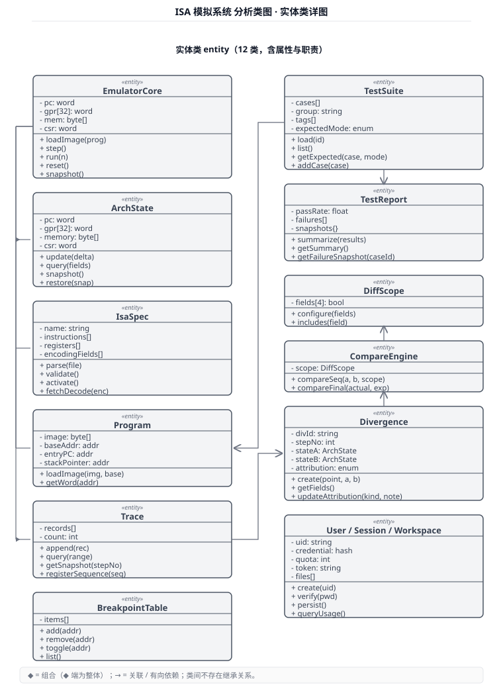

**（二）分析类的划分依据**

分析类来自两个来源，二者必须闭合：

1. **用例图中的外部执行者**——人工执行者（注册用户及其四个子类、平台管理员）与系统执行者（外部汇编工具链、外部参考模拟器、集成 API 客户端）。系统执行者**不映射为控制类**，而是映射为边界类（`ToolchainAdapter`、`RefSimAdapter`、`ApiEndpoint`），因为它们是"系统对系统的交互界面"；
2. **用例交互图中的每个对象**——14 张顺序图中的全部生命线，逐一对应一个分析类。

共 **30 个分析类**：边界类 10 个、控制类 8 个、实体类 12 个。

> **计数口径**：实体类表实列为 11 个独立类名 + 1 行合并书写的账号族（`User` / `Session` / `Workspace` 三个类并为一行），按**合并行计 1 个**得 12 个，按**逐类计**得 14 个。本文档与配套的《分析类模型说明》及各设计阶段文档统一采用**合并口径**，故分析类总数为 30（边界类 10 + 控制类 8 + 实体类 12）。两组口径的差异只在账号族一行。

**（三）边界类（10 个）**

边界类承担"系统与外部世界之间的界面"，只有交互行为、不持有业务状态。

| 分析类 | 中文名 | 职责 | 主要方法 | 关联控制类 | 涉及用例 |
| --- | --- | --- | --- | --- | --- |
| `SessionView` | 会话界面 | 注册/登录表单交互、用户列表与配额呈现 | `submitCredentials()` `renderUserList()` `updateQuota()` | `SessionController` | UC-01、UC-14 |
| `IsaView` | ISA 管理界面 | ISA 描述文件提交、装载结果与问题清单呈现 | `uploadSpec()` `renderResult()` | `IsaController` | UC-02 |
| `LoadView` | 装载界面 | 程序提交、基址与初始状态配置、结果呈现 | `submitProgram()` `renderLoadResult()` | `LoadController` | UC-03 |
| `DebugView` | 调试界面 | 单步/运行/暂停/复位操作，四类视图呈现 | `step()` `run()` `pause()` `reset()` `setBreakpoint()` `switchView()` | `DebugController` | UC-04、UC-05、UC-06、UC-07 |
| `TestView` | 测试界面 | 测试报告打开、失败用例点选与失败现场呈现 | `openReport()` `clickFailure()` `renderReport()` | `TestController` | UC-09 |
| `DiffView` | 对拍界面 | 比对子集选择、分歧现场呈现与归因提交 | `selectScope()` `annotate()` `renderDivergence()` | `DiffController` | UC-10、UC-11 |
| `WorkspaceView` | 工作区界面 | 工作区保存/加载触发与恢复结果呈现 | `save()` `load()` `renderRestored()` | `WorkspaceController` | UC-12 |
| `ApiEndpoint` | 集成 API 接口 | 对外 HTTP / WebSocket 入口，请求接收与响应回送 | `handleRequest()` | `ApiController` | UC-08、UC-13 |
| `ToolchainAdapter` | 工具链适配器 | 调用外部汇编工具链，回收机器码映像或错误行 | `assemble()` | 由 `LoadController` 调用 | UC-03 |
| `RefSimAdapter` | 参考模拟器适配器 | 调用外部参考模拟器，解析其逐步提交日志 | `run()` | 由 `DiffController` 调用 | UC-10 |

**（四）控制类（8 个）**

控制类协调单个用例的处理流程，是"用例的执行者"；本身不长期持有业务数据。

| 分析类 | 中文名 | 职责 | 主要方法 | 使用的实体类 | 涉及用例 |
| --- | --- | --- | --- | --- | --- |
| `SessionController` | 会话控制器 | 凭据校验、建立会话与隔离工作区、用户与配额管理 | `verify()` `createSession()` `createWorkspace()` `listUsers()` `updateQuota()` | `User` `Session` `Workspace` | UC-01、UC-14 |
| `IsaController` | ISA 管理控制器 | 校验 ISA 描述的完备性与自洽性、装载并切换当前 ISA | `loadSpec()` `validate()` | `IsaSpec` | UC-02 |
| `LoadController` | 装载控制器 | 汇编转码、按基址载入、初始化 PC 与栈指针 | `loadProgram()` `assemble()` `initCore()` | `Program` `IsaSpec` `EmulatorCore` | UC-03 |
| `DebugController` | 调试控制器 | 单步/运行/暂停/复位、断点登记与命中检查、状态读取、历史回退 | `execute()` `registerBreakpoint()` `checkHit()` `readState()` `rollback()` | `EmulatorCore` `ArchState` `Trace` `BreakpointTable` | UC-04、UC-05、UC-06、UC-07 |
| `TestController` | 测试控制器 | 用例编排、判定模式选择、结果汇总与报告读取 | `runSuite()` `executeCase()` `compare()` `summarize()` `getReport()` | `TestSuite` `EmulatorCore` `CompareEngine` `TestReport` | UC-08、UC-09 |
| `DiffController` | 对拍控制器 | 驱动双方执行、调度比对、组装分歧报告与归因 | `startDiff()` `invokeRefSim()` `recordTrace()` `compare()` `makeRecord()` `annotate()` | `EmulatorCore` `Trace` `CompareEngine` `Divergence` | UC-10、UC-11 |
| `WorkspaceController` | 工作区控制器 | 工作区持久化与恢复 | `save()` `load()` `persist()` `restore()` | `Workspace` `Program` `TestSuite` | UC-12 |
| `ApiController` | 接口请求控制器 | 请求解析、鉴权与配额检查、操作分发、响应封装 | `parseRequest()` `authorize()` `checkQuota()` `dispatch()` `wrap()` | `Session` `EmulatorCore` `TestController` `DiffController` | UC-13 |

**（五）实体类（12 个）**

实体类是被维护、被流转的数据，属性与职责见分析类实体详图，此处以自然语言补充其语义。

| 分析类 | 中文名 | 关键属性 | 主要职责 | 关联 |
| --- | --- | --- | --- | --- |
| `EmulatorCore` | 模拟内核 | `pc` `gpr[32]` `mem` `csr` | 取指—译码—执行—写回，对外提供执行服务 | 组合 `ArchState`、`Trace`；使用 `IsaSpec`、`Program` |
| `ArchState` | 架构状态 | `pc` `gpr[32]` `memory` `csr` | 状态更新、按字段查询、快照与恢复 | 被 `EmulatorCore` 组合 |
| `IsaSpec` | ISA 描述 | `name` `instructions[]` `registers[]` `encodingFields[]` | 解析描述、校验完备性、激活为当前 ISA、按编码取译码规则 | 被 `EmulatorCore` 使用 |
| `Program` | 程序 | `image` `baseAddr` `entryPC` `stackPointer` | 按基址载入映像、按地址取字 | 被 `EmulatorCore`、`TestSuite` 引用 |
| `Trace` | 执行轨迹 | `records[]` `count` | 逐步追加、按范围查询、取某步快照、登记对比序列 | 被 `EmulatorCore` 组合；被 `Divergence` 引用 |
| `BreakpointTable` | 断点表 | `items[]` | 断点登记、删除、启停、列出、命中判定 | 被 `DebugController` 使用 |
| `TestSuite` | 测试用例与用例集 | `cases[]` `group` `tags[]` `expectedMode` | 加载用例集、列出用例、按模式取期望态 | 引用 `Program`；被 `TestReport` 引用 |
| `TestReport` | 测试报告 | `passRate` `failures[]` `snapshots{}` | 汇总结果集、给出通过率与失败清单、取失败现场快照 | 引用 `TestSuite` |
| `DiffScope` | 比对子集 | `fields[4]` | 配置参与比对的状态字段、判定某字段是否纳入比对 | 被 `CompareEngine` 使用 |
| `CompareEngine` | 比对引擎 | `scope` | 逐条比对两份状态序列定位首个分歧；比对程序终态 | 使用 `DiffScope`；被 `Divergence` 引用 |
| `Divergence` | 分歧记录 | `divId` `stepNo` `stateA` `stateB` `attribution` | 生成分歧记录、给出差异字段、更新归因标注 | 引用 `CompareEngine`、`Trace` |
| `User` / `Session` / `Workspace` | 用户与会话与工作区 | `uid` `credential` `quota` `token` `files[]` | 账号创建与凭据校验、工作区持久化、资源占用查询 | 关联 `Program`、`TestSuite` |

**（六）类间关系**

- **继承：无。** 分析类层面不存在泛化关系。用例图中四类具体用户对"注册用户"的泛化是**执行者层**的泛化，不映射为分析类的继承——四类用户在系统中共享同一套类，差异只体现在用例侧重上。
- **组合（2 处）：** `EmulatorCore ◆— ArchState`、`EmulatorCore ◆— Trace`。架构状态与执行轨迹随执行服务的存在而存在，生命周期一致。
- **关联 / 有向依赖：** 其余全部关系。方向遵循消息流：边界类 → 控制类，控制类 → 实体类，实体类之间的"引用"。
- **反向调用（2 处）：** `LoadController → ToolchainAdapter`、`DiffController → RefSimAdapter`。这两个边界类不由人工执行者直接驱动，而是被控制类调用，是"系统对系统"的交互界面。

**控制类对实体类的完整依赖映射**

| 控制类 | 使用的实体类 |
| --- | --- |
| `SessionController` | `User` `Session` `Workspace` |
| `IsaController` | `IsaSpec` |
| `LoadController` | `Program` `IsaSpec` `EmulatorCore` |
| `DebugController` | `EmulatorCore` `ArchState` `Trace` `BreakpointTable` |
| `TestController` | `TestSuite` `EmulatorCore` `CompareEngine` `TestReport` |
| `DiffController` | `EmulatorCore` `Trace` `CompareEngine` `Divergence` |
| `WorkspaceController` | `Workspace` `Program` `TestSuite` |
| `ApiController` | `Session` `EmulatorCore` `TestController` `DiffController` |

**关键一处：`CompareEngine` 同时被 `TestController`（UC-08）与 `DiffController`（UC-10）使用**，这是 FR-6.5「两种判定模式复用同一比对引擎」在分析类模型上的落点，也是把 `CompareEngine` 从控制器中独立出来的直接理由。

**（七）用例—分析类对照表**

| 用例 | 边界类 | 控制类 | 主要实体类 |
| --- | --- | --- | --- |
| UC-01 注册与登录 | `SessionView` | `SessionController` | `User` `Session` `Workspace` |
| UC-02 装载与管理 ISA 指令集 | `IsaView` | `IsaController` | `IsaSpec` |
| UC-03 装载并配置待模拟程序 | `LoadView` `ToolchainAdapter` | `LoadController` | `Program` `EmulatorCore` |
| UC-04 单步与连续执行 | `DebugView` | `DebugController` | `EmulatorCore` `ArchState` `Trace` |
| UC-05 设置与管理断点 | `DebugView` | `DebugController` | `BreakpointTable` `EmulatorCore` |
| UC-06 查看架构状态与执行轨迹 | `DebugView` | `DebugController` | `ArchState` `Trace` |
| UC-07 回退执行历史 | `DebugView` | `DebugController` | `Trace` `ArchState` |
| UC-08 管理并批量执行测试用例 | `ApiEndpoint` | `ApiController` `TestController` | `TestSuite` `EmulatorCore` `CompareEngine` `TestReport` |
| UC-09 查看测试报告 | `TestView` | `TestController` | `TestReport` |
| UC-10 发起 ISA 一致性对拍 | `DiffView` `RefSimAdapter` | `DiffController` | `EmulatorCore` `Trace` `CompareEngine` `Divergence` |
| UC-11 分析与标注分歧归因 | `DiffView` | `DiffController` | `Divergence` |
| UC-12 保存与加载工作区 | `WorkspaceView` | `WorkspaceController` | `Workspace` `Program` `TestSuite` |
| UC-13 通过集成 API 驱动模拟 | `ApiEndpoint` | `ApiController` | `Session` `EmulatorCore` |
| UC-14 管理用户与资源配额 | `SessionView` | `SessionController` | `User` `Workspace` |

#### 3.3.4 软件功能需求条目

| 编号 | 功能需求 | 来源 |
| --- | --- | --- |
| FR-1.1 | 内核与 ISA 定义之间保持抽象边界：指令编码格式、指令语义与架构状态以 ISA 描述文件形式提供，装载后由内核统一解释执行。本期以 RISC-V RV32I 验证该边界成立 | S2-1、S2-8 |
| FR-1.2 | 装载 ISA 描述文件时校验其完备性与自洽性（语义缺失、编码冲突、字段重叠），输出问题清单 | S5 |
| FR-1.3 | 支持查询、列出与切换已装载的 ISA；首期提供 RISC-V RV32I 描述 | S2-1、S2-8 |
| FR-2.1 | 载入机器码文件（bin、hex，以及 ELF 中标记为可装载的段）到指定基址 | S6 |
| FR-2.2 | 载入汇编源文件，经外部工具链汇编后载入；汇编失败时报告出错行；亦接受用户直接提供的机器码；工具链缺失时给出明确提示而不静默失败 | S2-5 |
| FR-2.3 | 设定起始 PC、栈指针与内存初值 | S6 |
| FR-2.4 | 提供内置示例程序集，覆盖 RV32I 常用指令的演示程序与经典算法样例（如寄存器运算演示、冒泡排序、斐波那契数列），并配套新手引导 | S3 |
| FR-3.1 | 执行取指—译码—执行—写回循环，维护 PC、GPR、内存与 CSR | S1 |
| FR-3.2 | 识别非法、未定义与保留编码，定位到具体指令地址且不导致系统崩溃 | S5 |
| FR-3.3 | 记录执行轨迹（指令地址、指令、操作数、状态增量），供回放与比对使用 | S1 |
| FR-3.4 | 实现程序终止与运行结束判定：识别终止序列（RV32I 的 ecall / ebreak 退出约定），设置终止标志，向调试流程与测试流程返回结束状态与退出码 | S1、S4 |
| FR-3.5 | 处理运行期异常：内存越界访问、非法访存地址、非法 CSR 访问等，须记录异常现场（异常类型、触发地址、当时架构状态）并按配置终止执行或暂停，不得使服务进程崩溃 | S5、S9 |
| FR-4.1 | 支持单步执行、连续运行、暂停与复位 | S1 |
| FR-4.2 | 支持按地址设置、删除、启用与禁用断点，命中后暂停并高亮 | S3 |
| FR-4.3 | 支持"运行到指定地址"，以及"运行至程序结束或触碰边界"——此处"边界"指程序映像所占内存区间的端点，亦包含 NFR-Q5 的指令执行条数上限 | S6 |
| FR-4.4 | 支持执行历史回退，可回到任意已执行步的架构状态 | S3 |
| FR-5.1 | 提供寄存器视图（PC、GPR、CSR），高亮本步发生变化的位 | S1 |
| FR-5.2 | 提供内存视图，按字节 / 半字 / 字显示，支持地址跳转、搜索与编辑 | S1 |
| FR-5.3 | 提供反汇编视图，显示当前 PC 前后若干条指令并高亮当前指令 | S3 |
| FR-5.4 | 提供执行轨迹与时间轴视图，点击可定位到对应步 | S3 |
| FR-6.1 | 支持导入与编辑测试用例（程序加期望态），支持分组与标签 | S4 |
| FR-6.2 | 支持批量执行用例集并自动判定通过或失败 | S4 |
| FR-6.3 | 输出测试报告：通过率、失败清单与失败现场状态快照 | S4 |
| FR-6.4 | 支持外部脚本或 CI 经 API 触发批量测试并取回结果 | S2-2 |
| FR-6.5 | 测试期望态同时支持"终态快照"与"逐条提交日志"两种判定模式，二者复用同一比对引擎 | S2-7 |
| FR-7.1 | 调用外部参考模拟器执行同一程序并获取其逐步架构状态；首期对接 Spike 的逐步提交日志 | S2-3、S1 |
| FR-7.2 | 按可配置的比对子集逐条比对架构状态。默认比对子集包含：① PC 值；② 32 个 GPR 的值；③ 该指令引发的内存写（写入地址与写入值）；④ 被该指令修改的 CSR 字段 | S2-3、S5 |
| FR-7.3 | 报告首个分歧点，包含指令序号、双方状态与差异字段 | S5 |
| FR-7.4 | 提供差异归因辅助，区分实现缺陷、基准偏差与规范歧义，支持人工标注 | S5 |
| FR-7.5 | 提供外部参考模拟器不可用时的降级模式，退化为基于期望态快照的断言比对 | S9 |
| FR-8.1 | 提供 HTTP/WebSocket 接口，支持装载程序、单步 / 运行 / 暂停、读取状态、执行测试与发起对拍 | S2-2 |
| FR-8.2 | 接口具备鉴权与请求限额能力（限额维度：并发会话数、单位时间请求数、单次请求的指令执行条数），本地部署时可关闭 | S2-2、S2-6 |
| FR-8.3 | 提供接口文档与调用示例 | S6、S8 |
| FR-9.1 | 支持创建与销毁运行会话，会话之间状态隔离，异常会话可回收 | S2-6 |
| FR-9.2 | 支持本地单机部署与云端部署两种形态，功能对等 | S2-2 |
| FR-9.3 | 支持程序与用例集的保存与加载 | S3、S6 |
| FR-9.4 | 支持用户注册、登录、登出与会话管理 | S2-6 |
| FR-9.5 | 实现多用户隔离，运行环境、工作区数据、程序与用例互不可见，并按用户设置资源配额 | S2-6 |

### 3.4 软件质量需求

#### 3.4.1 外部质量需求

| 编号 | 类别 | 需求描述 | 来源 |
| --- | --- | --- | --- |
| NFR-Q1 | 性能 | 单步操作端到端响应：本地部署不超过 100 毫秒，云端部署不超过 300 毫秒（不含网络传输）。连续执行吞吐：关闭轨迹记录时不低于 10⁷ 条 RV32I 指令每秒；开启逐步轨迹记录时不低于 10⁶ 条每秒 | S3、S4、S9 |
| NFR-Q2 | 可靠性 | 连续执行 10⁸ 条指令不出现架构状态漂移与内存泄漏；批量测试中单个用例执行失败不影响其余用例 | S4 |
| NFR-Q3 | 易用性 | 新用户在 5 分钟内完成"装载程序 → 单步执行 → 观察到寄存器变化"，该目标由 FR-2.4 的内置示例程序集与新手引导支撑；架构状态的变化必须有视觉高亮提示 | S3 |
| NFR-Q4 | 兼容性 | 支持 Chrome、Edge、Firefox 的最近两个大版本；最低适配 1280×720 视口 | S3、S4、S5、S6 |
| NFR-Q5 | 安全性 | 云端部署时接口需账号鉴权；被模拟程序视为不可信输入，须限制指令执行条数与内存用量，防止死循环或越界访问导致服务不可用；用户之间数据隔离；空闲会话超时回收 | S2-6 |

#### 3.4.2 内部质量需求

| 编号 | 类别 | 需求描述 | 来源 |
| --- | --- | --- | --- |
| NFR-I1 | 可扩展性 | 内核与 ISA 定义之间保持抽象边界，新增 ISA 时不需修改内核的核心执行逻辑；本期以 RV32I 验证该边界成立，第二套 ISA 为后续演进目标；比对子集可配置 | S2-1、S2-8 |
| NFR-I2 | 可测试性 | 模拟内核与 Web 前端解耦，内核可独立编译为库并做单元测试 | S9 |
| NFR-I3 | 可移植性 | 内核使用 C++17 实现，可在 Linux 与 Windows 上构建，不依赖特定 IDE 或图形界面 | S1、S9 |

### 3.5 软件开发约束需求

| 编号 | 类别 | 约束描述 | 来源 |
| --- | --- | --- | --- |
| NFR-C1 | 技术栈 | 核心使用 C++ 实现，前端采用 Web 技术；开发工具为 Visual Studio Code | S1 |
| NFR-C2 | 版本控制 | 使用 Git 进行版本控制，仓库托管于 Gitee 或 Github | S1 |
| NFR-C3 | 团队与工期 | 项目组 5 人，须在课程周期内完成 | S1、S8 |
| NFR-C4 | 许可合规 | 外部汇编工具链与外部参考模拟器（首期为 Spike）及所用第三方库的开源许可证，须与本项目的分发方式兼容 | S2-3、S8 |
| NFR-C5 | 交付物 | 需求文档、设计文档、源代码与测试报告 | S8 |

---

## 附录 A 需求来源编号表

| 编号 | 来源 | 说明 |
| --- | --- | --- |
| S1 | 项目选题文档 | 《项目选题.docx》，由项目组提交 |
| S2 | 团队决策（需求获取阶段） | 见下表 S2-1 ~ S2-8 |
| S3 | 需求方 · ISA 学习者 | 来源 S1 所述用户类型，待真实用户确认 |
| S4 | 需求方 · 工业芯片工程师 | 来源 S1 所述用户类型，已确认走程序接口驱动 |
| S5 | 需求方 · ISA 工程师 | 来源 S1 所述用户类型，待真实用户确认 |
| S6 | 需求方 · 机器语言程序员 | 来源 S1 所述用户类型，待真实用户确认 |
| S7 | 平台管理员 | 由 S2-6 派生 |
| S8 | 课程要求 | 软件工程课程大作业的交付与工期要求 |
| S9 | 技术约束 | 由技术选型与运行环境派生 |

**团队决策明细**

| 编号 | 决策内容 |
| --- | --- |
| S2-1 | 采用多 ISA 可插拔架构作为设计方向 |
| S2-2 | 交付形态为 Web 云端可访问 + 本地可部署 + 对外集成 API |
| S2-3 | 对拍基准采用外部成熟参考模拟器 |
| S2-4 | 需求获取采取逐阶段确认的推进节奏 |
| S2-5 | 汇编源复用外部工具链，同时允许用户直接提供机器码 |
| S2-6 | 云端部署需支持多用户隔离（引入账号与会话体系） |
| S2-7 | 测试期望态支持终态快照与逐条提交日志两种判定模式 |
| S2-8 | 范围收敛：首期仅完整实现 RISC-V RV32I；对拍基准首期锁定 Spike |

> **记**：S2-1 与 S2-8 存在演进关系——S2-1 确定架构方向，S2-8 在工期约束下将"可插拔"由交付指标收敛为架构预留。引用时以 S2-8 为准。

---

## 附录 B 需求追踪矩阵

追踪方向：**业务目标 → 问题 → 用例 → 功能需求 → 分析类**。

| 业务目标 | 对应问题 | 承载用例 | 主要功能需求 | 主要分析类 |
| --- | --- | --- | --- | --- |
| G1 可视化理解指令语义 | P1 | UC-03、UC-04、UC-05、UC-06、UC-07 | FR-2.4、FR-3.x、FR-4.1~4.4、FR-5.1~5.4 | `LoadController` `DebugController` `DebugView` `ArchState` `Trace` |
| G2 秒级冒烟验证 | P2 | UC-08、UC-09、UC-13 | FR-6.1~6.5、FR-8.1~8.3 | `ApiController` `TestController` `CompareEngine` `TestReport` |
| G3 对拍发现规范歧义 | P3 | UC-10、UC-11 | FR-7.1~7.5 | `DiffController` `RefSimAdapter` `DiffScope` `Divergence` |
| G4 可回退调试裸机程序 | P4 | UC-03、UC-04、UC-05、UC-07、UC-12 | FR-2.1~2.3、FR-4.2~4.4、FR-9.3 | `LoadController` `DebugController` `Program` `BreakpointTable` `Workspace` |

**功能需求 → 用例对应表**

| 功能需求组 | 承载用例 |
| --- | --- |
| FR-1.x（ISA 抽象与描述） | UC-02 |
| FR-2.x（程序装载） | UC-03、UC-12 |
| FR-3.x（执行内核） | UC-04（被 UC-08、UC-10、UC-13 复用） |
| FR-4.x（调试控制） | UC-04、UC-05、UC-07 |
| FR-5.x（状态可视化） | UC-06 |
| FR-6.x（测试验证） | UC-08、UC-09 |
| FR-7.x（一致性对拍） | UC-10、UC-11 |
| FR-8.x（集成 API） | UC-13（UC-08、UC-10 经此触发） |
| FR-9.x（会话与存储） | UC-01、UC-12、UC-14 |

**质量需求与开发约束 → 关联条目对应表**

| 需求编号 | 关联功能需求 / 用例 | 关联业务目标 |
| --- | --- | --- |
| NFR-Q1 性能 | FR-3.1（内核循环）、FR-4.1（单步）、FR-5.x（视图推送）；UC-04、UC-06 | G1、G2 |
| NFR-Q2 可靠性 | FR-6.2（批量执行）、FR-3.5（运行期异常）；UC-08 | G2 |
| NFR-Q3 易用性 | FR-2.4（示例程序与新手引导）、FR-5.1（变化高亮）；UC-03、UC-06 | G1 |
| NFR-Q4 兼容性 | FR-5.x（四类视图）；UC-06 | G1、G4 |
| NFR-Q5 安全性 | FR-8.2（鉴权限额）、FR-9.5（多用户隔离）、FR-4.3（指令条数上限）；UC-01、UC-13、UC-14 | G2 |
| NFR-I1 可扩展性 | FR-1.1（ISA 抽象边界）、FR-7.2（比对子集可配置）；UC-02、UC-10 | G3 |
| NFR-I2 可测试性 | FR-3.1（内核可独立编译为库）；UC-04 | 全部（工程支撑） |
| NFR-I3 可移植性 | FR-9.2（双形态部署） | 全部（工程支撑） |
| NFR-C1 ~ C5 开发约束 | 约束全部功能需求与技术选型 | 全部 |
